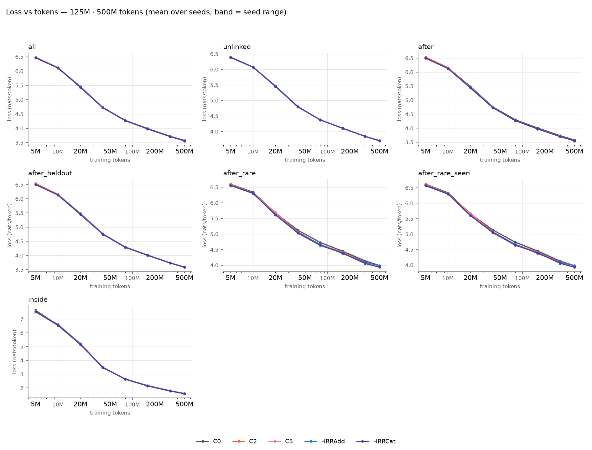
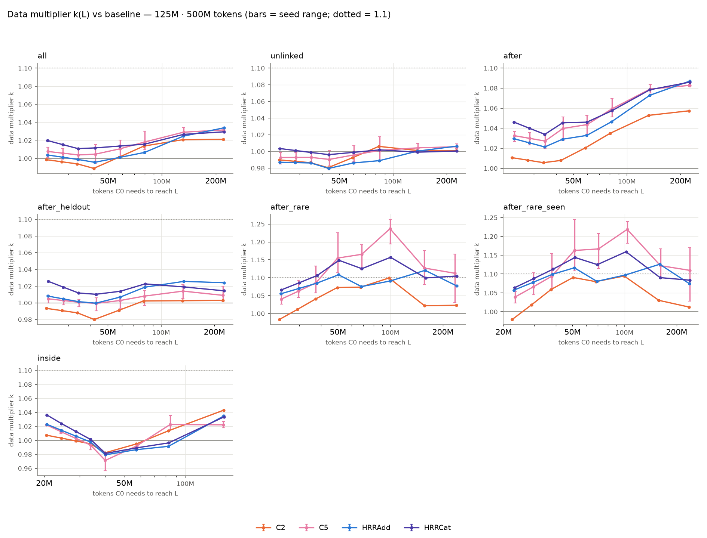
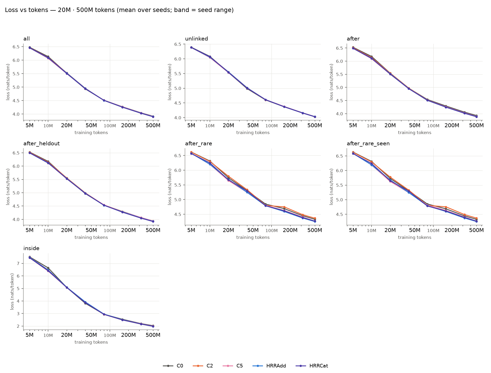
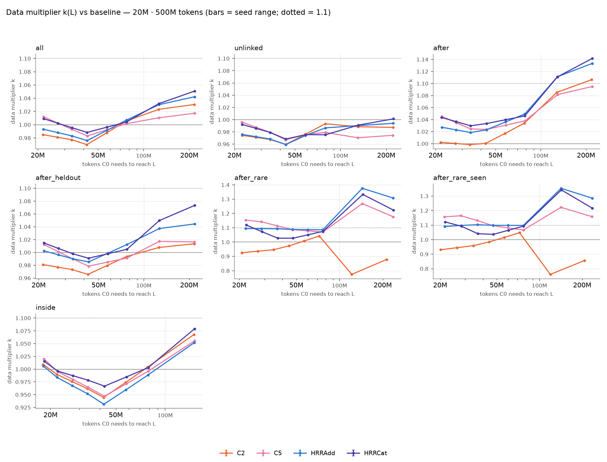
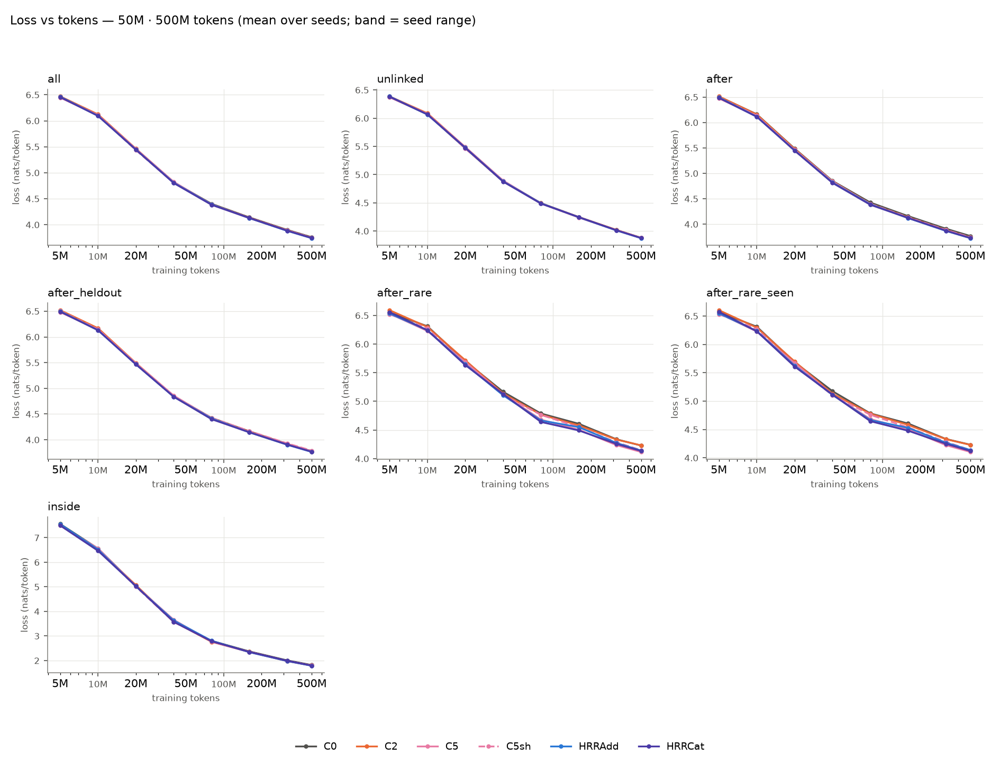
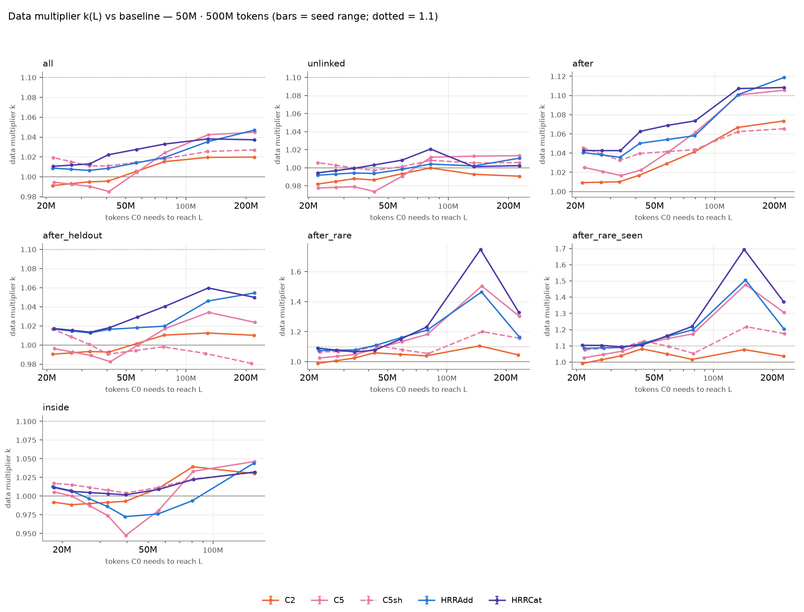

# E4 scaling screen, phase 1 (decision 65): per-size E4 analysis

20 runs found, 20 complete. Baseline **C0** (a cohort without it uses C0'). Paired differences are condition − reference at the final evaluation (negative = lower loss), token-weighted; CIs are 95% cluster bootstraps over evaluation windows (10000 resamples; each window carries every seed) when `eval_windows.npz` exists, else seed-level t intervals. `*` = significant after Holm correction over the condition grid within the stratum. Final-loss cells are mean ± half-width of the seed-level 95% t interval.

## Runs

| Cohort | Condition | Seed | Status | Final tokens | Windows saved | Probes | Parameters | Channel | tokens/s |
|---|---|---:|---|---:|---|---|---:|---:|---:|
| 125M · 500M tokens | C0 | 1 | complete | 500M | yes | no | 124,439,808 | 0 | 34,608 |
| 125M · 500M tokens | C0 | 2 | complete | 500M | yes | no | 124,439,808 | 0 | 34,982 |
| 125M · 500M tokens | C0 | 3 | complete | 500M | yes | no | 124,439,808 | 0 | 35,005 |
| 125M · 500M tokens | C2 | 1 | complete | 500M | yes | no | 126,691,242 | 2,251,434 | 34,574 |
| 125M · 500M tokens | C5 | 1 | complete | 500M | yes | no | 126,749,635 | 2,303,683 | 34,084 |
| 125M · 500M tokens | C5 | 2 | complete | 500M | yes | no | 126,749,635 | 2,303,683 | 34,476 |
| 125M · 500M tokens | C5 | 3 | complete | 500M | yes | no | 126,749,635 | 2,303,683 | 34,423 |
| 125M · 500M tokens | HRRAdd | 1 | complete | 500M | yes | no | 126,716,567 | 2,270,615 | 34,164 |
| 125M · 500M tokens | HRRCat | 1 | complete | 500M | yes | no | 126,723,607 | 2,277,655 | 34,178 |
| 20M · 500M tokens | C0 | 1 | complete | 500M | yes | no | 30,339,456 | 0 | 101,524 |
| 20M · 500M tokens | C2 | 1 | complete | 500M | yes | no | 32,581,674 | 2,242,218 | 100,514 |
| 20M · 500M tokens | C5 | 1 | complete | 500M | yes | no | 32,547,139 | 2,204,611 | 98,588 |
| 20M · 500M tokens | HRRAdd | 1 | complete | 500M | yes | no | 32,563,223 | 2,220,695 | 98,528 |
| 20M · 500M tokens | HRRCat | 1 | complete | 500M | yes | no | 32,566,039 | 2,223,511 | 98,600 |
| 50M · 500M tokens | C0 | 1 | complete | 500M | yes | no | 51,475,968 | 0 | 69,600 |
| 50M · 500M tokens | C2 | 1 | complete | 500M | yes | no | 53,721,258 | 2,245,290 | 69,216 |
| 50M · 500M tokens | C5 | 1 | complete | 500M | yes | no | 53,717,699 | 2,237,635 | 68,019 |
| 50M · 500M tokens | C5sh | 1 | complete | 500M | yes | no | 53,717,699 | 2,237,635 | 68,148 |
| 50M · 500M tokens | HRRAdd | 1 | complete | 500M | yes | no | 53,717,399 | 2,237,335 | 67,980 |
| 50M · 500M tokens | HRRCat | 1 | complete | 500M | yes | no | 53,721,623 | 2,241,559 | 68,084 |

## 125M · 500M tokens

> Exploratory: **single seed**: CIs are over evaluation windows only and say nothing about seed variance (the gate needs 3 seeds). Gate verdicts below are computed mechanically, not as a gate.

Conditions and seeds: C0 [1, 2, 3]; C2 [1]; C5 [1, 2, 3]; HRRAdd [1]; HRRCat [1].

### Final loss per stratum

| Stratum | Targets | C0 | C2 | C5 | HRRAdd | HRRCat |
|---|---:|---:|---:|---:|---:|---:|
| all | 1,047,552 | 3.5775 ± 0.0030 | 3.5693 (1 seed) | 3.5657 ± 0.0024 | 3.5638 (1 seed) | 3.5650 (1 seed) |
| unlinked | 653,442 | 3.7020 ± 0.0031 | 3.7005 (1 seed) | 3.6986 ± 0.0026 | 3.6972 (1 seed) | 3.6992 (1 seed) |
| inside | 66,092 | 1.6027 ± 0.0063 | 1.5882 (1 seed) | 1.5856 ± 0.0048 | 1.5854 (1 seed) | 1.5846 (1 seed) |
| after | 352,617 | 3.5798 ± 0.0023 | 3.5587 (1 seed) | 3.5518 ± 0.0019 | 3.5485 (1 seed) | 3.5486 (1 seed) |
| after_heldout | 53,768 | 3.5861 ± 0.0080 | 3.5847 (1 seed) | 3.5924 ± 0.0017 | 3.5830 (1 seed) | 3.5834 (1 seed) |
| after_rare | 691 | 3.9892 ± 0.0832 | 3.9741 (1 seed) | 3.9841 ± 0.0617 | 3.9844 (1 seed) | 3.9347 (1 seed) |
| after_mid | 8,744 | 3.9036 ± 0.0090 | 3.8808 (1 seed) | 3.8366 ± 0.0098 | 3.8279 (1 seed) | 3.8385 (1 seed) |
| after_frequent | 306,132 | 3.5706 ± 0.0019 | 3.5463 (1 seed) | 3.5377 ± 0.0023 | 3.5352 (1 seed) | 3.5354 (1 seed) |
| after_len1 | 0 | – | – | – | – | – |
| after_len2 | 290,263 | 3.5819 ± 0.0031 | 3.5618 (1 seed) | 3.5558 ± 0.0025 | 3.5524 (1 seed) | 3.5522 (1 seed) |
| after_len3plus | 90,491 | 3.5740 ± 0.0037 | 3.5432 (1 seed) | 3.5306 ± 0.0029 | 3.5266 (1 seed) | 3.5298 (1 seed) |
| after_rare_seen | 643 | 3.9797 ± 0.0846 | 3.9767 (1 seed) | 3.9759 ± 0.0626 | 3.9810 (1 seed) | 3.9289 (1 seed) |
| after_unseen | 48 | 4.1174 ± 0.2529 | 3.9388 (1 seed) | 4.0945 ± 0.0925 | 4.0310 (1 seed) | 4.0130 (1 seed) |

### Relative difference vs C0 (condition − C0) / C0

| Stratum | C2 | C5 | HRRAdd | HRRCat |
|---|---:|---:|---:|---:|
| all | -0.19% [-0.23, -0.15]* | -0.33% [-0.36, -0.30]* | -0.35% [-0.39, -0.31]* | -0.31% [-0.35, -0.27]* |
| unlinked | -0.00% [-0.05, +0.05] | -0.09% [-0.12, -0.06]* | -0.09% [-0.14, -0.04]* | -0.04% [-0.08, +0.01] |
| inside | -0.74% [-1.10, -0.37]* | -1.07% [-1.33, -0.79]* | -0.92% [-1.30, -0.52]* | -0.96% [-1.34, -0.57]* |
| after | -0.57% [-0.64, -0.50]* | -0.78% [-0.84, -0.73]* | -0.86% [-0.93, -0.78]* | -0.85% [-0.93, -0.78]* |
| after_heldout | +0.03% [-0.14, +0.20] | +0.18% [+0.04, +0.32] | -0.02% [-0.21, +0.18] | -0.01% [-0.20, +0.19] |
| after_rare | -0.24% [-1.76, +1.21] | -0.13% [-1.32, +0.95] | +0.02% [-2.03, +2.11] | -1.23% [-3.12, +0.71] |
| after_mid | -0.55% [-0.99, -0.09] | -1.72% [-2.06, -1.37]* | -1.91% [-2.38, -1.44]* | -1.64% [-2.13, -1.13]* |
| after_frequent | -0.67% [-0.74, -0.59]* | -0.92% [-0.98, -0.86]* | -0.98% [-1.06, -0.89]* | -0.97% [-1.05, -0.89]* |
| after_len1 | – | – | – | – |
| after_len2 | -0.54% [-0.62, -0.47]* | -0.73% [-0.79, -0.67]* | -0.81% [-0.89, -0.72]* | -0.81% [-0.89, -0.73]* |
| after_len3plus | -0.82% [-0.97, -0.66]* | -1.21% [-1.33, -1.10]* | -1.28% [-1.44, -1.12]* | -1.19% [-1.34, -1.04]* |
| after_rare_seen | -0.14% [-1.78, +1.44] | -0.09% [-1.38, +1.06] | -0.03% [-2.20, +2.19] | -1.34% [-3.32, +0.74] |
| after_unseen | -1.59% [-4.10, +0.66] | -0.56% [-1.99, +1.95] | +0.71% [-1.84, +2.93] | +0.26% [-7.57, +5.09] |

Method: window bootstrap.

### Relative difference vs C2 (condition − C2) / C2

| Stratum | C5 | HRRAdd | HRRCat |
|---|---:|---:|---:|
| all | -0.09% [-0.13, -0.05]* | -0.16% [-0.20, -0.12]* | -0.12% [-0.16, -0.08]* |
| unlinked | -0.04% [-0.08, +0.01] | -0.09% [-0.14, -0.04]* | -0.04% [-0.08, +0.01] |
| inside | -0.03% [-0.41, +0.36] | -0.18% [-0.52, +0.18] | -0.23% [-0.58, +0.14] |
| after | -0.20% [-0.28, -0.13]* | -0.29% [-0.36, -0.22]* | -0.28% [-0.36, -0.22]* |
| after_heldout | +0.22% [+0.02, +0.41] | -0.05% [-0.25, +0.16] | -0.03% [-0.22, +0.15] |
| after_rare | -0.45% [-2.19, +1.31] | +0.26% [-1.37, +1.92] | -0.99% [-2.85, +0.88] |
| after_mid | -1.25% [-1.72, -0.79]* | -1.36% [-1.81, -0.91]* | -1.09% [-1.58, -0.60]* |
| after_frequent | -0.25% [-0.33, -0.17]* | -0.31% [-0.39, -0.24]* | -0.31% [-0.38, -0.24]* |
| after_len1 | – | – | – |
| after_len2 | -0.19% [-0.27, -0.11]* | -0.27% [-0.34, -0.19]* | -0.27% [-0.35, -0.20]* |
| after_len3plus | -0.32% [-0.47, -0.17]* | -0.47% [-0.61, -0.32]* | -0.38% [-0.52, -0.23]* |
| after_rare_seen | -0.75% [-2.59, +1.07] | +0.11% [-1.63, +1.86] | -1.20% [-3.17, +0.72] |
| after_unseen | +3.55% [-1.33, +10.16] | +2.34% [-1.59, +6.22] | +1.88% [-5.10, +6.33] |

Method: window bootstrap.

### Relative difference vs C5 (condition − C5) / C5

| Stratum | HRRAdd | HRRCat |
|---|---:|---:|
| all | -0.06% [-0.10, -0.02]* | -0.03% [-0.07, +0.01] |
| unlinked | -0.05% [-0.10, -0.00] | +0.00% [-0.05, +0.05] |
| inside | -0.15% [-0.50, +0.19] | -0.20% [-0.55, +0.15] |
| after | -0.09% [-0.15, -0.02]* | -0.08% [-0.15, -0.01]* |
| after_heldout | -0.27% [-0.45, -0.07] | -0.25% [-0.43, -0.08]* |
| after_rare | +0.71% [-0.93, +2.28] | -0.54% [-1.95, +0.83] |
| after_mid | -0.11% [-0.54, +0.31] | +0.17% [-0.26, +0.60] |
| after_frequent | -0.06% [-0.13, +0.01] | -0.06% [-0.13, +0.02] |
| after_len1 | – | – |
| after_len2 | -0.07% [-0.15, +0.00] | -0.08% [-0.15, -0.01] |
| after_len3plus | -0.15% [-0.29, -0.01] | -0.06% [-0.20, +0.08] |
| after_rare_seen | +0.86% [-0.84, +2.51] | -0.46% [-1.95, +1.00] |
| after_unseen | -1.17% [-5.84, +5.43] | -1.61% [-5.87, +2.48] |

Method: window bootstrap.

### E4 gate items

| Candidate | 1 held-out vs C2 | 2 linked vs C1 | 3 locality | 4 probes | Overall |
|---|---|---|---|---|---|
| C5 | fail | not available | pass | not available | **fail** |
| HRRAdd | fail | not available | pass | not available | **fail** |
| HRRCat | fail | not available | pass | not available | **fail** |

- C5 item 1: held-out Δ +0.0079 [+0.0006, +0.0148]; rare relative upper bound +1.07% (margin +0.50%); channel parameters 2,303,683 vs C2 2,251,434
- C5 item 2: C1 not in this cohort
- C5 item 3: unlinked -0.09% vs C0, upper bound -0.06% (margin +0.50%)
- C5 item 4: no probes.json for the candidate and the baseline
- HRRAdd item 1: held-out Δ -0.0017 [-0.0089, +0.0056]; rare relative upper bound +1.86% (margin +0.50%); channel parameters 2,270,615 vs C2 2,251,434
- HRRAdd item 2: C1 not in this cohort
- HRRAdd item 3: unlinked -0.09% vs C0, upper bound -0.04% (margin +0.50%)
- HRRAdd item 4: no probes.json for the candidate and the baseline
- HRRCat item 1: held-out Δ -0.0012 [-0.0079, +0.0055]; rare relative upper bound +0.72% (margin +0.50%); channel parameters 2,277,655 vs C2 2,251,434
- HRRCat item 2: C1 not in this cohort
- HRRCat item 3: unlinked -0.04% vs C0, upper bound +0.01% (margin +0.50%)
- HRRCat item 4: no probes.json for the candidate and the baseline

### Convergence

Data multiplier `k = D_C0(L) / D_cond(L)` at the lowest common loss target (the one the escalation rule uses), with the seed-level CI; gaps are baseline − condition (positive = condition better), projected with per-seed power-law fits.

| Stratum | Condition | Target L | k [95% CI] | Final gap | Projected gap @ 2.5B | Projected gap @ 7B |
|---|---|---:|---|---|---|---|
| all | C2 | 3.8673 | +1.021 | +0.0069 | +0.0195 | +0.0253 |
| all | C5 | 3.8670 | +1.031 [+1.026, +1.037] | +0.0118 [+0.0082, +0.0154] | +0.0220 [-0.0007, +0.0447] | +0.0277 [-0.0072, +0.0627] |
| all | HRRAdd | 3.8651 | +1.034 | +0.0125 | +0.0332 | +0.0449 |
| all | HRRCat | 3.8648 | +1.029 | +0.0112 | +0.0167 | +0.0202 |
| unlinked | C2 | 3.9707 | +1.001 | +0.0001 | +0.0118 | +0.0176 |
| unlinked | C5 | 3.9713 | +1.006 [+0.998, +1.013] | +0.0034 [-0.0009, +0.0077] | +0.0160 [-0.0112, +0.0432] | +0.0233 [-0.0192, +0.0658] |
| unlinked | HRRAdd | 3.9695 | +1.006 | +0.0034 | +0.0259 | +0.0389 |
| unlinked | HRRCat | 3.9692 | +1.000 | +0.0014 | +0.0083 | +0.0127 |
| inside | C2 | 2.1929 | +1.043 | +0.0118 | -0.0066 | -0.0060 |
| inside | C5 | 2.1950 | +1.022 [+1.011, +1.034] | +0.0171 [+0.0060, +0.0281] | -0.0019 [-0.0202, +0.0164] | -0.0024 [-0.0188, +0.0139] |
| inside | HRRAdd | 2.1920 | +1.035 | +0.0146 | -0.0073 | -0.0068 |
| inside | HRRCat | 2.1912 | +1.034 | +0.0154 | -0.0059 | -0.0060 |
| after | C2 | 3.8746 | +1.057 | +0.0204 | +0.0294 | +0.0324 |
| after | C5 | 3.8720 | +1.083 [+1.080, +1.086] | +0.0280 [+0.0272, +0.0288] | +0.0311 [+0.0106, +0.0515] | +0.0321 [+0.0001, +0.0641] |
| after | HRRAdd | 3.8709 | +1.087 | +0.0306 | +0.0448 | +0.0523 |
| after | HRRCat | 3.8706 | +1.086 | +0.0305 | +0.0298 | +0.0295 |
| after_heldout | C2 | 3.8796 | +1.003 | -0.0010 | +0.0074 | +0.0105 |
| after_heldout | C5 | 3.8832 | +1.009 [+0.985, +1.033] | -0.0064 [-0.0158, +0.0031] | +0.0013 [-0.0157, +0.0184] | +0.0038 [-0.0184, +0.0260] |
| after_heldout | HRRAdd | 3.8753 | +1.024 | +0.0007 | +0.0151 | +0.0210 |
| after_heldout | HRRCat | 3.8750 | +1.014 | +0.0002 | -0.0016 | -0.0029 |
| after_rare | C2 | 4.2441 | +1.023 | +0.0096 | -0.0059 | -0.0191 |
| after_rare | C5 | 4.2777 | +1.112 [+0.932, +1.292] | +0.0051 [-0.0787, +0.0889] | -0.0124 [-0.2184, +0.1935] | -0.0411 [-0.3262, +0.2439] |
| after_rare | HRRAdd | 4.2421 | +1.077 | -0.0008 | -0.0348 | -0.0644 |
| after_rare | HRRCat | 4.2407 | +1.105 | +0.0490 | +0.0292 | +0.0154 |
| after_rare_seen | C2 | 4.2447 | +1.012 | +0.0056 | -0.0226 | -0.0426 |
| after_rare_seen | C5 | 4.2676 | +1.110 [+0.927, +1.292] | +0.0038 [-0.0980, +0.1055] | -0.0165 [-0.2502, +0.2171] | -0.0468 [-0.3698, +0.2762] |
| after_rare_seen | HRRAdd | 4.2420 | +1.074 | +0.0013 | -0.0383 | -0.0703 |
| after_rare_seen | HRRCat | 4.2406 | +1.084 | +0.0534 | +0.0288 | +0.0165 |

Power-law fits `L(D) = E + B·(D/D₀)^(−β)` (mean over seeds):

| Stratum | Condition | E | B | β | RMSE |
|---|---|---:|---:|---:|---:|
| all | C0 | 1.6966 | 4.9170 | 0.216 | 0.1085 |
| all | C2 | 1.6659 | 4.9507 | 0.215 | 0.1095 |
| all | C5 | 1.6186 | 4.9765 | 0.211 | 0.1093 |
| all | HRRAdd | 1.5894 | 5.0060 | 0.209 | 0.1092 |
| all | HRRCat | 1.6809 | 4.9113 | 0.215 | 0.1089 |
| unlinked | C0 | 1.7739 | 4.7434 | 0.202 | 0.1009 |
| unlinked | C2 | 1.7556 | 4.7691 | 0.201 | 0.1013 |
| unlinked | C5 | 1.6822 | 4.8311 | 0.196 | 0.1027 |
| unlinked | HRRAdd | 1.6601 | 4.8517 | 0.195 | 0.1015 |
| unlinked | HRRCat | 1.7669 | 4.7433 | 0.201 | 0.1019 |
| after | C0 | 1.6203 | 5.0398 | 0.212 | 0.1069 |
| after | C2 | 1.6053 | 5.0563 | 0.214 | 0.1069 |
| after | C5 | 1.5770 | 5.0462 | 0.211 | 0.1070 |
| after | HRRAdd | 1.5364 | 5.0889 | 0.208 | 0.1066 |
| after | HRRCat | 1.6242 | 4.9969 | 0.214 | 0.1058 |
| after_heldout | C0 | 1.6793 | 4.9742 | 0.215 | 0.1065 |
| after_heldout | C2 | 1.6891 | 4.9794 | 0.217 | 0.1061 |
| after_heldout | C5 | 1.6434 | 4.9834 | 0.211 | 0.1079 |
| after_heldout | HRRAdd | 1.6433 | 4.9873 | 0.212 | 0.1091 |
| after_heldout | HRRCat | 1.7241 | 4.9005 | 0.217 | 0.1064 |
| after_rare | C0 | 1.5537 | 5.1594 | 0.169 | 0.0896 |
| after_rare | C2 | 1.8217 | 4.8946 | 0.184 | 0.0963 |
| after_rare | C5 | 1.9502 | 4.7372 | 0.191 | 0.1039 |
| after_rare | HRRAdd | 2.0191 | 4.6665 | 0.195 | 0.0984 |
| after_rare | HRRCat | 1.7926 | 4.8840 | 0.184 | 0.0999 |
| after_rare_seen | C0 | 1.5097 | 5.2134 | 0.168 | 0.0832 |
| after_rare_seen | C2 | 1.9115 | 4.8160 | 0.189 | 0.0906 |
| after_rare_seen | C5 | 1.9347 | 4.7603 | 0.190 | 0.0953 |
| after_rare_seen | HRRAdd | 2.0451 | 4.6506 | 0.197 | 0.0922 |
| after_rare_seen | HRRCat | 1.7664 | 4.9138 | 0.183 | 0.0933 |
| inside | C0 | 0.0000 | 7.9251 | 0.360 | 0.2666 |
| inside | C2 | 0.0000 | 7.8866 | 0.359 | 0.2889 |
| inside | C5 | 0.0000 | 7.8517 | 0.359 | 0.2595 |
| inside | HRRAdd | 0.0000 | 7.8694 | 0.359 | 0.2787 |
| inside | HRRCat | 0.0000 | 7.8427 | 0.358 | 0.2668 |

Escalation rule (§0.13; rule ii against C1/C2/C1h, rule iii projection or size trend):

| Candidate | Stratum | k mean | k CI low | (i) k_low > 1.1 | (ii) controls | (iii) projection / size trend | Escalate |
|---|---|---:|---:|---|---|---|---|
| C5 | after_heldout | 1.009 | 0.985 | False | C2 not beaten | False / False | **False** |
| C5 | after_rare_seen | 1.110 | 0.927 | False | C2 not beaten | False / False | **False** |
| HRRAdd | after_heldout | 1.024 | n/a | False | C2 not beaten | False / False | **False** |
| HRRAdd | after_rare_seen | 1.074 | n/a | False | C2 not beaten | False / False | **False** |
| HRRCat | after_heldout | 1.014 | n/a | False | C2 not beaten | False / False | **False** |
| HRRCat | after_rare_seen | 1.084 | n/a | False | C2 not beaten | False / False | **False** |

### Throughput and parameters

| Condition | tokens/s | Overhead vs C0 | Parameters | Channel parameters | Channel bytes fp32 / fp16 |
|---|---:|---:|---:|---:|---:|
| C0 | 34,865 | +0.0% | 124,439,808 | 0 | 0.0 / 0.0 MiB |
| C2 | 34,574 | +0.8% | 126,691,242 | 2,251,434 | 8.6 / 4.3 MiB |
| C5 | 34,328 | +1.6% | 126,749,635 | 2,303,683 | 8.8 / 4.4 MiB |
| HRRAdd | 34,164 | +2.1% | 126,716,567 | 2,270,615 | 8.7 / 4.3 MiB |
| HRRCat | 34,178 | +2.0% | 126,723,607 | 2,277,655 | 8.7 / 4.3 MiB |

Throughput is the median logged training rate per run (evaluation intervals included in a few log windows); the GPU is shared, so treat overheads as indicative.

### Figures

## 20M · 500M tokens

> Exploratory: **single seed**: CIs are over evaluation windows only and say nothing about seed variance (the gate needs 3 seeds); the pre-registered gate is defined at 125M × 500M tokens. Gate verdicts below are computed mechanically, not as a gate.

Conditions and seeds: C0 [1]; C2 [1]; C5 [1]; HRRAdd [1]; HRRCat [1].

### Final loss per stratum

| Stratum | Targets | C0 | C2 | C5 | HRRAdd | HRRCat |
|---|---:|---:|---:|---:|---:|---:|
| all | 1,047,552 | 3.9176 (1 seed) | 3.9059 (1 seed) | 3.9082 (1 seed) | 3.9033 (1 seed) | 3.9006 (1 seed) |
| unlinked | 653,442 | 4.0320 (1 seed) | 4.0346 (1 seed) | 4.0356 (1 seed) | 4.0335 (1 seed) | 4.0312 (1 seed) |
| inside | 66,092 | 2.0314 (1 seed) | 1.9863 (1 seed) | 1.9964 (1 seed) | 1.9823 (1 seed) | 1.9808 (1 seed) |
| after | 352,617 | 3.9296 (1 seed) | 3.8926 (1 seed) | 3.8971 (1 seed) | 3.8879 (1 seed) | 3.8838 (1 seed) |
| after_heldout | 53,768 | 3.9366 (1 seed) | 3.9294 (1 seed) | 3.9375 (1 seed) | 3.9256 (1 seed) | 3.9182 (1 seed) |
| after_rare | 691 | 4.3299 (1 seed) | 4.3671 (1 seed) | 4.2664 (1 seed) | 4.2532 (1 seed) | 4.2685 (1 seed) |
| after_mid | 8,744 | 4.2519 (1 seed) | 4.2217 (1 seed) | 4.2075 (1 seed) | 4.1974 (1 seed) | 4.1951 (1 seed) |
| after_frequent | 306,132 | 3.9209 (1 seed) | 3.8778 (1 seed) | 3.8824 (1 seed) | 3.8737 (1 seed) | 3.8695 (1 seed) |
| after_len1 | 0 | – | – | – | – | – |
| after_len2 | 290,263 | 3.9299 (1 seed) | 3.8938 (1 seed) | 3.8985 (1 seed) | 3.8897 (1 seed) | 3.8858 (1 seed) |
| after_len3plus | 90,491 | 3.9336 (1 seed) | 3.8835 (1 seed) | 3.8863 (1 seed) | 3.8739 (1 seed) | 3.8673 (1 seed) |
| after_rare_seen | 643 | 4.3269 (1 seed) | 4.3694 (1 seed) | 4.2655 (1 seed) | 4.2515 (1 seed) | 4.2644 (1 seed) |
| after_unseen | 48 | 4.3707 (1 seed) | 4.3370 (1 seed) | 4.2779 (1 seed) | 4.2762 (1 seed) | 4.3241 (1 seed) |

### Relative difference vs C0 (condition − C0) / C0

| Stratum | C2 | C5 | HRRAdd | HRRCat |
|---|---:|---:|---:|---:|
| all | -0.30% [-0.35, -0.25]* | -0.24% [-0.28, -0.20]* | -0.36% [-0.41, -0.32]* | -0.43% [-0.48, -0.39]* |
| unlinked | +0.06% [+0.01, +0.12] | +0.09% [+0.04, +0.14]* | +0.04% [-0.01, +0.09] | -0.02% [-0.07, +0.03] |
| inside | -2.22% [-2.55, -1.90]* | -1.72% [-2.06, -1.40]* | -2.42% [-2.74, -2.10]* | -2.49% [-2.83, -2.16]* |
| after | -0.94% [-1.01, -0.86]* | -0.83% [-0.90, -0.75]* | -1.06% [-1.14, -0.98]* | -1.17% [-1.24, -1.09]* |
| after_heldout | -0.18% [-0.36, -0.01] | +0.02% [-0.16, +0.21] | -0.28% [-0.46, -0.10]* | -0.47% [-0.64, -0.29]* |
| after_rare | +0.86% [-0.88, +2.76] | -1.47% [-2.81, -0.01] | -1.77% [-3.05, -0.43] | -1.42% [-2.81, +0.00] |
| after_mid | -0.71% [-1.13, -0.30]* | -1.04% [-1.51, -0.56]* | -1.28% [-1.75, -0.81]* | -1.33% [-1.80, -0.88]* |
| after_frequent | -1.10% [-1.18, -1.02]* | -0.98% [-1.07, -0.90]* | -1.21% [-1.29, -1.12]* | -1.31% [-1.39, -1.23]* |
| after_len1 | – | – | – | – |
| after_len2 | -0.92% [-1.00, -0.84]* | -0.80% [-0.88, -0.71]* | -1.02% [-1.11, -0.94]* | -1.12% [-1.20, -1.04]* |
| after_len3plus | -1.27% [-1.42, -1.12]* | -1.20% [-1.35, -1.05]* | -1.52% [-1.67, -1.37]* | -1.68% [-1.84, -1.53]* |
| after_rare_seen | +0.98% [-0.88, +3.02] | -1.42% [-2.85, +0.14] | -1.74% [-3.08, -0.33] | -1.44% [-2.94, +0.09] |
| after_unseen | -0.77% [-2.93, +0.73] | -2.12% [-6.00, +0.87] | -2.16% [-5.43, +2.93] | -1.07% [-2.62, +1.52] |

Method: window bootstrap.

### Relative difference vs C2 (condition − C2) / C2

| Stratum | C5 | HRRAdd | HRRCat |
|---|---:|---:|---:|
| all | +0.06% [+0.02, +0.10]* | -0.07% [-0.11, -0.02]* | -0.13% [-0.18, -0.09]* |
| unlinked | +0.02% [-0.02, +0.07] | -0.03% [-0.08, +0.02] | -0.09% [-0.13, -0.04]* |
| inside | +0.51% [+0.19, +0.82]* | -0.20% [-0.51, +0.11] | -0.28% [-0.60, +0.04] |
| after | +0.12% [+0.05, +0.19]* | -0.12% [-0.19, -0.05]* | -0.23% [-0.29, -0.16]* |
| after_heldout | +0.21% [+0.01, +0.40] | -0.10% [-0.28, +0.08] | -0.28% [-0.46, -0.10]* |
| after_rare | -2.31% [-4.22, -0.54] | -2.61% [-4.22, -1.13]* | -2.26% [-4.57, -0.19] |
| after_mid | -0.34% [-0.76, +0.08] | -0.58% [-1.00, -0.14]* | -0.63% [-1.04, -0.24]* |
| after_frequent | +0.12% [+0.04, +0.19]* | -0.11% [-0.18, -0.04]* | -0.21% [-0.29, -0.14]* |
| after_len1 | – | – | – |
| after_len2 | +0.12% [+0.05, +0.20]* | -0.11% [-0.18, -0.03]* | -0.21% [-0.28, -0.13]* |
| after_len3plus | +0.07% [-0.07, +0.21] | -0.25% [-0.38, -0.12]* | -0.42% [-0.55, -0.28]* |
| after_rare_seen | -2.38% [-4.42, -0.47] | -2.70% [-4.40, -1.13]* | -2.40% [-4.83, -0.20] |
| after_unseen | -1.36% [-6.28, +2.83] | -1.40% [-4.72, +3.74] | -0.30% [-3.10, +4.16] |

Method: window bootstrap.

### Relative difference vs C5 (condition − C5) / C5

| Stratum | HRRAdd | HRRCat |
|---|---:|---:|
| all | -0.13% [-0.16, -0.09]* | -0.19% [-0.23, -0.16]* |
| unlinked | -0.05% [-0.10, -0.01] | -0.11% [-0.16, -0.06]* |
| inside | -0.71% [-0.99, -0.41]* | -0.78% [-1.09, -0.49]* |
| after | -0.24% [-0.30, -0.18]* | -0.34% [-0.41, -0.28]* |
| after_heldout | -0.30% [-0.46, -0.14]* | -0.49% [-0.66, -0.32]* |
| after_rare | -0.31% [-1.67, +1.07] | +0.05% [-1.49, +1.58] |
| after_mid | -0.24% [-0.65, +0.18] | -0.29% [-0.70, +0.11] |
| after_frequent | -0.22% [-0.29, -0.16]* | -0.33% [-0.40, -0.26]* |
| after_len1 | – | – |
| after_len2 | -0.23% [-0.30, -0.16]* | -0.33% [-0.40, -0.26]* |
| after_len3plus | -0.32% [-0.44, -0.19]* | -0.49% [-0.61, -0.36]* |
| after_rare_seen | -0.33% [-1.76, +1.12] | -0.03% [-1.67, +1.60] |
| after_unseen | -0.04% [-4.46, +5.99] | +1.08% [-1.72, +4.79] |

Method: window bootstrap.

### E4 gate items

| Candidate | 1 held-out vs C2 | 2 linked vs C1 | 3 locality | 4 probes | Overall |
|---|---|---|---|---|---|
| C5 | fail | not available | pass | not available | **fail** |
| HRRAdd | fail | not available | pass | not available | **fail** |
| HRRCat | pass | not available | pass | not available | **incomplete** |

- C5 item 1: held-out Δ +0.0081 [+0.0005, +0.0156]; rare relative upper bound -0.47% (margin +0.50%); channel parameters 2,204,611 vs C2 2,242,218
- C5 item 2: C1 not in this cohort
- C5 item 3: unlinked +0.09% vs C0, upper bound +0.14% (margin +0.50%)
- C5 item 4: no probes.json for the candidate and the baseline
- HRRAdd item 1: held-out Δ -0.0037 [-0.0108, +0.0031]; rare relative upper bound -1.13% (margin +0.50%); channel parameters 2,220,695 vs C2 2,242,218
- HRRAdd item 2: C1 not in this cohort
- HRRAdd item 3: unlinked +0.04% vs C0, upper bound +0.09% (margin +0.50%)
- HRRAdd item 4: no probes.json for the candidate and the baseline
- HRRCat item 1: held-out Δ -0.0111 [-0.0181, -0.0041]; rare relative upper bound -0.20% (margin +0.50%); channel parameters 2,223,511 vs C2 2,242,218
- HRRCat item 2: C1 not in this cohort
- HRRCat item 3: unlinked -0.02% vs C0, upper bound +0.03% (margin +0.50%)
- HRRCat item 4: no probes.json for the candidate and the baseline

### Convergence

Data multiplier `k = D_C0(L) / D_cond(L)` at the lowest common loss target (the one the escalation rule uses), with the seed-level CI; gaps are baseline − condition (positive = condition better), projected with per-seed power-law fits.

| Stratum | Condition | Target L | k [95% CI] | Final gap | Projected gap @ 2.5B | Projected gap @ 7B |
|---|---|---:|---|---|---|---|
| all | C2 | 4.1726 | +1.031 | +0.0117 | +0.0331 | +0.0461 |
| all | C5 | 4.1716 | +1.017 | +0.0094 | +0.0102 | +0.0148 |
| all | HRRAdd | 4.1719 | +1.042 | +0.0143 | +0.0333 | +0.0456 |
| all | HRRCat | 4.1718 | +1.051 | +0.0170 | +0.0304 | +0.0397 |
| unlinked | C2 | 4.2697 | +0.987 | -0.0026 | +0.0172 | +0.0295 |
| unlinked | C5 | 4.2707 | +0.974 | -0.0036 | -0.0021 | +0.0024 |
| unlinked | HRRAdd | 4.2688 | +0.994 | -0.0014 | +0.0177 | +0.0297 |
| unlinked | HRRCat | 4.2676 | +1.001 | +0.0009 | +0.0153 | +0.0247 |
| inside | C2 | 2.5784 | +1.068 | +0.0452 | +0.0668 | +0.0844 |
| inside | C5 | 2.5739 | +1.055 | +0.0350 | +0.0390 | +0.0527 |
| inside | HRRAdd | 2.5769 | +1.052 | +0.0491 | +0.0834 | +0.1104 |
| inside | HRRCat | 2.5732 | +1.079 | +0.0507 | +0.0644 | +0.0810 |
| after | C2 | 4.1879 | +1.106 | +0.0370 | +0.0614 | +0.0757 |
| after | C5 | 4.1855 | +1.095 | +0.0324 | +0.0300 | +0.0325 |
| after | HRRAdd | 4.1858 | +1.133 | +0.0417 | +0.0572 | +0.0670 |
| after | HRRCat | 4.1859 | +1.142 | +0.0458 | +0.0558 | +0.0633 |
| after_heldout | C2 | 4.1946 | +1.014 | +0.0072 | +0.0281 | +0.0416 |
| after_heldout | C5 | 4.1937 | +1.016 | -0.0009 | -0.0006 | +0.0023 |
| after_heldout | HRRAdd | 4.1927 | +1.044 | +0.0110 | +0.0256 | +0.0349 |
| after_heldout | HRRCat | 4.1929 | +1.073 | +0.0183 | +0.0344 | +0.0445 |
| after_rare | C2 | 4.5918 | +0.878 | -0.0372 | -0.0441 | -0.0479 |
| after_rare | C5 | 4.5545 | +1.177 | +0.0636 | +0.0222 | +0.0074 |
| after_rare | HRRAdd | 4.5545 | +1.308 | +0.0767 | +0.0831 | +0.0853 |
| after_rare | HRRCat | 4.5536 | +1.223 | +0.0614 | +0.0805 | +0.0903 |
| after_rare_seen | C2 | 4.5950 | +0.857 | -0.0425 | -0.0630 | -0.0731 |
| after_rare_seen | C5 | 4.5533 | +1.158 | +0.0614 | +0.0091 | -0.0096 |
| after_rare_seen | HRRAdd | 4.5530 | +1.286 | +0.0754 | +0.0743 | +0.0736 |
| after_rare_seen | HRRCat | 4.5523 | +1.217 | +0.0625 | +0.0663 | +0.0694 |

Power-law fits `L(D) = E + B·(D/D₀)^(−β)` (mean over seeds):

| Stratum | Condition | E | B | β | RMSE |
|---|---|---:|---:|---:|---:|
| all | C0 | 2.4439 | 4.1419 | 0.232 | 0.0885 |
| all | C2 | 2.2938 | 4.2711 | 0.219 | 0.0830 |
| all | C5 | 2.3838 | 4.1615 | 0.225 | 0.0749 |
| all | HRRAdd | 2.2980 | 4.2565 | 0.219 | 0.0803 |
| all | HRRCat | 2.3290 | 4.2272 | 0.222 | 0.0807 |
| unlinked | C0 | 2.5196 | 3.9729 | 0.216 | 0.0814 |
| unlinked | C2 | 2.3768 | 4.1013 | 0.203 | 0.0786 |
| unlinked | C5 | 2.4670 | 4.0027 | 0.209 | 0.0710 |
| unlinked | HRRAdd | 2.3786 | 4.0981 | 0.203 | 0.0763 |
| unlinked | HRRCat | 2.4103 | 4.0704 | 0.206 | 0.0769 |
| after | C0 | 2.4096 | 4.2257 | 0.229 | 0.0873 |
| after | C2 | 2.2250 | 4.3844 | 0.217 | 0.0813 |
| after | C5 | 2.3481 | 4.2267 | 0.225 | 0.0727 |
| after | HRRAdd | 2.2626 | 4.3215 | 0.219 | 0.0779 |
| after | HRRCat | 2.2865 | 4.2999 | 0.222 | 0.0778 |
| after_heldout | C0 | 2.4595 | 4.1762 | 0.233 | 0.0882 |
| after_heldout | C2 | 2.3084 | 4.3058 | 0.219 | 0.0822 |
| after_heldout | C5 | 2.4202 | 4.1688 | 0.227 | 0.0754 |
| after_heldout | HRRAdd | 2.3434 | 4.2476 | 0.222 | 0.0789 |
| after_heldout | HRRCat | 2.3319 | 4.2637 | 0.222 | 0.0793 |
| after_rare | C0 | 2.9013 | 3.8053 | 0.219 | 0.0775 |
| after_rare | C2 | 2.9662 | 3.7363 | 0.219 | 0.0941 |
| after_rare | C5 | 3.0019 | 3.6357 | 0.233 | 0.0578 |
| after_rare | HRRAdd | 2.8030 | 3.8404 | 0.218 | 0.0616 |
| after_rare | HRRCat | 2.7302 | 3.9169 | 0.209 | 0.0747 |
| after_rare_seen | C0 | 2.9504 | 3.7662 | 0.224 | 0.0728 |
| after_rare_seen | C2 | 3.0844 | 3.6251 | 0.231 | 0.0894 |
| after_rare_seen | C5 | 3.0891 | 3.5557 | 0.243 | 0.0515 |
| after_rare_seen | HRRAdd | 2.8845 | 3.7645 | 0.226 | 0.0570 |
| after_rare_seen | HRRCat | 2.8571 | 3.7987 | 0.221 | 0.0723 |
| inside | C0 | 0.3313 | 7.4416 | 0.341 | 0.2259 |
| inside | C2 | 0.1702 | 7.5259 | 0.327 | 0.1828 |
| inside | C5 | 0.2115 | 7.4197 | 0.327 | 0.1688 |
| inside | HRRAdd | 0.1015 | 7.5752 | 0.320 | 0.1781 |
| inside | HRRCat | 0.1727 | 7.4649 | 0.326 | 0.1786 |

Escalation rule (§0.13; rule ii against C1/C2/C1h, rule iii projection or size trend):

| Candidate | Stratum | k mean | k CI low | (i) k_low > 1.1 | (ii) controls | (iii) projection / size trend | Escalate |
|---|---|---:|---:|---|---|---|---|
| C5 | after_heldout | 1.016 | n/a | False | C2 not beaten | False / False | **False** |
| C5 | after_rare_seen | 1.158 | n/a | False | C2 not beaten | False / False | **False** |
| HRRAdd | after_heldout | 1.044 | n/a | False | C2 not beaten | False / False | **False** |
| HRRAdd | after_rare_seen | 1.286 | n/a | False | C2 not beaten | False / False | **False** |
| HRRCat | after_heldout | 1.073 | n/a | False | C2 not beaten | False / False | **False** |
| HRRCat | after_rare_seen | 1.217 | n/a | False | C2 not beaten | False / False | **False** |

### Throughput and parameters

| Condition | tokens/s | Overhead vs C0 | Parameters | Channel parameters | Channel bytes fp32 / fp16 |
|---|---:|---:|---:|---:|---:|
| C0 | 101,524 | +0.0% | 30,339,456 | 0 | 0.0 / 0.0 MiB |
| C2 | 100,514 | +1.0% | 32,581,674 | 2,242,218 | 8.6 / 4.3 MiB |
| C5 | 98,588 | +3.0% | 32,547,139 | 2,204,611 | 8.4 / 4.2 MiB |
| HRRAdd | 98,528 | +3.0% | 32,563,223 | 2,220,695 | 8.5 / 4.2 MiB |
| HRRCat | 98,600 | +3.0% | 32,566,039 | 2,223,511 | 8.5 / 4.2 MiB |

Throughput is the median logged training rate per run (evaluation intervals included in a few log windows); the GPU is shared, so treat overheads as indicative.

### Figures

## 50M · 500M tokens

> Exploratory: **single seed**: CIs are over evaluation windows only and say nothing about seed variance (the gate needs 3 seeds); the pre-registered gate is defined at 125M × 500M tokens. Gate verdicts below are computed mechanically, not as a gate.

Conditions and seeds: C0 [1]; C2 [1]; C5 [1]; C5sh [1]; HRRAdd [1]; HRRCat [1].

### Final loss per stratum

| Stratum | Targets | C0 | C2 | C5 | C5sh | HRRAdd | HRRCat |
|---|---:|---:|---:|---:|---:|---:|---:|
| all | 1,047,552 | 3.7602 (1 seed) | 3.7499 (1 seed) | 3.7458 (1 seed) | 3.7519 (1 seed) | 3.7417 (1 seed) | 3.7437 (1 seed) |
| unlinked | 653,442 | 3.8804 (1 seed) | 3.8797 (1 seed) | 3.8760 (1 seed) | 3.8801 (1 seed) | 3.8741 (1 seed) | 3.8761 (1 seed) |
| inside | 66,092 | 1.8191 (1 seed) | 1.7983 (1 seed) | 1.7968 (1 seed) | 1.8015 (1 seed) | 1.7887 (1 seed) | 1.7936 (1 seed) |
| after | 352,617 | 3.7674 (1 seed) | 3.7382 (1 seed) | 3.7335 (1 seed) | 3.7441 (1 seed) | 3.7256 (1 seed) | 3.7272 (1 seed) |
| after_heldout | 53,768 | 3.7784 (1 seed) | 3.7696 (1 seed) | 3.7764 (1 seed) | 3.7899 (1 seed) | 3.7629 (1 seed) | 3.7672 (1 seed) |
| after_rare | 691 | 4.2289 (1 seed) | 4.2322 (1 seed) | 4.1169 (1 seed) | 4.1477 (1 seed) | 4.1415 (1 seed) | 4.1346 (1 seed) |
| after_mid | 8,744 | 4.1018 (1 seed) | 4.0614 (1 seed) | 4.0282 (1 seed) | 4.0735 (1 seed) | 4.0212 (1 seed) | 4.0183 (1 seed) |
| after_frequent | 306,132 | 3.7578 (1 seed) | 3.7248 (1 seed) | 3.7186 (1 seed) | 3.7286 (1 seed) | 3.7114 (1 seed) | 3.7128 (1 seed) |
| after_len1 | 0 | – | – | – | – | – | – |
| after_len2 | 290,263 | 3.7686 (1 seed) | 3.7410 (1 seed) | 3.7369 (1 seed) | 3.7460 (1 seed) | 3.7282 (1 seed) | 3.7303 (1 seed) |
| after_len3plus | 90,491 | 3.7670 (1 seed) | 3.7235 (1 seed) | 3.7141 (1 seed) | 3.7327 (1 seed) | 3.7090 (1 seed) | 3.7087 (1 seed) |
| after_rare_seen | 643 | 4.2311 (1 seed) | 4.2281 (1 seed) | 4.1039 (1 seed) | 4.1373 (1 seed) | 4.1381 (1 seed) | 4.1210 (1 seed) |
| after_unseen | 48 | 4.2000 (1 seed) | 4.2866 (1 seed) | 4.2909 (1 seed) | 4.2865 (1 seed) | 4.1878 (1 seed) | 4.3171 (1 seed) |

### Relative difference vs C0 (condition − C0) / C0

| Stratum | C2 | C5 | C5sh | HRRAdd | HRRCat |
|---|---:|---:|---:|---:|---:|
| all | -0.27% [-0.32, -0.23]* | -0.38% [-0.43, -0.34]* | -0.22% [-0.27, -0.18]* | -0.49% [-0.54, -0.45]* | -0.44% [-0.48, -0.39]* |
| unlinked | -0.02% [-0.07, +0.03] | -0.11% [-0.16, -0.06]* | -0.01% [-0.06, +0.04] | -0.16% [-0.21, -0.11]* | -0.11% [-0.16, -0.06]* |
| inside | -1.14% [-1.50, -0.79]* | -1.23% [-1.58, -0.87]* | -0.97% [-1.32, -0.62]* | -1.67% [-2.04, -1.30]* | -1.40% [-1.76, -1.04]* |
| after | -0.77% [-0.85, -0.70]* | -0.90% [-0.98, -0.82]* | -0.62% [-0.69, -0.54]* | -1.11% [-1.19, -1.03]* | -1.07% [-1.15, -0.99]* |
| after_heldout | -0.23% [-0.41, -0.04] | -0.05% [-0.25, +0.14] | +0.30% [+0.11, +0.50]* | -0.41% [-0.60, -0.21]* | -0.30% [-0.49, -0.11]* |
| after_rare | +0.08% [-1.61, +1.87] | -2.65% [-4.12, -1.02]* | -1.92% [-3.55, -0.14] | -2.07% [-3.55, -0.40] | -2.23% [-3.96, -0.42] |
| after_mid | -0.98% [-1.43, -0.54]* | -1.79% [-2.28, -1.32]* | -0.69% [-1.15, -0.24]* | -1.96% [-2.48, -1.47]* | -2.03% [-2.54, -1.55]* |
| after_frequent | -0.88% [-0.96, -0.80]* | -1.04% [-1.13, -0.96]* | -0.78% [-0.86, -0.70]* | -1.24% [-1.32, -1.15]* | -1.20% [-1.28, -1.11]* |
| after_len1 | – | – | – | – | – |
| after_len2 | -0.73% [-0.81, -0.65]* | -0.84% [-0.93, -0.76]* | -0.60% [-0.68, -0.52]* | -1.07% [-1.16, -0.99]* | -1.02% [-1.10, -0.93]* |
| after_len3plus | -1.16% [-1.30, -1.01]* | -1.40% [-1.56, -1.25]* | -0.91% [-1.06, -0.76]* | -1.54% [-1.70, -1.38]* | -1.55% [-1.71, -1.39]* |
| after_rare_seen | -0.07% [-1.87, +1.81] | -3.01% [-4.50, -1.39]* | -2.22% [-3.92, -0.37] | -2.20% [-3.74, -0.46] | -2.60% [-4.40, -0.76] |
| after_unseen | +2.06% [-3.13, +6.26] | +2.16% [-4.25, +10.53] | +2.06% [-4.05, +9.01] | -0.29% [-5.32, +5.06] | +2.79% [-5.65, +13.21] |

Method: window bootstrap.

### Relative difference vs C2 (condition − C2) / C2

| Stratum | C5 | C5sh | HRRAdd | HRRCat |
|---|---:|---:|---:|---:|
| all | -0.11% [-0.15, -0.07]* | +0.05% [+0.01, +0.09]* | -0.22% [-0.26, -0.18]* | -0.16% [-0.20, -0.13]* |
| unlinked | -0.09% [-0.14, -0.05]* | +0.01% [-0.04, +0.06] | -0.14% [-0.19, -0.09]* | -0.09% [-0.14, -0.05]* |
| inside | -0.08% [-0.41, +0.26] | +0.18% [-0.16, +0.52] | -0.54% [-0.88, -0.19]* | -0.26% [-0.59, +0.08] |
| after | -0.13% [-0.20, -0.05]* | +0.16% [+0.08, +0.23]* | -0.34% [-0.41, -0.27]* | -0.30% [-0.37, -0.23]* |
| after_heldout | +0.18% [-0.01, +0.38] | +0.54% [+0.34, +0.73]* | -0.18% [-0.37, +0.01] | -0.07% [-0.26, +0.13] |
| after_rare | -2.72% [-4.22, -1.20]* | -2.00% [-3.44, -0.51] | -2.14% [-3.85, -0.44] | -2.31% [-3.98, -0.64] |
| after_mid | -0.82% [-1.29, -0.35]* | +0.30% [-0.16, +0.74] | -0.99% [-1.46, -0.53]* | -1.06% [-1.55, -0.56]* |
| after_frequent | -0.17% [-0.24, -0.09]* | +0.10% [+0.02, +0.18]* | -0.36% [-0.44, -0.28]* | -0.32% [-0.40, -0.25]* |
| after_len1 | – | – | – | – |
| after_len2 | -0.11% [-0.19, -0.03]* | +0.13% [+0.05, +0.21]* | -0.34% [-0.42, -0.26]* | -0.29% [-0.36, -0.21]* |
| after_len3plus | -0.25% [-0.40, -0.11]* | +0.25% [+0.10, +0.39]* | -0.39% [-0.54, -0.24]* | -0.40% [-0.54, -0.26]* |
| after_rare_seen | -2.94% [-4.54, -1.34]* | -2.15% [-3.64, -0.65] | -2.13% [-3.95, -0.29] | -2.53% [-4.24, -0.90]* |
| after_unseen | +0.10% [-3.33, +7.19] | -0.00% [-4.43, +7.00] | -2.30% [-5.07, +0.13] | +0.71% [-4.80, +11.02] |

Method: window bootstrap.

### Relative difference vs C5sh (condition − C5sh) / C5sh

| Stratum | C5 | HRRAdd | HRRCat |
|---|---:|---:|---:|
| all | -0.16% [-0.20, -0.12]* | -0.27% [-0.31, -0.23]* | -0.22% [-0.26, -0.18]* |
| unlinked | -0.10% [-0.15, -0.05]* | -0.15% [-0.20, -0.10]* | -0.10% [-0.15, -0.06]* |
| inside | -0.26% [-0.61, +0.09] | -0.71% [-1.07, -0.35]* | -0.44% [-0.79, -0.07] |
| after | -0.28% [-0.35, -0.21]* | -0.49% [-0.56, -0.42]* | -0.45% [-0.52, -0.38]* |
| after_heldout | -0.36% [-0.55, -0.16]* | -0.71% [-0.91, -0.51]* | -0.60% [-0.79, -0.41]* |
| after_rare | -0.74% [-2.19, +0.72] | -0.15% [-1.77, +1.50] | -0.32% [-1.76, +1.09] |
| after_mid | -1.11% [-1.56, -0.66]* | -1.28% [-1.75, -0.83]* | -1.35% [-1.81, -0.86]* |
| after_frequent | -0.27% [-0.34, -0.19]* | -0.46% [-0.54, -0.39]* | -0.42% [-0.50, -0.35]* |
| after_len1 | – | – | – |
| after_len2 | -0.24% [-0.32, -0.17]* | -0.47% [-0.55, -0.40]* | -0.42% [-0.50, -0.34]* |
| after_len3plus | -0.50% [-0.63, -0.36]* | -0.64% [-0.77, -0.50]* | -0.64% [-0.78, -0.51]* |
| after_rare_seen | -0.81% [-2.33, +0.70] | +0.02% [-1.66, +1.77] | -0.39% [-1.94, +1.12] |
| after_unseen | +0.10% [-5.53, +4.35] | -2.30% [-9.56, +2.83] | +0.72% [-3.81, +5.16] |

Method: window bootstrap.

### Relative difference vs C5 (condition − C5) / C5

| Stratum | HRRAdd | HRRCat |
|---|---:|---:|
| all | -0.11% [-0.15, -0.07]* | -0.06% [-0.10, -0.01]* |
| unlinked | -0.05% [-0.10, +0.00] | +0.00% [-0.05, +0.05] |
| inside | -0.45% [-0.78, -0.12] | -0.18% [-0.51, +0.16] |
| after | -0.21% [-0.28, -0.15]* | -0.17% [-0.24, -0.10]* |
| after_heldout | -0.36% [-0.53, -0.18]* | -0.24% [-0.42, -0.07]* |
| after_rare | +0.60% [-0.56, +1.85] | +0.43% [-1.24, +2.08] |
| after_mid | -0.17% [-0.64, +0.27] | -0.24% [-0.71, +0.23] |
| after_frequent | -0.20% [-0.26, -0.13]* | -0.16% [-0.23, -0.08]* |
| after_len1 | – | – |
| after_len2 | -0.23% [-0.30, -0.16]* | -0.18% [-0.25, -0.10]* |
| after_len3plus | -0.14% [-0.27, -0.00] | -0.15% [-0.28, -0.01] |
| after_rare_seen | +0.83% [-0.38, +2.15] | +0.42% [-1.36, +2.14] |
| after_unseen | -2.40% [-10.00, +1.42] | +0.61% [-3.25, +8.73] |

Method: window bootstrap.

### E4 gate items

| Candidate | 1 held-out vs C2 | 2 linked vs C1 | 3 locality | 4 probes | Overall |
|---|---|---|---|---|---|
| C5 | fail | not available | pass | not available | **fail** |
| HRRAdd | fail | not available | pass | not available | **fail** |
| HRRCat | fail | not available | pass | not available | **fail** |

- C5 item 1: held-out Δ +0.0067 [-0.0005, +0.0142]; rare relative upper bound -1.34% (margin +0.50%); channel parameters 2,237,635 vs C2 2,245,290
- C5 item 2: C1 not in this cohort
- C5 item 3: unlinked -0.11% vs C0, upper bound -0.06% (margin +0.50%)
- C5 item 4: no probes.json for the candidate and the baseline
- HRRAdd item 1: held-out Δ -0.0067 [-0.0139, +0.0005]; rare relative upper bound -0.29% (margin +0.50%); channel parameters 2,237,335 vs C2 2,245,290
- HRRAdd item 2: C1 not in this cohort
- HRRAdd item 3: unlinked -0.16% vs C0, upper bound -0.11% (margin +0.50%)
- HRRAdd item 4: no probes.json for the candidate and the baseline
- HRRCat item 1: held-out Δ -0.0025 [-0.0098, +0.0049]; rare relative upper bound -0.90% (margin +0.50%); channel parameters 2,241,559 vs C2 2,245,290
- HRRCat item 2: C1 not in this cohort
- HRRCat item 3: unlinked -0.11% vs C0, upper bound -0.06% (margin +0.50%)
- HRRCat item 4: no probes.json for the candidate and the baseline

### Convergence

Data multiplier `k = D_C0(L) / D_cond(L)` at the lowest common loss target (the one the escalation rule uses), with the seed-level CI; gaps are baseline − condition (positive = condition better), projected with per-seed power-law fits.

| Stratum | Condition | Target L | k [95% CI] | Final gap | Projected gap @ 2.5B | Projected gap @ 7B |
|---|---|---:|---|---|---|---|
| all | C2 | 4.0306 | +1.020 | +0.0103 | +0.0196 | +0.0243 |
| all | C5 | 4.0288 | +1.045 | +0.0144 | +0.0373 | +0.0490 |
| all | C5sh | 4.0302 | +1.027 | +0.0083 | +0.0033 | +0.0003 |
| all | HRRAdd | 4.0305 | +1.047 | +0.0185 | +0.0221 | +0.0245 |
| all | HRRCat | 4.0297 | +1.037 | +0.0165 | +0.0146 | +0.0142 |
| unlinked | C2 | 4.1301 | +0.991 | +0.0007 | +0.0097 | +0.0145 |
| unlinked | C5 | 4.1295 | +1.013 | +0.0044 | +0.0288 | +0.0416 |
| unlinked | C5sh | 4.1301 | +1.006 | +0.0003 | -0.0020 | -0.0040 |
| unlinked | HRRAdd | 4.1301 | +1.011 | +0.0063 | +0.0114 | +0.0146 |
| unlinked | HRRCat | 4.1301 | +1.002 | +0.0043 | +0.0053 | +0.0062 |
| inside | C2 | 2.3891 | +1.030 | +0.0208 | +0.0510 | +0.0630 |
| inside | C5 | 2.3879 | +1.046 | +0.0223 | +0.0625 | +0.0806 |
| inside | C5sh | 2.3871 | +1.032 | +0.0176 | +0.0260 | +0.0299 |
| inside | HRRAdd | 2.3922 | +1.044 | +0.0304 | +0.0487 | +0.0600 |
| inside | HRRCat | 2.3870 | +1.032 | +0.0255 | +0.0253 | +0.0301 |
| after | C2 | 4.0418 | +1.073 | +0.0292 | +0.0365 | +0.0398 |
| after | C5 | 4.0381 | +1.106 | +0.0339 | +0.0496 | +0.0573 |
| after | C5sh | 4.0403 | +1.065 | +0.0234 | +0.0096 | +0.0025 |
| after | HRRAdd | 4.0401 | +1.119 | +0.0419 | +0.0389 | +0.0376 |
| after | HRRCat | 4.0393 | +1.108 | +0.0403 | +0.0310 | +0.0266 |
| after_heldout | C2 | 4.0516 | +1.010 | +0.0087 | +0.0146 | +0.0182 |
| after_heldout | C5 | 4.0487 | +1.024 | +0.0020 | +0.0187 | +0.0269 |
| after_heldout | C5sh | 4.0614 | +0.981 | -0.0115 | -0.0242 | -0.0308 |
| after_heldout | HRRAdd | 4.0505 | +1.054 | +0.0155 | +0.0152 | +0.0151 |
| after_heldout | HRRCat | 4.0497 | +1.050 | +0.0112 | +0.0086 | +0.0060 |
| after_rare | C2 | 4.4643 | +1.045 | -0.0032 | -0.0241 | -0.0431 |
| after_rare | C5 | 4.4591 | +1.302 | +0.1121 | +0.1480 | +0.1662 |
| after_rare | C5sh | 4.4581 | +1.156 | +0.0813 | +0.0854 | +0.0962 |
| after_rare | HRRAdd | 4.4595 | +1.165 | +0.0874 | +0.0600 | +0.0484 |
| after_rare | HRRCat | 4.4614 | +1.329 | +0.0943 | +0.0773 | +0.0617 |
| after_rare_seen | C2 | 4.4652 | +1.037 | +0.0030 | -0.0228 | -0.0403 |
| after_rare_seen | C5 | 4.4627 | +1.306 | +0.1272 | +0.1614 | +0.1822 |
| after_rare_seen | C5sh | 4.4613 | +1.175 | +0.0938 | +0.0900 | +0.0997 |
| after_rare_seen | HRRAdd | 4.4628 | +1.204 | +0.0930 | +0.0665 | +0.0558 |
| after_rare_seen | HRRCat | 4.4652 | +1.373 | +0.1101 | +0.0850 | +0.0693 |

Power-law fits `L(D) = E + B·(D/D₀)^(−β)` (mean over seeds):

| Stratum | Condition | E | B | β | RMSE |
|---|---|---:|---:|---:|---:|
| all | C0 | 2.2072 | 4.3739 | 0.232 | 0.0978 |
| all | C2 | 2.1534 | 4.4355 | 0.229 | 0.0999 |
| all | C5 | 2.0694 | 4.4958 | 0.222 | 0.0993 |
| all | C5sh | 2.2294 | 4.3460 | 0.235 | 0.0962 |
| all | HRRAdd | 2.1682 | 4.4062 | 0.231 | 0.0932 |
| all | HRRCat | 2.1965 | 4.3722 | 0.233 | 0.0961 |
| unlinked | C0 | 2.2897 | 4.1975 | 0.217 | 0.0904 |
| unlinked | C2 | 2.2398 | 4.2607 | 0.214 | 0.0939 |
| unlinked | C5 | 2.1401 | 4.3443 | 0.206 | 0.0932 |
| unlinked | C5sh | 2.3131 | 4.1801 | 0.220 | 0.0902 |
| unlinked | HRRAdd | 2.2527 | 4.2393 | 0.215 | 0.0879 |
| unlinked | HRRCat | 2.2787 | 4.2108 | 0.217 | 0.0907 |
| after | C0 | 2.1381 | 4.4910 | 0.227 | 0.0980 |
| after | C2 | 2.0836 | 4.5492 | 0.226 | 0.0980 |
| after | C5 | 2.0202 | 4.5727 | 0.220 | 0.0976 |
| after | C5sh | 2.1885 | 4.4210 | 0.234 | 0.0942 |
| after | HRRAdd | 2.1153 | 4.4885 | 0.229 | 0.0910 |
| after | HRRCat | 2.1463 | 4.4515 | 0.231 | 0.0939 |
| after_heldout | C0 | 2.2186 | 4.4115 | 0.233 | 0.0989 |
| after_heldout | C2 | 2.1789 | 4.4615 | 0.231 | 0.1000 |
| after_heldout | C5 | 2.1227 | 4.4797 | 0.224 | 0.0997 |
| after_heldout | C5sh | 2.2915 | 4.3285 | 0.238 | 0.0952 |
| after_heldout | HRRAdd | 2.2036 | 4.4080 | 0.233 | 0.0935 |
| after_heldout | HRRCat | 2.2293 | 4.3784 | 0.235 | 0.0968 |
| after_rare | C0 | 2.6787 | 3.9880 | 0.212 | 0.0943 |
| after_rare | C2 | 2.8848 | 3.8162 | 0.235 | 0.0934 |
| after_rare | C5 | 2.3835 | 4.2513 | 0.201 | 0.0901 |
| after_rare | C5sh | 2.4987 | 4.1313 | 0.204 | 0.0908 |
| after_rare | HRRAdd | 2.7412 | 3.8999 | 0.228 | 0.0959 |
| after_rare | HRRCat | 2.7703 | 3.8926 | 0.235 | 0.0932 |
| after_rare_seen | C0 | 2.7566 | 3.9245 | 0.220 | 0.0909 |
| after_rare_seen | C2 | 2.9379 | 3.7695 | 0.241 | 0.0885 |
| after_rare_seen | C5 | 2.4300 | 4.2155 | 0.207 | 0.0850 |
| after_rare_seen | C5sh | 2.5880 | 4.0510 | 0.213 | 0.0881 |
| after_rare_seen | HRRAdd | 2.7990 | 3.8508 | 0.235 | 0.0897 |
| after_rare_seen | HRRCat | 2.8323 | 3.8399 | 0.244 | 0.0849 |
| inside | C0 | 0.1535 | 7.6483 | 0.350 | 0.2287 |
| inside | C2 | 0.0418 | 7.7154 | 0.341 | 0.2283 |
| inside | C5 | 0.0000 | 7.7604 | 0.337 | 0.2283 |
| inside | C5sh | 0.1053 | 7.6333 | 0.346 | 0.2250 |
| inside | HRRAdd | 0.0490 | 7.7266 | 0.342 | 0.2091 |
| inside | HRRCat | 0.1001 | 7.6238 | 0.345 | 0.2163 |

Escalation rule (§0.13; rule ii against C1/C2/C1h, rule iii projection or size trend):

| Candidate | Stratum | k mean | k CI low | (i) k_low > 1.1 | (ii) controls | (iii) projection / size trend | Escalate |
|---|---|---:|---:|---|---|---|---|
| C5 | after_heldout | 1.024 | n/a | False | C2 not beaten | False / True | **False** |
| C5 | after_rare_seen | 1.306 | n/a | False | C2 not beaten | False / True | **False** |
| C5sh | after_heldout | 0.981 | n/a | False | C2 not beaten | False / False | **False** |
| C5sh | after_rare_seen | 1.175 | n/a | False | C2 not beaten | False / False | **False** |
| HRRAdd | after_heldout | 1.054 | n/a | False | C2 not beaten | False / True | **False** |
| HRRAdd | after_rare_seen | 1.204 | n/a | False | C2 not beaten | False / False | **False** |
| HRRCat | after_heldout | 1.050 | n/a | False | C2 not beaten | False / False | **False** |
| HRRCat | after_rare_seen | 1.373 | n/a | False | C2 not beaten | False / True | **False** |

### Throughput and parameters

| Condition | tokens/s | Overhead vs C0 | Parameters | Channel parameters | Channel bytes fp32 / fp16 |
|---|---:|---:|---:|---:|---:|
| C0 | 69,600 | +0.0% | 51,475,968 | 0 | 0.0 / 0.0 MiB |
| C2 | 69,216 | +0.6% | 53,721,258 | 2,245,290 | 8.6 / 4.3 MiB |
| C5 | 68,019 | +2.3% | 53,717,699 | 2,237,635 | 8.5 / 4.3 MiB |
| C5sh | 68,148 | +2.1% | 53,717,699 | 2,237,635 | 8.5 / 4.3 MiB |
| HRRAdd | 67,980 | +2.4% | 53,717,399 | 2,237,335 | 8.5 / 4.3 MiB |
| HRRCat | 68,084 | +2.2% | 53,721,623 | 2,241,559 | 8.6 / 4.3 MiB |

Throughput is the median logged training rate per run (evaluation intervals included in a few log windows); the GPU is shared, so treat overheads as indicative.

### Figures

