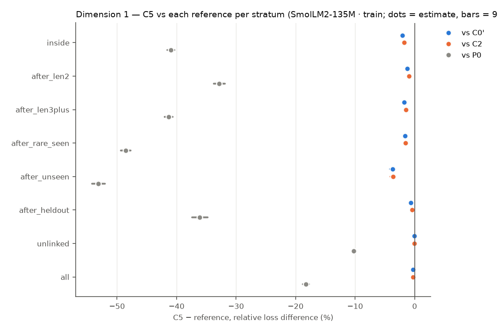
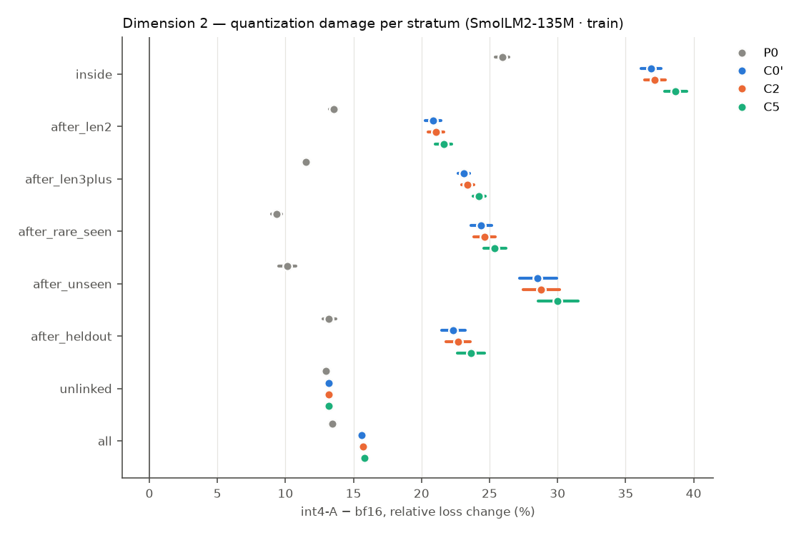
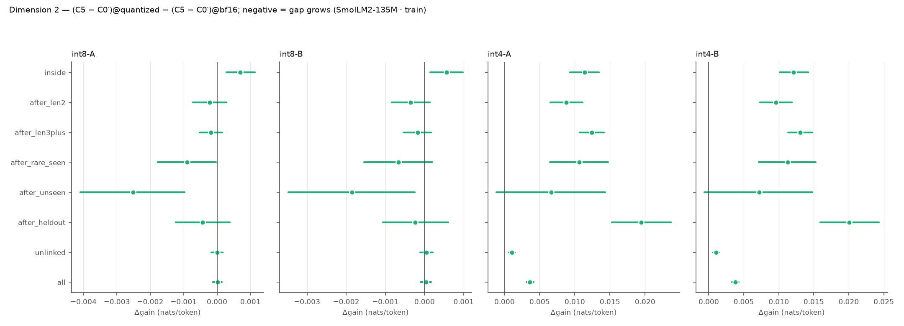
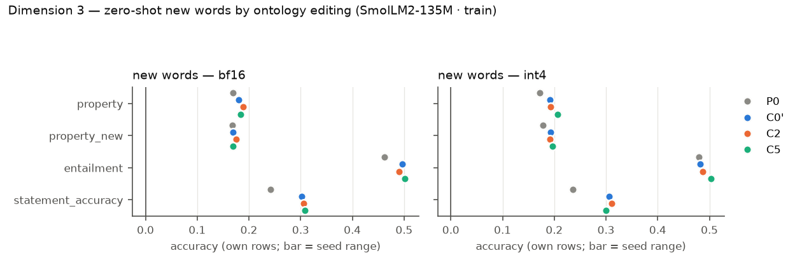
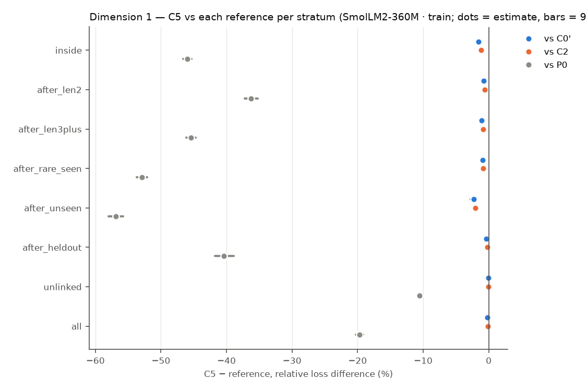
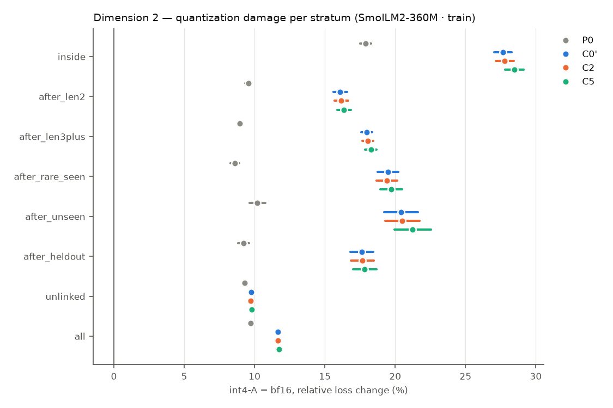
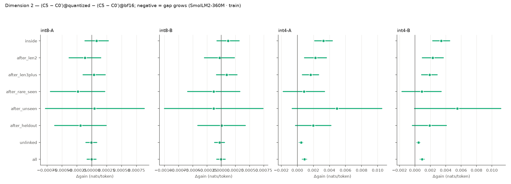
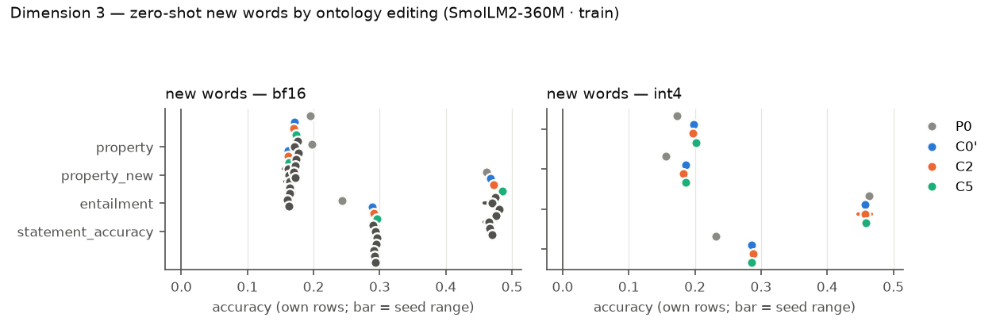

# R9 — retrofit × quantization (E9)

E9 asks three questions on pretrained hosts, all on one fixed test set: (1) does a VSA ontology channel trained jointly with the host improve it on long-token, rare and out-of-distribution words; (2) is the gap larger under weight quantization; (3) after training, can the model learn new or changed words zero-shot by editing the ontology alone? Models: **P0** the original host (evaluation only), **C0′** continued training without the channel, **C2** the same with a capacity-matched free per-concept table, **C5** the same with the attentive VSA channel. Loss differences are condition − reference (negative = lower loss), token-weighted and pooled over common seeds, with 95% cluster bootstraps over evaluation windows (10000 resamples); `*` = Holm-adjusted p < 0.05 within the family named in each table. P0 has no training randomness and pairs with every seed.

## SmolLM2-135M · train

Seeds: P0 [1]; C0' [1]; C2 [1]; C5 [1].

### Dimension 1 — C5 vs C0′, C2 and P0 (bf16)

> single seed: CIs cover evaluation windows or items only, not seed variance.

Relative loss difference [95% CI] (Holm over the three references within each stratum):

| Stratum | Targets | C5 − C0′ | C5 − C2 | C5 − P0 | C2 − C0′ | C0′ − P0 |
|---|---:|---|---|---|---|---|
| inside (long-token words) | 130661 | -2.03% [-2.19, -1.88]* | -1.73% [-1.87, -1.59]* | -40.98% [-41.58, -40.37]* | -0.31% [-0.36, -0.26] | -39.75% [-40.32, -39.16] |
| after_len2 (long-token words) | 87946 | -1.22% [-1.35, -1.10]* | -0.95% [-1.06, -0.85]* | -32.82% [-33.71, -31.91]* | -0.27% [-0.32, -0.22] | -31.99% [-32.85, -31.11] |
| after_len3plus (long-token words) | 185109 | -1.73% [-1.83, -1.62]* | -1.46% [-1.56, -1.37]* | -41.31% [-41.98, -40.63]* | -0.27% [-0.30, -0.24] | -40.28% [-40.93, -39.61] |
| after_rare_seen (rare words) | 31458 | -1.62% [-1.82, -1.43]* | -1.56% [-1.74, -1.39]* | -48.54% [-49.35, -47.74]* | -0.06% [-0.12, +0.00] | -47.69% [-48.49, -46.89] |
| after_unseen (out of distribution) | 9792 | -3.70% [-4.17, -3.23]* | -3.63% [-4.10, -3.16]* | -53.12% [-54.20, -52.04]* | -0.07% [-0.21, +0.07] | -51.32% [-52.38, -50.27] |
| after_heldout (out of distribution) | 35747 | -0.63% [-0.85, -0.41]* | -0.40% [-0.61, -0.19]* | -36.10% [-37.37, -34.75]* | -0.23% [-0.29, -0.17] | -35.69% [-36.93, -34.39] |
| unlinked (locality) | 739780 | -0.03% [-0.03, -0.02]* | -0.02% [-0.03, -0.01]* | -10.27% [-10.52, -10.02]* | -0.00% [-0.01, +0.00] | -10.25% [-10.50, -10.00] |
| all (locality) | 1047552 | -0.30% [-0.32, -0.28]* | -0.26% [-0.28, -0.24]* | -18.26% [-18.76, -17.77]* | -0.05% [-0.05, -0.04] | -18.02% [-18.50, -17.53] |

Absolute differences (nats/token):

| Stratum | C5 − C0′ | C5 − C2 | C5 − P0 |
|---|---|---|---|
| inside | -0.0227 [-0.0244, -0.0210]* | -0.0192 [-0.0208, -0.0178]* | -0.7581 [-0.7724, -0.7436]* |
| after_len2 | -0.0220 [-0.0242, -0.0199]* | -0.0171 [-0.0191, -0.0153]* | -0.8690 [-0.8929, -0.8453]* |
| after_len3plus | -0.0296 [-0.0314, -0.0279]* | -0.0250 [-0.0266, -0.0235]* | -1.1864 [-1.2068, -1.1649]* |
| after_rare_seen | -0.0292 [-0.0327, -0.0258]* | -0.0281 [-0.0315, -0.0249]* | -1.6711 [-1.7034, -1.6389]* |
| after_unseen | -0.0673 [-0.0759, -0.0588]* | -0.0659 [-0.0746, -0.0573]* | -1.9847 [-2.0323, -1.9380]* |
| after_heldout | -0.0105 [-0.0142, -0.0069]* | -0.0067 [-0.0102, -0.0032]* | -0.9412 [-0.9764, -0.9046]* |
| unlinked | -0.0006 [-0.0008, -0.0004]* | -0.0005 [-0.0007, -0.0004]* | -0.2683 [-0.2745, -0.2619]* |
| all | -0.0064 [-0.0069, -0.0060]* | -0.0054 [-0.0058, -0.0051]* | -0.4728 [-0.4852, -0.4602]* |

Probe differences (bf16): C5 − reference per subset, per seed (paired bootstrap over items):

| Reference | Seed | Probe | all | heldout | seen | unlinked |
|---|---:|---|---|---|---|---|
| C0' | 1 | lambada/accuracy | +0.001 [-0.002, +0.003] (n 5153) | — | +0.100 [+0.000, +0.300] (n 10) | +0.000 [-0.002, +0.003] (n 5143) |
| C0' | 1 | wic/probe_accuracy | -0.006 [-0.019, +0.006] (n 638) | +0.000 [+0.000, +0.000] (n 1) | +0.000 [+0.000, +0.000] (n 1) | -0.006 [-0.019, +0.006] (n 636) |
| C0' | 1 | card660/spearman_tied | +0.002 [-0.001, +0.005] (n 660) | — | +0.019 [-0.105, +0.144] (n 18) | +0.001 [-0.002, +0.003] (n 641) |
| C0' | 1 | rare_words/spearman_tied | +0.002 [+0.000, +0.004] (n 2034) | — | +0.024 [-0.430, +0.538] (n 8) | +0.002 [+0.000, +0.003] (n 2026) |
| C0' | 1 | wsd/probe_f1 | -0.001 [-0.002, +0.001] (n 7253) | — | +0.000 [+0.000, +0.000] (n 10) | -0.001 [-0.002, +0.001] (n 7243) |
| C0' | 1 | bless/pair_probe_macro_f1 | -0.003 [-0.006, +0.000] (n 4310) | — | -0.035 [-0.095, +0.005] (n 84) | -0.002 [-0.005, +0.001] (n 4226) |
| C0' | 1 | bless/prompt_auc | -0.002 [-0.003, -0.002] (n 14547) | — | -0.033 [-0.084, +0.012] (n 201) | -0.002 [-0.002, -0.002] (n 14344) |
| C0' | 1 | hyperlex/cosine_spearman | -0.001 [-0.002, +0.001] (n 2616) | — | +0.000 [+0.000, +0.000] (n 7) | -0.001 [-0.002, +0.000] (n 2609) |
| C2 | 1 | lambada/accuracy | +0.000 [-0.003, +0.003] (n 5153) | — | +0.100 [+0.000, +0.300] (n 10) | -0.000 [-0.003, +0.003] (n 5143) |
| C2 | 1 | wic/probe_accuracy | -0.005 [-0.014, +0.005] (n 638) | +0.000 [+0.000, +0.000] (n 1) | +0.000 [+0.000, +0.000] (n 1) | -0.005 [-0.014, +0.005] (n 636) |
| C2 | 1 | card660/spearman_tied | +0.001 [-0.003, +0.004] (n 660) | — | +0.028 [-0.019, +0.115] (n 18) | -0.001 [-0.004, +0.001] (n 641) |
| C2 | 1 | rare_words/spearman_tied | +0.002 [+0.000, +0.003] (n 2034) | — | +0.071 [-0.385, +0.615] (n 8) | +0.002 [+0.000, +0.003] (n 2026) |
| C2 | 1 | wsd/probe_f1 | -0.000 [-0.002, +0.002] (n 7253) | — | +0.000 [+0.000, +0.000] (n 10) | -0.000 [-0.002, +0.001] (n 7243) |
| C2 | 1 | bless/pair_probe_macro_f1 | -0.001 [-0.004, +0.003] (n 4310) | — | -0.035 [-0.095, +0.005] (n 84) | +0.000 [-0.003, +0.003] (n 4226) |
| C2 | 1 | bless/prompt_auc | -0.004 [-0.005, -0.003] (n 14547) | — | -0.033 [-0.081, +0.009] (n 201) | -0.004 [-0.004, -0.003] (n 14344) |
| C2 | 1 | hyperlex/cosine_spearman | +0.000 [-0.001, +0.001] (n 2616) | — | +0.000 [+0.000, +0.000] (n 7) | +0.000 [-0.001, +0.001] (n 2609) |
| P0 | 1 | lambada/accuracy | +0.003 [-0.002, +0.009] (n 5153) | — | +0.100 [+0.000, +0.300] (n 10) | +0.003 [-0.003, +0.009] (n 5143) |
| P0 | 1 | wic/probe_accuracy | +0.011 [-0.022, +0.044] (n 638) | +0.000 [+0.000, +0.000] (n 1) | +0.000 [+0.000, +0.000] (n 1) | +0.011 [-0.022, +0.044] (n 636) |
| P0 | 1 | card660/spearman_tied | -0.006 [-0.020, +0.007] (n 660) | — | +0.118 [-0.044, +0.327] (n 18) | -0.009 [-0.023, +0.003] (n 641) |
| P0 | 1 | rare_words/spearman_tied | -0.002 [-0.010, +0.007] (n 2034) | — | +0.095 [-0.274, +0.586] (n 8) | -0.002 [-0.010, +0.006] (n 2026) |
| P0 | 1 | wsd/probe_f1 | +0.000 [-0.003, +0.003] (n 7253) | — | +0.000 [+0.000, +0.000] (n 10) | +0.000 [-0.003, +0.004] (n 7243) |
| P0 | 1 | bless/pair_probe_macro_f1 | -0.006 [-0.012, -0.000] (n 4310) | — | -0.022 [-0.083, +0.022] (n 84) | -0.006 [-0.012, +0.001] (n 4226) |
| P0 | 1 | bless/prompt_auc | +0.023 [+0.020, +0.026] (n 14547) | — | -0.018 [-0.075, +0.043] (n 201) | +0.024 [+0.021, +0.026] (n 14344) |
| P0 | 1 | hyperlex/cosine_spearman | +0.003 [-0.003, +0.009] (n 2616) | — | +0.000 [+0.000, +0.000] (n 7) | +0.003 [-0.003, +0.010] (n 2609) |

### Dimension 2 — quantization damage and the gap under quantization

Quantization damage `variant − bf16`, relative [95% CI] (A = channel FP16, B = channel quantized; models without a channel have B = A):

| Stratum | Model | int8-A | int8-B | int4-A | int4-B |
|---|---|---|---|---|---|
| inside | P0 | +0.07% [+0.04, +0.10] | +0.07% [+0.04, +0.10] | +25.92% [+25.41, +26.44] | +25.92% [+25.41, +26.44] |
| inside | C0' | +0.11% [+0.06, +0.16] | +0.11% [+0.06, +0.16] | +36.86% [+36.14, +37.63] | +36.86% [+36.14, +37.63] |
| inside | C2 | +0.14% [+0.09, +0.19] | +0.13% [+0.08, +0.18] | +37.16% [+36.42, +37.93] | +37.14% [+36.40, +37.91] |
| inside | C5 | +0.17% [+0.12, +0.22] | +0.16% [+0.11, +0.21] | +38.67% [+37.89, +39.49] | +38.74% [+37.95, +39.56] |
| after_len2 | P0 | +0.03% [+0.00, +0.05] | +0.03% [+0.00, +0.05] | +13.56% [+13.26, +13.85] | +13.56% [+13.26, +13.85] |
| after_len2 | C0' | +0.22% [+0.19, +0.26] | +0.22% [+0.19, +0.26] | +20.86% [+20.29, +21.44] | +20.86% [+20.29, +21.44] |
| after_len2 | C2 | +0.21% [+0.17, +0.24] | +0.20% [+0.17, +0.24] | +21.06% [+20.49, +21.64] | +21.04% [+20.47, +21.62] |
| after_len2 | C5 | +0.21% [+0.17, +0.25] | +0.20% [+0.17, +0.24] | +21.62% [+21.00, +22.22] | +21.66% [+21.05, +22.27] |
| after_len3plus | P0 | -0.08% [-0.10, -0.07] | -0.08% [-0.10, -0.07] | +11.50% [+11.30, +11.71] | +11.50% [+11.30, +11.71] |
| after_len3plus | C0' | +0.20% [+0.17, +0.22] | +0.20% [+0.17, +0.22] | +23.09% [+22.67, +23.51] | +23.09% [+22.67, +23.51] |
| after_len3plus | C2 | +0.20% [+0.18, +0.23] | +0.20% [+0.18, +0.23] | +23.40% [+22.97, +23.83] | +23.40% [+22.98, +23.83] |
| after_len3plus | C5 | +0.19% [+0.16, +0.22] | +0.19% [+0.16, +0.22] | +24.23% [+23.77, +24.69] | +24.27% [+23.81, +24.73] |
| after_rare_seen | P0 | -0.11% [-0.14, -0.07] | -0.11% [-0.14, -0.07] | +9.34% [+8.98, +9.69] | +9.34% [+8.98, +9.69] |
| after_rare_seen | C0' | +0.29% [+0.23, +0.36] | +0.29% [+0.23, +0.36] | +24.39% [+23.63, +25.17] | +24.39% [+23.63, +25.17] |
| after_rare_seen | C2 | +0.28% [+0.22, +0.34] | +0.28% [+0.22, +0.35] | +24.64% [+23.87, +25.43] | +24.64% [+23.87, +25.42] |
| after_rare_seen | C5 | +0.25% [+0.19, +0.31] | +0.26% [+0.20, +0.32] | +25.39% [+24.59, +26.20] | +25.42% [+24.62, +26.24] |
| after_unseen | P0 | -0.20% [-0.25, -0.13] | -0.20% [-0.25, -0.13] | +10.13% [+9.50, +10.77] | +10.13% [+9.50, +10.77] |
| after_unseen | C0' | +0.57% [+0.47, +0.68] | +0.57% [+0.47, +0.68] | +28.53% [+27.21, +29.93] | +28.53% [+27.21, +29.93] |
| after_unseen | C2 | +0.47% [+0.37, +0.58] | +0.48% [+0.38, +0.59] | +28.78% [+27.45, +30.17] | +28.82% [+27.50, +30.20] |
| after_unseen | C5 | +0.45% [+0.34, +0.56] | +0.49% [+0.38, +0.60] | +30.01% [+28.58, +31.53] | +30.04% [+28.61, +31.56] |
| after_heldout | P0 | -0.03% [-0.07, +0.01] | -0.03% [-0.07, +0.01] | +13.20% [+12.74, +13.68] | +13.20% [+12.74, +13.68] |
| after_heldout | C0' | +0.18% [+0.12, +0.24] | +0.18% [+0.12, +0.24] | +22.35% [+21.47, +23.22] | +22.35% [+21.47, +23.22] |
| after_heldout | C2 | +0.17% [+0.12, +0.23] | +0.17% [+0.11, +0.23] | +22.70% [+21.80, +23.59] | +22.70% [+21.79, +23.59] |
| after_heldout | C5 | +0.16% [+0.10, +0.22] | +0.17% [+0.11, +0.23] | +23.65% [+22.66, +24.63] | +23.69% [+22.70, +24.66] |
| unlinked | P0 | +0.14% [+0.13, +0.15] | +0.14% [+0.13, +0.15] | +13.00% [+12.88, +13.11] | +13.00% [+12.88, +13.11] |
| unlinked | C0' | +0.16% [+0.15, +0.17] | +0.16% [+0.15, +0.17] | +13.16% [+13.02, +13.30] | +13.16% [+13.02, +13.30] |
| unlinked | C2 | +0.17% [+0.15, +0.18] | +0.17% [+0.16, +0.18] | +13.20% [+13.07, +13.34] | +13.20% [+13.07, +13.34] |
| unlinked | C5 | +0.16% [+0.15, +0.17] | +0.16% [+0.15, +0.17] | +13.21% [+13.07, +13.35] | +13.21% [+13.07, +13.35] |
| all | P0 | +0.10% [+0.09, +0.11] | +0.10% [+0.09, +0.11] | +13.42% [+13.32, +13.52] | +13.42% [+13.32, +13.52] |
| all | C0' | +0.17% [+0.16, +0.18] | +0.17% [+0.16, +0.18] | +15.62% [+15.43, +15.81] | +15.62% [+15.43, +15.81] |
| all | C2 | +0.17% [+0.16, +0.18] | +0.17% [+0.16, +0.18] | +15.70% [+15.51, +15.90] | +15.70% [+15.51, +15.90] |
| all | C5 | +0.17% [+0.16, +0.18] | +0.17% [+0.16, +0.18] | +15.83% [+15.64, +16.04] | +15.84% [+15.64, +16.05] |

Gap under quantization vs C0': gain = C5 − C0' at bf16 and quantized, `Δgain` = difference in differences (negative = the channel's advantage grows under quantization; Holm over references × variants within each stratum), retained = gain_q / gain_bf16:

| Stratum | Variant | gain bf16 | gain quantized | Δgain [95% CI] | retained |
|---|---|---|---|---|---|
| inside | int8-A | -0.0227 [-0.0245, -0.0211] | -0.0220 [-0.0237, -0.0204] | +0.0007 [+0.0003, +0.0011]* | 0.97 |
| inside | int8-B | -0.0227 [-0.0245, -0.0211] | -0.0222 [-0.0239, -0.0205] | +0.0006 [+0.0001, +0.0010]* | 0.98 |
| inside | int4-A | -0.0227 [-0.0245, -0.0211] | -0.0114 [-0.0138, -0.0089] | +0.0114 [+0.0093, +0.0134]* | 0.50 |
| inside | int4-B | -0.0227 [-0.0245, -0.0211] | -0.0106 [-0.0130, -0.0082] | +0.0121 [+0.0101, +0.0142]* | 0.47 |
| after_len2 | int8-A | -0.0220 [-0.0242, -0.0199] | -0.0222 [-0.0244, -0.0201] | -0.0002 [-0.0007, +0.0003] | 1.01 |
| after_len2 | int8-B | -0.0220 [-0.0242, -0.0199] | -0.0223 [-0.0245, -0.0202] | -0.0004 [-0.0008, +0.0001] | 1.02 |
| after_len2 | int4-A | -0.0220 [-0.0242, -0.0199] | -0.0132 [-0.0160, -0.0105] | +0.0088 [+0.0065, +0.0111]* | 0.60 |
| after_len2 | int4-B | -0.0220 [-0.0242, -0.0199] | -0.0124 [-0.0152, -0.0096] | +0.0096 [+0.0073, +0.0119]* | 0.56 |
| after_len3plus | int8-A | -0.0297 [-0.0314, -0.0280] | -0.0298 [-0.0316, -0.0281] | -0.0002 [-0.0005, +0.0002] | 1.01 |
| after_len3plus | int8-B | -0.0297 [-0.0314, -0.0280] | -0.0298 [-0.0316, -0.0281] | -0.0002 [-0.0005, +0.0002] | 1.01 |
| after_len3plus | int4-A | -0.0297 [-0.0314, -0.0280] | -0.0172 [-0.0193, -0.0152] | +0.0124 [+0.0107, +0.0141]* | 0.58 |
| after_len3plus | int4-B | -0.0297 [-0.0314, -0.0280] | -0.0166 [-0.0186, -0.0146] | +0.0131 [+0.0114, +0.0148]* | 0.56 |
| after_rare_seen | int8-A | -0.0293 [-0.0328, -0.0259] | -0.0302 [-0.0336, -0.0269] | -0.0009 [-0.0018, -0.0000] | 1.03 |
| after_rare_seen | int8-B | -0.0293 [-0.0328, -0.0259] | -0.0300 [-0.0334, -0.0267] | -0.0007 [-0.0015, +0.0002] | 1.02 |
| after_rare_seen | int4-A | -0.0293 [-0.0328, -0.0259] | -0.0187 [-0.0235, -0.0140] | +0.0106 [+0.0064, +0.0147]* | 0.64 |
| after_rare_seen | int4-B | -0.0293 [-0.0328, -0.0259] | -0.0181 [-0.0228, -0.0135] | +0.0112 [+0.0072, +0.0153]* | 0.62 |
| after_unseen | int8-A | -0.0672 [-0.0758, -0.0587] | -0.0697 [-0.0784, -0.0611] | -0.0025 [-0.0041, -0.0010]* | 1.04 |
| after_unseen | int8-B | -0.0672 [-0.0758, -0.0587] | -0.0690 [-0.0777, -0.0604] | -0.0018 [-0.0035, -0.0003] | 1.03 |
| after_unseen | int4-A | -0.0672 [-0.0758, -0.0587] | -0.0605 [-0.0708, -0.0506] | +0.0067 [-0.0011, +0.0143] | 0.90 |
| after_unseen | int4-B | -0.0672 [-0.0758, -0.0587] | -0.0600 [-0.0702, -0.0502] | +0.0072 [-0.0006, +0.0148] | 0.89 |
| after_heldout | int8-A | -0.0105 [-0.0143, -0.0069] | -0.0109 [-0.0147, -0.0073] | -0.0004 [-0.0012, +0.0004] | 1.04 |
| after_heldout | int8-B | -0.0105 [-0.0143, -0.0069] | -0.0108 [-0.0144, -0.0072] | -0.0002 [-0.0011, +0.0006] | 1.02 |
| after_heldout | int4-A | -0.0105 [-0.0143, -0.0069] | +0.0089 [+0.0049, +0.0130] | +0.0195 [+0.0153, +0.0237]* | -0.85 |
| after_heldout | int4-B | -0.0105 [-0.0143, -0.0069] | +0.0096 [+0.0056, +0.0136] | +0.0201 [+0.0159, +0.0243]* | -0.91 |
| unlinked | int8-A | -0.0006 [-0.0008, -0.0004] | -0.0006 [-0.0008, -0.0004] | +0.0000 [-0.0002, +0.0002] | 1.00 |
| unlinked | int8-B | -0.0006 [-0.0008, -0.0004] | -0.0006 [-0.0007, -0.0004] | +0.0000 [-0.0001, +0.0002] | 0.92 |
| unlinked | int4-A | -0.0006 [-0.0008, -0.0004] | +0.0005 [+0.0000, +0.0008] | +0.0011 [+0.0006, +0.0015]* | -0.75 |
| unlinked | int4-B | -0.0006 [-0.0008, -0.0004] | +0.0005 [+0.0001, +0.0009] | +0.0011 [+0.0007, +0.0015]* | -0.77 |
| all | int8-A | -0.0064 [-0.0069, -0.0060] | -0.0064 [-0.0069, -0.0060] | +0.0000 [-0.0001, +0.0001] | 1.00 |
| all | int8-B | -0.0064 [-0.0069, -0.0060] | -0.0064 [-0.0068, -0.0060] | +0.0000 [-0.0001, +0.0002] | 0.99 |
| all | int4-A | -0.0064 [-0.0069, -0.0060] | -0.0028 [-0.0033, -0.0023] | +0.0036 [+0.0031, +0.0041]* | 0.43 |
| all | int4-B | -0.0064 [-0.0069, -0.0060] | -0.0026 [-0.0032, -0.0021] | +0.0038 [+0.0033, +0.0043]* | 0.41 |

Gap under quantization vs C2: gain = C5 − C2 at bf16 and quantized, `Δgain` = difference in differences (negative = the channel's advantage grows under quantization; Holm over references × variants within each stratum), retained = gain_q / gain_bf16:

| Stratum | Variant | gain bf16 | gain quantized | Δgain [95% CI] | retained |
|---|---|---|---|---|---|
| inside | int8-A | -0.0193 [-0.0208, -0.0178] | -0.0189 [-0.0204, -0.0174] | +0.0004 [-0.0001, +0.0008] | 0.98 |
| inside | int8-B | -0.0193 [-0.0208, -0.0178] | -0.0189 [-0.0205, -0.0174] | +0.0004 [-0.0001, +0.0008] | 0.98 |
| inside | int4-A | -0.0193 [-0.0208, -0.0178] | -0.0099 [-0.0122, -0.0076] | +0.0094 [+0.0074, +0.0114]* | 0.51 |
| inside | int4-B | -0.0193 [-0.0208, -0.0178] | -0.0089 [-0.0112, -0.0067] | +0.0103 [+0.0083, +0.0124]* | 0.46 |
| after_len2 | int8-A | -0.0171 [-0.0190, -0.0153] | -0.0171 [-0.0190, -0.0153] | +0.0000 [-0.0005, +0.0005] | 1.00 |
| after_len2 | int8-B | -0.0171 [-0.0190, -0.0153] | -0.0172 [-0.0191, -0.0153] | -0.0001 [-0.0005, +0.0004] | 1.00 |
| after_len2 | int4-A | -0.0171 [-0.0190, -0.0153] | -0.0109 [-0.0136, -0.0082] | +0.0062 [+0.0040, +0.0085]* | 0.64 |
| after_len2 | int4-B | -0.0171 [-0.0190, -0.0153] | -0.0097 [-0.0124, -0.0071] | +0.0074 [+0.0051, +0.0097]* | 0.57 |
| after_len3plus | int8-A | -0.0251 [-0.0266, -0.0235] | -0.0254 [-0.0269, -0.0238] | -0.0003 [-0.0006, +0.0000] | 1.01 |
| after_len3plus | int8-B | -0.0251 [-0.0266, -0.0235] | -0.0254 [-0.0269, -0.0238] | -0.0003 [-0.0006, +0.0000] | 1.01 |
| after_len3plus | int4-A | -0.0251 [-0.0266, -0.0235] | -0.0169 [-0.0188, -0.0149] | +0.0082 [+0.0065, +0.0099]* | 0.67 |
| after_len3plus | int4-B | -0.0251 [-0.0266, -0.0235] | -0.0163 [-0.0182, -0.0144] | +0.0088 [+0.0071, +0.0105]* | 0.65 |
| after_rare_seen | int8-A | -0.0282 [-0.0316, -0.0250] | -0.0289 [-0.0322, -0.0257] | -0.0007 [-0.0015, +0.0002] | 1.02 |
| after_rare_seen | int8-B | -0.0282 [-0.0316, -0.0250] | -0.0288 [-0.0321, -0.0256] | -0.0005 [-0.0014, +0.0003] | 1.02 |
| after_rare_seen | int4-A | -0.0282 [-0.0316, -0.0250] | -0.0220 [-0.0268, -0.0173] | +0.0063 [+0.0021, +0.0104]* | 0.78 |
| after_rare_seen | int4-B | -0.0282 [-0.0316, -0.0250] | -0.0213 [-0.0259, -0.0166] | +0.0070 [+0.0029, +0.0110]* | 0.75 |
| after_unseen | int8-A | -0.0658 [-0.0745, -0.0571] | -0.0666 [-0.0752, -0.0580] | -0.0008 [-0.0022, +0.0008] | 1.01 |
| after_unseen | int8-B | -0.0658 [-0.0745, -0.0571] | -0.0661 [-0.0748, -0.0575] | -0.0003 [-0.0018, +0.0013] | 1.00 |
| after_unseen | int4-A | -0.0658 [-0.0745, -0.0571] | -0.0633 [-0.0740, -0.0529] | +0.0025 [-0.0054, +0.0103] | 0.96 |
| after_unseen | int4-B | -0.0658 [-0.0745, -0.0571] | -0.0634 [-0.0740, -0.0530] | +0.0024 [-0.0055, +0.0102] | 0.96 |
| after_heldout | int8-A | -0.0067 [-0.0102, -0.0033] | -0.0070 [-0.0105, -0.0036] | -0.0003 [-0.0011, +0.0005] | 1.04 |
| after_heldout | int8-B | -0.0067 [-0.0102, -0.0033] | -0.0067 [-0.0101, -0.0034] | +0.0000 [-0.0008, +0.0008] | 1.00 |
| after_heldout | int4-A | -0.0067 [-0.0102, -0.0033] | +0.0078 [+0.0037, +0.0119] | +0.0144 [+0.0103, +0.0186]* | -1.16 |
| after_heldout | int4-B | -0.0067 [-0.0102, -0.0033] | +0.0083 [+0.0044, +0.0123] | +0.0150 [+0.0109, +0.0192]* | -1.25 |
| unlinked | int8-A | -0.0005 [-0.0007, -0.0004] | -0.0007 [-0.0009, -0.0005] | -0.0002 [-0.0003, +0.0000] | 1.29 |
| unlinked | int8-B | -0.0005 [-0.0007, -0.0004] | -0.0006 [-0.0008, -0.0005] | -0.0001 [-0.0003, +0.0001] | 1.22 |
| unlinked | int4-A | -0.0005 [-0.0007, -0.0004] | -0.0005 [-0.0009, -0.0001] | +0.0000 [-0.0004, +0.0005] | 0.94 |
| unlinked | int4-B | -0.0005 [-0.0007, -0.0004] | -0.0005 [-0.0009, -0.0000] | +0.0001 [-0.0004, +0.0005] | 0.87 |
| all | int8-A | -0.0054 [-0.0058, -0.0051] | -0.0056 [-0.0060, -0.0052] | -0.0001 [-0.0003, +0.0000] | 1.02 |
| all | int8-B | -0.0054 [-0.0058, -0.0051] | -0.0055 [-0.0059, -0.0051] | -0.0001 [-0.0002, +0.0001] | 1.02 |
| all | int4-A | -0.0054 [-0.0058, -0.0051] | -0.0035 [-0.0040, -0.0030] | +0.0019 [+0.0015, +0.0025]* | 0.64 |
| all | int4-B | -0.0054 [-0.0058, -0.0051] | -0.0033 [-0.0038, -0.0028] | +0.0022 [+0.0017, +0.0027]* | 0.60 |

Gap under quantization vs P0: gain = C5 − P0 at bf16 and quantized, `Δgain` = difference in differences (negative = the channel's advantage grows under quantization; Holm over references × variants within each stratum), retained = gain_q / gain_bf16:

| Stratum | Variant | gain bf16 | gain quantized | Δgain [95% CI] | retained |
|---|---|---|---|---|---|
| inside | int8-A | -0.7581 [-0.7724, -0.7437] | -0.7575 [-0.7718, -0.7432] | +0.0006 [-0.0001, +0.0013] | 1.00 |
| inside | int8-B | -0.7581 [-0.7724, -0.7437] | -0.7577 [-0.7719, -0.7433] | +0.0005 [-0.0003, +0.0012] | 1.00 |
| inside | int4-A | -0.7581 [-0.7724, -0.7437] | -0.8154 [-0.8295, -0.8010] | -0.0573 [-0.0631, -0.0514]* | 1.08 |
| inside | int4-B | -0.7581 [-0.7724, -0.7437] | -0.8147 [-0.8287, -0.8002] | -0.0565 [-0.0624, -0.0506]* | 1.07 |
| after_len2 | int8-A | -0.8689 [-0.8929, -0.8453] | -0.8659 [-0.8896, -0.8423] | +0.0031 [+0.0022, +0.0039]* | 1.00 |
| after_len2 | int8-B | -0.8689 [-0.8929, -0.8453] | -0.8660 [-0.8897, -0.8425] | +0.0029 [+0.0020, +0.0038]* | 1.00 |
| after_len2 | int4-A | -0.8689 [-0.8929, -0.8453] | -0.8435 [-0.8650, -0.8217] | +0.0255 [+0.0186, +0.0323]* | 0.97 |
| after_len2 | int4-B | -0.8689 [-0.8929, -0.8453] | -0.8427 [-0.8642, -0.8209] | +0.0263 [+0.0194, +0.0332]* | 0.97 |
| after_len3plus | int8-A | -1.1864 [-1.2069, -1.1650] | -1.1808 [-1.2010, -1.1595] | +0.0056 [+0.0050, +0.0062]* | 1.00 |
| after_len3plus | int8-B | -1.1864 [-1.2069, -1.1650] | -1.1808 [-1.2010, -1.1595] | +0.0056 [+0.0050, +0.0062]* | 1.00 |
| after_len3plus | int4-A | -1.1864 [-1.2069, -1.1650] | -1.1083 [-1.1264, -1.0896] | +0.0781 [+0.0725, +0.0836]* | 0.93 |
| after_len3plus | int4-B | -1.1864 [-1.2069, -1.1650] | -1.1077 [-1.1257, -1.0891] | +0.0787 [+0.0732, +0.0842]* | 0.93 |
| after_rare_seen | int8-A | -1.6712 [-1.7035, -1.6390] | -1.6631 [-1.6953, -1.6312] | +0.0081 [+0.0066, +0.0096]* | 1.00 |
| after_rare_seen | int8-B | -1.6712 [-1.7035, -1.6390] | -1.6629 [-1.6951, -1.6308] | +0.0083 [+0.0068, +0.0099]* | 1.00 |
| after_rare_seen | int4-A | -1.6712 [-1.7035, -1.6390] | -1.5430 [-1.5741, -1.5120] | +0.1283 [+0.1159, +0.1404]* | 0.92 |
| after_rare_seen | int4-B | -1.6712 [-1.7035, -1.6390] | -1.5423 [-1.5733, -1.5113] | +0.1289 [+0.1166, +0.1411]* | 0.92 |
| after_unseen | int8-A | -1.9846 [-2.0322, -1.9379] | -1.9694 [-2.0167, -1.9229] | +0.0152 [+0.0125, +0.0178]* | 0.99 |
| after_unseen | int8-B | -1.9846 [-2.0322, -1.9379] | -1.9688 [-2.0160, -1.9221] | +0.0158 [+0.0131, +0.0185]* | 0.99 |
| after_unseen | int4-A | -1.9846 [-2.0322, -1.9379] | -1.8375 [-1.8870, -1.7897] | +0.1471 [+0.1250, +0.1694]* | 0.93 |
| after_unseen | int4-B | -1.9846 [-2.0322, -1.9379] | -1.8370 [-1.8866, -1.7891] | +0.1476 [+0.1256, +0.1700]* | 0.93 |
| after_heldout | int8-A | -0.9412 [-0.9765, -0.9046] | -0.9378 [-0.9727, -0.9012] | +0.0034 [+0.0021, +0.0047]* | 1.00 |
| after_heldout | int8-B | -0.9412 [-0.9765, -0.9046] | -0.9376 [-0.9725, -0.9010] | +0.0036 [+0.0023, +0.0049]* | 1.00 |
| after_heldout | int4-A | -0.9412 [-0.9765, -0.9046] | -0.8913 [-0.9235, -0.8580] | +0.0499 [+0.0383, +0.0615]* | 0.95 |
| after_heldout | int4-B | -0.9412 [-0.9765, -0.9046] | -0.8907 [-0.9230, -0.8573] | +0.0505 [+0.0390, +0.0621]* | 0.95 |
| unlinked | int8-A | -0.2683 [-0.2745, -0.2619] | -0.2682 [-0.2745, -0.2619] | +0.0000 [-0.0002, +0.0003] | 1.00 |
| unlinked | int8-B | -0.2683 [-0.2745, -0.2619] | -0.2682 [-0.2744, -0.2619] | +0.0001 [-0.0002, +0.0004] | 1.00 |
| unlinked | int4-A | -0.2683 [-0.2745, -0.2619] | -0.2982 [-0.3041, -0.2922] | -0.0299 [-0.0318, -0.0281]* | 1.11 |
| unlinked | int4-B | -0.2683 [-0.2745, -0.2619] | -0.2982 [-0.3041, -0.2922] | -0.0299 [-0.0318, -0.0281]* | 1.11 |
| all | int8-A | -0.4728 [-0.4852, -0.4602] | -0.4717 [-0.4841, -0.4592] | +0.0011 [+0.0008, +0.0013]* | 1.00 |
| all | int8-B | -0.4728 [-0.4852, -0.4602] | -0.4717 [-0.4840, -0.4592] | +0.0011 [+0.0008, +0.0014]* | 1.00 |
| all | int4-A | -0.4728 [-0.4852, -0.4602] | -0.4852 [-0.4963, -0.4739] | -0.0124 [-0.0146, -0.0102]* | 1.03 |
| all | int4-B | -0.4728 [-0.4852, -0.4602] | -0.4850 [-0.4962, -0.4738] | -0.0122 [-0.0144, -0.0100]* | 1.03 |

> Single seed in at least one model: CIs cover evaluation windows only.

Probe damage int4 − bf16 per model (paired over items; all items / held-out / seen):

| Model | Seed | Probe | all | heldout | seen |
|---|---:|---|---|---|---|
| P0 | 1 | lambada/accuracy | -0.038 [-0.049, -0.027] | — | +0.100 [-0.200, +0.400] |
| P0 | 1 | wic/probe_accuracy | +0.039 [-0.002, +0.080] | +0.000 [+0.000, +0.000] | -1.000 [-1.000, -1.000] |
| P0 | 1 | card660/spearman_tied | +0.018 [-0.022, +0.056] | — | +0.149 [-0.042, +0.394] |
| P0 | 1 | rare_words/spearman_tied | -0.051 [-0.076, -0.029] | — | +0.429 [-0.051, +0.914] |
| P0 | 1 | wsd/probe_f1 | -0.005 [-0.010, +0.001] | — | +0.000 [+0.000, +0.000] |
| P0 | 1 | bless/pair_probe_macro_f1 | -0.020 [-0.030, -0.010] | — | -0.007 [-0.090, +0.078] |
| P0 | 1 | bless/prompt_auc | -0.034 [-0.038, -0.029] | — | -0.031 [-0.077, +0.011] |
| P0 | 1 | hyperlex/cosine_spearman | -0.019 [-0.038, -0.001] | — | +0.000 [+0.000, +0.000] |
| C0' | 1 | lambada/accuracy | -0.030 [-0.041, -0.019] | — | +0.100 [+0.000, +0.300] |
| C0' | 1 | wic/probe_accuracy | -0.003 [-0.047, +0.039] | +0.000 [+0.000, +0.000] | -1.000 [-1.000, -1.000] |
| C0' | 1 | card660/spearman_tied | +0.017 [-0.023, +0.053] | — | -0.024 [-0.222, +0.153] |
| C0' | 1 | rare_words/spearman_tied | -0.041 [-0.063, -0.020] | — | +0.214 [-0.205, +0.861] |
| C0' | 1 | wsd/probe_f1 | -0.005 [-0.010, +0.001] | — | +0.000 [+0.000, +0.000] |
| C0' | 1 | bless/pair_probe_macro_f1 | -0.027 [-0.038, -0.016] | — | -0.058 [-0.152, +0.018] |
| C0' | 1 | bless/prompt_auc | -0.023 [-0.028, -0.018] | — | +0.000 [-0.037, +0.038] |
| C0' | 1 | hyperlex/cosine_spearman | -0.030 [-0.049, -0.013] | — | +0.220 [+0.000, +0.885] |
| C2 | 1 | lambada/accuracy | -0.027 [-0.038, -0.016] | — | +0.100 [+0.000, +0.300] |
| C2 | 1 | wic/probe_accuracy | +0.002 [-0.042, +0.045] | +0.000 [+0.000, +0.000] | -1.000 [-1.000, -1.000] |
| C2 | 1 | card660/spearman_tied | +0.019 [-0.021, +0.055] | — | -0.012 [-0.213, +0.194] |
| C2 | 1 | rare_words/spearman_tied | -0.043 [-0.065, -0.022] | — | +0.214 [-0.225, +0.844] |
| C2 | 1 | wsd/probe_f1 | -0.006 [-0.011, +0.000] | — | +0.000 [+0.000, +0.000] |
| C2 | 1 | bless/pair_probe_macro_f1 | -0.025 [-0.035, -0.014] | — | -0.042 [-0.130, +0.029] |
| C2 | 1 | bless/prompt_auc | -0.025 [-0.030, -0.020] | — | +0.001 [-0.036, +0.040] |
| C2 | 1 | hyperlex/cosine_spearman | -0.030 [-0.049, -0.012] | — | +0.220 [+0.000, +0.885] |
| C5 | 1 | lambada/accuracy | -0.032 [-0.044, -0.020] | — | +0.100 [+0.000, +0.300] |
| C5 | 1 | wic/probe_accuracy | +0.011 [-0.033, +0.055] | +0.000 [+0.000, +0.000] | -1.000 [-1.000, -1.000] |
| C5 | 1 | card660/spearman_tied | +0.016 [-0.024, +0.052] | — | +0.030 [-0.188, +0.274] |
| C5 | 1 | rare_words/spearman_tied | -0.041 [-0.063, -0.020] | — | +0.143 [-0.370, +0.667] |
| C5 | 1 | wsd/probe_f1 | -0.004 [-0.010, +0.002] | — | +0.000 [+0.000, +0.000] |
| C5 | 1 | bless/pair_probe_macro_f1 | -0.026 [-0.037, -0.015] | — | -0.034 [-0.126, +0.038] |
| C5 | 1 | bless/prompt_auc | -0.022 [-0.027, -0.017] | — | +0.046 [+0.006, +0.092] |
| C5 | 1 | hyperlex/cosine_spearman | -0.025 [-0.043, -0.007] | — | +0.220 [+0.000, +0.885] |

Probe differences at int4 (variant A): C5 − reference per subset, per seed (paired bootstrap over items):

| Reference | Seed | Probe | all | heldout | seen | unlinked |
|---|---:|---|---|---|---|---|
| C0' | 1 | lambada/accuracy | -0.002 [-0.006, +0.003] (n 5153) | — | +0.100 [+0.000, +0.300] (n 10) | -0.002 [-0.006, +0.003] (n 5143) |
| C0' | 1 | wic/probe_accuracy | +0.008 [-0.013, +0.027] (n 638) | +0.000 [+0.000, +0.000] (n 1) | +0.000 [+0.000, +0.000] (n 1) | +0.008 [-0.011, +0.027] (n 636) |
| C0' | 1 | card660/spearman_tied | +0.001 [-0.007, +0.009] (n 660) | — | +0.072 [-0.034, +0.235] (n 18) | -0.000 [-0.008, +0.008] (n 641) |
| C0' | 1 | rare_words/spearman_tied | +0.001 [-0.003, +0.006] (n 2034) | — | -0.048 [-0.304, +0.000] (n 8) | +0.001 [-0.003, +0.006] (n 2026) |
| C0' | 1 | wsd/probe_f1 | +0.000 [-0.002, +0.002] (n 7253) | — | +0.000 [+0.000, +0.000] (n 10) | +0.000 [-0.002, +0.002] (n 7243) |
| C0' | 1 | bless/pair_probe_macro_f1 | -0.001 [-0.007, +0.004] (n 4310) | — | -0.011 [-0.086, +0.048] (n 84) | -0.001 [-0.007, +0.005] (n 4226) |
| C0' | 1 | bless/prompt_auc | -0.001 [-0.002, -0.000] (n 14547) | — | +0.012 [-0.026, +0.053] (n 201) | -0.001 [-0.002, -0.001] (n 14344) |
| C0' | 1 | hyperlex/cosine_spearman | +0.005 [+0.001, +0.008] (n 2616) | — | +0.000 [+0.000, +0.000] (n 7) | +0.005 [+0.001, +0.008] (n 2609) |
| C2 | 1 | lambada/accuracy | -0.005 [-0.009, -0.001] (n 5153) | — | +0.100 [+0.000, +0.300] (n 10) | -0.005 [-0.010, -0.001] (n 5143) |
| C2 | 1 | wic/probe_accuracy | +0.005 [-0.013, +0.024] (n 638) | +0.000 [+0.000, +0.000] (n 1) | +0.000 [+0.000, +0.000] (n 1) | +0.005 [-0.013, +0.022] (n 636) |
| C2 | 1 | card660/spearman_tied | -0.002 [-0.010, +0.005] (n 660) | — | +0.070 [-0.035, +0.232] (n 18) | -0.003 [-0.010, +0.005] (n 641) |
| C2 | 1 | rare_words/spearman_tied | +0.003 [-0.002, +0.008] (n 2034) | — | +0.000 [+0.000, +0.000] (n 8) | +0.004 [-0.001, +0.008] (n 2026) |
| C2 | 1 | wsd/probe_f1 | +0.001 [-0.001, +0.004] (n 7253) | — | +0.000 [+0.000, +0.000] (n 10) | +0.001 [-0.001, +0.004] (n 7243) |
| C2 | 1 | bless/pair_probe_macro_f1 | -0.001 [-0.007, +0.004] (n 4310) | — | -0.027 [-0.094, +0.016] (n 84) | -0.001 [-0.007, +0.005] (n 4226) |
| C2 | 1 | bless/prompt_auc | -0.001 [-0.002, +0.000] (n 14547) | — | +0.012 [-0.028, +0.053] (n 201) | -0.001 [-0.002, +0.000] (n 14344) |
| C2 | 1 | hyperlex/cosine_spearman | +0.005 [+0.001, +0.009] (n 2616) | — | +0.000 [+0.000, +0.000] (n 7) | +0.006 [+0.002, +0.009] (n 2609) |
| P0 | 1 | lambada/accuracy | +0.010 [+0.002, +0.019] (n 5153) | — | +0.100 [+0.000, +0.300] (n 10) | +0.010 [+0.001, +0.018] (n 5143) |
| P0 | 1 | wic/probe_accuracy | -0.017 [-0.055, +0.020] (n 638) | +0.000 [+0.000, +0.000] (n 1) | +0.000 [+0.000, +0.000] (n 1) | -0.017 [-0.057, +0.019] (n 636) |
| P0 | 1 | card660/spearman_tied | -0.009 [-0.035, +0.017] (n 660) | — | -0.001 [-0.175, +0.152] (n 18) | -0.011 [-0.037, +0.016] (n 641) |
| P0 | 1 | rare_words/spearman_tied | +0.009 [-0.005, +0.024] (n 2034) | — | -0.190 [-0.716, +0.000] (n 8) | +0.009 [-0.005, +0.023] (n 2026) |
| P0 | 1 | wsd/probe_f1 | +0.001 [-0.003, +0.006] (n 7253) | — | +0.000 [+0.000, +0.000] (n 10) | +0.001 [-0.003, +0.006] (n 7243) |
| P0 | 1 | bless/pair_probe_macro_f1 | -0.012 [-0.021, -0.003] (n 4310) | — | -0.049 [-0.144, +0.026] (n 84) | -0.011 [-0.020, -0.002] (n 4226) |
| P0 | 1 | bless/prompt_auc | +0.034 [+0.030, +0.039] (n 14547) | — | +0.059 [+0.003, +0.119] (n 201) | +0.034 [+0.030, +0.038] (n 14344) |
| P0 | 1 | hyperlex/cosine_spearman | -0.002 [-0.016, +0.012] (n 2616) | — | +0.220 [+0.000, +0.885] (n 7) | -0.003 [-0.016, +0.010] (n 2609) |

### General text (the track's `eval-general`: locality and general-text quantization damage)

C5 − reference at bf16 (locality, nats/token; positive = worse on general text) and its change under quantization (Δgain; negative = the gap grows; Holm over references × variants):

| Stratum | Reference | Variant | gain bf16 [95% CI] | Δgain [95% CI] |
|---|---|---|---|---|
| all | C0' | int8-A | +0.0001 [+0.0001, +0.0003] | +0.0001 [-0.0001, +0.0002] |
| unlinked | C0' | int8-A | +0.0000 [-0.0001, +0.0001] | +0.0001 [-0.0000, +0.0002] |
| all | C0' | int8-B | +0.0001 [+0.0001, +0.0003] | +0.0000 [-0.0001, +0.0002] |
| unlinked | C0' | int8-B | +0.0000 [-0.0001, +0.0001] | +0.0001 [-0.0001, +0.0002] |
| all | C0' | int4-A | +0.0001 [+0.0001, +0.0003] | -0.0019 [-0.0023, -0.0016]* |
| unlinked | C0' | int4-A | +0.0000 [-0.0001, +0.0001] | -0.0019 [-0.0023, -0.0016]* |
| all | C0' | int4-B | +0.0001 [+0.0001, +0.0003] | -0.0019 [-0.0023, -0.0016]* |
| unlinked | C0' | int4-B | +0.0000 [-0.0001, +0.0001] | -0.0019 [-0.0023, -0.0016]* |
| all | C2 | int8-A | +0.0000 [-0.0001, +0.0001] | +0.0001 [-0.0000, +0.0002] |
| unlinked | C2 | int8-A | -0.0001 [-0.0002, -0.0000] | +0.0001 [-0.0000, +0.0003] |
| all | C2 | int8-B | +0.0000 [-0.0001, +0.0001] | +0.0001 [-0.0001, +0.0002] |
| unlinked | C2 | int8-B | -0.0001 [-0.0002, -0.0000] | +0.0001 [-0.0000, +0.0002] |
| all | C2 | int4-A | +0.0000 [-0.0001, +0.0001] | -0.0031 [-0.0035, -0.0028]* |
| unlinked | C2 | int4-A | -0.0001 [-0.0002, -0.0000] | -0.0031 [-0.0035, -0.0028]* |
| all | C2 | int4-B | +0.0000 [-0.0001, +0.0001] | -0.0031 [-0.0035, -0.0028]* |
| unlinked | C2 | int4-B | -0.0001 [-0.0002, -0.0000] | -0.0031 [-0.0035, -0.0028]* |
| all | P0 | int8-A | -0.0004 [-0.0013, +0.0004] | +0.0005 [+0.0003, +0.0007]* |
| unlinked | P0 | int8-A | -0.0007 [-0.0015, +0.0001] | +0.0005 [+0.0003, +0.0007]* |
| all | P0 | int8-B | -0.0004 [-0.0013, +0.0004] | +0.0004 [+0.0002, +0.0007]* |
| unlinked | P0 | int8-B | -0.0007 [-0.0015, +0.0001] | +0.0005 [+0.0002, +0.0007]* |
| all | P0 | int4-A | -0.0004 [-0.0013, +0.0004] | -0.0096 [-0.0106, -0.0085]* |
| unlinked | P0 | int4-A | -0.0007 [-0.0015, +0.0001] | -0.0095 [-0.0105, -0.0084]* |
| all | P0 | int4-B | -0.0004 [-0.0013, +0.0004] | -0.0096 [-0.0106, -0.0086]* |
| unlinked | P0 | int4-B | -0.0007 [-0.0015, +0.0001] | -0.0095 [-0.0105, -0.0084]* |

Quantization damage on general text (relative):

| Model | int8-A | int8-B | int4-A | int4-B |
|---|---|---|---|---|
| P0 | +0.11% [+0.11, +0.12] | +0.11% [+0.11, +0.12] | +11.20% [+11.08, +11.33] | +11.20% [+11.08, +11.33] |
| C0' | +0.13% [+0.12, +0.14] | +0.13% [+0.12, +0.14] | +10.93% [+10.80, +11.06] | +10.93% [+10.80, +11.06] |
| C2 | +0.13% [+0.12, +0.14] | +0.13% [+0.12, +0.14] | +10.97% [+10.85, +11.10] | +10.97% [+10.85, +11.10] |
| C5 | +0.13% [+0.12, +0.14] | +0.13% [+0.12, +0.14] | +10.86% [+10.73, +10.98] | +10.86% [+10.73, +10.98] |

### Dimension 3 — zero-shot learning by ontology editing (no weight update)

> Single seed: intervals cover items only, not seed variance.

**bf16** — new words (mean over linked items; `own` = the model's own rows: frame composed for C5, fallback row for C2, nothing for C0′/P0):

| Model | Seed | Source | property | property_new | entailment | paraphrase | statement_accuracy | statement_loss |
|---|---:|---|---:|---:|---:|---:|---:|---:|
| P0 | 1 | own | 0.169 | 0.168 | 0.462 | 0.366 | 0.242 | 4.413 |
| C0' | 1 | own | 0.181 | 0.169 | 0.497 | 0.374 | 0.302 | 3.323 |
| C2 | 1 | own | 0.188 | 0.175 | 0.490 | 0.357 | 0.305 | 3.319 |
| C2 | 1 | none | 0.185 | 0.172 | 0.508 | 0.361 | 0.300 | 3.317 |
| C2 | 1 | mean_row | 0.184 | 0.168 | 0.498 | 0.367 | 0.295 | 3.319 |
| C5 | 1 | own | 0.184 | 0.169 | 0.502 | 0.354 | 0.308 | 3.274 |
| C5 | 1 | none | 0.180 | 0.165 | 0.495 | 0.359 | 0.301 | 3.294 |
| C5 | 1 | mean_row | 0.187 | 0.176 | 0.508 | 0.371 | 0.301 | 3.280 |
| C5 | 1 | random_frame | 0.184 | 0.173 | 0.485 | 0.376 | 0.301 | 3.280 |

C5 own − C0' own (new words; paired over items, seed-averaged; Holm over tests):

| Test | Difference [95% CI] | n | p (Holm) |
|---|---|---:|---:|
| property | +0.003 [-0.011, +0.015] | 711 | 1.0000 |
| property_new | +0.000 [-0.018, +0.018] | 411 | 1.0000 |
| property_category | +0.007 [-0.012, +0.025] | 300 | 1.0000 |
| entailment | +0.005 [-0.018, +0.028] | 600 | 1.0000 |
| paraphrase | -0.020 [-0.052, +0.013] | 711 | 1.0000 |
| statement_accuracy | +0.006 [-0.007, +0.018] | 711 | 1.0000 |
| statement_margin | +0.020 [+0.007, +0.034]* | 711 | 0.0266 |
| statement_loss | -0.048 [-0.061, -0.036]* | 711 | 0.0016 |

C5 own − C2 own (new words; paired over items, seed-averaged; Holm over tests):

| Test | Difference [95% CI] | n | p (Holm) |
|---|---|---:|---:|
| property | -0.005 [-0.019, +0.009] | 711 | 1.0000 |
| property_new | -0.006 [-0.026, +0.013] | 411 | 1.0000 |
| property_category | -0.003 [-0.023, +0.017] | 300 | 1.0000 |
| entailment | +0.012 [-0.012, +0.035] | 600 | 1.0000 |
| paraphrase | -0.003 [-0.034, +0.028] | 711 | 1.0000 |
| statement_accuracy | +0.003 [-0.007, +0.013] | 711 | 1.0000 |
| statement_margin | +0.019 [+0.007, +0.032]* | 711 | 0.0280 |
| statement_loss | -0.045 [-0.057, -0.033]* | 711 | 0.0016 |

C5 own − P0 own (new words; paired over items, seed-averaged; Holm over tests):

| Test | Difference [95% CI] | n | p (Holm) |
|---|---|---:|---:|
| property | +0.015 [-0.009, +0.039] | 711 | 0.6893 |
| property_new | +0.001 [-0.030, +0.033] | 411 | 1.0000 |
| property_category | +0.033 [-0.003, +0.072] | 300 | 0.3344 |
| entailment | +0.040 [-0.002, +0.080] | 600 | 0.3060 |
| paraphrase | -0.011 [-0.058, +0.035] | 711 | 1.0000 |
| statement_accuracy | +0.066 [+0.039, +0.093]* | 711 | 0.0016 |
| statement_margin | +0.369 [+0.313, +0.424]* | 711 | 0.0016 |
| statement_loss | -1.139 [-1.191, -1.087]* | 711 | 0.0016 |

**bf16** — edits (ES/PS/NS after the edit; EM = change of log p(new) − log p(old)):

| Model | Seed | Subset | edits | ES before → after | EM [95% CI] | EM − control [95% CI] | PS | NS | score |
|---|---:|---|---:|---|---|---|---:|---:|---:|
| P0 (not editable) | 1 | all | 200 | 0.302 → 0.302 | +0.000 [+0.000, +0.000] | +0.000 [+0.000, +0.000] | 0.340 | 0.700 | 0.391 |
| P0 (not editable) | 1 | seen | 100 | 0.330 → 0.330 | +0.000 [+0.000, +0.000] | +0.000 [+0.000, +0.000] | 0.390 | 0.657 | 0.422 |
| P0 (not editable) | 1 | heldout | 100 | 0.275 → 0.275 | +0.000 [+0.000, +0.000] | +0.000 [+0.000, +0.000] | 0.290 | 0.743 | 0.356 |
| C0' (not editable) | 1 | all | 200 | 0.352 → 0.352 | +0.000 [+0.000, +0.000] | +0.000 [+0.000, +0.000] | 0.335 | 0.689 | 0.412 |
| C0' (not editable) | 1 | seen | 100 | 0.385 → 0.385 | +0.000 [+0.000, +0.000] | +0.000 [+0.000, +0.000] | 0.340 | 0.685 | 0.429 |
| C0' (not editable) | 1 | heldout | 100 | 0.320 → 0.320 | +0.000 [+0.000, +0.000] | +0.000 [+0.000, +0.000] | 0.330 | 0.693 | 0.395 |
| C2 (not editable) | 1 | all | 200 | 0.355 → 0.355 | +0.000 [+0.000, +0.000] | +0.000 [+0.000, +0.000] | 0.350 | 0.685 | 0.421 |
| C2 (not editable) | 1 | seen | 100 | 0.385 → 0.385 | +0.000 [+0.000, +0.000] | +0.000 [+0.000, +0.000] | 0.370 | 0.685 | 0.444 |
| C2 (not editable) | 1 | heldout | 100 | 0.325 → 0.325 | +0.000 [+0.000, +0.000] | +0.000 [+0.000, +0.000] | 0.330 | 0.685 | 0.396 |
| C5 | 1 | all | 200 | 0.360 → 0.362 | +0.050 [-0.026, +0.118] | +0.051 [-0.018, +0.118] | 0.370 | 0.682 | 0.433 |
| C5 | 1 | seen | 100 | 0.390 → 0.395 | +0.074 [-0.022, +0.165] | +0.018 [-0.058, +0.095] | 0.370 | 0.675 | 0.447 |
| C5 | 1 | heldout | 100 | 0.330 → 0.330 | +0.026 [-0.079, +0.126] | +0.083 [-0.032, +0.193] | 0.370 | 0.690 | 0.418 |

**bf16** — E5.4 contamination-free synthetic items (`own` source, linked concepts):

| Model | Seed | property | entailment | paraphrase |
|---|---:|---:|---:|---:|
| P0 | 1 | 0.462 | 0.627 | 0.555 |
| C0' | 1 | 0.575 | 0.746 | 0.704 |
| C2 | 1 | 0.567 | 0.745 | 0.695 |
| C5 | 1 | 0.574 | 0.753 | 0.720 |

C5 own − C0' own (E5.4): property -0.001 [-0.007, +0.006]; entailment +0.007 [-0.003, +0.018]; paraphrase +0.016 [+0.000, +0.032]

C5 own − C2 own (E5.4): property +0.007 [+0.000, +0.014]; entailment +0.009 [-0.002, +0.020]; paraphrase +0.026 [+0.010, +0.042]*

C5 own − P0 own (E5.4): property +0.113 [+0.097, +0.128]*; entailment +0.127 [+0.105, +0.148]*; paraphrase +0.165 [+0.137, +0.193]*

**int4** — new words (mean over linked items; `own` = the model's own rows: frame composed for C5, fallback row for C2, nothing for C0′/P0):

| Model | Seed | Source | property | property_new | entailment | paraphrase | statement_accuracy | statement_loss |
|---|---:|---|---:|---:|---:|---:|---:|---:|
| P0 | 1 | own | 0.172 | 0.178 | 0.480 | 0.373 | 0.236 | 5.252 |
| C0' | 1 | own | 0.191 | 0.193 | 0.482 | 0.342 | 0.307 | 3.955 |
| C2 | 1 | own | 0.193 | 0.192 | 0.487 | 0.335 | 0.311 | 3.966 |
| C2 | 1 | none | 0.192 | 0.195 | 0.485 | 0.328 | 0.307 | 3.965 |
| C2 | 1 | mean_row | 0.190 | 0.192 | 0.482 | 0.336 | 0.309 | 3.966 |
| C5 | 1 | own | 0.206 | 0.197 | 0.503 | 0.345 | 0.300 | 3.922 |
| C5 | 1 | none | 0.197 | 0.196 | 0.483 | 0.333 | 0.297 | 3.943 |
| C5 | 1 | mean_row | 0.199 | 0.195 | 0.495 | 0.342 | 0.295 | 3.929 |
| C5 | 1 | random_frame | 0.199 | 0.195 | 0.495 | 0.340 | 0.294 | 3.926 |

C5 own − C0' own (new words; paired over items, seed-averaged; Holm over tests):

| Test | Difference [95% CI] | n | p (Holm) |
|---|---|---:|---:|
| property | +0.015 [-0.001, +0.031] | 711 | 0.4400 |
| property_new | +0.004 [-0.018, +0.026] | 411 | 1.0000 |
| property_category | +0.030 [+0.005, +0.055] | 300 | 0.1116 |
| entailment | +0.022 [-0.005, +0.048] | 600 | 0.5215 |
| paraphrase | +0.003 [-0.030, +0.035] | 711 | 1.0000 |
| statement_accuracy | -0.007 [-0.021, +0.007] | 711 | 1.0000 |
| statement_margin | +0.023 [+0.006, +0.040]* | 711 | 0.0490 |
| statement_loss | -0.033 [-0.048, -0.018]* | 711 | 0.0016 |

C5 own − C2 own (new words; paired over items, seed-averaged; Holm over tests):

| Test | Difference [95% CI] | n | p (Holm) |
|---|---|---:|---:|
| property | +0.013 [-0.004, +0.029] | 711 | 0.6499 |
| property_new | +0.005 [-0.016, +0.027] | 411 | 1.0000 |
| property_category | +0.023 [+0.000, +0.048] | 300 | 0.4592 |
| entailment | +0.017 [-0.008, +0.042] | 600 | 0.6499 |
| paraphrase | +0.010 [-0.023, +0.042] | 711 | 1.0000 |
| statement_accuracy | -0.011 [-0.025, +0.003] | 711 | 0.6499 |
| statement_margin | +0.015 [-0.001, +0.032] | 711 | 0.4592 |
| statement_loss | -0.044 [-0.059, -0.030]* | 711 | 0.0016 |

C5 own − P0 own (new words; paired over items, seed-averaged; Holm over tests):

| Test | Difference [95% CI] | n | p (Holm) |
|---|---|---:|---:|
| property | +0.034 [+0.008, +0.059]* | 711 | 0.0344 |
| property_new | +0.019 [-0.016, +0.054] | 411 | 0.7037 |
| property_category | +0.053 [+0.017, +0.090]* | 300 | 0.0210 |
| entailment | +0.023 [-0.018, +0.065] | 600 | 0.7037 |
| paraphrase | -0.028 [-0.073, +0.017] | 711 | 0.7037 |
| statement_accuracy | +0.063 [+0.035, +0.093]* | 711 | 0.0016 |
| statement_margin | +0.384 [+0.320, +0.449]* | 711 | 0.0016 |
| statement_loss | -1.329 [-1.391, -1.268]* | 711 | 0.0016 |

**int4** — edits (ES/PS/NS after the edit; EM = change of log p(new) − log p(old)):

| Model | Seed | Subset | edits | ES before → after | EM [95% CI] | EM − control [95% CI] | PS | NS | score |
|---|---:|---|---:|---|---|---|---:|---:|---:|
| P0 (not editable) | 1 | all | 200 | 0.325 → 0.325 | +0.000 [+0.000, +0.000] | +0.000 [+0.000, +0.000] | 0.330 | 0.681 | 0.396 |
| P0 (not editable) | 1 | seen | 100 | 0.370 → 0.370 | +0.000 [+0.000, +0.000] | +0.000 [+0.000, +0.000] | 0.400 | 0.623 | 0.441 |
| P0 (not editable) | 1 | heldout | 100 | 0.280 → 0.280 | +0.000 [+0.000, +0.000] | +0.000 [+0.000, +0.000] | 0.260 | 0.740 | 0.342 |
| C0' (not editable) | 1 | all | 200 | 0.333 → 0.333 | +0.000 [+0.000, +0.000] | +0.000 [+0.000, +0.000] | 0.330 | 0.700 | 0.402 |
| C0' (not editable) | 1 | seen | 100 | 0.355 → 0.355 | +0.000 [+0.000, +0.000] | +0.000 [+0.000, +0.000] | 0.360 | 0.657 | 0.422 |
| C0' (not editable) | 1 | heldout | 100 | 0.310 → 0.310 | +0.000 [+0.000, +0.000] | +0.000 [+0.000, +0.000] | 0.300 | 0.743 | 0.379 |
| C2 (not editable) | 1 | all | 200 | 0.335 → 0.335 | +0.000 [+0.000, +0.000] | +0.000 [+0.000, +0.000] | 0.335 | 0.691 | 0.404 |
| C2 (not editable) | 1 | seen | 100 | 0.370 → 0.370 | +0.000 [+0.000, +0.000] | +0.000 [+0.000, +0.000] | 0.370 | 0.645 | 0.431 |
| C2 (not editable) | 1 | heldout | 100 | 0.300 → 0.300 | +0.000 [+0.000, +0.000] | +0.000 [+0.000, +0.000] | 0.300 | 0.738 | 0.374 |
| C5 | 1 | all | 200 | 0.343 → 0.347 | +0.100 [+0.012, +0.181] | +0.068 [-0.022, +0.157] | 0.330 | 0.700 | 0.409 |
| C5 | 1 | seen | 100 | 0.370 → 0.375 | +0.144 [+0.026, +0.261] | +0.037 [-0.080, +0.148] | 0.350 | 0.657 | 0.426 |
| C5 | 1 | heldout | 100 | 0.315 → 0.320 | +0.057 [-0.075, +0.181] | +0.100 [-0.025, +0.225] | 0.310 | 0.743 | 0.390 |

**int4** — E5.4 contamination-free synthetic items (`own` source, linked concepts):

| Model | Seed | property | entailment | paraphrase |
|---|---:|---:|---:|---:|
| P0 | 1 | 0.366 | 0.568 | 0.485 |
| C0' | 1 | 0.494 | 0.717 | 0.546 |
| C2 | 1 | 0.493 | 0.712 | 0.530 |
| C5 | 1 | 0.509 | 0.715 | 0.559 |

C5 own − C0' own (E5.4): property +0.015 [+0.007, +0.024]*; entailment -0.002 [-0.014, +0.010]; paraphrase +0.013 [-0.005, +0.032]

C5 own − C2 own (E5.4): property +0.016 [+0.008, +0.025]*; entailment +0.003 [-0.010, +0.015]; paraphrase +0.029 [+0.011, +0.047]*

C5 own − P0 own (E5.4): property +0.143 [+0.126, +0.161]*; entailment +0.147 [+0.122, +0.172]*; paraphrase +0.074 [+0.042, +0.106]*

### WP-PQ1 — filler vs non-filler targets after a term (copy concern)

`X_filler` = targets in the 8-token window after a span that belong to an alias of a filler of that span's ontology frame (starting after the span); `X_nonfiller` = the rest of `X` (`e9_rescore`, bf16). Relative loss difference C5 − reference [95% CI] (`*` = Holm over all filler / non-filler tests); filler share = fraction of the stratum's targets that are filler tokens; gain share = fraction of the summed loss difference carried by filler tokens.

| Stratum | Reference | targets | filler share | total | filler | non-filler | gain share on fillers |
|---|---|---:|---:|---|---|---|---:|
| after | C0' | 242955 | 0.035 | -1.43% [-1.51, -1.34] | -3.46% [-3.96, -2.99]* | -1.34% [-1.43, -1.26]* | 0.095 |
| after | C2 | 242955 | 0.035 | -1.21% [-1.29, -1.13] | -3.25% [-3.72, -2.81]* | -1.12% [-1.20, -1.05]* | 0.105 |
| after | P0 | 242955 | 0.035 | -37.95% [-38.62, -37.25] | -44.24% [-45.20, -43.28]* | -37.67% [-38.36, -36.96]* | 0.050 |
| after_heldout | C0' | 35747 | 0.007 | -0.63% [-0.85, -0.41] | -1.56% [-3.46, +0.64] | -0.62% [-0.85, -0.41]* | 0.017 |
| after_heldout | C2 | 35747 | 0.007 | -0.40% [-0.61, -0.20] | -1.37% [-3.20, +0.70] | -0.40% [-0.60, -0.19]* | 0.023 |
| after_heldout | P0 | 35747 | 0.007 | -36.10% [-37.38, -34.75] | -42.94% [-50.57, -35.59]* | -36.05% [-37.32, -34.71]* | 0.009 |
| after_rare_seen | C0' | 31458 | 0.100 | -1.63% [-1.82, -1.44] | -3.37% [-4.14, -2.62]* | -1.42% [-1.60, -1.24]* | 0.222 |
| after_rare_seen | C2 | 31458 | 0.100 | -1.57% [-1.75, -1.39] | -3.27% [-4.00, -2.57]* | -1.37% [-1.54, -1.19]* | 0.223 |
| after_rare_seen | P0 | 31458 | 0.100 | -48.54% [-49.35, -47.74] | -47.20% [-48.74, -45.66]* | -48.70% [-49.56, -47.82]* | 0.100 |
| after_unseen | C0' | 9792 | 0.266 | -3.71% [-4.18, -3.24] | -4.46% [-5.41, -3.56]* | -3.31% [-3.80, -2.82]* | 0.418 |
| after_unseen | C2 | 9792 | 0.266 | -3.64% [-4.11, -3.17] | -4.15% [-5.06, -3.30]* | -3.36% [-3.89, -2.85]* | 0.396 |
| after_unseen | P0 | 9792 | 0.266 | -53.12% [-54.21, -52.05] | -42.52% [-44.10, -40.96]* | -57.27% [-58.69, -55.88]* | 0.225 |
| after_len3plus | C0' | 185109 | 0.044 | -1.73% [-1.84, -1.63] | -3.50% [-4.00, -3.01]* | -1.64% [-1.74, -1.53]* | 0.102 |
| after_len3plus | C2 | 185109 | 0.044 | -1.47% [-1.56, -1.37] | -3.29% [-3.77, -2.83]* | -1.37% [-1.47, -1.28]* | 0.113 |
| after_len3plus | P0 | 185109 | 0.044 | -41.31% [-41.98, -40.63] | -44.36% [-45.34, -43.38]* | -41.15% [-41.84, -40.43]* | 0.056 |

### WP-PQ1 — claim-B controls (quantizers, channel off, quantized embedding)

Absolute nats/token in the four cells, gap = candidate − reference, `DiD` = gap@q − gap@bf16 (negative = the advantage grows under quantization; `*` = Holm over quantizers within the stratum), `DiD off` = the same with the candidate's channel switched off at both precisions (the C5-trained host weights alone), `channel DiD` = (C5 − C5off)@q − (C5 − C5off)@bf16 (the channel's own contribution). `int4-A` = torchao RTN; `int4-rtn/hqq/nf4/gptq/awq` simulated (`evaluation.quantization`); `-emb` = input embedding quantized too. Paired window bootstraps, pooled over common seeds.

**C5 vs C0'**

| Stratum | n | q | ref bf16 | cand bf16 | ref q | cand q | gap bf16 | gap q | DiD [95% CI] | DiD off [95% CI] | channel DiD [95% CI] |
|---|---:|---|---:|---:|---:|---:|---|---|---|---|---|
| after_heldout | 35747 | int4-A | 1.6767 | 1.6662 | 2.0514 | 2.0602 | -0.0106 | +0.0088 | +0.0194 [+0.0152, +0.0236]* | +0.0075 [+0.0049, +0.0101] | +0.0118 [+0.0074, +0.0162] |
| after_heldout | 35747 | int4-hqq | 1.6767 | 1.6662 | 1.9722 | 1.9744 | -0.0106 | +0.0021 | +0.0127 [+0.0093, +0.0160]* | n/a | n/a |
| after_heldout | 35747 | int4-nf4 | 1.6767 | 1.6662 | 1.9295 | 1.9204 | -0.0106 | -0.0091 | +0.0014 [-0.0016, +0.0045] | n/a | n/a |
| after_heldout | 35747 | int4-gptq | 1.6767 | 1.6662 | 1.8349 | 1.8264 | -0.0106 | -0.0085 | +0.0020 [-0.0024, +0.0066] | n/a | n/a |
| after_heldout | 35747 | int4-awq | 1.6767 | 1.6662 | 1.8433 | 1.8301 | -0.0106 | -0.0132 | -0.0027 [-0.0065, +0.0011] | n/a | n/a |
| after_heldout | 35747 | int4-A-emb | 1.6767 | 1.6662 | 2.0740 | 2.0782 | -0.0106 | +0.0042 | +0.0147 [+0.0105, +0.0189]* | n/a | n/a |
| after_rare_seen | 31458 | int4-A | 1.8008 | 1.7715 | 2.2399 | 2.2212 | -0.0293 | -0.0187 | +0.0106 [+0.0064, +0.0147]* | +0.0149 [+0.0122, +0.0175] | -0.0043 [-0.0084, -0.0002] |
| after_rare_seen | 31458 | int4-hqq | 1.8008 | 1.7715 | 2.1076 | 2.0883 | -0.0293 | -0.0193 | +0.0100 [+0.0063, +0.0136]* | n/a | n/a |
| after_rare_seen | 31458 | int4-nf4 | 1.8008 | 1.7715 | 2.0684 | 2.0410 | -0.0293 | -0.0275 | +0.0019 [-0.0009, +0.0045] | n/a | n/a |
| after_rare_seen | 31458 | int4-gptq | 1.8008 | 1.7715 | 1.9623 | 1.9331 | -0.0293 | -0.0293 | +0.0001 [-0.0046, +0.0047] | n/a | n/a |
| after_rare_seen | 31458 | int4-awq | 1.8008 | 1.7715 | 1.9733 | 1.9374 | -0.0293 | -0.0359 | -0.0066 [-0.0109, -0.0023]* | n/a | n/a |
| after_rare_seen | 31458 | int4-A-emb | 1.8008 | 1.7715 | 2.2536 | 2.2351 | -0.0293 | -0.0185 | +0.0108 [+0.0065, +0.0150]* | n/a | n/a |
| after_unseen | 9792 | int4-A | 1.8190 | 1.7516 | 2.3380 | 2.2774 | -0.0674 | -0.0606 | +0.0068 [-0.0010, +0.0144] | +0.0176 [+0.0119, +0.0230] | -0.0108 [-0.0190, -0.0025] |
| after_unseen | 9792 | int4-hqq | 1.8190 | 1.7516 | 2.1083 | 2.0512 | -0.0674 | -0.0571 | +0.0103 [+0.0031, +0.0172]* | n/a | n/a |
| after_unseen | 9792 | int4-nf4 | 1.8190 | 1.7516 | 2.0908 | 2.0323 | -0.0674 | -0.0586 | +0.0088 [+0.0028, +0.0148]* | n/a | n/a |
| after_unseen | 9792 | int4-gptq | 1.8190 | 1.7516 | 1.9993 | 1.9379 | -0.0674 | -0.0614 | +0.0060 [-0.0033, +0.0154] | n/a | n/a |
| after_unseen | 9792 | int4-awq | 1.8190 | 1.7516 | 1.9986 | 1.9262 | -0.0674 | -0.0724 | -0.0050 [-0.0136, +0.0035] | n/a | n/a |
| after_unseen | 9792 | int4-A-emb | 1.8190 | 1.7516 | 2.3569 | 2.2953 | -0.0674 | -0.0616 | +0.0058 [-0.0024, +0.0141] | n/a | n/a |
| after_len3plus | 185109 | int4-A | 1.7150 | 1.6853 | 2.1110 | 2.0936 | -0.0297 | -0.0173 | +0.0123 [+0.0106, +0.0140]* | +0.0085 [+0.0073, +0.0096] | +0.0039 [+0.0021, +0.0057] |
| after_len3plus | 185109 | int4-hqq | 1.7150 | 1.6853 | 2.0137 | 1.9949 | -0.0297 | -0.0188 | +0.0109 [+0.0093, +0.0124]* | n/a | n/a |
| after_len3plus | 185109 | int4-nf4 | 1.7150 | 1.6853 | 1.9693 | 1.9422 | -0.0297 | -0.0271 | +0.0026 [+0.0014, +0.0038]* | n/a | n/a |
| after_len3plus | 185109 | int4-gptq | 1.7150 | 1.6853 | 1.8724 | 1.8441 | -0.0297 | -0.0283 | +0.0014 [-0.0005, +0.0034] | n/a | n/a |
| after_len3plus | 185109 | int4-awq | 1.7150 | 1.6853 | 1.8893 | 1.8568 | -0.0297 | -0.0326 | -0.0029 [-0.0046, -0.0011]* | n/a | n/a |
| after_len3plus | 185109 | int4-A-emb | 1.7150 | 1.6853 | 2.1302 | 2.1122 | -0.0297 | -0.0180 | +0.0117 [+0.0100, +0.0135]* | n/a | n/a |
| inside | 130661 | int4-A | 1.1146 | 1.0919 | 1.5255 | 1.5141 | -0.0227 | -0.0114 | +0.0113 [+0.0093, +0.0134]* | +0.0067 [+0.0053, +0.0081] | +0.0047 [+0.0029, +0.0065] |
| inside | 130661 | int4-hqq | 1.1146 | 1.0919 | 1.4408 | 1.4235 | -0.0227 | -0.0174 | +0.0054 [+0.0036, +0.0072]* | n/a | n/a |
| inside | 130661 | int4-nf4 | 1.1146 | 1.0919 | 1.3969 | 1.3765 | -0.0227 | -0.0204 | +0.0024 [+0.0011, +0.0037]* | n/a | n/a |
| inside | 130661 | int4-gptq | 1.1146 | 1.0919 | 1.3224 | 1.3010 | -0.0227 | -0.0215 | +0.0013 [-0.0013, +0.0038] | n/a | n/a |
| inside | 130661 | int4-awq | 1.1146 | 1.0919 | 1.3338 | 1.2899 | -0.0227 | -0.0439 | -0.0212 [-0.0235, -0.0190]* | n/a | n/a |
| inside | 130661 | int4-A-emb | 1.1146 | 1.0919 | 1.5624 | 1.5493 | -0.0227 | -0.0132 | +0.0096 [+0.0075, +0.0117]* | n/a | n/a |
| unlinked | 739780 | int4-A | 2.3439 | 2.3433 | 2.6523 | 2.6528 | -0.0006 | +0.0005 | +0.0011 [+0.0007, +0.0015]* | +0.0009 [+0.0005, +0.0013] | +0.0002 [-0.0001, +0.0004] |
| unlinked | 739780 | int4-hqq | 2.3439 | 2.3433 | 2.6047 | 2.6028 | -0.0006 | -0.0019 | -0.0012 [-0.0017, -0.0007]* | n/a | n/a |
| unlinked | 739780 | int4-nf4 | 2.3439 | 2.3433 | 2.5516 | 2.5508 | -0.0006 | -0.0008 | -0.0002 [-0.0005, +0.0000] | n/a | n/a |
| unlinked | 739780 | int4-gptq | 2.3439 | 2.3433 | 2.4712 | 2.4711 | -0.0006 | -0.0001 | +0.0006 [-0.0002, +0.0013] | n/a | n/a |
| unlinked | 739780 | int4-awq | 2.3439 | 2.3433 | 2.4760 | 2.4833 | -0.0006 | +0.0073 | +0.0079 [+0.0071, +0.0087]* | n/a | n/a |
| unlinked | 739780 | int4-A-emb | 2.3439 | 2.3433 | 2.6672 | 2.6678 | -0.0006 | +0.0006 | +0.0012 [+0.0008, +0.0017]* | n/a | n/a |
| all | 1047552 | int4-A | 2.1224 | 2.1160 | 2.4539 | 2.4510 | -0.0064 | -0.0028 | +0.0036 [+0.0031, +0.0041]* | +0.0031 [+0.0027, +0.0035] | +0.0005 [+0.0001, +0.0010] |
| all | 1047552 | int4-hqq | 2.1224 | 2.1160 | 2.3944 | 2.3891 | -0.0064 | -0.0053 | +0.0011 [+0.0006, +0.0016]* | n/a | n/a |
| all | 1047552 | int4-nf4 | 2.1224 | 2.1160 | 2.3433 | 2.3372 | -0.0064 | -0.0061 | +0.0004 [+0.0000, +0.0007] | n/a | n/a |
| all | 1047552 | int4-gptq | 2.1224 | 2.1160 | 2.2608 | 2.2552 | -0.0064 | -0.0057 | +0.0008 [+0.0000, +0.0015] | n/a | n/a |
| all | 1047552 | int4-awq | 2.1224 | 2.1160 | 2.2687 | 2.2657 | -0.0064 | -0.0030 | +0.0035 [+0.0028, +0.0042]* | n/a | n/a |
| all | 1047552 | int4-A-emb | 2.1224 | 2.1160 | 2.4713 | 2.4683 | -0.0064 | -0.0030 | +0.0034 [+0.0029, +0.0039]* | n/a | n/a |

**C5 vs C2**

| Stratum | n | q | ref bf16 | cand bf16 | ref q | cand q | gap bf16 | gap q | DiD [95% CI] | DiD off [95% CI] | channel DiD [95% CI] |
|---|---:|---|---:|---:|---:|---:|---|---|---|---|---|
| after_heldout | 35747 | int4-A | 1.6729 | 1.6662 | 2.0526 | 2.0602 | -0.0067 | +0.0076 | +0.0144 [+0.0102, +0.0185]* | +0.0025 [-0.0005, +0.0056] | +0.0118 [+0.0074, +0.0162] |
| after_heldout | 35747 | int4-hqq | 1.6729 | 1.6662 | 1.9683 | 1.9744 | -0.0067 | +0.0060 | +0.0127 [+0.0094, +0.0161]* | n/a | n/a |
| after_heldout | 35747 | int4-nf4 | 1.6729 | 1.6662 | 1.9259 | 1.9204 | -0.0067 | -0.0055 | +0.0012 [-0.0018, +0.0042] | n/a | n/a |
| after_heldout | 35747 | int4-gptq | 1.6729 | 1.6662 | 1.8409 | 1.8264 | -0.0067 | -0.0146 | -0.0079 [-0.0125, -0.0031]* | n/a | n/a |
| after_heldout | 35747 | int4-awq | 1.6729 | 1.6662 | 1.8339 | 1.8301 | -0.0067 | -0.0038 | +0.0030 [-0.0007, +0.0066] | n/a | n/a |
| after_heldout | 35747 | int4-A-emb | 1.6729 | 1.6662 | 2.0739 | 2.0782 | -0.0067 | +0.0043 | +0.0110 [+0.0068, +0.0152]* | n/a | n/a |
| after_rare_seen | 31458 | int4-A | 1.7997 | 1.7715 | 2.2432 | 2.2212 | -0.0283 | -0.0220 | +0.0063 [+0.0021, +0.0104]* | +0.0106 [+0.0074, +0.0136] | -0.0043 [-0.0084, -0.0002] |
| after_rare_seen | 31458 | int4-hqq | 1.7997 | 1.7715 | 2.1104 | 2.0883 | -0.0283 | -0.0221 | +0.0061 [+0.0025, +0.0097]* | n/a | n/a |
| after_rare_seen | 31458 | int4-nf4 | 1.7997 | 1.7715 | 2.0639 | 2.0410 | -0.0283 | -0.0230 | +0.0053 [+0.0025, +0.0080]* | n/a | n/a |
| after_rare_seen | 31458 | int4-gptq | 1.7997 | 1.7715 | 1.9777 | 1.9331 | -0.0283 | -0.0446 | -0.0164 [-0.0214, -0.0114]* | n/a | n/a |
| after_rare_seen | 31458 | int4-awq | 1.7997 | 1.7715 | 1.9726 | 1.9374 | -0.0283 | -0.0353 | -0.0070 [-0.0110, -0.0030]* | n/a | n/a |
| after_rare_seen | 31458 | int4-A-emb | 1.7997 | 1.7715 | 2.2563 | 2.2351 | -0.0283 | -0.0212 | +0.0071 [+0.0030, +0.0112]* | n/a | n/a |
| after_unseen | 9792 | int4-A | 1.8177 | 1.7516 | 2.3409 | 2.2774 | -0.0661 | -0.0634 | +0.0027 [-0.0052, +0.0103] | +0.0134 [+0.0072, +0.0197] | -0.0108 [-0.0190, -0.0025] |
| after_unseen | 9792 | int4-hqq | 1.8177 | 1.7516 | 2.1023 | 2.0512 | -0.0661 | -0.0511 | +0.0150 [+0.0083, +0.0217]* | n/a | n/a |
| after_unseen | 9792 | int4-nf4 | 1.8177 | 1.7516 | 2.0880 | 2.0323 | -0.0661 | -0.0558 | +0.0103 [+0.0043, +0.0165]* | n/a | n/a |
| after_unseen | 9792 | int4-gptq | 1.8177 | 1.7516 | 2.0078 | 1.9379 | -0.0661 | -0.0699 | -0.0039 [-0.0139, +0.0060] | n/a | n/a |
| after_unseen | 9792 | int4-awq | 1.8177 | 1.7516 | 1.9987 | 1.9262 | -0.0661 | -0.0725 | -0.0065 [-0.0143, +0.0012] | n/a | n/a |
| after_unseen | 9792 | int4-A-emb | 1.8177 | 1.7516 | 2.3569 | 2.2953 | -0.0661 | -0.0616 | +0.0045 [-0.0036, +0.0127] | n/a | n/a |
| after_len3plus | 185109 | int4-A | 1.7104 | 1.6853 | 2.1106 | 2.0936 | -0.0251 | -0.0170 | +0.0081 [+0.0064, +0.0098]* | +0.0043 [+0.0029, +0.0056] | +0.0039 [+0.0021, +0.0057] |
| after_len3plus | 185109 | int4-hqq | 1.7104 | 1.6853 | 2.0122 | 1.9949 | -0.0251 | -0.0173 | +0.0078 [+0.0063, +0.0093]* | n/a | n/a |
| after_len3plus | 185109 | int4-nf4 | 1.7104 | 1.6853 | 1.9638 | 1.9422 | -0.0251 | -0.0215 | +0.0036 [+0.0024, +0.0048]* | n/a | n/a |
| after_len3plus | 185109 | int4-gptq | 1.7104 | 1.6853 | 1.8792 | 1.8441 | -0.0251 | -0.0351 | -0.0100 [-0.0120, -0.0080]* | n/a | n/a |
| after_len3plus | 185109 | int4-awq | 1.7104 | 1.6853 | 1.8797 | 1.8568 | -0.0251 | -0.0229 | +0.0021 [+0.0004, +0.0039]* | n/a | n/a |
| after_len3plus | 185109 | int4-A-emb | 1.7104 | 1.6853 | 2.1291 | 2.1122 | -0.0251 | -0.0169 | +0.0081 [+0.0065, +0.0099]* | n/a | n/a |
| inside | 130661 | int4-A | 1.1112 | 1.0919 | 1.5241 | 1.5141 | -0.0193 | -0.0100 | +0.0093 [+0.0074, +0.0114]* | +0.0047 [+0.0031, +0.0062] | +0.0047 [+0.0029, +0.0065] |
| inside | 130661 | int4-hqq | 1.1112 | 1.0919 | 1.4419 | 1.4235 | -0.0193 | -0.0184 | +0.0009 [-0.0008, +0.0026] | n/a | n/a |
| inside | 130661 | int4-nf4 | 1.1112 | 1.0919 | 1.3968 | 1.3765 | -0.0193 | -0.0203 | -0.0010 [-0.0024, +0.0003] | n/a | n/a |
| inside | 130661 | int4-gptq | 1.1112 | 1.0919 | 1.3330 | 1.3010 | -0.0193 | -0.0320 | -0.0127 [-0.0155, -0.0099]* | n/a | n/a |
| inside | 130661 | int4-awq | 1.1112 | 1.0919 | 1.3077 | 1.2899 | -0.0193 | -0.0178 | +0.0015 [-0.0006, +0.0035] | n/a | n/a |
| inside | 130661 | int4-A-emb | 1.1112 | 1.0919 | 1.5610 | 1.5493 | -0.0193 | -0.0117 | +0.0076 [+0.0055, +0.0096]* | n/a | n/a |
| unlinked | 739780 | int4-A | 2.3438 | 2.3433 | 2.6533 | 2.6528 | -0.0005 | -0.0005 | +0.0000 [-0.0004, +0.0005] | -0.0001 [-0.0006, +0.0003] | +0.0002 [-0.0001, +0.0004] |
| unlinked | 739780 | int4-hqq | 2.3438 | 2.3433 | 2.6005 | 2.6028 | -0.0005 | +0.0023 | +0.0029 [+0.0024, +0.0034]* | n/a | n/a |
| unlinked | 739780 | int4-nf4 | 2.3438 | 2.3433 | 2.5519 | 2.5508 | -0.0005 | -0.0010 | -0.0005 [-0.0008, -0.0002]* | n/a | n/a |
| unlinked | 739780 | int4-gptq | 2.3438 | 2.3433 | 2.4739 | 2.4711 | -0.0005 | -0.0028 | -0.0023 [-0.0031, -0.0015]* | n/a | n/a |
| unlinked | 739780 | int4-awq | 2.3438 | 2.3433 | 2.4693 | 2.4833 | -0.0005 | +0.0140 | +0.0145 [+0.0138, +0.0153]* | n/a | n/a |
| unlinked | 739780 | int4-A-emb | 2.3438 | 2.3433 | 2.6684 | 2.6678 | -0.0005 | -0.0006 | -0.0000 [-0.0005, +0.0004] | n/a | n/a |
| all | 1047552 | int4-A | 2.1214 | 2.1160 | 2.4546 | 2.4510 | -0.0055 | -0.0035 | +0.0019 [+0.0014, +0.0024]* | +0.0014 [+0.0010, +0.0018] | +0.0005 [+0.0001, +0.0010] |
| all | 1047552 | int4-hqq | 2.1214 | 2.1160 | 2.3915 | 2.3891 | -0.0055 | -0.0024 | +0.0031 [+0.0026, +0.0036]* | n/a | n/a |
| all | 1047552 | int4-nf4 | 2.1214 | 2.1160 | 2.3426 | 2.3372 | -0.0055 | -0.0054 | +0.0001 [-0.0003, +0.0004] | n/a | n/a |
| all | 1047552 | int4-gptq | 2.1214 | 2.1160 | 2.2650 | 2.2552 | -0.0055 | -0.0098 | -0.0044 [-0.0051, -0.0036]* | n/a | n/a |
| all | 1047552 | int4-awq | 2.1214 | 2.1160 | 2.2600 | 2.2657 | -0.0055 | +0.0057 | +0.0112 [+0.0105, +0.0118]* | n/a | n/a |
| all | 1047552 | int4-A-emb | 2.1214 | 2.1160 | 2.4721 | 2.4683 | -0.0055 | -0.0038 | +0.0017 [+0.0012, +0.0022]* | n/a | n/a |

**C5 vs P0**

| Stratum | n | q | ref bf16 | cand bf16 | ref q | cand q | gap bf16 | gap q | DiD [95% CI] | DiD off [95% CI] | channel DiD [95% CI] |
|---|---:|---|---:|---:|---:|---:|---|---|---|---|---|
| after_heldout | 35747 | int4-A | 2.6074 | 1.6662 | 2.9516 | 2.0602 | -0.9412 | -0.8914 | +0.0498 [+0.0382, +0.0614]* | +0.0380 [+0.0271, +0.0487] | +0.0118 [+0.0074, +0.0162] |
| after_heldout | 35747 | int4-hqq | 2.6074 | 1.6662 | 2.8281 | 1.9744 | -0.9412 | -0.8538 | +0.0875 [+0.0770, +0.0981]* | n/a | n/a |
| after_heldout | 35747 | int4-nf4 | 2.6074 | 1.6662 | 2.7700 | 1.9204 | -0.9412 | -0.8496 | +0.0916 [+0.0835, +0.0996]* | n/a | n/a |
| after_heldout | 35747 | int4-gptq | 2.6074 | 1.6662 | 2.7653 | 1.8264 | -0.9412 | -0.9389 | +0.0023 [-0.0040, +0.0087] | n/a | n/a |
| after_heldout | 35747 | int4-awq | 2.6074 | 1.6662 | 2.7106 | 1.8301 | -0.9412 | -0.8805 | +0.0607 [+0.0526, +0.0686]* | n/a | n/a |
| after_heldout | 35747 | int4-A-emb | 2.6074 | 1.6662 | 2.9732 | 2.0782 | -0.9412 | -0.8950 | +0.0463 [+0.0343, +0.0582]* | n/a | n/a |
| after_rare_seen | 31458 | int4-A | 3.4427 | 1.7715 | 3.7642 | 2.2212 | -1.6712 | -1.5430 | +0.1283 [+0.1159, +0.1404]* | +0.1325 [+0.1205, +0.1448] | -0.0043 [-0.0084, -0.0002] |
| after_rare_seen | 31458 | int4-hqq | 3.4427 | 1.7715 | 3.5767 | 2.0883 | -1.6712 | -1.4885 | +0.1828 [+0.1711, +0.1940]* | n/a | n/a |
| after_rare_seen | 31458 | int4-nf4 | 3.4427 | 1.7715 | 3.5744 | 2.0410 | -1.6712 | -1.5334 | +0.1378 [+0.1287, +0.1469]* | n/a | n/a |
| after_rare_seen | 31458 | int4-gptq | 3.4427 | 1.7715 | 3.6134 | 1.9331 | -1.6712 | -1.6803 | -0.0091 [-0.0171, -0.0013]* | n/a | n/a |
| after_rare_seen | 31458 | int4-awq | 3.4427 | 1.7715 | 3.4983 | 1.9374 | -1.6712 | -1.5609 | +0.1103 [+0.1015, +0.1190]* | n/a | n/a |
| after_rare_seen | 31458 | int4-A-emb | 3.4427 | 1.7715 | 3.7738 | 2.2351 | -1.6712 | -1.5387 | +0.1325 [+0.1199, +0.1452]* | n/a | n/a |
| after_unseen | 9792 | int4-A | 3.7364 | 1.7516 | 4.1150 | 2.2774 | -1.9848 | -1.8376 | +0.1472 [+0.1252, +0.1696]* | +0.1580 [+0.1360, +0.1805] | -0.0108 [-0.0190, -0.0025] |
| after_unseen | 9792 | int4-hqq | 3.7364 | 1.7516 | 3.8075 | 2.0512 | -1.9848 | -1.7564 | +0.2285 [+0.2085, +0.2477]* | n/a | n/a |
| after_unseen | 9792 | int4-nf4 | 3.7364 | 1.7516 | 3.8172 | 2.0323 | -1.9848 | -1.7850 | +0.1999 [+0.1809, +0.2184]* | n/a | n/a |
| after_unseen | 9792 | int4-gptq | 3.7364 | 1.7516 | 3.9649 | 1.9379 | -1.9848 | -2.0270 | -0.0422 [-0.0578, -0.0265]* | n/a | n/a |
| after_unseen | 9792 | int4-awq | 3.7364 | 1.7516 | 3.8163 | 1.9262 | -1.9848 | -1.8901 | +0.0947 [+0.0782, +0.1109]* | n/a | n/a |
| after_unseen | 9792 | int4-A-emb | 3.7364 | 1.7516 | 4.1249 | 2.2953 | -1.9848 | -1.8296 | +0.1553 [+0.1322, +0.1784]* | n/a | n/a |
| after_len3plus | 185109 | int4-A | 2.8717 | 1.6853 | 3.2020 | 2.0936 | -1.1864 | -1.1084 | +0.0780 [+0.0725, +0.0835]* | +0.0741 [+0.0687, +0.0794] | +0.0039 [+0.0021, +0.0057] |
| after_len3plus | 185109 | int4-hqq | 2.8717 | 1.6853 | 3.0715 | 1.9949 | -1.1864 | -1.0766 | +0.1098 [+0.1047, +0.1149]* | n/a | n/a |
| after_len3plus | 185109 | int4-nf4 | 2.8717 | 1.6853 | 3.0397 | 1.9422 | -1.1864 | -1.0974 | +0.0890 [+0.0848, +0.0930]* | n/a | n/a |
| after_len3plus | 185109 | int4-gptq | 2.8717 | 1.6853 | 3.0413 | 1.8441 | -1.1864 | -1.1972 | -0.0108 [-0.0141, -0.0077]* | n/a | n/a |
| after_len3plus | 185109 | int4-awq | 2.8717 | 1.6853 | 2.9619 | 1.8568 | -1.1864 | -1.1052 | +0.0813 [+0.0772, +0.0853]* | n/a | n/a |
| after_len3plus | 185109 | int4-A-emb | 2.8717 | 1.6853 | 3.2193 | 2.1122 | -1.1864 | -1.1071 | +0.0793 [+0.0735, +0.0849]* | n/a | n/a |
| inside | 130661 | int4-A | 1.8500 | 1.0919 | 2.3296 | 1.5141 | -0.7581 | -0.8155 | -0.0573 [-0.0631, -0.0515]* | -0.0620 [-0.0678, -0.0562] | +0.0047 [+0.0029, +0.0065] |
| inside | 130661 | int4-hqq | 1.8500 | 1.0919 | 2.1556 | 1.4235 | -0.7581 | -0.7322 | +0.0260 [+0.0208, +0.0310]* | n/a | n/a |
| inside | 130661 | int4-nf4 | 1.8500 | 1.0919 | 2.1148 | 1.3765 | -0.7581 | -0.7383 | +0.0198 [+0.0150, +0.0245]* | n/a | n/a |
| inside | 130661 | int4-gptq | 1.8500 | 1.0919 | 2.1010 | 1.3010 | -0.7581 | -0.8000 | -0.0419 [-0.0460, -0.0377]* | n/a | n/a |
| inside | 130661 | int4-awq | 1.8500 | 1.0919 | 2.0402 | 1.2899 | -0.7581 | -0.7503 | +0.0078 [+0.0036, +0.0120]* | n/a | n/a |
| inside | 130661 | int4-A-emb | 1.8500 | 1.0919 | 2.3707 | 1.5493 | -0.7581 | -0.8214 | -0.0633 [-0.0694, -0.0571]* | n/a | n/a |
| unlinked | 739780 | int4-A | 2.6116 | 2.3433 | 2.9509 | 2.6528 | -0.2683 | -0.2982 | -0.0299 [-0.0317, -0.0281]* | -0.0301 [-0.0319, -0.0283] | +0.0002 [-0.0001, +0.0004] |
| unlinked | 739780 | int4-hqq | 2.6116 | 2.3433 | 2.8629 | 2.6028 | -0.2683 | -0.2601 | +0.0082 [+0.0066, +0.0098]* | n/a | n/a |
| unlinked | 739780 | int4-nf4 | 2.6116 | 2.3433 | 2.8114 | 2.5508 | -0.2683 | -0.2605 | +0.0077 [+0.0066, +0.0088]* | n/a | n/a |
| unlinked | 739780 | int4-gptq | 2.6116 | 2.3433 | 2.7506 | 2.4711 | -0.2683 | -0.2795 | -0.0112 [-0.0124, -0.0101]* | n/a | n/a |
| unlinked | 739780 | int4-awq | 2.6116 | 2.3433 | 2.7423 | 2.4833 | -0.2683 | -0.2590 | +0.0093 [+0.0081, +0.0104]* | n/a | n/a |
| unlinked | 739780 | int4-A-emb | 2.6116 | 2.3433 | 2.9681 | 2.6678 | -0.2683 | -0.3003 | -0.0320 [-0.0339, -0.0301]* | n/a | n/a |
| all | 1047552 | int4-A | 2.5888 | 2.1160 | 2.9363 | 2.4510 | -0.4728 | -0.4852 | -0.0124 [-0.0146, -0.0102]* | -0.0129 [-0.0151, -0.0108] | +0.0005 [+0.0001, +0.0010] |
| all | 1047552 | int4-hqq | 2.5888 | 2.1160 | 2.8344 | 2.3891 | -0.4728 | -0.4452 | +0.0276 [+0.0256, +0.0295]* | n/a | n/a |
| all | 1047552 | int4-nf4 | 2.5888 | 2.1160 | 2.7870 | 2.3372 | -0.4728 | -0.4497 | +0.0231 [+0.0215, +0.0246]* | n/a | n/a |
| all | 1047552 | int4-gptq | 2.5888 | 2.1160 | 2.7404 | 2.2552 | -0.4728 | -0.4852 | -0.0124 [-0.0135, -0.0113]* | n/a | n/a |
| all | 1047552 | int4-awq | 2.5888 | 2.1160 | 2.7169 | 2.2657 | -0.4728 | -0.4512 | +0.0217 [+0.0202, +0.0231]* | n/a | n/a |
| all | 1047552 | int4-A-emb | 2.5888 | 2.1160 | 2.9555 | 2.4683 | -0.4728 | -0.4872 | -0.0144 [-0.0167, -0.0121]* | n/a | n/a |

Rescored runs (`RUN/rescore`): P0 [1]; C0' [1]; C2 [1]; C5 [1].

### Figures

## SmolLM2-360M · train

Seeds: P0 [1]; C0' [1, 2, 3]; C2 [1, 2, 3]; C5 [1, 2, 3]; C5rf [1, 2, 3]; C5sh [1, 2, 3]; C5tr [1, 2, 3]; C5ut [1, 2, 3]; C6d [1, 2, 3]; C6g [1, 2, 3]; C6m [1, 2, 3].

### Dimension 1 — C5 vs C0′, C2 and P0 (bf16)

Relative loss difference [95% CI] (Holm over the three references within each stratum):

| Stratum | Targets | C5 − C0′ | C5 − C2 | C5 − P0 | C2 − C0′ | C0′ − P0 |
|---|---:|---|---|---|---|---|
| inside (long-token words) | 391983 | -1.54% [-1.67, -1.41]* | -1.16% [-1.25, -1.06]* | -46.00% [-46.63, -45.36]* | -0.39% [-0.44, -0.33] | -45.16% [-45.76, -44.53] |
| after_len2 (long-token words) | 263838 | -0.77% [-0.86, -0.68]* | -0.62% [-0.70, -0.55]* | -36.27% [-37.25, -35.26]* | -0.15% [-0.18, -0.12] | -35.77% [-36.74, -34.78] |
| after_len3plus (long-token words) | 555327 | -1.09% [-1.16, -1.01]* | -0.86% [-0.92, -0.80]* | -45.42% [-46.14, -44.67]* | -0.23% [-0.26, -0.20] | -44.82% [-45.53, -44.08] |
| after_rare_seen (rare words) | 94374 | -0.91% [-1.06, -0.77]* | -0.86% [-1.00, -0.73]* | -52.90% [-53.74, -52.07]* | -0.05% [-0.10, -0.01] | -52.47% [-53.29, -51.64] |
| after_unseen (out of distribution) | 29376 | -2.29% [-2.72, -1.90]* | -2.06% [-2.42, -1.72]* | -56.88% [-58.01, -55.75]* | -0.23% [-0.40, -0.09] | -55.87% [-56.97, -54.78] |
| after_heldout (out of distribution) | 107241 | -0.40% [-0.54, -0.25]* | -0.22% [-0.33, -0.10]* | -40.38% [-41.78, -38.90]* | -0.18% [-0.24, -0.12] | -40.14% [-41.52, -38.68] |
| unlinked (locality) | 2219340 | -0.01% [-0.02, -0.01]* | -0.01% [-0.02, -0.01]* | -10.55% [-10.82, -10.28]* | +0.00% [-0.00, +0.00] | -10.54% [-10.80, -10.27] |
| all (locality) | 3142656 | -0.18% [-0.20, -0.17]* | -0.15% [-0.16, -0.14]* | -19.73% [-20.29, -19.16]* | -0.03% [-0.04, -0.03] | -19.58% [-20.13, -19.03] |

Absolute differences (nats/token):

| Stratum | C5 − C0′ | C5 − C2 | C5 − P0 |
|---|---|---|---|
| inside | -0.0138 [-0.0149, -0.0127]* | -0.0103 [-0.0112, -0.0095]* | -0.7529 [-0.7676, -0.7379]* |
| after_len2 | -0.0120 [-0.0134, -0.0106]* | -0.0097 [-0.0108, -0.0086]* | -0.8806 [-0.9059, -0.8553]* |
| after_len3plus | -0.0161 [-0.0172, -0.0150]* | -0.0127 [-0.0135, -0.0118]* | -1.2203 [-1.2423, -1.1976]* |
| after_rare_seen | -0.0143 [-0.0167, -0.0121]* | -0.0135 [-0.0157, -0.0114]* | -1.7499 [-1.7840, -1.7156]* |
| after_unseen | -0.0354 [-0.0420, -0.0294]* | -0.0318 [-0.0372, -0.0267]* | -1.9934 [-2.0421, -1.9459]* |
| after_heldout | -0.0057 [-0.0078, -0.0036]* | -0.0031 [-0.0047, -0.0015]* | -0.9676 [-1.0046, -0.9293]* |
| unlinked | -0.0003 [-0.0004, -0.0002]* | -0.0003 [-0.0004, -0.0002]* | -0.2482 [-0.2542, -0.2421]* |
| all | -0.0035 [-0.0037, -0.0032]* | -0.0028 [-0.0030, -0.0026]* | -0.4629 [-0.4758, -0.4500]* |

Probe differences (bf16): C5 − reference per subset, per seed (paired bootstrap over items):

| Reference | Seed | Probe | all | heldout | seen | unlinked |
|---|---:|---|---|---|---|---|
| C0' | 1 | lambada/accuracy | +0.001 [-0.002, +0.003] (n 5153) | — | +0.000 [+0.000, +0.000] (n 10) | +0.001 [-0.002, +0.003] (n 5143) |
| C0' | 1 | wic/probe_accuracy | +0.005 [-0.005, +0.016] (n 638) | +0.000 [+0.000, +0.000] (n 1) | +0.000 [+0.000, +0.000] (n 1) | +0.005 [-0.005, +0.016] (n 636) |
| C0' | 1 | card660/spearman_tied | -0.002 [-0.006, +0.001] (n 660) | — | -0.004 [-0.083, +0.073] (n 18) | -0.001 [-0.003, +0.002] (n 641) |
| C0' | 1 | rare_words/spearman_tied | +0.000 [-0.001, +0.001] (n 2034) | — | +0.000 [+0.000, +0.000] (n 8) | +0.000 [-0.001, +0.001] (n 2026) |
| C0' | 1 | wsd/probe_f1 | -0.002 [-0.003, -0.000] (n 7253) | — | +0.000 [+0.000, +0.000] (n 10) | -0.002 [-0.003, -0.000] (n 7243) |
| C0' | 1 | bless/pair_probe_macro_f1 | -0.004 [-0.007, -0.001] (n 4310) | — | +0.000 [+0.000, +0.000] (n 84) | -0.004 [-0.008, -0.001] (n 4226) |
| C0' | 1 | bless/prompt_auc | +0.001 [+0.001, +0.001] (n 14547) | — | -0.008 [-0.019, +0.002] (n 201) | +0.001 [+0.001, +0.002] (n 14344) |
| C0' | 1 | hyperlex/cosine_spearman | +0.000 [-0.001, +0.001] (n 2616) | — | +0.000 [+0.000, +0.000] (n 7) | +0.000 [-0.001, +0.001] (n 2609) |
| C0' | 2 | lambada/accuracy | -0.001 [-0.004, +0.001] (n 5153) | — | +0.000 [+0.000, +0.000] (n 10) | -0.001 [-0.004, +0.001] (n 5143) |
| C0' | 2 | wic/probe_accuracy | +0.014 [+0.005, +0.025] (n 638) | +0.000 [+0.000, +0.000] (n 1) | +0.000 [+0.000, +0.000] (n 1) | +0.014 [+0.005, +0.025] (n 636) |
| C0' | 2 | card660/spearman_tied | -0.002 [-0.006, +0.002] (n 660) | — | -0.048 [-0.275, +0.107] (n 18) | -0.001 [-0.003, +0.001] (n 641) |
| C0' | 2 | rare_words/spearman_tied | +0.000 [-0.001, +0.001] (n 2034) | — | +0.000 [+0.000, +0.000] (n 8) | +0.000 [-0.001, +0.001] (n 2026) |
| C0' | 2 | wsd/probe_f1 | +0.001 [-0.001, +0.002] (n 7253) | — | +0.000 [+0.000, +0.000] (n 10) | +0.001 [-0.001, +0.002] (n 7243) |
| C0' | 2 | bless/pair_probe_macro_f1 | -0.001 [-0.004, +0.002] (n 4310) | — | -0.018 [-0.062, +0.000] (n 84) | -0.001 [-0.004, +0.002] (n 4226) |
| C0' | 2 | bless/prompt_auc | -0.002 [-0.002, -0.001] (n 14547) | — | -0.004 [-0.013, +0.003] (n 201) | -0.002 [-0.002, -0.001] (n 14344) |
| C0' | 2 | hyperlex/cosine_spearman | -0.000 [-0.001, +0.001] (n 2616) | — | +0.000 [+0.000, +0.000] (n 7) | -0.000 [-0.001, +0.000] (n 2609) |
| C0' | 3 | lambada/accuracy | -0.001 [-0.004, +0.002] (n 5153) | — | +0.000 [+0.000, +0.000] (n 10) | -0.001 [-0.004, +0.002] (n 5143) |
| C0' | 3 | wic/probe_accuracy | +0.002 [-0.006, +0.009] (n 638) | +0.000 [+0.000, +0.000] (n 1) | +0.000 [+0.000, +0.000] (n 1) | +0.002 [-0.006, +0.009] (n 636) |
| C0' | 3 | card660/spearman_tied | -0.003 [-0.008, +0.001] (n 660) | — | -0.050 [-0.263, +0.069] (n 18) | -0.001 [-0.003, +0.001] (n 641) |
| C0' | 3 | rare_words/spearman_tied | -0.000 [-0.001, +0.001] (n 2034) | — | +0.000 [+0.000, +0.000] (n 8) | -0.001 [-0.001, +0.000] (n 2026) |
| C0' | 3 | wsd/probe_f1 | -0.000 [-0.002, +0.001] (n 7253) | — | +0.000 [+0.000, +0.000] (n 10) | -0.000 [-0.002, +0.001] (n 7243) |
| C0' | 3 | bless/pair_probe_macro_f1 | -0.002 [-0.005, +0.001] (n 4310) | — | -0.013 [-0.046, +0.000] (n 84) | -0.002 [-0.005, +0.001] (n 4226) |
| C0' | 3 | bless/prompt_auc | -0.000 [-0.001, -0.000] (n 14547) | — | +0.004 [-0.003, +0.013] (n 201) | -0.001 [-0.001, -0.000] (n 14344) |
| C0' | 3 | hyperlex/cosine_spearman | -0.000 [-0.001, +0.001] (n 2616) | — | +0.000 [+0.000, +0.000] (n 7) | -0.000 [-0.001, +0.001] (n 2609) |
| C2 | 1 | lambada/accuracy | +0.000 [-0.002, +0.003] (n 5153) | — | +0.000 [+0.000, +0.000] (n 10) | +0.000 [-0.002, +0.003] (n 5143) |
| C2 | 1 | wic/probe_accuracy | +0.002 [-0.008, +0.011] (n 638) | +0.000 [+0.000, +0.000] (n 1) | +0.000 [+0.000, +0.000] (n 1) | +0.002 [-0.009, +0.011] (n 636) |
| C2 | 1 | card660/spearman_tied | -0.001 [-0.005, +0.002] (n 660) | — | +0.004 [-0.058, +0.075] (n 18) | +0.000 [-0.002, +0.003] (n 641) |
| C2 | 1 | rare_words/spearman_tied | +0.001 [-0.000, +0.002] (n 2034) | — | +0.000 [+0.000, +0.000] (n 8) | +0.001 [-0.000, +0.002] (n 2026) |
| C2 | 1 | wsd/probe_f1 | +0.000 [-0.002, +0.002] (n 7253) | — | +0.000 [+0.000, +0.000] (n 10) | +0.000 [-0.002, +0.002] (n 7243) |
| C2 | 1 | bless/pair_probe_macro_f1 | -0.003 [-0.006, -0.000] (n 4310) | — | +0.000 [+0.000, +0.000] (n 84) | -0.004 [-0.007, -0.000] (n 4226) |
| C2 | 1 | bless/prompt_auc | -0.000 [-0.000, +0.000] (n 14547) | — | -0.005 [-0.017, +0.005] (n 201) | -0.000 [-0.000, +0.000] (n 14344) |
| C2 | 1 | hyperlex/cosine_spearman | -0.001 [-0.002, +0.000] (n 2616) | — | +0.000 [+0.000, +0.000] (n 7) | -0.001 [-0.002, +0.000] (n 2609) |
| C2 | 2 | lambada/accuracy | -0.003 [-0.005, +0.000] (n 5153) | — | +0.000 [+0.000, +0.000] (n 10) | -0.003 [-0.005, -0.000] (n 5143) |
| C2 | 2 | wic/probe_accuracy | +0.009 [+0.000, +0.020] (n 638) | +0.000 [+0.000, +0.000] (n 1) | +0.000 [+0.000, +0.000] (n 1) | +0.009 [-0.002, +0.020] (n 636) |
| C2 | 2 | card660/spearman_tied | -0.001 [-0.004, +0.002] (n 660) | — | -0.013 [-0.169, +0.089] (n 18) | -0.000 [-0.002, +0.002] (n 641) |
| C2 | 2 | rare_words/spearman_tied | -0.000 [-0.001, +0.001] (n 2034) | — | +0.000 [+0.000, +0.000] (n 8) | -0.000 [-0.001, +0.001] (n 2026) |
| C2 | 2 | wsd/probe_f1 | +0.002 [+0.000, +0.003] (n 7253) | — | +0.000 [+0.000, +0.000] (n 10) | +0.002 [+0.000, +0.003] (n 7243) |
| C2 | 2 | bless/pair_probe_macro_f1 | -0.002 [-0.005, +0.000] (n 4310) | — | -0.018 [-0.062, +0.000] (n 84) | -0.002 [-0.004, +0.001] (n 4226) |
| C2 | 2 | bless/prompt_auc | -0.001 [-0.002, -0.001] (n 14547) | — | -0.005 [-0.014, +0.002] (n 201) | -0.001 [-0.002, -0.001] (n 14344) |
| C2 | 2 | hyperlex/cosine_spearman | -0.001 [-0.002, +0.001] (n 2616) | — | +0.000 [+0.000, +0.000] (n 7) | -0.001 [-0.002, -0.000] (n 2609) |
| C2 | 3 | lambada/accuracy | -0.002 [-0.004, +0.001] (n 5153) | — | +0.000 [+0.000, +0.000] (n 10) | -0.002 [-0.004, +0.001] (n 5143) |
| C2 | 3 | wic/probe_accuracy | -0.003 [-0.013, +0.006] (n 638) | +0.000 [+0.000, +0.000] (n 1) | +0.000 [+0.000, +0.000] (n 1) | -0.003 [-0.013, +0.006] (n 636) |
| C2 | 3 | card660/spearman_tied | -0.002 [-0.006, +0.001] (n 660) | — | -0.066 [-0.253, +0.000] (n 18) | -0.001 [-0.003, +0.002] (n 641) |
| C2 | 3 | rare_words/spearman_tied | -0.000 [-0.001, +0.001] (n 2034) | — | +0.000 [+0.000, +0.000] (n 8) | -0.001 [-0.001, +0.000] (n 2026) |
| C2 | 3 | wsd/probe_f1 | -0.001 [-0.002, +0.001] (n 7253) | — | +0.000 [+0.000, +0.000] (n 10) | -0.001 [-0.002, +0.001] (n 7243) |
| C2 | 3 | bless/pair_probe_macro_f1 | -0.002 [-0.005, +0.000] (n 4310) | — | -0.013 [-0.046, +0.000] (n 84) | -0.002 [-0.005, +0.000] (n 4226) |
| C2 | 3 | bless/prompt_auc | +0.000 [-0.000, +0.001] (n 14547) | — | +0.008 [-0.001, +0.018] (n 201) | +0.000 [-0.000, +0.000] (n 14344) |
| C2 | 3 | hyperlex/cosine_spearman | -0.000 [-0.001, +0.001] (n 2616) | — | +0.000 [+0.000, +0.000] (n 7) | +0.000 [-0.001, +0.001] (n 2609) |
| P0 | 1 | lambada/accuracy | +0.003 [-0.003, +0.008] (n 5153) | — | +0.000 [+0.000, +0.000] (n 10) | +0.003 [-0.003, +0.007] (n 5143) |
| P0 | 1 | wic/probe_accuracy | +0.017 [-0.013, +0.045] (n 638) | +0.000 [+0.000, +0.000] (n 1) | +0.000 [+0.000, +0.000] (n 1) | +0.017 [-0.009, +0.046] (n 636) |
| P0 | 1 | card660/spearman_tied | -0.005 [-0.019, +0.010] (n 660) | — | -0.021 [-0.207, +0.168] (n 18) | -0.004 [-0.019, +0.011] (n 641) |
| P0 | 1 | rare_words/spearman_tied | -0.009 [-0.016, -0.001] (n 2034) | — | +0.000 [+0.000, +0.000] (n 8) | -0.009 [-0.016, -0.001] (n 2026) |
| P0 | 1 | wsd/probe_f1 | -0.002 [-0.005, +0.002] (n 7253) | — | +0.000 [+0.000, +0.000] (n 10) | -0.002 [-0.005, +0.002] (n 7243) |
| P0 | 1 | bless/pair_probe_macro_f1 | -0.003 [-0.010, +0.004] (n 4310) | — | +0.000 [+0.000, +0.000] (n 84) | -0.003 [-0.010, +0.004] (n 4226) |
| P0 | 1 | bless/prompt_auc | +0.015 [+0.013, +0.017] (n 14547) | — | +0.001 [-0.016, +0.017] (n 201) | +0.016 [+0.014, +0.018] (n 14344) |
| P0 | 1 | hyperlex/cosine_spearman | -0.000 [-0.007, +0.006] (n 2616) | — | +0.000 [+0.000, +0.000] (n 7) | +0.000 [-0.007, +0.007] (n 2609) |
| P0 | 2 | lambada/accuracy | +0.001 [-0.004, +0.006] (n 5153) | — | +0.000 [+0.000, +0.000] (n 10) | +0.001 [-0.004, +0.006] (n 5143) |
| P0 | 2 | wic/probe_accuracy | +0.024 [-0.005, +0.052] (n 638) | +0.000 [+0.000, +0.000] (n 1) | +0.000 [+0.000, +0.000] (n 1) | +0.024 [-0.005, +0.050] (n 636) |
| P0 | 2 | card660/spearman_tied | -0.004 [-0.019, +0.011] (n 660) | — | -0.032 [-0.224, +0.162] (n 18) | -0.004 [-0.019, +0.011] (n 641) |
| P0 | 2 | rare_words/spearman_tied | -0.009 [-0.017, -0.002] (n 2034) | — | +0.000 [+0.000, +0.000] (n 8) | -0.009 [-0.017, -0.001] (n 2026) |
| P0 | 2 | wsd/probe_f1 | -0.001 [-0.004, +0.003] (n 7253) | — | +0.000 [+0.000, +0.000] (n 10) | -0.001 [-0.004, +0.002] (n 7243) |
| P0 | 2 | bless/pair_probe_macro_f1 | -0.001 [-0.008, +0.006] (n 4310) | — | -0.018 [-0.062, +0.000] (n 84) | -0.001 [-0.008, +0.006] (n 4226) |
| P0 | 2 | bless/prompt_auc | +0.013 [+0.011, +0.015] (n 14547) | — | +0.003 [-0.011, +0.018] (n 201) | +0.014 [+0.011, +0.016] (n 14344) |
| P0 | 2 | hyperlex/cosine_spearman | -0.000 [-0.006, +0.006] (n 2616) | — | +0.000 [+0.000, +0.000] (n 7) | -0.000 [-0.007, +0.006] (n 2609) |
| P0 | 3 | lambada/accuracy | +0.000 [-0.005, +0.005] (n 5153) | — | +0.000 [+0.000, +0.000] (n 10) | +0.000 [-0.005, +0.005] (n 5143) |
| P0 | 3 | wic/probe_accuracy | +0.014 [-0.013, +0.044] (n 638) | +0.000 [+0.000, +0.000] (n 1) | +0.000 [+0.000, +0.000] (n 1) | +0.014 [-0.013, +0.041] (n 636) |
| P0 | 3 | card660/spearman_tied | -0.006 [-0.022, +0.009] (n 660) | — | -0.075 [-0.317, +0.149] (n 18) | -0.005 [-0.020, +0.010] (n 641) |
| P0 | 3 | rare_words/spearman_tied | -0.010 [-0.017, -0.002] (n 2034) | — | +0.000 [+0.000, +0.000] (n 8) | -0.010 [-0.018, -0.002] (n 2026) |
| P0 | 3 | wsd/probe_f1 | -0.002 [-0.006, +0.001] (n 7253) | — | +0.000 [+0.000, +0.000] (n 10) | -0.002 [-0.005, +0.001] (n 7243) |
| P0 | 3 | bless/pair_probe_macro_f1 | -0.002 [-0.010, +0.004] (n 4310) | — | -0.013 [-0.046, +0.000] (n 84) | -0.002 [-0.009, +0.005] (n 4226) |
| P0 | 3 | bless/prompt_auc | +0.015 [+0.013, +0.017] (n 14547) | — | +0.013 [-0.001, +0.031] (n 201) | +0.015 [+0.013, +0.017] (n 14344) |
| P0 | 3 | hyperlex/cosine_spearman | +0.000 [-0.006, +0.007] (n 2616) | — | +0.000 [+0.000, +0.000] (n 7) | +0.000 [-0.007, +0.007] (n 2609) |

### Dimension 2 — quantization damage and the gap under quantization

Quantization damage `variant − bf16`, relative [95% CI] (A = channel FP16, B = channel quantized; models without a channel have B = A):

| Stratum | Model | int8-A | int8-B | int4-A | int4-B |
|---|---|---|---|---|---|
| inside | P0 | -0.14% [-0.17, -0.11] | -0.14% [-0.17, -0.11] | +17.88% [+17.51, +18.27] | +17.88% [+17.51, +18.27] |
| inside | C0' | +0.16% [+0.11, +0.20] | +0.16% [+0.11, +0.20] | +27.67% [+27.04, +28.30] | +27.67% [+27.04, +28.30] |
| inside | C2 | +0.14% [+0.09, +0.19] | +0.15% [+0.10, +0.20] | +27.78% [+27.15, +28.42] | +27.82% [+27.18, +28.46] |
| inside | C5 | +0.17% [+0.12, +0.21] | +0.17% [+0.12, +0.22] | +28.47% [+27.82, +29.13] | +28.49% [+27.84, +29.15] |
| after_len2 | P0 | -0.04% [-0.06, -0.01] | -0.04% [-0.06, -0.01] | +9.57% [+9.33, +9.81] | +9.57% [+9.33, +9.81] |
| after_len2 | C0' | +0.18% [+0.15, +0.21] | +0.18% [+0.15, +0.21] | +16.10% [+15.61, +16.57] | +16.10% [+15.61, +16.57] |
| after_len2 | C2 | +0.19% [+0.15, +0.22] | +0.19% [+0.15, +0.22] | +16.17% [+15.69, +16.65] | +16.18% [+15.69, +16.65] |
| after_len2 | C5 | +0.18% [+0.14, +0.21] | +0.18% [+0.15, +0.21] | +16.37% [+15.87, +16.86] | +16.37% [+15.88, +16.86] |
| after_len3plus | P0 | -0.04% [-0.06, -0.03] | -0.04% [-0.06, -0.03] | +8.96% [+8.81, +9.11] | +8.96% [+8.81, +9.11] |
| after_len3plus | C0' | +0.19% [+0.16, +0.21] | +0.19% [+0.16, +0.21] | +17.97% [+17.57, +18.36] | +17.97% [+17.57, +18.36] |
| after_len3plus | C2 | +0.20% [+0.17, +0.22] | +0.19% [+0.17, +0.22] | +18.05% [+17.65, +18.44] | +18.06% [+17.66, +18.45] |
| after_len3plus | C5 | +0.19% [+0.17, +0.22] | +0.20% [+0.17, +0.22] | +18.28% [+17.86, +18.69] | +18.30% [+17.88, +18.71] |
| after_rare_seen | P0 | -0.04% [-0.08, -0.01] | -0.04% [-0.08, -0.01] | +8.62% [+8.31, +8.92] | +8.62% [+8.31, +8.92] |
| after_rare_seen | C0' | +0.25% [+0.18, +0.30] | +0.25% [+0.18, +0.30] | +19.50% [+18.74, +20.23] | +19.50% [+18.74, +20.23] |
| after_rare_seen | C2 | +0.24% [+0.18, +0.30] | +0.24% [+0.18, +0.30] | +19.43% [+18.68, +20.16] | +19.43% [+18.69, +20.17] |
| after_rare_seen | C5 | +0.23% [+0.17, +0.29] | +0.24% [+0.18, +0.30] | +19.73% [+18.96, +20.48] | +19.73% [+18.97, +20.48] |
| after_unseen | P0 | +0.18% [+0.12, +0.24] | +0.18% [+0.12, +0.24] | +10.19% [+9.63, +10.76] | +10.19% [+9.63, +10.76] |
| after_unseen | C0' | +0.16% [+0.06, +0.26] | +0.16% [+0.06, +0.26] | +20.41% [+19.23, +21.64] | +20.41% [+19.23, +21.64] |
| after_unseen | C2 | +0.16% [+0.06, +0.25] | +0.17% [+0.07, +0.26] | +20.49% [+19.30, +21.72] | +20.52% [+19.32, +21.75] |
| after_unseen | C5 | +0.17% [+0.07, +0.26] | +0.15% [+0.06, +0.25] | +21.21% [+19.94, +22.54] | +21.25% [+19.98, +22.58] |
| after_heldout | P0 | -0.01% [-0.05, +0.03] | -0.01% [-0.05, +0.03] | +9.22% [+8.84, +9.59] | +9.22% [+8.84, +9.59] |
| after_heldout | C0' | +0.18% [+0.13, +0.24] | +0.18% [+0.13, +0.24] | +17.63% [+16.83, +18.44] | +17.63% [+16.83, +18.44] |
| after_heldout | C2 | +0.18% [+0.12, +0.23] | +0.18% [+0.12, +0.23] | +17.65% [+16.84, +18.46] | +17.66% [+16.85, +18.47] |
| after_heldout | C5 | +0.17% [+0.12, +0.23] | +0.19% [+0.13, +0.24] | +17.84% [+17.02, +18.66] | +17.83% [+17.01, +18.64] |
| unlinked | P0 | +0.06% [+0.05, +0.07] | +0.06% [+0.05, +0.07] | +9.29% [+9.20, +9.39] | +9.29% [+9.20, +9.39] |
| unlinked | C0' | +0.15% [+0.14, +0.16] | +0.15% [+0.14, +0.16] | +9.76% [+9.64, +9.88] | +9.76% [+9.64, +9.88] |
| unlinked | C2 | +0.15% [+0.14, +0.16] | +0.15% [+0.14, +0.16] | +9.74% [+9.62, +9.86] | +9.74% [+9.63, +9.87] |
| unlinked | C5 | +0.15% [+0.14, +0.16] | +0.15% [+0.14, +0.16] | +9.79% [+9.67, +9.91] | +9.79% [+9.67, +9.91] |
| all | P0 | +0.03% [+0.02, +0.04] | +0.03% [+0.02, +0.04] | +9.74% [+9.65, +9.83] | +9.74% [+9.65, +9.83] |
| all | C0' | +0.16% [+0.15, +0.17] | +0.16% [+0.15, +0.17] | +11.65% [+11.49, +11.82] | +11.65% [+11.49, +11.82] |
| all | C2 | +0.16% [+0.15, +0.17] | +0.16% [+0.15, +0.17] | +11.64% [+11.48, +11.81] | +11.65% [+11.48, +11.81] |
| all | C5 | +0.16% [+0.15, +0.17] | +0.16% [+0.15, +0.17] | +11.72% [+11.55, +11.89] | +11.72% [+11.56, +11.89] |

Gap under quantization vs C0': gain = C5 − C0' at bf16 and quantized, `Δgain` = difference in differences (negative = the channel's advantage grows under quantization; Holm over references × variants within each stratum), retained = gain_q / gain_bf16:

| Stratum | Variant | gain bf16 | gain quantized | Δgain [95% CI] | retained |
|---|---|---|---|---|---|
| inside | int8-A | -0.0138 [-0.0149, -0.0127] | -0.0137 [-0.0149, -0.0126] | +0.0001 [-0.0001, +0.0003] | 0.99 |
| inside | int8-B | -0.0138 [-0.0149, -0.0127] | -0.0137 [-0.0148, -0.0126] | +0.0001 [-0.0001, +0.0003] | 0.99 |
| inside | int4-A | -0.0138 [-0.0149, -0.0127] | -0.0106 [-0.0120, -0.0092] | +0.0033 [+0.0022, +0.0044]* | 0.76 |
| inside | int4-B | -0.0138 [-0.0149, -0.0127] | -0.0104 [-0.0118, -0.0090] | +0.0034 [+0.0023, +0.0045]* | 0.75 |
| after_len2 | int8-A | -0.0120 [-0.0134, -0.0106] | -0.0121 [-0.0135, -0.0107] | -0.0001 [-0.0004, +0.0002] | 1.01 |
| after_len2 | int8-B | -0.0120 [-0.0134, -0.0106] | -0.0120 [-0.0134, -0.0107] | -0.0000 [-0.0003, +0.0002] | 1.00 |
| after_len2 | int4-A | -0.0120 [-0.0134, -0.0106] | -0.0098 [-0.0114, -0.0081] | +0.0022 [+0.0009, +0.0036]* | 0.81 |
| after_len2 | int4-B | -0.0120 [-0.0134, -0.0106] | -0.0097 [-0.0113, -0.0080] | +0.0023 [+0.0010, +0.0037]* | 0.81 |
| after_len3plus | int8-A | -0.0161 [-0.0172, -0.0150] | -0.0161 [-0.0171, -0.0150] | +0.0000 [-0.0001, +0.0002] | 1.00 |
| after_len3plus | int8-B | -0.0161 [-0.0172, -0.0150] | -0.0160 [-0.0171, -0.0149] | +0.0001 [-0.0001, +0.0003] | 0.99 |
| after_len3plus | int4-A | -0.0161 [-0.0172, -0.0150] | -0.0145 [-0.0157, -0.0132] | +0.0016 [+0.0006, +0.0026]* | 0.90 |
| after_len3plus | int4-B | -0.0161 [-0.0172, -0.0150] | -0.0142 [-0.0154, -0.0129] | +0.0019 [+0.0009, +0.0029]* | 0.88 |
| after_rare_seen | int8-A | -0.0143 [-0.0166, -0.0120] | -0.0145 [-0.0169, -0.0123] | -0.0002 [-0.0007, +0.0002] | 1.02 |
| after_rare_seen | int8-B | -0.0143 [-0.0166, -0.0120] | -0.0144 [-0.0168, -0.0122] | -0.0001 [-0.0006, +0.0003] | 1.01 |
| after_rare_seen | int4-A | -0.0143 [-0.0166, -0.0120] | -0.0135 [-0.0161, -0.0108] | +0.0008 [-0.0018, +0.0034] | 0.94 |
| after_rare_seen | int4-B | -0.0143 [-0.0166, -0.0120] | -0.0134 [-0.0160, -0.0108] | +0.0009 [-0.0017, +0.0034] | 0.94 |
| after_unseen | int8-A | -0.0355 [-0.0421, -0.0295] | -0.0355 [-0.0420, -0.0294] | +0.0000 [-0.0008, +0.0009] | 1.00 |
| after_unseen | int8-B | -0.0355 [-0.0421, -0.0295] | -0.0356 [-0.0422, -0.0296] | -0.0001 [-0.0010, +0.0007] | 1.00 |
| after_unseen | int4-A | -0.0355 [-0.0421, -0.0295] | -0.0306 [-0.0381, -0.0232] | +0.0049 [-0.0006, +0.0105] | 0.86 |
| after_unseen | int4-B | -0.0355 [-0.0421, -0.0295] | -0.0300 [-0.0374, -0.0226] | +0.0055 [-0.0001, +0.0111] | 0.84 |
| after_heldout | int8-A | -0.0057 [-0.0077, -0.0036] | -0.0058 [-0.0079, -0.0038] | -0.0002 [-0.0006, +0.0002] | 1.03 |
| after_heldout | int8-B | -0.0057 [-0.0077, -0.0036] | -0.0056 [-0.0078, -0.0036] | +0.0000 [-0.0004, +0.0004] | 1.00 |
| after_heldout | int4-A | -0.0057 [-0.0077, -0.0036] | -0.0037 [-0.0063, -0.0010] | +0.0020 [-0.0002, +0.0042] | 0.65 |
| after_heldout | int4-B | -0.0057 [-0.0077, -0.0036] | -0.0038 [-0.0064, -0.0011] | +0.0019 [-0.0003, +0.0041] | 0.66 |
| unlinked | int8-A | -0.0003 [-0.0004, -0.0002] | -0.0003 [-0.0004, -0.0002] | -0.0000 [-0.0001, +0.0001] | 1.03 |
| unlinked | int8-B | -0.0003 [-0.0004, -0.0002] | -0.0003 [-0.0004, -0.0002] | -0.0000 [-0.0001, +0.0001] | 1.10 |
| unlinked | int4-A | -0.0003 [-0.0004, -0.0002] | +0.0002 [-0.0000, +0.0004] | +0.0005 [+0.0002, +0.0007]* | -0.66 |
| unlinked | int4-B | -0.0003 [-0.0004, -0.0002] | +0.0002 [-0.0000, +0.0004] | +0.0005 [+0.0002, +0.0007]* | -0.65 |
| all | int8-A | -0.0035 [-0.0037, -0.0032] | -0.0035 [-0.0037, -0.0032] | -0.0000 [-0.0001, +0.0001] | 1.00 |
| all | int8-B | -0.0035 [-0.0037, -0.0032] | -0.0035 [-0.0037, -0.0032] | -0.0000 [-0.0001, +0.0001] | 1.00 |
| all | int4-A | -0.0035 [-0.0037, -0.0032] | -0.0026 [-0.0029, -0.0022] | +0.0009 [+0.0006, +0.0012]* | 0.74 |
| all | int4-B | -0.0035 [-0.0037, -0.0032] | -0.0025 [-0.0028, -0.0022] | +0.0009 [+0.0007, +0.0012]* | 0.73 |

Gap under quantization vs C2: gain = C5 − C2 at bf16 and quantized, `Δgain` = difference in differences (negative = the channel's advantage grows under quantization; Holm over references × variants within each stratum), retained = gain_q / gain_bf16:

| Stratum | Variant | gain bf16 | gain quantized | Δgain [95% CI] | retained |
|---|---|---|---|---|---|
| inside | int8-A | -0.0103 [-0.0112, -0.0095] | -0.0101 [-0.0110, -0.0093] | +0.0002 [-0.0000, +0.0004] | 0.98 |
| inside | int8-B | -0.0103 [-0.0112, -0.0095] | -0.0101 [-0.0110, -0.0093] | +0.0002 [+0.0000, +0.0004] | 0.98 |
| inside | int4-A | -0.0103 [-0.0112, -0.0095] | -0.0072 [-0.0083, -0.0060] | +0.0032 [+0.0022, +0.0042]* | 0.69 |
| inside | int4-B | -0.0103 [-0.0112, -0.0095] | -0.0073 [-0.0085, -0.0061] | +0.0031 [+0.0020, +0.0041]* | 0.70 |
| after_len2 | int8-A | -0.0097 [-0.0108, -0.0086] | -0.0098 [-0.0110, -0.0087] | -0.0002 [-0.0004, +0.0001] | 1.02 |
| after_len2 | int8-B | -0.0097 [-0.0108, -0.0086] | -0.0098 [-0.0109, -0.0087] | -0.0001 [-0.0004, +0.0002] | 1.01 |
| after_len2 | int4-A | -0.0097 [-0.0108, -0.0086] | -0.0082 [-0.0097, -0.0068] | +0.0015 [+0.0002, +0.0027] | 0.85 |
| after_len2 | int4-B | -0.0097 [-0.0108, -0.0086] | -0.0082 [-0.0097, -0.0068] | +0.0014 [+0.0002, +0.0027] | 0.85 |
| after_len3plus | int8-A | -0.0127 [-0.0135, -0.0118] | -0.0128 [-0.0136, -0.0119] | -0.0001 [-0.0003, +0.0001] | 1.01 |
| after_len3plus | int8-B | -0.0127 [-0.0135, -0.0118] | -0.0127 [-0.0135, -0.0118] | -0.0000 [-0.0002, +0.0002] | 1.00 |
| after_len3plus | int4-A | -0.0127 [-0.0135, -0.0118] | -0.0116 [-0.0126, -0.0104] | +0.0011 [+0.0002, +0.0020] | 0.91 |
| after_len3plus | int4-B | -0.0127 [-0.0135, -0.0118] | -0.0115 [-0.0126, -0.0104] | +0.0012 [+0.0003, +0.0021] | 0.90 |
| after_rare_seen | int8-A | -0.0135 [-0.0156, -0.0114] | -0.0137 [-0.0159, -0.0116] | -0.0002 [-0.0006, +0.0002] | 1.02 |
| after_rare_seen | int8-B | -0.0135 [-0.0156, -0.0114] | -0.0136 [-0.0157, -0.0115] | -0.0001 [-0.0005, +0.0004] | 1.01 |
| after_rare_seen | int4-A | -0.0135 [-0.0156, -0.0114] | -0.0114 [-0.0139, -0.0090] | +0.0021 [-0.0003, +0.0044] | 0.85 |
| after_rare_seen | int4-B | -0.0135 [-0.0156, -0.0114] | -0.0115 [-0.0140, -0.0090] | +0.0020 [-0.0004, +0.0043] | 0.85 |
| after_unseen | int8-A | -0.0319 [-0.0373, -0.0267] | -0.0318 [-0.0372, -0.0266] | +0.0001 [-0.0007, +0.0009] | 1.00 |
| after_unseen | int8-B | -0.0319 [-0.0373, -0.0267] | -0.0321 [-0.0375, -0.0270] | -0.0002 [-0.0011, +0.0006] | 1.01 |
| after_unseen | int4-A | -0.0319 [-0.0373, -0.0267] | -0.0275 [-0.0340, -0.0211] | +0.0044 [-0.0006, +0.0092] | 0.86 |
| after_unseen | int4-B | -0.0319 [-0.0373, -0.0267] | -0.0274 [-0.0338, -0.0211] | +0.0045 [-0.0004, +0.0094] | 0.86 |
| after_heldout | int8-A | -0.0031 [-0.0047, -0.0015] | -0.0032 [-0.0049, -0.0015] | -0.0001 [-0.0005, +0.0003] | 1.02 |
| after_heldout | int8-B | -0.0031 [-0.0047, -0.0015] | -0.0030 [-0.0047, -0.0014] | +0.0001 [-0.0003, +0.0005] | 0.98 |
| after_heldout | int4-A | -0.0031 [-0.0047, -0.0015] | -0.0010 [-0.0032, +0.0013] | +0.0021 [+0.0002, +0.0041] | 0.32 |
| after_heldout | int4-B | -0.0031 [-0.0047, -0.0015] | -0.0013 [-0.0035, +0.0010] | +0.0019 [-0.0001, +0.0038] | 0.40 |
| unlinked | int8-A | -0.0003 [-0.0004, -0.0002] | -0.0003 [-0.0004, -0.0002] | +0.0000 [-0.0001, +0.0001] | 0.88 |
| unlinked | int8-B | -0.0003 [-0.0004, -0.0002] | -0.0003 [-0.0004, -0.0002] | -0.0000 [-0.0001, +0.0001] | 1.03 |
| unlinked | int4-A | -0.0003 [-0.0004, -0.0002] | +0.0006 [+0.0004, +0.0008] | +0.0009 [+0.0007, +0.0011]* | -1.99 |
| unlinked | int4-B | -0.0003 [-0.0004, -0.0002] | +0.0005 [+0.0003, +0.0008] | +0.0008 [+0.0006, +0.0011]* | -1.84 |
| all | int8-A | -0.0028 [-0.0030, -0.0026] | -0.0028 [-0.0030, -0.0026] | +0.0000 [-0.0001, +0.0001] | 0.99 |
| all | int8-B | -0.0028 [-0.0030, -0.0026] | -0.0028 [-0.0030, -0.0026] | +0.0000 [-0.0001, +0.0001] | 1.00 |
| all | int4-A | -0.0028 [-0.0030, -0.0026] | -0.0017 [-0.0020, -0.0014] | +0.0011 [+0.0009, +0.0014]* | 0.60 |
| all | int4-B | -0.0028 [-0.0030, -0.0026] | -0.0017 [-0.0020, -0.0014] | +0.0011 [+0.0009, +0.0014]* | 0.61 |

Gap under quantization vs P0: gain = C5 − P0 at bf16 and quantized, `Δgain` = difference in differences (negative = the channel's advantage grows under quantization; Holm over references × variants within each stratum), retained = gain_q / gain_bf16:

| Stratum | Variant | gain bf16 | gain quantized | Δgain [95% CI] | retained |
|---|---|---|---|---|---|
| inside | int8-A | -0.7529 [-0.7676, -0.7379] | -0.7491 [-0.7638, -0.7342] | +0.0038 [+0.0032, +0.0044]* | 0.99 |
| inside | int8-B | -0.7529 [-0.7676, -0.7379] | -0.7491 [-0.7638, -0.7342] | +0.0038 [+0.0033, +0.0044]* | 0.99 |
| inside | int4-A | -0.7529 [-0.7676, -0.7379] | -0.7940 [-0.8087, -0.7787] | -0.0411 [-0.0464, -0.0358]* | 1.05 |
| inside | int4-B | -0.7529 [-0.7676, -0.7379] | -0.7938 [-0.8086, -0.7785] | -0.0409 [-0.0462, -0.0357]* | 1.05 |
| after_len2 | int8-A | -0.8806 [-0.9060, -0.8553] | -0.8770 [-0.9021, -0.8518] | +0.0037 [+0.0030, +0.0043]* | 1.00 |
| after_len2 | int8-B | -0.8806 [-0.9060, -0.8553] | -0.8769 [-0.9021, -0.8517] | +0.0037 [+0.0030, +0.0044]* | 1.00 |
| after_len2 | int4-A | -0.8806 [-0.9060, -0.8553] | -0.8597 [-0.8838, -0.8355] | +0.0210 [+0.0158, +0.0261]* | 0.98 |
| after_len2 | int4-B | -0.8806 [-0.9060, -0.8553] | -0.8596 [-0.8837, -0.8355] | +0.0210 [+0.0159, +0.0261]* | 0.98 |
| after_len3plus | int8-A | -1.2203 [-1.2423, -1.1976] | -1.2163 [-1.2381, -1.1938] | +0.0040 [+0.0034, +0.0045]* | 1.00 |
| after_len3plus | int8-B | -1.2203 [-1.2423, -1.1976] | -1.2163 [-1.2381, -1.1937] | +0.0040 [+0.0035, +0.0046]* | 1.00 |
| after_len3plus | int4-A | -1.2203 [-1.2423, -1.1976] | -1.1930 [-1.2146, -1.1707] | +0.0273 [+0.0231, +0.0316]* | 0.98 |
| after_len3plus | int4-B | -1.2203 [-1.2423, -1.1976] | -1.1927 [-1.2144, -1.1705] | +0.0276 [+0.0233, +0.0318]* | 0.98 |
| after_rare_seen | int8-A | -1.7498 [-1.7840, -1.7156] | -1.7448 [-1.7789, -1.7108] | +0.0050 [+0.0037, +0.0063]* | 1.00 |
| after_rare_seen | int8-B | -1.7498 [-1.7840, -1.7156] | -1.7447 [-1.7789, -1.7107] | +0.0051 [+0.0037, +0.0064]* | 1.00 |
| after_rare_seen | int4-A | -1.7498 [-1.7840, -1.7156] | -1.7275 [-1.7618, -1.6937] | +0.0223 [+0.0115, +0.0333]* | 0.99 |
| after_rare_seen | int4-B | -1.7498 [-1.7840, -1.7156] | -1.7274 [-1.7619, -1.6936] | +0.0224 [+0.0116, +0.0334]* | 0.99 |
| after_unseen | int8-A | -1.9934 [-2.0421, -1.9460] | -1.9973 [-2.0458, -1.9502] | -0.0038 [-0.0061, -0.0016]* | 1.00 |
| after_unseen | int8-B | -1.9934 [-2.0421, -1.9460] | -1.9974 [-2.0461, -1.9501] | -0.0040 [-0.0064, -0.0017]* | 1.00 |
| after_unseen | int4-A | -1.9934 [-2.0421, -1.9460] | -2.0300 [-2.0788, -1.9818] | -0.0366 [-0.0568, -0.0164]* | 1.02 |
| after_unseen | int4-B | -1.9934 [-2.0421, -1.9460] | -2.0294 [-2.0782, -1.9811] | -0.0360 [-0.0560, -0.0160]* | 1.02 |
| after_heldout | int8-A | -0.9676 [-1.0045, -0.9293] | -0.9650 [-1.0018, -0.9268] | +0.0026 [+0.0016, +0.0037]* | 1.00 |
| after_heldout | int8-B | -0.9676 [-1.0045, -0.9293] | -0.9648 [-1.0016, -0.9266] | +0.0028 [+0.0017, +0.0039]* | 1.00 |
| after_heldout | int4-A | -0.9676 [-1.0045, -0.9293] | -0.9336 [-0.9687, -0.8961] | +0.0340 [+0.0259, +0.0424]* | 0.96 |
| after_heldout | int4-B | -0.9676 [-1.0045, -0.9293] | -0.9337 [-0.9688, -0.8963] | +0.0339 [+0.0258, +0.0423]* | 0.96 |
| unlinked | int8-A | -0.2482 [-0.2542, -0.2421] | -0.2465 [-0.2525, -0.2404] | +0.0017 [+0.0015, +0.0019]* | 0.99 |
| unlinked | int8-B | -0.2482 [-0.2542, -0.2421] | -0.2465 [-0.2526, -0.2405] | +0.0017 [+0.0015, +0.0019]* | 0.99 |
| unlinked | int4-A | -0.2482 [-0.2542, -0.2421] | -0.2609 [-0.2669, -0.2549] | -0.0127 [-0.0140, -0.0115]* | 1.05 |
| unlinked | int4-B | -0.2482 [-0.2542, -0.2421] | -0.2609 [-0.2669, -0.2549] | -0.0127 [-0.0140, -0.0115]* | 1.05 |
| all | int8-A | -0.4629 [-0.4758, -0.4500] | -0.4606 [-0.4734, -0.4478] | +0.0023 [+0.0021, +0.0025]* | 0.99 |
| all | int8-B | -0.4629 [-0.4758, -0.4500] | -0.4606 [-0.4734, -0.4478] | +0.0023 [+0.0021, +0.0025]* | 0.99 |
| all | int4-A | -0.4629 [-0.4758, -0.4500] | -0.4708 [-0.4833, -0.4582] | -0.0079 [-0.0092, -0.0065]* | 1.02 |
| all | int4-B | -0.4629 [-0.4758, -0.4500] | -0.4707 [-0.4833, -0.4581] | -0.0078 [-0.0092, -0.0064]* | 1.02 |

> Single seed in at least one model: CIs cover evaluation windows only.

Probe damage int4 − bf16 per model (paired over items; all items / held-out / seen):

| Model | Seed | Probe | all | heldout | seen |
|---|---:|---|---|---|---|
| P0 | 1 | lambada/accuracy | -0.132 [-0.143, -0.121] | — | -0.100 [-0.300, +0.000] |
| P0 | 1 | wic/probe_accuracy | +0.045 [+0.003, +0.086] | +0.000 [+0.000, +0.000] | +0.000 [+0.000, +0.000] |
| P0 | 1 | card660/spearman_tied | -0.018 [-0.052, +0.014] | — | +0.067 [-0.193, +0.366] |
| P0 | 1 | rare_words/spearman_tied | -0.000 [-0.018, +0.018] | — | +0.095 [-0.296, +0.593] |
| P0 | 1 | wsd/probe_f1 | +0.002 [-0.002, +0.007] | — | +0.000 [+0.000, +0.000] |
| P0 | 1 | bless/pair_probe_macro_f1 | -0.008 [-0.019, +0.002] | — | -0.072 [-0.140, -0.022] |
| P0 | 1 | bless/prompt_auc | +0.042 [+0.038, +0.046] | — | +0.066 [+0.028, +0.109] |
| P0 | 1 | hyperlex/cosine_spearman | +0.014 [-0.001, +0.030] | — | +0.000 [-0.832, +0.894] |
| C0' | 1 | lambada/accuracy | -0.124 [-0.134, -0.113] | — | +0.000 [-0.300, +0.300] |
| C0' | 1 | wic/probe_accuracy | +0.025 [-0.016, +0.066] | +0.000 [+0.000, +0.000] | +0.000 [+0.000, +0.000] |
| C0' | 1 | card660/spearman_tied | -0.027 [-0.059, +0.004] | — | +0.042 [-0.265, +0.379] |
| C0' | 1 | rare_words/spearman_tied | -0.000 [-0.018, +0.018] | — | -0.095 [-0.494, +0.000] |
| C0' | 1 | wsd/probe_f1 | +0.003 [-0.001, +0.007] | — | +0.000 [+0.000, +0.000] |
| C0' | 1 | bless/pair_probe_macro_f1 | -0.004 [-0.015, +0.006] | — | -0.061 [-0.134, -0.012] |
| C0' | 1 | bless/prompt_auc | +0.055 [+0.051, +0.059] | — | +0.086 [+0.041, +0.138] |
| C0' | 1 | hyperlex/cosine_spearman | +0.010 [-0.005, +0.025] | — | -0.147 [-0.983, +0.311] |
| C0' | 2 | lambada/accuracy | -0.124 [-0.134, -0.113] | — | -0.100 [-0.300, +0.000] |
| C0' | 2 | wic/probe_accuracy | +0.027 [-0.016, +0.067] | +0.000 [+0.000, +0.000] | +0.000 [+0.000, +0.000] |
| C0' | 2 | card660/spearman_tied | -0.026 [-0.058, +0.004] | — | -0.005 [-0.349, +0.359] |
| C0' | 2 | rare_words/spearman_tied | +0.001 [-0.016, +0.019] | — | -0.095 [-0.494, +0.000] |
| C0' | 2 | wsd/probe_f1 | +0.004 [+0.000, +0.009] | — | +0.000 [+0.000, +0.000] |
| C0' | 2 | bless/pair_probe_macro_f1 | -0.003 [-0.013, +0.008] | — | -0.061 [-0.134, -0.012] |
| C0' | 2 | bless/prompt_auc | +0.055 [+0.051, +0.059] | — | +0.087 [+0.043, +0.140] |
| C0' | 2 | hyperlex/cosine_spearman | +0.010 [-0.005, +0.025] | — | -0.147 [-0.983, +0.311] |
| C0' | 3 | lambada/accuracy | -0.125 [-0.136, -0.114] | — | +0.000 [-0.300, +0.300] |
| C0' | 3 | wic/probe_accuracy | +0.000 [-0.042, +0.039] | +0.000 [+0.000, +0.000] | +0.000 [+0.000, +0.000] |
| C0' | 3 | card660/spearman_tied | -0.025 [-0.058, +0.005] | — | +0.039 [-0.275, +0.380] |
| C0' | 3 | rare_words/spearman_tied | +0.002 [-0.016, +0.019] | — | -0.095 [-0.494, +0.000] |
| C0' | 3 | wsd/probe_f1 | +0.004 [-0.000, +0.008] | — | +0.000 [+0.000, +0.000] |
| C0' | 3 | bless/pair_probe_macro_f1 | -0.004 [-0.014, +0.007] | — | -0.044 [-0.111, +0.000] |
| C0' | 3 | bless/prompt_auc | +0.052 [+0.048, +0.056] | — | +0.083 [+0.039, +0.134] |
| C0' | 3 | hyperlex/cosine_spearman | +0.010 [-0.005, +0.025] | — | -0.147 [-0.983, +0.311] |
| C2 | 1 | lambada/accuracy | -0.128 [-0.139, -0.117] | — | -0.100 [-0.300, +0.000] |
| C2 | 1 | wic/probe_accuracy | +0.034 [-0.005, +0.072] | +0.000 [+0.000, +0.000] | +0.000 [+0.000, +0.000] |
| C2 | 1 | card660/spearman_tied | -0.023 [-0.056, +0.008] | — | +0.018 [-0.308, +0.346] |
| C2 | 1 | rare_words/spearman_tied | +0.001 [-0.017, +0.019] | — | -0.095 [-0.494, +0.000] |
| C2 | 1 | wsd/probe_f1 | +0.004 [-0.000, +0.008] | — | +0.000 [+0.000, +0.000] |
| C2 | 1 | bless/pair_probe_macro_f1 | -0.005 [-0.016, +0.005] | — | -0.036 [-0.101, +0.000] |
| C2 | 1 | bless/prompt_auc | +0.060 [+0.057, +0.065] | — | +0.089 [+0.044, +0.142] |
| C2 | 1 | hyperlex/cosine_spearman | +0.009 [-0.007, +0.025] | — | -0.147 [-0.983, +0.311] |
| C2 | 2 | lambada/accuracy | -0.123 [-0.134, -0.112] | — | -0.100 [-0.300, +0.000] |
| C2 | 2 | wic/probe_accuracy | +0.025 [-0.017, +0.064] | +0.000 [+0.000, +0.000] | +0.000 [+0.000, +0.000] |
| C2 | 2 | card660/spearman_tied | -0.020 [-0.049, +0.012] | — | +0.103 [-0.083, +0.363] |
| C2 | 2 | rare_words/spearman_tied | +0.000 [-0.018, +0.019] | — | +0.143 [+0.000, +0.593] |
| C2 | 2 | wsd/probe_f1 | +0.004 [-0.000, +0.009] | — | +0.000 [+0.000, +0.000] |
| C2 | 2 | bless/pair_probe_macro_f1 | -0.006 [-0.017, +0.004] | — | -0.044 [-0.111, +0.000] |
| C2 | 2 | bless/prompt_auc | +0.058 [+0.054, +0.062] | — | +0.085 [+0.042, +0.136] |
| C2 | 2 | hyperlex/cosine_spearman | +0.011 [-0.005, +0.028] | — | +0.000 [+0.000, +0.000] |
| C2 | 3 | lambada/accuracy | -0.121 [-0.131, -0.109] | — | -0.100 [-0.300, +0.000] |
| C2 | 3 | wic/probe_accuracy | +0.008 [-0.034, +0.047] | +0.000 [+0.000, +0.000] | +0.000 [+0.000, +0.000] |
| C2 | 3 | card660/spearman_tied | -0.027 [-0.058, +0.004] | — | +0.011 [-0.311, +0.355] |
| C2 | 3 | rare_words/spearman_tied | +0.002 [-0.016, +0.019] | — | -0.095 [-0.494, +0.000] |
| C2 | 3 | wsd/probe_f1 | +0.003 [-0.002, +0.008] | — | +0.000 [+0.000, +0.000] |
| C2 | 3 | bless/pair_probe_macro_f1 | -0.006 [-0.017, +0.003] | — | -0.043 [-0.094, -0.008] |
| C2 | 3 | bless/prompt_auc | +0.054 [+0.050, +0.058] | — | +0.086 [+0.040, +0.140] |
| C2 | 3 | hyperlex/cosine_spearman | +0.010 [-0.005, +0.026] | — | -0.294 [-1.400, +0.849] |
| C5 | 1 | lambada/accuracy | -0.124 [-0.134, -0.113] | — | -0.100 [-0.300, +0.000] |
| C5 | 1 | wic/probe_accuracy | +0.002 [-0.041, +0.042] | +0.000 [+0.000, +0.000] | +0.000 [+0.000, +0.000] |
| C5 | 1 | card660/spearman_tied | -0.018 [-0.049, +0.014] | — | -0.052 [-0.386, +0.284] |
| C5 | 1 | rare_words/spearman_tied | +0.001 [-0.017, +0.020] | — | +0.095 [-0.296, +0.593] |
| C5 | 1 | wsd/probe_f1 | +0.004 [-0.001, +0.008] | — | +0.000 [+0.000, +0.000] |
| C5 | 1 | bless/pair_probe_macro_f1 | -0.001 [-0.011, +0.009] | — | -0.066 [-0.140, -0.015] |
| C5 | 1 | bless/prompt_auc | +0.053 [+0.049, +0.057] | — | +0.071 [+0.032, +0.117] |
| C5 | 1 | hyperlex/cosine_spearman | +0.014 [-0.002, +0.030] | — | +0.000 [+0.000, +0.000] |
| C5 | 2 | lambada/accuracy | -0.120 [-0.130, -0.108] | — | -0.100 [-0.300, +0.000] |
| C5 | 2 | wic/probe_accuracy | +0.003 [-0.038, +0.042] | +0.000 [+0.000, +0.000] | +0.000 [+0.000, +0.000] |
| C5 | 2 | card660/spearman_tied | -0.021 [-0.053, +0.010] | — | -0.026 [-0.324, +0.279] |
| C5 | 2 | rare_words/spearman_tied | -0.001 [-0.018, +0.018] | — | -0.095 [-0.494, +0.000] |
| C5 | 2 | wsd/probe_f1 | +0.003 [-0.001, +0.008] | — | +0.000 [+0.000, +0.000] |
| C5 | 2 | bless/pair_probe_macro_f1 | -0.002 [-0.012, +0.009] | — | -0.040 [-0.124, +0.028] |
| C5 | 2 | bless/prompt_auc | +0.055 [+0.051, +0.059] | — | +0.082 [+0.039, +0.132] |
| C5 | 2 | hyperlex/cosine_spearman | +0.013 [-0.003, +0.029] | — | -0.294 [-1.400, +0.849] |
| C5 | 3 | lambada/accuracy | -0.124 [-0.134, -0.113] | — | -0.100 [-0.300, +0.000] |
| C5 | 3 | wic/probe_accuracy | +0.014 [-0.028, +0.052] | +0.000 [+0.000, +0.000] | +0.000 [+0.000, +0.000] |
| C5 | 3 | card660/spearman_tied | -0.020 [-0.052, +0.010] | — | +0.006 [-0.237, +0.299] |
| C5 | 3 | rare_words/spearman_tied | +0.003 [-0.015, +0.022] | — | +0.048 [-0.493, +0.593] |
| C5 | 3 | wsd/probe_f1 | +0.003 [-0.001, +0.008] | — | +0.000 [+0.000, +0.000] |
| C5 | 3 | bless/pair_probe_macro_f1 | -0.002 [-0.012, +0.009] | — | -0.048 [-0.122, +0.010] |
| C5 | 3 | bless/prompt_auc | +0.053 [+0.049, +0.056] | — | +0.074 [+0.033, +0.123] |
| C5 | 3 | hyperlex/cosine_spearman | +0.013 [-0.003, +0.028] | — | -0.147 [-0.983, +0.311] |

Probe differences at int4 (variant A): C5 − reference per subset, per seed (paired bootstrap over items):

| Reference | Seed | Probe | all | heldout | seen | unlinked |
|---|---:|---|---|---|---|---|
| C0' | 1 | lambada/accuracy | +0.001 [-0.003, +0.005] (n 5153) | — | -0.100 [-0.300, +0.000] (n 10) | +0.001 [-0.003, +0.005] (n 5143) |
| C0' | 1 | wic/probe_accuracy | -0.019 [-0.034, -0.003] (n 638) | +0.000 [+0.000, +0.000] (n 1) | +0.000 [+0.000, +0.000] (n 1) | -0.019 [-0.035, -0.003] (n 636) |
| C0' | 1 | card660/spearman_tied | +0.007 [-0.001, +0.016] (n 660) | — | -0.098 [-0.314, +0.027] (n 18) | +0.009 [+0.000, +0.018] (n 641) |
| C0' | 1 | rare_words/spearman_tied | +0.002 [-0.002, +0.006] (n 2034) | — | +0.190 [-0.228, +0.617] (n 8) | +0.002 [-0.002, +0.006] (n 2026) |
| C0' | 1 | wsd/probe_f1 | -0.001 [-0.003, +0.000] (n 7253) | — | +0.000 [+0.000, +0.000] (n 10) | -0.001 [-0.003, +0.000] (n 7243) |
| C0' | 1 | bless/pair_probe_macro_f1 | -0.001 [-0.006, +0.004] (n 4310) | — | -0.006 [-0.044, +0.024] (n 84) | -0.001 [-0.005, +0.004] (n 4226) |
| C0' | 1 | bless/prompt_auc | -0.001 [-0.001, -0.000] (n 14547) | — | -0.022 [-0.040, -0.007] (n 201) | -0.001 [-0.001, -0.000] (n 14344) |
| C0' | 1 | hyperlex/cosine_spearman | +0.004 [+0.001, +0.008] (n 2616) | — | +0.147 [-0.311, +0.983] (n 7) | +0.004 [+0.001, +0.007] (n 2609) |
| C0' | 2 | lambada/accuracy | +0.003 [-0.001, +0.007] (n 5153) | — | +0.000 [+0.000, +0.000] (n 10) | +0.003 [-0.001, +0.007] (n 5143) |
| C0' | 2 | wic/probe_accuracy | -0.009 [-0.028, +0.008] (n 638) | +0.000 [+0.000, +0.000] (n 1) | +0.000 [+0.000, +0.000] (n 1) | -0.009 [-0.028, +0.009] (n 636) |
| C0' | 2 | card660/spearman_tied | +0.002 [-0.005, +0.010] (n 660) | — | -0.068 [-0.306, +0.065] (n 18) | +0.004 [-0.003, +0.011] (n 641) |
| C0' | 2 | rare_words/spearman_tied | -0.002 [-0.005, +0.002] (n 2034) | — | +0.000 [+0.000, +0.000] (n 8) | -0.002 [-0.005, +0.002] (n 2026) |
| C0' | 2 | wsd/probe_f1 | -0.001 [-0.002, +0.001] (n 7253) | — | +0.000 [+0.000, +0.000] (n 10) | -0.001 [-0.002, +0.001] (n 7243) |
| C0' | 2 | bless/pair_probe_macro_f1 | -0.000 [-0.004, +0.005] (n 4310) | — | +0.002 [-0.037, +0.036] (n 84) | -0.000 [-0.005, +0.004] (n 4226) |
| C0' | 2 | bless/prompt_auc | -0.001 [-0.002, -0.001] (n 14547) | — | -0.010 [-0.025, +0.003] (n 201) | -0.001 [-0.002, -0.001] (n 14344) |
| C0' | 2 | hyperlex/cosine_spearman | +0.003 [-0.000, +0.006] (n 2616) | — | -0.147 [-1.029, +0.833] (n 7) | +0.003 [-0.000, +0.005] (n 2609) |
| C0' | 3 | lambada/accuracy | -0.000 [-0.005, +0.004] (n 5153) | — | -0.100 [-0.300, +0.000] (n 10) | +0.000 [-0.004, +0.004] (n 5143) |
| C0' | 3 | wic/probe_accuracy | +0.016 [-0.003, +0.034] (n 638) | +0.000 [+0.000, +0.000] (n 1) | +0.000 [+0.000, +0.000] (n 1) | +0.016 [-0.003, +0.035] (n 636) |
| C0' | 3 | card660/spearman_tied | +0.002 [-0.004, +0.008] (n 660) | — | -0.083 [-0.281, +0.029] (n 18) | +0.003 [-0.003, +0.009] (n 641) |
| C0' | 3 | rare_words/spearman_tied | +0.001 [-0.002, +0.004] (n 2034) | — | +0.143 [+0.000, +0.593] (n 8) | +0.001 [-0.002, +0.004] (n 2026) |
| C0' | 3 | wsd/probe_f1 | -0.001 [-0.003, +0.001] (n 7253) | — | +0.000 [+0.000, +0.000] (n 10) | -0.001 [-0.003, +0.001] (n 7243) |
| C0' | 3 | bless/pair_probe_macro_f1 | -0.000 [-0.004, +0.004] (n 4310) | — | -0.017 [-0.043, +0.000] (n 84) | -0.000 [-0.004, +0.004] (n 4226) |
| C0' | 3 | bless/prompt_auc | +0.000 [-0.000, +0.001] (n 14547) | — | -0.004 [-0.017, +0.006] (n 201) | +0.000 [-0.000, +0.001] (n 14344) |
| C0' | 3 | hyperlex/cosine_spearman | +0.003 [-0.000, +0.006] (n 2616) | — | +0.000 [+0.000, +0.000] (n 7) | +0.002 [-0.000, +0.005] (n 2609) |
| C2 | 1 | lambada/accuracy | +0.004 [+0.000, +0.009] (n 5153) | — | +0.000 [+0.000, +0.000] (n 10) | +0.004 [+0.000, +0.009] (n 5143) |
| C2 | 1 | wic/probe_accuracy | -0.031 [-0.052, -0.013] (n 638) | +0.000 [+0.000, +0.000] (n 1) | +0.000 [+0.000, +0.000] (n 1) | -0.031 [-0.050, -0.013] (n 636) |
| C2 | 1 | card660/spearman_tied | +0.004 [-0.003, +0.012] (n 660) | — | -0.065 [-0.248, +0.050] (n 18) | +0.006 [-0.002, +0.013] (n 641) |
| C2 | 1 | rare_words/spearman_tied | +0.001 [-0.002, +0.005] (n 2034) | — | +0.190 [-0.228, +0.617] (n 8) | +0.001 [-0.003, +0.005] (n 2026) |
| C2 | 1 | wsd/probe_f1 | -0.000 [-0.002, +0.002] (n 7253) | — | +0.000 [+0.000, +0.000] (n 10) | -0.000 [-0.002, +0.002] (n 7243) |
| C2 | 1 | bless/pair_probe_macro_f1 | +0.001 [-0.004, +0.005] (n 4310) | — | -0.030 [-0.076, +0.000] (n 84) | +0.001 [-0.004, +0.006] (n 4226) |
| C2 | 1 | bless/prompt_auc | -0.008 [-0.008, -0.007] (n 14547) | — | -0.022 [-0.040, -0.008] (n 201) | -0.008 [-0.008, -0.007] (n 14344) |
| C2 | 1 | hyperlex/cosine_spearman | +0.005 [+0.001, +0.008] (n 2616) | — | +0.147 [-0.311, +0.983] (n 7) | +0.004 [+0.001, +0.008] (n 2609) |
| C2 | 2 | lambada/accuracy | +0.001 [-0.003, +0.004] (n 5153) | — | +0.000 [+0.000, +0.000] (n 10) | +0.001 [-0.003, +0.005] (n 5143) |
| C2 | 2 | wic/probe_accuracy | -0.013 [-0.030, +0.005] (n 638) | +0.000 [+0.000, +0.000] (n 1) | +0.000 [+0.000, +0.000] (n 1) | -0.013 [-0.030, +0.005] (n 636) |
| C2 | 2 | card660/spearman_tied | -0.003 [-0.011, +0.004] (n 660) | — | -0.143 [-0.453, +0.061] (n 18) | -0.001 [-0.007, +0.006] (n 641) |
| C2 | 2 | rare_words/spearman_tied | -0.001 [-0.004, +0.002] (n 2034) | — | -0.238 [-0.634, +0.000] (n 8) | -0.001 [-0.004, +0.002] (n 2026) |
| C2 | 2 | wsd/probe_f1 | +0.000 [-0.001, +0.002] (n 7253) | — | +0.000 [+0.000, +0.000] (n 10) | +0.000 [-0.001, +0.002] (n 7243) |
| C2 | 2 | bless/pair_probe_macro_f1 | +0.003 [-0.001, +0.006] (n 4310) | — | -0.014 [-0.051, +0.000] (n 84) | +0.003 [-0.001, +0.007] (n 4226) |
| C2 | 2 | bless/prompt_auc | -0.004 [-0.005, -0.004] (n 14547) | — | -0.009 [-0.026, +0.006] (n 201) | -0.004 [-0.005, -0.004] (n 14344) |
| C2 | 2 | hyperlex/cosine_spearman | +0.001 [-0.002, +0.003] (n 2616) | — | -0.294 [-1.400, +0.849] (n 7) | +0.001 [-0.002, +0.003] (n 2609) |
| C2 | 3 | lambada/accuracy | -0.005 [-0.010, -0.001] (n 5153) | — | +0.000 [+0.000, +0.000] (n 10) | -0.005 [-0.010, +0.000] (n 5143) |
| C2 | 3 | wic/probe_accuracy | +0.003 [-0.016, +0.022] (n 638) | +0.000 [+0.000, +0.000] (n 1) | +0.000 [+0.000, +0.000] (n 1) | +0.003 [-0.016, +0.022] (n 636) |
| C2 | 3 | card660/spearman_tied | +0.005 [-0.002, +0.012] (n 660) | — | -0.071 [-0.201, +0.002] (n 18) | +0.005 [-0.002, +0.012] (n 641) |
| C2 | 3 | rare_words/spearman_tied | +0.001 [-0.003, +0.004] (n 2034) | — | +0.143 [+0.000, +0.593] (n 8) | +0.001 [-0.003, +0.004] (n 2026) |
| C2 | 3 | wsd/probe_f1 | -0.000 [-0.002, +0.002] (n 7253) | — | +0.000 [+0.000, +0.000] (n 10) | -0.000 [-0.002, +0.002] (n 7243) |
| C2 | 3 | bless/pair_probe_macro_f1 | +0.002 [-0.003, +0.007] (n 4310) | — | -0.018 [-0.066, +0.000] (n 84) | +0.002 [-0.002, +0.007] (n 4226) |
| C2 | 3 | bless/prompt_auc | -0.001 [-0.002, -0.000] (n 14547) | — | -0.004 [-0.018, +0.010] (n 201) | -0.001 [-0.002, -0.000] (n 14344) |
| C2 | 3 | hyperlex/cosine_spearman | +0.002 [-0.000, +0.005] (n 2616) | — | +0.147 [-0.833, +1.029] (n 7) | +0.002 [-0.001, +0.005] (n 2609) |
| P0 | 1 | lambada/accuracy | +0.011 [+0.003, +0.019] (n 5153) | — | +0.000 [+0.000, +0.000] (n 10) | +0.011 [+0.003, +0.019] (n 5143) |
| P0 | 1 | wic/probe_accuracy | -0.027 [-0.063, +0.008] (n 638) | +0.000 [+0.000, +0.000] (n 1) | +0.000 [+0.000, +0.000] (n 1) | -0.027 [-0.061, +0.008] (n 636) |
| P0 | 1 | card660/spearman_tied | -0.005 [-0.026, +0.017] (n 660) | — | -0.139 [-0.496, +0.177] (n 18) | -0.004 [-0.027, +0.018] (n 641) |
| P0 | 1 | rare_words/spearman_tied | -0.007 [-0.019, +0.005] (n 2034) | — | +0.000 [+0.000, +0.000] (n 8) | -0.007 [-0.019, +0.006] (n 2026) |
| P0 | 1 | wsd/probe_f1 | -0.000 [-0.004, +0.003] (n 7253) | — | +0.000 [+0.000, +0.000] (n 10) | -0.000 [-0.004, +0.003] (n 7243) |
| P0 | 1 | bless/pair_probe_macro_f1 | +0.004 [-0.004, +0.012] (n 4310) | — | +0.005 [-0.049, +0.055] (n 84) | +0.004 [-0.004, +0.012] (n 4226) |
| P0 | 1 | bless/prompt_auc | +0.026 [+0.023, +0.030] (n 14547) | — | +0.007 [-0.019, +0.037] (n 201) | +0.027 [+0.023, +0.030] (n 14344) |
| P0 | 1 | hyperlex/cosine_spearman | -0.000 [-0.010, +0.010] (n 2616) | — | +0.000 [-0.894, +0.832] (n 7) | -0.000 [-0.010, +0.010] (n 2609) |
| P0 | 2 | lambada/accuracy | +0.014 [+0.006, +0.021] (n 5153) | — | +0.000 [+0.000, +0.000] (n 10) | +0.014 [+0.006, +0.022] (n 5143) |
| P0 | 2 | wic/probe_accuracy | -0.019 [-0.053, +0.016] (n 638) | +0.000 [+0.000, +0.000] (n 1) | +0.000 [+0.000, +0.000] (n 1) | -0.019 [-0.052, +0.014] (n 636) |
| P0 | 2 | card660/spearman_tied | -0.008 [-0.031, +0.015] (n 660) | — | -0.125 [-0.502, +0.207] (n 18) | -0.007 [-0.029, +0.015] (n 641) |
| P0 | 2 | rare_words/spearman_tied | -0.010 [-0.023, +0.003] (n 2034) | — | -0.190 [-0.617, +0.228] (n 8) | -0.009 [-0.023, +0.004] (n 2026) |
| P0 | 2 | wsd/probe_f1 | +0.000 [-0.004, +0.004] (n 7253) | — | +0.000 [+0.000, +0.000] (n 10) | +0.000 [-0.004, +0.004] (n 7243) |
| P0 | 2 | bless/pair_probe_macro_f1 | +0.005 [-0.003, +0.013] (n 4310) | — | +0.014 [-0.043, +0.064] (n 84) | +0.005 [-0.002, +0.013] (n 4226) |
| P0 | 2 | bless/prompt_auc | +0.027 [+0.024, +0.030] (n 14547) | — | +0.020 [-0.011, +0.057] (n 201) | +0.027 [+0.024, +0.030] (n 14344) |
| P0 | 2 | hyperlex/cosine_spearman | -0.001 [-0.012, +0.009] (n 2616) | — | -0.294 [-1.396, +1.049] (n 7) | -0.001 [-0.012, +0.008] (n 2609) |
| P0 | 3 | lambada/accuracy | +0.008 [+0.001, +0.016] (n 5153) | — | +0.000 [+0.000, +0.000] (n 10) | +0.008 [+0.001, +0.016] (n 5143) |
| P0 | 3 | wic/probe_accuracy | -0.017 [-0.052, +0.014] (n 638) | +0.000 [+0.000, +0.000] (n 1) | +0.000 [+0.000, +0.000] (n 1) | -0.017 [-0.049, +0.014] (n 636) |
| P0 | 3 | card660/spearman_tied | -0.009 [-0.032, +0.014] (n 660) | — | -0.136 [-0.489, +0.174] (n 18) | -0.009 [-0.032, +0.014] (n 641) |
| P0 | 3 | rare_words/spearman_tied | -0.006 [-0.020, +0.006] (n 2034) | — | -0.048 [-0.456, +0.293] (n 8) | -0.006 [-0.020, +0.007] (n 2026) |
| P0 | 3 | wsd/probe_f1 | -0.001 [-0.005, +0.003] (n 7253) | — | +0.000 [+0.000, +0.000] (n 10) | -0.001 [-0.005, +0.003] (n 7243) |
| P0 | 3 | bless/pair_probe_macro_f1 | +0.004 [-0.004, +0.012] (n 4310) | — | +0.011 [-0.046, +0.070] (n 84) | +0.004 [-0.004, +0.012] (n 4226) |
| P0 | 3 | bless/prompt_auc | +0.026 [+0.022, +0.029] (n 14547) | — | +0.022 [-0.004, +0.052] (n 201) | +0.026 [+0.022, +0.029] (n 14344) |
| P0 | 3 | hyperlex/cosine_spearman | -0.001 [-0.012, +0.009] (n 2616) | — | -0.147 [-1.360, +0.980] (n 7) | -0.002 [-0.012, +0.008] (n 2609) |

### General text (the track's `eval-general`: locality and general-text quantization damage)

C5 − reference at bf16 (locality, nats/token; positive = worse on general text) and its change under quantization (Δgain; negative = the gap grows; Holm over references × variants):

| Stratum | Reference | Variant | gain bf16 [95% CI] | Δgain [95% CI] |
|---|---|---|---|---|
| all | C0' | int8-A | +0.0001 [+0.0000, +0.0001] | -0.0001 [-0.0002, -0.0000] |
| unlinked | C0' | int8-A | +0.0000 [-0.0000, +0.0001] | -0.0001 [-0.0002, -0.0000]* |
| all | C0' | int8-B | +0.0001 [+0.0000, +0.0001] | -0.0001 [-0.0002, -0.0000] |
| unlinked | C0' | int8-B | +0.0000 [-0.0000, +0.0001] | -0.0001 [-0.0002, -0.0000] |
| all | C0' | int4-A | +0.0001 [+0.0000, +0.0001] | +0.0003 [+0.0001, +0.0005]* |
| unlinked | C0' | int4-A | +0.0000 [-0.0000, +0.0001] | +0.0003 [+0.0001, +0.0005]* |
| all | C0' | int4-B | +0.0001 [+0.0000, +0.0001] | +0.0003 [+0.0001, +0.0005]* |
| unlinked | C0' | int4-B | +0.0000 [-0.0000, +0.0001] | +0.0003 [+0.0001, +0.0005]* |
| all | C2 | int8-A | +0.0000 [-0.0000, +0.0001] | +0.0000 [-0.0001, +0.0001] |
| unlinked | C2 | int8-A | -0.0000 [-0.0001, +0.0000] | +0.0000 [-0.0001, +0.0001] |
| all | C2 | int8-B | +0.0000 [-0.0000, +0.0001] | +0.0000 [-0.0000, +0.0001] |
| unlinked | C2 | int8-B | -0.0000 [-0.0001, +0.0000] | +0.0000 [-0.0000, +0.0001] |
| all | C2 | int4-A | +0.0000 [-0.0000, +0.0001] | +0.0003 [+0.0002, +0.0005]* |
| unlinked | C2 | int4-A | -0.0000 [-0.0001, +0.0000] | +0.0003 [+0.0002, +0.0005]* |
| all | C2 | int4-B | +0.0000 [-0.0000, +0.0001] | +0.0003 [+0.0001, +0.0005]* |
| unlinked | C2 | int4-B | -0.0000 [-0.0001, +0.0000] | +0.0003 [+0.0002, +0.0005]* |
| all | P0 | int8-A | -0.0099 [-0.0109, -0.0089] | +0.0004 [+0.0002, +0.0006]* |
| unlinked | P0 | int8-A | -0.0101 [-0.0111, -0.0091] | +0.0004 [+0.0002, +0.0006]* |
| all | P0 | int8-B | -0.0099 [-0.0109, -0.0089] | +0.0004 [+0.0002, +0.0006]* |
| unlinked | P0 | int8-B | -0.0101 [-0.0111, -0.0091] | +0.0004 [+0.0002, +0.0006]* |
| all | P0 | int4-A | -0.0099 [-0.0109, -0.0089] | -0.0029 [-0.0036, -0.0021]* |
| unlinked | P0 | int4-A | -0.0101 [-0.0111, -0.0091] | -0.0029 [-0.0037, -0.0021]* |
| all | P0 | int4-B | -0.0099 [-0.0109, -0.0089] | -0.0029 [-0.0037, -0.0021]* |
| unlinked | P0 | int4-B | -0.0101 [-0.0111, -0.0091] | -0.0029 [-0.0037, -0.0022]* |

Quantization damage on general text (relative):

| Model | int8-A | int8-B | int4-A | int4-B |
|---|---|---|---|---|
| P0 | +0.09% [+0.09, +0.10] | +0.09% [+0.09, +0.10] | +7.68% [+7.57, +7.78] | +7.68% [+7.57, +7.78] |
| C0' | +0.11% [+0.11, +0.12] | +0.11% [+0.11, +0.12] | +7.58% [+7.48, +7.69] | +7.58% [+7.48, +7.69] |
| C2 | +0.11% [+0.10, +0.12] | +0.11% [+0.10, +0.12] | +7.58% [+7.48, +7.69] | +7.58% [+7.48, +7.69] |
| C5 | +0.11% [+0.10, +0.12] | +0.11% [+0.10, +0.12] | +7.59% [+7.49, +7.70] | +7.59% [+7.49, +7.70] |

### Dimension 3 — zero-shot learning by ontology editing (no weight update)

**bf16** — new words (mean over linked items; `own` = the model's own rows: frame composed for C5, fallback row for C2, nothing for C0′/P0):

| Model | Seed | Source | property | property_new | entailment | paraphrase | statement_accuracy | statement_loss |
|---|---:|---|---:|---:|---:|---:|---:|---:|
| P0 | 1 | own | 0.195 | 0.197 | 0.462 | 0.335 | 0.243 | 4.178 |
| C0' | 1 | own | 0.172 | 0.164 | 0.462 | 0.360 | 0.288 | 3.142 |
| C0' | 2 | own | 0.173 | 0.159 | 0.472 | 0.359 | 0.290 | 3.142 |
| C0' | 3 | own | 0.169 | 0.159 | 0.470 | 0.360 | 0.288 | 3.142 |
| C2 | 1 | own | 0.165 | 0.159 | 0.475 | 0.368 | 0.295 | 3.134 |
| C2 | 1 | none | 0.170 | 0.159 | 0.468 | 0.359 | 0.291 | 3.134 |
| C2 | 1 | mean_row | 0.165 | 0.158 | 0.475 | 0.367 | 0.295 | 3.135 |
| C2 | 2 | own | 0.171 | 0.164 | 0.472 | 0.363 | 0.290 | 3.134 |
| C2 | 2 | none | 0.172 | 0.163 | 0.465 | 0.371 | 0.293 | 3.134 |
| C2 | 2 | mean_row | 0.173 | 0.167 | 0.470 | 0.353 | 0.294 | 3.135 |
| C2 | 3 | own | 0.174 | 0.161 | 0.468 | 0.370 | 0.290 | 3.135 |
| C2 | 3 | none | 0.168 | 0.162 | 0.460 | 0.361 | 0.293 | 3.135 |
| C2 | 3 | mean_row | 0.172 | 0.161 | 0.475 | 0.376 | 0.293 | 3.135 |
| C5 | 1 | own | 0.175 | 0.167 | 0.487 | 0.354 | 0.294 | 3.113 |
| C5 | 1 | none | 0.169 | 0.161 | 0.480 | 0.361 | 0.293 | 3.122 |
| C5 | 1 | mean_row | 0.171 | 0.156 | 0.483 | 0.368 | 0.295 | 3.117 |
| C5 | 1 | random_frame | 0.175 | 0.162 | 0.492 | 0.350 | 0.293 | 3.114 |
| C5 | 2 | own | 0.173 | 0.164 | 0.480 | 0.370 | 0.297 | 3.115 |
| C5 | 2 | none | 0.167 | 0.159 | 0.482 | 0.359 | 0.294 | 3.122 |
| C5 | 2 | mean_row | 0.171 | 0.155 | 0.473 | 0.361 | 0.295 | 3.119 |
| C5 | 2 | random_frame | 0.169 | 0.150 | 0.480 | 0.359 | 0.297 | 3.113 |
| C5 | 3 | own | 0.173 | 0.157 | 0.490 | 0.353 | 0.297 | 3.118 |
| C5 | 3 | none | 0.163 | 0.150 | 0.475 | 0.356 | 0.295 | 3.125 |
| C5 | 3 | mean_row | 0.170 | 0.157 | 0.478 | 0.357 | 0.293 | 3.123 |
| C5 | 3 | random_frame | 0.167 | 0.155 | 0.485 | 0.346 | 0.295 | 3.121 |
| C5rf | 1 | own | 0.177 | 0.168 | 0.470 | 0.360 | 0.293 | 3.111 |
| C5rf | 1 | none | 0.167 | 0.161 | 0.465 | 0.367 | 0.288 | 3.119 |
| C5rf | 1 | mean_row | 0.172 | 0.152 | 0.468 | 0.360 | 0.294 | 3.115 |
| C5rf | 1 | random_frame | 0.172 | 0.156 | 0.473 | 0.361 | 0.295 | 3.113 |
| C5rf | 2 | own | 0.170 | 0.155 | 0.480 | 0.359 | 0.286 | 3.117 |
| C5rf | 2 | none | 0.169 | 0.162 | 0.475 | 0.352 | 0.288 | 3.120 |
| C5rf | 2 | mean_row | 0.171 | 0.155 | 0.467 | 0.371 | 0.293 | 3.116 |
| C5rf | 2 | random_frame | 0.169 | 0.153 | 0.473 | 0.359 | 0.291 | 3.113 |
| C5rf | 3 | own | 0.179 | 0.163 | 0.475 | 0.350 | 0.293 | 3.113 |
| C5rf | 3 | none | 0.173 | 0.159 | 0.467 | 0.371 | 0.294 | 3.118 |
| C5rf | 3 | mean_row | 0.173 | 0.155 | 0.463 | 0.352 | 0.294 | 3.116 |
| C5rf | 3 | random_frame | 0.174 | 0.157 | 0.468 | 0.361 | 0.294 | 3.115 |
| C5sh | 1 | own | 0.172 | 0.162 | 0.473 | 0.359 | 0.293 | 3.114 |
| C5sh | 1 | none | 0.170 | 0.158 | 0.463 | 0.354 | 0.286 | 3.118 |
| C5sh | 1 | mean_row | 0.169 | 0.153 | 0.472 | 0.359 | 0.290 | 3.114 |
| C5sh | 1 | random_frame | 0.173 | 0.165 | 0.467 | 0.354 | 0.295 | 3.110 |
| C5sh | 2 | own | 0.171 | 0.162 | 0.477 | 0.361 | 0.291 | 3.113 |
| C5sh | 2 | none | 0.172 | 0.163 | 0.475 | 0.353 | 0.290 | 3.117 |
| C5sh | 2 | mean_row | 0.169 | 0.156 | 0.467 | 0.346 | 0.297 | 3.114 |
| C5sh | 2 | random_frame | 0.171 | 0.161 | 0.463 | 0.347 | 0.297 | 3.112 |
| C5sh | 3 | own | 0.172 | 0.163 | 0.458 | 0.368 | 0.295 | 3.113 |
| C5sh | 3 | none | 0.171 | 0.159 | 0.465 | 0.356 | 0.294 | 3.118 |
| C5sh | 3 | mean_row | 0.175 | 0.169 | 0.470 | 0.356 | 0.297 | 3.115 |
| C5sh | 3 | random_frame | 0.165 | 0.161 | 0.467 | 0.363 | 0.293 | 3.114 |
| C5tr | 1 | own | 0.174 | 0.161 | 0.483 | 0.360 | 0.295 | 3.112 |
| C5tr | 1 | none | 0.177 | 0.165 | 0.478 | 0.359 | 0.290 | 3.122 |
| C5tr | 1 | mean_row | 0.173 | 0.157 | 0.468 | 0.363 | 0.295 | 3.119 |
| C5tr | 1 | random_frame | 0.169 | 0.159 | 0.480 | 0.366 | 0.294 | 3.115 |
| C5tr | 2 | own | 0.176 | 0.157 | 0.475 | 0.354 | 0.298 | 3.112 |
| C5tr | 2 | none | 0.175 | 0.162 | 0.468 | 0.361 | 0.291 | 3.120 |
| C5tr | 2 | mean_row | 0.177 | 0.164 | 0.465 | 0.363 | 0.295 | 3.118 |
| C5tr | 2 | random_frame | 0.179 | 0.172 | 0.480 | 0.347 | 0.294 | 3.110 |
| C5tr | 3 | own | 0.180 | 0.173 | 0.485 | 0.367 | 0.294 | 3.116 |
| C5tr | 3 | none | 0.175 | 0.165 | 0.475 | 0.353 | 0.294 | 3.124 |
| C5tr | 3 | mean_row | 0.174 | 0.158 | 0.470 | 0.357 | 0.297 | 3.122 |
| C5tr | 3 | random_frame | 0.175 | 0.169 | 0.487 | 0.353 | 0.297 | 3.115 |
| C5ut | 1 | own | 0.173 | 0.161 | 0.482 | 0.349 | 0.300 | 3.115 |
| C5ut | 1 | none | 0.171 | 0.162 | 0.468 | 0.360 | 0.294 | 3.120 |
| C5ut | 1 | mean_row | 0.169 | 0.155 | 0.467 | 0.356 | 0.295 | 3.116 |
| C5ut | 1 | random_frame | 0.168 | 0.157 | 0.477 | 0.350 | 0.294 | 3.115 |
| C5ut | 2 | own | 0.178 | 0.167 | 0.473 | 0.364 | 0.295 | 3.109 |
| C5ut | 2 | none | 0.171 | 0.162 | 0.467 | 0.360 | 0.295 | 3.118 |
| C5ut | 2 | mean_row | 0.177 | 0.163 | 0.468 | 0.367 | 0.294 | 3.113 |
| C5ut | 2 | random_frame | 0.177 | 0.165 | 0.477 | 0.363 | 0.293 | 3.111 |
| C5ut | 3 | own | 0.171 | 0.163 | 0.472 | 0.359 | 0.290 | 3.115 |
| C5ut | 3 | none | 0.172 | 0.163 | 0.465 | 0.356 | 0.294 | 3.123 |
| C5ut | 3 | mean_row | 0.167 | 0.158 | 0.463 | 0.360 | 0.290 | 3.119 |
| C5ut | 3 | random_frame | 0.168 | 0.159 | 0.470 | 0.356 | 0.293 | 3.117 |
| C6d | 1 | own | 0.170 | 0.159 | 0.458 | 0.356 | 0.290 | 3.128 |
| C6d | 1 | none | 0.179 | 0.173 | 0.460 | 0.352 | 0.294 | 3.129 |
| C6d | 1 | mean_row | 0.173 | 0.161 | 0.462 | 0.349 | 0.293 | 3.127 |
| C6d | 2 | own | 0.177 | 0.172 | 0.465 | 0.357 | 0.291 | 3.128 |
| C6d | 2 | none | 0.175 | 0.165 | 0.462 | 0.354 | 0.295 | 3.127 |
| C6d | 2 | mean_row | 0.174 | 0.167 | 0.468 | 0.347 | 0.293 | 3.126 |
| C6d | 3 | own | 0.169 | 0.159 | 0.470 | 0.343 | 0.291 | 3.129 |
| C6d | 3 | none | 0.170 | 0.159 | 0.470 | 0.345 | 0.295 | 3.129 |
| C6d | 3 | mean_row | 0.170 | 0.157 | 0.467 | 0.356 | 0.294 | 3.129 |
| C6g | 1 | own | 0.171 | 0.162 | 0.465 | 0.361 | 0.291 | 3.117 |
| C6g | 1 | none | 0.167 | 0.158 | 0.462 | 0.367 | 0.293 | 3.117 |
| C6g | 1 | mean_row | 0.167 | 0.156 | 0.465 | 0.359 | 0.294 | 3.117 |
| C6g | 2 | own | 0.169 | 0.159 | 0.470 | 0.350 | 0.293 | 3.119 |
| C6g | 2 | none | 0.166 | 0.155 | 0.463 | 0.354 | 0.294 | 3.119 |
| C6g | 2 | mean_row | 0.172 | 0.159 | 0.458 | 0.350 | 0.293 | 3.119 |
| C6g | 3 | own | 0.168 | 0.158 | 0.463 | 0.342 | 0.293 | 3.120 |
| C6g | 3 | none | 0.171 | 0.163 | 0.470 | 0.363 | 0.297 | 3.119 |
| C6g | 3 | mean_row | 0.165 | 0.157 | 0.458 | 0.363 | 0.293 | 3.119 |
| C6m | 1 | own | 0.174 | 0.164 | 0.463 | 0.367 | 0.293 | 3.124 |
| C6m | 1 | none | 0.171 | 0.162 | 0.470 | 0.370 | 0.293 | 3.123 |
| C6m | 1 | mean_row | 0.170 | 0.161 | 0.467 | 0.383 | 0.294 | 3.122 |
| C6m | 2 | own | 0.172 | 0.161 | 0.477 | 0.370 | 0.294 | 3.123 |
| C6m | 2 | none | 0.174 | 0.164 | 0.472 | 0.361 | 0.291 | 3.122 |
| C6m | 2 | mean_row | 0.174 | 0.159 | 0.475 | 0.366 | 0.291 | 3.122 |
| C6m | 3 | own | 0.172 | 0.162 | 0.470 | 0.364 | 0.293 | 3.120 |
| C6m | 3 | none | 0.170 | 0.159 | 0.475 | 0.359 | 0.293 | 3.120 |
| C6m | 3 | mean_row | 0.173 | 0.165 | 0.470 | 0.366 | 0.293 | 3.120 |

C5 own − C0' own (new words; paired over items, seed-averaged; Holm over tests):

| Test | Difference [95% CI] | n | p (Holm) |
|---|---|---:|---:|
| property | +0.002 [-0.006, +0.010] | 711 | 1.0000 |
| property_new | +0.002 [-0.009, +0.012] | 411 | 1.0000 |
| property_category | +0.003 [-0.010, +0.016] | 300 | 1.0000 |
| entailment | +0.018 [+0.004, +0.032] | 600 | 0.0744 |
| paraphrase | -0.000 [-0.020, +0.019] | 711 | 1.0000 |
| statement_accuracy | +0.007 [-0.002, +0.016] | 711 | 0.6619 |
| statement_margin | +0.014 [+0.005, +0.022]* | 711 | 0.0126 |
| statement_loss | -0.027 [-0.035, -0.019]* | 711 | 0.0016 |

C5 own − C2 own (new words; paired over items, seed-averaged; Holm over tests):

| Test | Difference [95% CI] | n | p (Holm) |
|---|---|---:|---:|
| property | +0.004 [-0.004, +0.012] | 711 | 1.0000 |
| property_new | +0.001 [-0.009, +0.012] | 411 | 1.0000 |
| property_category | +0.007 [-0.005, +0.020] | 300 | 1.0000 |
| entailment | +0.014 [-0.000, +0.028] | 600 | 0.3528 |
| paraphrase | -0.008 [-0.025, +0.010] | 711 | 1.0000 |
| statement_accuracy | +0.004 [-0.003, +0.011] | 711 | 1.0000 |
| statement_margin | +0.009 [+0.001, +0.016] | 711 | 0.1722 |
| statement_loss | -0.019 [-0.026, -0.013]* | 711 | 0.0016 |

C5 own − P0 own (new words; paired over items, seed-averaged; Holm over tests):

| Test | Difference [95% CI] | n | p (Holm) |
|---|---|---:|---:|
| property | -0.021 [-0.044, +0.002] | 711 | 0.2720 |
| property_new | -0.034 [-0.065, -0.004] | 411 | 0.1230 |
| property_category | -0.003 [-0.039, +0.034] | 300 | 0.9065 |
| entailment | +0.024 [-0.019, +0.067] | 600 | 0.9065 |
| paraphrase | +0.024 [-0.022, +0.070] | 711 | 0.9065 |
| statement_accuracy | +0.053 [+0.027, +0.079]* | 711 | 0.0016 |
| statement_margin | +0.315 [+0.256, +0.375]* | 711 | 0.0016 |
| statement_loss | -1.062 [-1.120, -1.006]* | 711 | 0.0016 |

**bf16** — edits (ES/PS/NS after the edit; EM = change of log p(new) − log p(old)):

| Model | Seed | Subset | edits | ES before → after | EM [95% CI] | EM − control [95% CI] | PS | NS | score |
|---|---:|---|---:|---|---|---|---:|---:|---:|
| P0 (not editable) | 1 | all | 200 | 0.295 → 0.295 | +0.000 [+0.000, +0.000] | +0.000 [+0.000, +0.000] | 0.315 | 0.743 | 0.379 |
| P0 (not editable) | 1 | seen | 100 | 0.325 → 0.325 | +0.000 [+0.000, +0.000] | +0.000 [+0.000, +0.000] | 0.370 | 0.718 | 0.418 |
| P0 (not editable) | 1 | heldout | 100 | 0.265 → 0.265 | +0.000 [+0.000, +0.000] | +0.000 [+0.000, +0.000] | 0.260 | 0.767 | 0.336 |
| C0' (not editable) | 1 | all | 200 | 0.323 → 0.323 | +0.000 [+0.000, +0.000] | +0.000 [+0.000, +0.000] | 0.325 | 0.738 | 0.398 |
| C0' (not editable) | 1 | seen | 100 | 0.315 → 0.315 | +0.000 [+0.000, +0.000] | +0.000 [+0.000, +0.000] | 0.340 | 0.740 | 0.402 |
| C0' (not editable) | 1 | heldout | 100 | 0.330 → 0.330 | +0.000 [+0.000, +0.000] | +0.000 [+0.000, +0.000] | 0.310 | 0.735 | 0.394 |
| C0' (not editable) | 2 | all | 200 | 0.320 → 0.320 | +0.000 [+0.000, +0.000] | +0.000 [+0.000, +0.000] | 0.325 | 0.734 | 0.397 |
| C0' (not editable) | 2 | seen | 100 | 0.315 → 0.315 | +0.000 [+0.000, +0.000] | +0.000 [+0.000, +0.000] | 0.340 | 0.733 | 0.401 |
| C0' (not editable) | 2 | heldout | 100 | 0.325 → 0.325 | +0.000 [+0.000, +0.000] | +0.000 [+0.000, +0.000] | 0.310 | 0.735 | 0.391 |
| C0' (not editable) | 3 | all | 200 | 0.325 → 0.325 | +0.000 [+0.000, +0.000] | +0.000 [+0.000, +0.000] | 0.325 | 0.731 | 0.399 |
| C0' (not editable) | 3 | seen | 100 | 0.315 → 0.315 | +0.000 [+0.000, +0.000] | +0.000 [+0.000, +0.000] | 0.340 | 0.730 | 0.401 |
| C0' (not editable) | 3 | heldout | 100 | 0.335 → 0.335 | +0.000 [+0.000, +0.000] | +0.000 [+0.000, +0.000] | 0.310 | 0.733 | 0.396 |
| C2 (not editable) | 1 | all | 200 | 0.325 → 0.325 | +0.000 [+0.000, +0.000] | +0.000 [+0.000, +0.000] | 0.320 | 0.731 | 0.396 |
| C2 (not editable) | 1 | seen | 100 | 0.315 → 0.315 | +0.000 [+0.000, +0.000] | +0.000 [+0.000, +0.000] | 0.340 | 0.733 | 0.401 |
| C2 (not editable) | 1 | heldout | 100 | 0.335 → 0.335 | +0.000 [+0.000, +0.000] | +0.000 [+0.000, +0.000] | 0.300 | 0.730 | 0.390 |
| C2 (not editable) | 2 | all | 200 | 0.320 → 0.320 | +0.000 [+0.000, +0.000] | +0.000 [+0.000, +0.000] | 0.335 | 0.726 | 0.401 |
| C2 (not editable) | 2 | seen | 100 | 0.315 → 0.315 | +0.000 [+0.000, +0.000] | +0.000 [+0.000, +0.000] | 0.360 | 0.725 | 0.409 |
| C2 (not editable) | 2 | heldout | 100 | 0.325 → 0.325 | +0.000 [+0.000, +0.000] | +0.000 [+0.000, +0.000] | 0.310 | 0.728 | 0.391 |
| C2 (not editable) | 3 | all | 200 | 0.318 → 0.318 | +0.000 [+0.000, +0.000] | +0.000 [+0.000, +0.000] | 0.330 | 0.736 | 0.398 |
| C2 (not editable) | 3 | seen | 100 | 0.315 → 0.315 | +0.000 [+0.000, +0.000] | +0.000 [+0.000, +0.000] | 0.340 | 0.743 | 0.402 |
| C2 (not editable) | 3 | heldout | 100 | 0.320 → 0.320 | +0.000 [+0.000, +0.000] | +0.000 [+0.000, +0.000] | 0.320 | 0.730 | 0.394 |
| C5 | 1 | all | 200 | 0.312 → 0.315 | +0.060 [+0.009, +0.112] | -0.003 [-0.047, +0.039] | 0.325 | 0.736 | 0.394 |
| C5 | 1 | seen | 100 | 0.290 → 0.295 | +0.098 [+0.035, +0.164] | +0.014 [-0.045, +0.069] | 0.320 | 0.745 | 0.382 |
| C5 | 1 | heldout | 100 | 0.335 → 0.335 | +0.022 [-0.057, +0.101] | -0.020 [-0.090, +0.043] | 0.330 | 0.728 | 0.406 |
| C5 | 2 | all | 200 | 0.315 → 0.320 | +0.042 [-0.011, +0.097] | -0.009 [-0.073, +0.054] | 0.335 | 0.730 | 0.401 |
| C5 | 2 | seen | 100 | 0.310 → 0.310 | +0.024 [-0.050, +0.099] | +0.009 [-0.076, +0.091] | 0.350 | 0.738 | 0.403 |
| C5 | 2 | heldout | 100 | 0.320 → 0.330 | +0.061 [-0.028, +0.146] | -0.028 [-0.124, +0.067] | 0.320 | 0.723 | 0.398 |
| C5 | 3 | all | 200 | 0.320 → 0.323 | +0.071 [+0.018, +0.127] | +0.055 [-0.007, +0.122] | 0.330 | 0.735 | 0.400 |
| C5 | 3 | seen | 100 | 0.310 → 0.310 | +0.051 [+0.001, +0.099] | +0.046 [-0.017, +0.119] | 0.340 | 0.738 | 0.399 |
| C5 | 3 | heldout | 100 | 0.330 → 0.335 | +0.092 [+0.002, +0.194] | +0.063 [-0.034, +0.173] | 0.320 | 0.733 | 0.401 |
| C5rf | 1 | all | 200 | 0.312 → 0.312 | +0.050 [-0.007, +0.110] | -0.000 [-0.066, +0.070] | 0.320 | 0.734 | 0.390 |
| C5rf | 1 | seen | 100 | 0.290 → 0.300 | +0.066 [-0.014, +0.150] | +0.014 [-0.086, +0.117] | 0.320 | 0.740 | 0.384 |
| C5rf | 1 | heldout | 100 | 0.335 → 0.325 | +0.034 [-0.060, +0.120] | -0.014 [-0.115, +0.083] | 0.320 | 0.728 | 0.396 |
| C5rf | 2 | all | 200 | 0.307 → 0.310 | +0.063 [+0.011, +0.117] | -0.011 [-0.065, +0.046] | 0.325 | 0.736 | 0.392 |
| C5rf | 2 | seen | 100 | 0.295 → 0.300 | +0.071 [+0.010, +0.130] | -0.002 [-0.090, +0.083] | 0.320 | 0.745 | 0.385 |
| C5rf | 2 | heldout | 100 | 0.320 → 0.320 | +0.056 [-0.031, +0.152] | -0.019 [-0.096, +0.061] | 0.330 | 0.728 | 0.398 |
| C5rf | 3 | all | 200 | 0.315 → 0.315 | +0.038 [-0.021, +0.095] | +0.001 [-0.052, +0.057] | 0.315 | 0.746 | 0.390 |
| C5rf | 3 | seen | 100 | 0.300 → 0.300 | +0.090 [+0.019, +0.167] | +0.041 [-0.011, +0.089] | 0.320 | 0.750 | 0.385 |
| C5rf | 3 | heldout | 100 | 0.330 → 0.330 | -0.014 [-0.101, +0.075] | -0.038 [-0.127, +0.057] | 0.310 | 0.743 | 0.395 |
| C5tr | 1 | all | 200 | 0.312 → 0.312 | +0.034 [-0.018, +0.088] | -0.010 [-0.061, +0.043] | 0.330 | 0.738 | 0.395 |
| C5tr | 1 | seen | 100 | 0.295 → 0.300 | +0.100 [+0.035, +0.177] | +0.017 [-0.042, +0.082] | 0.330 | 0.743 | 0.389 |
| C5tr | 1 | heldout | 100 | 0.330 → 0.325 | -0.032 [-0.111, +0.038] | -0.037 [-0.118, +0.040] | 0.330 | 0.733 | 0.401 |
| C5tr | 2 | all | 200 | 0.320 → 0.325 | +0.049 [+0.001, +0.099] | +0.012 [-0.033, +0.059] | 0.335 | 0.734 | 0.404 |
| C5tr | 2 | seen | 100 | 0.305 → 0.315 | +0.068 [+0.006, +0.132] | +0.015 [-0.047, +0.078] | 0.330 | 0.740 | 0.397 |
| C5tr | 2 | heldout | 100 | 0.335 → 0.335 | +0.030 [-0.046, +0.102] | +0.010 [-0.057, +0.071] | 0.340 | 0.728 | 0.411 |
| C5tr | 3 | all | 200 | 0.315 → 0.318 | +0.038 [-0.009, +0.087] | +0.041 [-0.005, +0.091] | 0.325 | 0.739 | 0.396 |
| C5tr | 3 | seen | 100 | 0.305 → 0.310 | +0.048 [-0.007, +0.100] | +0.030 [-0.039, +0.091] | 0.330 | 0.745 | 0.395 |
| C5tr | 3 | heldout | 100 | 0.325 → 0.325 | +0.029 [-0.052, +0.118] | +0.052 [-0.010, +0.135] | 0.320 | 0.733 | 0.396 |
| C5ut | 1 | all | 200 | 0.318 → 0.318 | +0.016 [-0.041, +0.074] | -0.025 [-0.081, +0.027] | 0.320 | 0.734 | 0.393 |
| C5ut | 1 | seen | 100 | 0.295 → 0.300 | +0.033 [-0.034, +0.102] | +0.008 [-0.058, +0.072] | 0.320 | 0.743 | 0.384 |
| C5ut | 1 | heldout | 100 | 0.340 → 0.335 | -0.001 [-0.092, +0.085] | -0.058 [-0.146, +0.027] | 0.320 | 0.725 | 0.401 |
| C5ut | 2 | all | 200 | 0.312 → 0.318 | +0.090 [+0.035, +0.146] | +0.042 [-0.013, +0.097] | 0.335 | 0.735 | 0.400 |
| C5ut | 2 | seen | 100 | 0.305 → 0.310 | +0.121 [+0.052, +0.197] | +0.058 [-0.021, +0.139] | 0.340 | 0.740 | 0.399 |
| C5ut | 2 | heldout | 100 | 0.320 → 0.325 | +0.059 [-0.027, +0.142] | +0.025 [-0.057, +0.108] | 0.330 | 0.730 | 0.401 |
| C5ut | 3 | all | 200 | 0.315 → 0.310 | +0.090 [+0.033, +0.147] | +0.043 [-0.018, +0.106] | 0.330 | 0.739 | 0.394 |
| C5ut | 3 | seen | 100 | 0.305 → 0.305 | +0.116 [+0.045, +0.194] | +0.064 [-0.014, +0.152] | 0.330 | 0.743 | 0.392 |
| C5ut | 3 | heldout | 100 | 0.325 → 0.315 | +0.064 [-0.017, +0.155] | +0.021 [-0.063, +0.110] | 0.330 | 0.735 | 0.397 |
| C6d (not editable) | 1 | all | 200 | 0.315 → 0.315 | +0.000 [+0.000, +0.000] | +0.000 [+0.000, +0.000] | 0.335 | 0.736 | 0.399 |
| C6d (not editable) | 1 | seen | 100 | 0.295 → 0.295 | +0.000 [+0.000, +0.000] | +0.000 [+0.000, +0.000] | 0.330 | 0.743 | 0.386 |
| C6d (not editable) | 1 | heldout | 100 | 0.335 → 0.335 | +0.000 [+0.000, +0.000] | +0.000 [+0.000, +0.000] | 0.340 | 0.730 | 0.411 |
| C6d (not editable) | 2 | all | 200 | 0.312 → 0.312 | +0.000 [+0.000, +0.000] | +0.000 [+0.000, +0.000] | 0.330 | 0.735 | 0.395 |
| C6d (not editable) | 2 | seen | 100 | 0.295 → 0.295 | +0.000 [+0.000, +0.000] | +0.000 [+0.000, +0.000] | 0.330 | 0.743 | 0.386 |
| C6d (not editable) | 2 | heldout | 100 | 0.330 → 0.330 | +0.000 [+0.000, +0.000] | +0.000 [+0.000, +0.000] | 0.330 | 0.728 | 0.403 |
| C6d (not editable) | 3 | all | 200 | 0.312 → 0.312 | +0.000 [+0.000, +0.000] | +0.000 [+0.000, +0.000] | 0.330 | 0.735 | 0.395 |
| C6d (not editable) | 3 | seen | 100 | 0.290 → 0.290 | +0.000 [+0.000, +0.000] | +0.000 [+0.000, +0.000] | 0.330 | 0.740 | 0.383 |
| C6d (not editable) | 3 | heldout | 100 | 0.335 → 0.335 | +0.000 [+0.000, +0.000] | +0.000 [+0.000, +0.000] | 0.330 | 0.730 | 0.406 |
| C6g (not editable) | 1 | all | 200 | 0.318 → 0.318 | +0.000 [+0.000, +0.000] | +0.000 [+0.000, +0.000] | 0.325 | 0.738 | 0.396 |
| C6g (not editable) | 1 | seen | 100 | 0.305 → 0.305 | +0.000 [+0.000, +0.000] | +0.000 [+0.000, +0.000] | 0.310 | 0.740 | 0.382 |
| C6g (not editable) | 1 | heldout | 100 | 0.330 → 0.330 | +0.000 [+0.000, +0.000] | +0.000 [+0.000, +0.000] | 0.340 | 0.735 | 0.409 |
| C6g (not editable) | 2 | all | 200 | 0.315 → 0.315 | +0.000 [+0.000, +0.000] | +0.000 [+0.000, +0.000] | 0.325 | 0.736 | 0.394 |
| C6g (not editable) | 2 | seen | 100 | 0.300 → 0.300 | +0.000 [+0.000, +0.000] | +0.000 [+0.000, +0.000] | 0.320 | 0.740 | 0.384 |
| C6g (not editable) | 2 | heldout | 100 | 0.330 → 0.330 | +0.000 [+0.000, +0.000] | +0.000 [+0.000, +0.000] | 0.330 | 0.733 | 0.404 |
| C6g (not editable) | 3 | all | 200 | 0.318 → 0.318 | +0.000 [+0.000, +0.000] | +0.000 [+0.000, +0.000] | 0.325 | 0.738 | 0.396 |
| C6g (not editable) | 3 | seen | 100 | 0.305 → 0.305 | +0.000 [+0.000, +0.000] | +0.000 [+0.000, +0.000] | 0.310 | 0.743 | 0.382 |
| C6g (not editable) | 3 | heldout | 100 | 0.330 → 0.330 | +0.000 [+0.000, +0.000] | +0.000 [+0.000, +0.000] | 0.340 | 0.733 | 0.409 |
| C6m (not editable) | 1 | all | 200 | 0.323 → 0.323 | +0.000 [+0.000, +0.000] | +0.000 [+0.000, +0.000] | 0.320 | 0.730 | 0.395 |
| C6m (not editable) | 1 | seen | 100 | 0.315 → 0.315 | +0.000 [+0.000, +0.000] | +0.000 [+0.000, +0.000] | 0.320 | 0.735 | 0.392 |
| C6m (not editable) | 1 | heldout | 100 | 0.330 → 0.330 | +0.000 [+0.000, +0.000] | +0.000 [+0.000, +0.000] | 0.320 | 0.725 | 0.398 |
| C6m (not editable) | 2 | all | 200 | 0.318 → 0.318 | +0.000 [+0.000, +0.000] | +0.000 [+0.000, +0.000] | 0.320 | 0.731 | 0.393 |
| C6m (not editable) | 2 | seen | 100 | 0.305 → 0.305 | +0.000 [+0.000, +0.000] | +0.000 [+0.000, +0.000] | 0.330 | 0.735 | 0.391 |
| C6m (not editable) | 2 | heldout | 100 | 0.330 → 0.330 | +0.000 [+0.000, +0.000] | +0.000 [+0.000, +0.000] | 0.310 | 0.728 | 0.393 |
| C6m (not editable) | 3 | all | 200 | 0.320 → 0.320 | +0.000 [+0.000, +0.000] | +0.000 [+0.000, +0.000] | 0.320 | 0.731 | 0.394 |
| C6m (not editable) | 3 | seen | 100 | 0.310 → 0.310 | +0.000 [+0.000, +0.000] | +0.000 [+0.000, +0.000] | 0.320 | 0.735 | 0.389 |
| C6m (not editable) | 3 | heldout | 100 | 0.330 → 0.330 | +0.000 [+0.000, +0.000] | +0.000 [+0.000, +0.000] | 0.320 | 0.728 | 0.398 |

**bf16** — E5.4 contamination-free synthetic items (`own` source, linked concepts):

| Model | Seed | property | entailment | paraphrase |
|---|---:|---:|---:|---:|
| P0 | 1 | 0.492 | 0.681 | 0.551 |
| C0' | 1 | 0.625 | 0.799 | 0.600 |
| C0' | 2 | 0.625 | 0.799 | 0.598 |
| C0' | 3 | 0.625 | 0.804 | 0.600 |
| C2 | 1 | 0.622 | 0.792 | 0.602 |
| C2 | 2 | 0.623 | 0.796 | 0.598 |
| C2 | 3 | 0.622 | 0.794 | 0.600 |
| C5 | 1 | 0.620 | 0.788 | 0.590 |
| C5 | 2 | 0.623 | 0.788 | 0.590 |
| C5 | 3 | 0.621 | 0.796 | 0.593 |
| C5rf | 1 | 0.622 | 0.793 | 0.597 |
| C5rf | 2 | 0.625 | 0.792 | 0.607 |
| C5rf | 3 | 0.624 | 0.793 | 0.598 |
| C5sh | 1 | 0.620 | 0.802 | 0.606 |
| C5sh | 2 | 0.621 | 0.792 | 0.602 |
| C5sh | 3 | 0.619 | 0.794 | 0.613 |
| C5tr | 1 | 0.622 | 0.786 | 0.604 |
| C5tr | 2 | 0.619 | 0.786 | 0.604 |
| C5tr | 3 | 0.619 | 0.794 | 0.601 |
| C5ut | 1 | 0.617 | 0.796 | 0.598 |
| C5ut | 2 | 0.623 | 0.798 | 0.600 |
| C5ut | 3 | 0.624 | 0.794 | 0.595 |
| C6d | 1 | 0.621 | 0.790 | 0.598 |
| C6d | 2 | 0.621 | 0.792 | 0.598 |
| C6d | 3 | 0.621 | 0.796 | 0.602 |
| C6g | 1 | 0.622 | 0.796 | 0.600 |
| C6g | 2 | 0.623 | 0.797 | 0.610 |
| C6g | 3 | 0.623 | 0.797 | 0.606 |
| C6m | 1 | 0.620 | 0.794 | 0.609 |
| C6m | 2 | 0.619 | 0.792 | 0.602 |
| C6m | 3 | 0.618 | 0.789 | 0.601 |

C5 own − C0' own (E5.4): property -0.003 [-0.007, +0.001]; entailment -0.009 [-0.016, -0.003]*; paraphrase -0.009 [-0.018, +0.001]

C5 own − C2 own (E5.4): property -0.001 [-0.005, +0.003]; entailment -0.003 [-0.009, +0.003]; paraphrase -0.009 [-0.018, -0.001]

C5 own − P0 own (E5.4): property +0.129 [+0.115, +0.144]*; entailment +0.110 [+0.086, +0.134]*; paraphrase +0.040 [+0.007, +0.072]*

**int4** — new words (mean over linked items; `own` = the model's own rows: frame composed for C5, fallback row for C2, nothing for C0′/P0):

| Model | Seed | Source | property | property_new | entailment | paraphrase | statement_accuracy | statement_loss |
|---|---:|---|---:|---:|---:|---:|---:|---:|
| P0 | 1 | own | 0.172 | 0.156 | 0.463 | 0.326 | 0.232 | 4.758 |
| C0' | 1 | own | 0.201 | 0.187 | 0.458 | 0.290 | 0.286 | 3.694 |
| C0' | 2 | own | 0.197 | 0.185 | 0.453 | 0.281 | 0.283 | 3.691 |
| C0' | 3 | own | 0.198 | 0.186 | 0.458 | 0.288 | 0.287 | 3.681 |
| C2 | 1 | own | 0.195 | 0.181 | 0.467 | 0.281 | 0.288 | 3.664 |
| C2 | 1 | none | 0.196 | 0.184 | 0.458 | 0.288 | 0.287 | 3.665 |
| C2 | 1 | mean_row | 0.199 | 0.186 | 0.460 | 0.287 | 0.287 | 3.665 |
| C2 | 2 | own | 0.201 | 0.180 | 0.460 | 0.281 | 0.294 | 3.670 |
| C2 | 2 | none | 0.198 | 0.181 | 0.458 | 0.271 | 0.291 | 3.669 |
| C2 | 2 | mean_row | 0.197 | 0.180 | 0.457 | 0.280 | 0.291 | 3.670 |
| C2 | 3 | own | 0.193 | 0.186 | 0.447 | 0.288 | 0.283 | 3.656 |
| C2 | 3 | none | 0.195 | 0.190 | 0.450 | 0.274 | 0.281 | 3.656 |
| C2 | 3 | mean_row | 0.195 | 0.182 | 0.462 | 0.277 | 0.287 | 3.656 |
| C5 | 1 | own | 0.198 | 0.187 | 0.455 | 0.283 | 0.284 | 3.672 |
| C5 | 1 | none | 0.193 | 0.180 | 0.453 | 0.284 | 0.283 | 3.690 |
| C5 | 1 | mean_row | 0.196 | 0.181 | 0.455 | 0.290 | 0.283 | 3.679 |
| C5 | 1 | random_frame | 0.193 | 0.182 | 0.452 | 0.287 | 0.277 | 3.675 |
| C5 | 2 | own | 0.202 | 0.181 | 0.460 | 0.297 | 0.288 | 3.658 |
| C5 | 2 | none | 0.196 | 0.178 | 0.457 | 0.290 | 0.278 | 3.677 |
| C5 | 2 | mean_row | 0.195 | 0.179 | 0.452 | 0.284 | 0.290 | 3.668 |
| C5 | 2 | random_frame | 0.196 | 0.179 | 0.457 | 0.286 | 0.288 | 3.657 |
| C5 | 3 | own | 0.205 | 0.191 | 0.460 | 0.287 | 0.283 | 3.671 |
| C5 | 3 | none | 0.200 | 0.185 | 0.465 | 0.281 | 0.286 | 3.687 |
| C5 | 3 | mean_row | 0.203 | 0.187 | 0.450 | 0.278 | 0.284 | 3.678 |
| C5 | 3 | random_frame | 0.202 | 0.191 | 0.440 | 0.288 | 0.287 | 3.672 |

C5 own − C0' own (new words; paired over items, seed-averaged; Holm over tests):

| Test | Difference [95% CI] | n | p (Holm) |
|---|---|---:|---:|
| property | +0.003 [-0.007, +0.013] | 711 | 1.0000 |
| property_new | +0.000 [-0.013, +0.013] | 411 | 1.0000 |
| property_category | +0.007 [-0.009, +0.023] | 300 | 1.0000 |
| entailment | +0.002 [-0.016, +0.019] | 600 | 1.0000 |
| paraphrase | +0.002 [-0.020, +0.024] | 711 | 1.0000 |
| statement_accuracy | -0.000 [-0.010, +0.010] | 711 | 1.0000 |
| statement_margin | +0.017 [+0.005, +0.028]* | 711 | 0.0280 |
| statement_loss | -0.022 [-0.032, -0.012]* | 711 | 0.0016 |

C5 own − C2 own (new words; paired over items, seed-averaged; Holm over tests):

| Test | Difference [95% CI] | n | p (Holm) |
|---|---|---:|---:|
| property | +0.005 [-0.004, +0.015] | 711 | 1.0000 |
| property_new | +0.004 [-0.008, +0.015] | 411 | 1.0000 |
| property_category | +0.007 [-0.008, +0.022] | 300 | 1.0000 |
| entailment | +0.001 [-0.016, +0.018] | 600 | 1.0000 |
| paraphrase | +0.005 [-0.015, +0.025] | 711 | 1.0000 |
| statement_accuracy | -0.003 [-0.013, +0.006] | 711 | 1.0000 |
| statement_margin | +0.002 [-0.008, +0.013] | 711 | 1.0000 |
| statement_loss | +0.004 [-0.006, +0.014] | 711 | 1.0000 |

C5 own − P0 own (new words; paired over items, seed-averaged; Holm over tests):

| Test | Difference [95% CI] | n | p (Holm) |
|---|---|---:|---:|
| property | +0.029 [+0.005, +0.053] | 711 | 0.0760 |
| property_new | +0.031 [-0.002, +0.062] | 411 | 0.2464 |
| property_category | +0.027 [-0.011, +0.064] | 300 | 0.3308 |
| entailment | -0.005 [-0.047, +0.037] | 600 | 0.8017 |
| paraphrase | -0.038 [-0.080, +0.005] | 711 | 0.2464 |
| statement_accuracy | +0.053 [+0.029, +0.077]* | 711 | 0.0016 |
| statement_margin | +0.291 [+0.236, +0.345]* | 711 | 0.0016 |
| statement_loss | -1.091 [-1.143, -1.041]* | 711 | 0.0016 |

**int4** — edits (ES/PS/NS after the edit; EM = change of log p(new) − log p(old)):

| Model | Seed | Subset | edits | ES before → after | EM [95% CI] | EM − control [95% CI] | PS | NS | score |
|---|---:|---|---:|---|---|---|---:|---:|---:|
| P0 (not editable) | 1 | all | 200 | 0.305 → 0.305 | +0.000 [+0.000, +0.000] | +0.000 [+0.000, +0.000] | 0.290 | 0.710 | 0.369 |
| P0 (not editable) | 1 | seen | 100 | 0.345 → 0.345 | +0.000 [+0.000, +0.000] | +0.000 [+0.000, +0.000] | 0.320 | 0.672 | 0.399 |
| P0 (not editable) | 1 | heldout | 100 | 0.265 → 0.265 | +0.000 [+0.000, +0.000] | +0.000 [+0.000, +0.000] | 0.260 | 0.748 | 0.335 |
| C0' (not editable) | 1 | all | 200 | 0.323 → 0.323 | +0.000 [+0.000, +0.000] | +0.000 [+0.000, +0.000] | 0.320 | 0.729 | 0.395 |
| C0' (not editable) | 1 | seen | 100 | 0.345 → 0.345 | +0.000 [+0.000, +0.000] | +0.000 [+0.000, +0.000] | 0.360 | 0.710 | 0.423 |
| C0' (not editable) | 1 | heldout | 100 | 0.300 → 0.300 | +0.000 [+0.000, +0.000] | +0.000 [+0.000, +0.000] | 0.280 | 0.748 | 0.364 |
| C0' (not editable) | 2 | all | 200 | 0.318 → 0.318 | +0.000 [+0.000, +0.000] | +0.000 [+0.000, +0.000] | 0.315 | 0.730 | 0.390 |
| C0' (not editable) | 2 | seen | 100 | 0.345 → 0.345 | +0.000 [+0.000, +0.000] | +0.000 [+0.000, +0.000] | 0.350 | 0.713 | 0.419 |
| C0' (not editable) | 2 | heldout | 100 | 0.290 → 0.290 | +0.000 [+0.000, +0.000] | +0.000 [+0.000, +0.000] | 0.280 | 0.748 | 0.359 |
| C0' (not editable) | 3 | all | 200 | 0.320 → 0.320 | +0.000 [+0.000, +0.000] | +0.000 [+0.000, +0.000] | 0.315 | 0.729 | 0.391 |
| C0' (not editable) | 3 | seen | 100 | 0.345 → 0.345 | +0.000 [+0.000, +0.000] | +0.000 [+0.000, +0.000] | 0.350 | 0.708 | 0.418 |
| C0' (not editable) | 3 | heldout | 100 | 0.295 → 0.295 | +0.000 [+0.000, +0.000] | +0.000 [+0.000, +0.000] | 0.280 | 0.750 | 0.362 |
| C2 (not editable) | 1 | all | 200 | 0.325 → 0.325 | +0.000 [+0.000, +0.000] | +0.000 [+0.000, +0.000] | 0.320 | 0.729 | 0.396 |
| C2 (not editable) | 1 | seen | 100 | 0.345 → 0.345 | +0.000 [+0.000, +0.000] | +0.000 [+0.000, +0.000] | 0.360 | 0.715 | 0.424 |
| C2 (not editable) | 1 | heldout | 100 | 0.305 → 0.305 | +0.000 [+0.000, +0.000] | +0.000 [+0.000, +0.000] | 0.280 | 0.743 | 0.366 |
| C2 (not editable) | 2 | all | 200 | 0.330 → 0.330 | +0.000 [+0.000, +0.000] | +0.000 [+0.000, +0.000] | 0.330 | 0.726 | 0.403 |
| C2 (not editable) | 2 | seen | 100 | 0.350 → 0.350 | +0.000 [+0.000, +0.000] | +0.000 [+0.000, +0.000] | 0.380 | 0.705 | 0.434 |
| C2 (not editable) | 2 | heldout | 100 | 0.310 → 0.310 | +0.000 [+0.000, +0.000] | +0.000 [+0.000, +0.000] | 0.280 | 0.748 | 0.369 |
| C2 (not editable) | 3 | all | 200 | 0.320 → 0.320 | +0.000 [+0.000, +0.000] | +0.000 [+0.000, +0.000] | 0.320 | 0.733 | 0.394 |
| C2 (not editable) | 3 | seen | 100 | 0.345 → 0.345 | +0.000 [+0.000, +0.000] | +0.000 [+0.000, +0.000] | 0.360 | 0.715 | 0.424 |
| C2 (not editable) | 3 | heldout | 100 | 0.295 → 0.295 | +0.000 [+0.000, +0.000] | +0.000 [+0.000, +0.000] | 0.280 | 0.750 | 0.362 |
| C5 | 1 | all | 200 | 0.323 → 0.323 | +0.016 [-0.053, +0.080] | -0.010 [-0.075, +0.049] | 0.320 | 0.728 | 0.395 |
| C5 | 1 | seen | 100 | 0.335 → 0.335 | +0.076 [-0.010, +0.160] | +0.042 [-0.050, +0.121] | 0.350 | 0.713 | 0.414 |
| C5 | 1 | heldout | 100 | 0.310 → 0.310 | -0.044 [-0.137, +0.048] | -0.061 [-0.152, +0.027] | 0.290 | 0.743 | 0.374 |
| C5 | 2 | all | 200 | 0.323 → 0.315 | +0.027 [-0.044, +0.098] | +0.012 [-0.065, +0.095] | 0.320 | 0.731 | 0.391 |
| C5 | 2 | seen | 100 | 0.340 → 0.330 | +0.036 [-0.072, +0.146] | +0.055 [-0.069, +0.185] | 0.350 | 0.715 | 0.412 |
| C5 | 2 | heldout | 100 | 0.305 → 0.300 | +0.018 [-0.075, +0.108] | -0.030 [-0.134, +0.066] | 0.290 | 0.748 | 0.369 |
| C5 | 3 | all | 200 | 0.320 → 0.328 | +0.061 [+0.001, +0.120] | +0.036 [-0.025, +0.101] | 0.330 | 0.726 | 0.402 |
| C5 | 3 | seen | 100 | 0.330 → 0.335 | +0.070 [-0.001, +0.138] | +0.099 [+0.028, +0.178] | 0.370 | 0.708 | 0.422 |
| C5 | 3 | heldout | 100 | 0.310 → 0.320 | +0.053 [-0.045, +0.148] | -0.026 [-0.120, +0.073] | 0.290 | 0.745 | 0.379 |

**int4** — E5.4 contamination-free synthetic items (`own` source, linked concepts):

| Model | Seed | property | entailment | paraphrase |
|---|---:|---:|---:|---:|
| P0 | 1 | 0.423 | 0.625 | 0.524 |
| C0' | 1 | 0.562 | 0.799 | 0.512 |
| C0' | 2 | 0.565 | 0.799 | 0.499 |
| C0' | 3 | 0.564 | 0.795 | 0.489 |
| C2 | 1 | 0.563 | 0.803 | 0.499 |
| C2 | 2 | 0.558 | 0.786 | 0.497 |
| C2 | 3 | 0.570 | 0.796 | 0.526 |
| C5 | 1 | 0.562 | 0.789 | 0.499 |
| C5 | 2 | 0.555 | 0.786 | 0.487 |
| C5 | 3 | 0.555 | 0.789 | 0.487 |

C5 own − C0' own (E5.4): property -0.006 [-0.012, -0.000]; entailment -0.009 [-0.018, -0.002]; paraphrase -0.009 [-0.022, +0.003]

C5 own − C2 own (E5.4): property -0.006 [-0.011, -0.001]*; entailment -0.007 [-0.013, +0.000]; paraphrase -0.016 [-0.028, -0.005]*

C5 own − P0 own (E5.4): property +0.134 [+0.119, +0.150]*; entailment +0.163 [+0.138, +0.188]*; paraphrase -0.033 [-0.066, -0.001]*

### WP-PQ1 — operator and specificity ablation of C5

Arms: **C5rf** fixed random orthogonal operators; **C5ut** untyped (no binding); **C5tr** translation x + r; **C5sh** shuffled frames. Same recipe, test set and parameters as the candidate otherwise.

Seeds: C5rf [1, 2, 3]; C5ut [1, 2, 3]; C5tr [1, 2, 3]; C5sh [1, 2, 3].

Relative loss difference [95% CI] (`*` = Holm over the arms within the stratum; negative C5 − arm = C5 better):

| Stratum | C5 − C5rf | C5 − C5ut | C5 − C5tr | C5 − C5sh | C5rf − C0′ | C5ut − C0′ | C5tr − C0′ | C5sh − C0′ |
|---|---|---|---|---|---|---|---|---|
| inside (long-token words) | -0.01% [-0.04, +0.03] | +0.01% [-0.03, +0.04] | -0.10% [-0.15, -0.06]* | -0.18% [-0.24, -0.13]* | -1.53% [-1.66, -1.41]* | -1.54% [-1.67, -1.42]* | -1.44% [-1.56, -1.32]* | -1.36% [-1.48, -1.24]* |
| after_len2 (long-token words) | +0.03% [+0.00, +0.06] | +0.03% [+0.00, +0.06] | +0.02% [-0.02, +0.06] | -0.08% [-0.12, -0.04]* | -0.80% [-0.90, -0.71]* | -0.80% [-0.90, -0.71]* | -0.79% [-0.88, -0.70]* | -0.69% [-0.78, -0.61]* |
| after_len3plus (long-token words) | +0.01% [-0.01, +0.03] | -0.00% [-0.03, +0.02] | -0.02% [-0.05, +0.01] | -0.20% [-0.23, -0.16]* | -1.10% [-1.17, -1.02]* | -1.08% [-1.16, -1.00]* | -1.07% [-1.14, -0.99]* | -0.89% [-0.96, -0.82]* |
| after_rare_seen (rare words) | +0.06% [+0.00, +0.12] | +0.05% [-0.01, +0.12] | +0.11% [+0.03, +0.18]* | -0.37% [-0.47, -0.28]* | -0.97% [-1.12, -0.82]* | -0.96% [-1.12, -0.81]* | -1.02% [-1.17, -0.87]* | -0.54% [-0.67, -0.42]* |
| after_unseen (out of distribution) | +0.09% [-0.03, +0.22] | -0.03% [-0.16, +0.09] | +0.14% [-0.02, +0.30] | -0.82% [-1.06, -0.59]* | -2.38% [-2.82, -1.98]* | -2.26% [-2.67, -1.88]* | -2.42% [-2.85, -2.04]* | -1.48% [-1.84, -1.16]* |
| after_heldout (out of distribution) | -0.05% [-0.10, +0.01] | -0.04% [-0.10, +0.02] | +0.06% [-0.01, +0.12] | +0.01% [-0.07, +0.10] | -0.35% [-0.50, -0.20]* | -0.36% [-0.52, -0.21]* | -0.45% [-0.60, -0.30]* | -0.41% [-0.56, -0.27]* |
| unlinked (locality) | +0.00% [-0.00, +0.01] | +0.00% [-0.00, +0.00] | +0.00% [-0.00, +0.00] | -0.01% [-0.01, -0.00]* | -0.02% [-0.02, -0.01]* | -0.01% [-0.02, -0.01]* | -0.01% [-0.02, -0.01]* | -0.01% [-0.01, -0.00]* |
| all (locality) | +0.00% [+0.00, +0.01] | +0.00% [-0.00, +0.01] | -0.00% [-0.01, +0.00] | -0.03% [-0.04, -0.03]* | -0.19% [-0.20, -0.17]* | -0.18% [-0.20, -0.17]* | -0.18% [-0.20, -0.17]* | -0.15% [-0.16, -0.14]* |

Absolute C5 − arm (nats/token):

| Stratum | C5rf | C5ut | C5tr | C5sh |
|---|---|---|---|---|
| inside | -0.0001 [-0.0004, +0.0003] | +0.0001 [-0.0003, +0.0004] | -0.0009 [-0.0013, -0.0005]* | -0.0016 [-0.0021, -0.0011]* |
| after_len2 | +0.0005 [+0.0000, +0.0009] | +0.0005 [+0.0001, +0.0010] | +0.0003 [-0.0003, +0.0009] | -0.0012 [-0.0019, -0.0006]* |
| after_len3plus | +0.0001 [-0.0002, +0.0005] | -0.0000 [-0.0004, +0.0003] | -0.0003 [-0.0007, +0.0001] | -0.0029 [-0.0034, -0.0023]* |
| after_rare_seen | +0.0009 [+0.0000, +0.0018] | +0.0008 [-0.0001, +0.0018] | +0.0016 [+0.0005, +0.0028]* | -0.0058 [-0.0073, -0.0043]* |
| after_unseen | +0.0014 [-0.0005, +0.0032] | -0.0005 [-0.0024, +0.0013] | +0.0020 [-0.0003, +0.0045] | -0.0125 [-0.0161, -0.0090]* |
| after_heldout | -0.0007 [-0.0015, +0.0002] | -0.0005 [-0.0014, +0.0003] | +0.0008 [-0.0002, +0.0018] | +0.0002 [-0.0011, +0.0014] |
| unlinked | +0.0000 [-0.0000, +0.0001] | +0.0000 [-0.0000, +0.0001] | +0.0000 [-0.0001, +0.0001] | -0.0001 [-0.0002, -0.0000]* |
| all | +0.0001 [+0.0000, +0.0002] | +0.0000 [-0.0001, +0.0001] | -0.0000 [-0.0001, +0.0001] | -0.0006 [-0.0008, -0.0005]* |

### WP-PQ1 — same-site row sources (vs C5)

Arms: **C6m** subtoken mean (FVT); **C6d** definition encoder; **C6g** TransE KG embedding: a frozen per-entry vector through a trained MLP projector (parameters matched to the candidate's dictionary plus projector), at the same site and gate; held-out terms get their vectors from the same source. `after_heldout` is the zero-shot comparison.

Seeds: C6m [1, 2, 3]; C6d [1, 2, 3]; C6g [1, 2, 3].

Relative loss difference [95% CI] (`*` = Holm over the arms within the stratum; negative C5 − arm = C5 better):

| Stratum | C5 − C6m | C5 − C6d | C5 − C6g | C6m − C0′ | C6d − C0′ | C6g − C0′ |
|---|---|---|---|---|---|---|
| inside (long-token words) | -0.34% [-0.41, -0.26]* | -0.50% [-0.58, -0.41]* | -0.02% [-0.08, +0.06] | -1.21% [-1.33, -1.09]* | -1.05% [-1.16, -0.93]* | -1.52% [-1.66, -1.38]* |
| after_len2 (long-token words) | -0.10% [-0.16, -0.05]* | -0.16% [-0.22, -0.10]* | +0.02% [-0.04, +0.08] | -0.67% [-0.75, -0.59]* | -0.61% [-0.69, -0.53]* | -0.79% [-0.89, -0.69]* |
| after_len3plus (long-token words) | -0.20% [-0.24, -0.15]* | -0.20% [-0.25, -0.15]* | +0.05% [+0.00, +0.09]* | -0.89% [-0.96, -0.82]* | -0.89% [-0.96, -0.82]* | -1.13% [-1.22, -1.05]* |
| after_rare_seen (rare words) | -0.21% [-0.33, -0.08]* | -0.00% [-0.13, +0.13] | +0.02% [-0.10, +0.14] | -0.71% [-0.84, -0.57]* | -0.91% [-1.05, -0.77]* | -0.93% [-1.08, -0.79]* |
| after_unseen (out of distribution) | -0.48% [-0.75, -0.20]* | +0.19% [-0.10, +0.49] | -0.04% [-0.28, +0.20] | -1.82% [-2.21, -1.48]* | -2.48% [-2.87, -2.11]* | -2.25% [-2.69, -1.86]* |
| after_heldout (out of distribution) | +0.03% [-0.09, +0.15] | +0.17% [+0.05, +0.29]* | +0.10% [-0.02, +0.23] | -0.42% [-0.59, -0.26]* | -0.56% [-0.72, -0.41]* | -0.50% [-0.69, -0.32]* |
| unlinked (locality) | -0.00% [-0.00, +0.00] | +0.00% [-0.00, +0.01] | +0.00% [-0.00, +0.01] | -0.01% [-0.02, -0.01]* | -0.02% [-0.02, -0.01]* | -0.01% [-0.02, -0.01]* |
| all (locality) | -0.03% [-0.04, -0.02]* | -0.03% [-0.04, -0.02]* | +0.01% [-0.00, +0.02] | -0.15% [-0.17, -0.14]* | -0.15% [-0.16, -0.14]* | -0.19% [-0.21, -0.17]* |

Absolute C5 − arm (nats/token):

| Stratum | C6m | C6d | C6g |
|---|---|---|---|
| inside | -0.0030 [-0.0036, -0.0023]* | -0.0044 [-0.0051, -0.0037]* | -0.0001 [-0.0007, +0.0005] |
| after_len2 | -0.0016 [-0.0025, -0.0007]* | -0.0025 [-0.0035, -0.0015]* | +0.0003 [-0.0006, +0.0013] |
| after_len3plus | -0.0029 [-0.0036, -0.0023]* | -0.0029 [-0.0037, -0.0022]* | +0.0007 [+0.0000, +0.0013]* |
| after_rare_seen | -0.0032 [-0.0052, -0.0013]* | -0.0000 [-0.0020, +0.0020] | +0.0003 [-0.0015, +0.0021] |
| after_unseen | -0.0072 [-0.0114, -0.0031]* | +0.0029 [-0.0015, +0.0073] | -0.0006 [-0.0042, +0.0031] |
| after_heldout | +0.0004 [-0.0013, +0.0021] | +0.0024 [+0.0007, +0.0042]* | +0.0015 [-0.0003, +0.0033] |
| unlinked | -0.0000 [-0.0001, +0.0001] | +0.0001 [-0.0000, +0.0002] | +0.0000 [-0.0001, +0.0001] |
| all | -0.0006 [-0.0007, -0.0004]* | -0.0006 [-0.0008, -0.0005]* | +0.0001 [-0.0000, +0.0003] |

### WP-PQ1 — filler vs non-filler targets after a term (copy concern)

`X_filler` = targets in the 8-token window after a span that belong to an alias of a filler of that span's ontology frame (starting after the span); `X_nonfiller` = the rest of `X` (`e9_rescore`, bf16). Relative loss difference C5 − reference [95% CI] (`*` = Holm over all filler / non-filler tests); filler share = fraction of the stratum's targets that are filler tokens; gain share = fraction of the summed loss difference carried by filler tokens.

| Stratum | Reference | targets | filler share | total | filler | non-filler | gain share on fillers |
|---|---|---:|---:|---|---|---|---:|
| after | C0' | 728865 | 0.035 | -0.89% [-0.95, -0.83] | -2.67% [-3.09, -2.27]* | -0.82% [-0.89, -0.76]* | 0.111 |
| after | C2 | 728865 | 0.035 | -0.71% [-0.76, -0.66] | -2.34% [-2.68, -2.01]* | -0.65% [-0.70, -0.60]* | 0.121 |
| after | P0 | 728865 | 0.035 | -41.81% [-42.54, -41.04] | -48.61% [-49.73, -47.49]* | -41.52% [-42.28, -40.73]* | 0.048 |
| after | C5rf | 728865 | 0.035 | +0.01% [-0.01, +0.03] | -0.02% [-0.15, +0.11] | +0.01% [-0.01, +0.03] | -0.061 |
| after | C5ut | 728865 | 0.035 | +0.00% [-0.02, +0.02] | +0.04% [-0.09, +0.16] | -0.00% [-0.02, +0.02] | 1.434 |
| after | C5tr | 728865 | 0.035 | -0.01% [-0.03, +0.01] | -0.11% [-0.27, +0.06] | -0.01% [-0.03, +0.02] | 0.355 |
| after | C5sh | 728865 | 0.035 | -0.15% [-0.18, -0.13] | -0.88% [-1.10, -0.66]* | -0.13% [-0.16, -0.10]* | 0.206 |
| after | C6m | 728865 | 0.035 | -0.16% [-0.19, -0.12] | -0.67% [-0.92, -0.43]* | -0.14% [-0.17, -0.10]* | 0.155 |
| after | C6d | 728865 | 0.035 | -0.18% [-0.22, -0.14] | -0.05% [-0.36, +0.26] | -0.18% [-0.22, -0.14]* | 0.010 |
| after | C6g | 728865 | 0.035 | +0.03% [-0.01, +0.06] | +0.04% [-0.21, +0.28] | +0.03% [-0.01, +0.06] | 0.049 |
| after_heldout | C0' | 107241 | 0.007 | -0.40% [-0.54, -0.25] | -0.65% [-2.16, +0.77] | -0.39% [-0.54, -0.25]* | 0.011 |
| after_heldout | C2 | 107241 | 0.007 | -0.22% [-0.33, -0.10] | -0.30% [-1.73, +1.06] | -0.22% [-0.33, -0.10]* | 0.009 |
| after_heldout | P0 | 107241 | 0.007 | -40.38% [-41.78, -38.90] | -46.76% [-53.98, -39.93]* | -40.33% [-41.74, -38.84]* | 0.009 |
| after_heldout | C5rf | 107241 | 0.007 | -0.04% [-0.10, +0.02] | -0.47% [-1.20, +0.25] | -0.04% [-0.10, +0.02] | 0.073 |
| after_heldout | C5ut | 107241 | 0.007 | -0.03% [-0.09, +0.03] | +0.03% [-0.76, +0.84] | -0.03% [-0.10, +0.03] | -0.007 |
| after_heldout | C5tr | 107241 | 0.007 | +0.05% [-0.01, +0.12] | -0.26% [-1.20, +0.69] | +0.06% [-0.01, +0.13] | -0.032 |
| after_heldout | C5sh | 107241 | 0.007 | +0.02% [-0.07, +0.10] | -0.17% [-1.19, +0.87] | +0.02% [-0.07, +0.10] | -0.074 |
| after_heldout | C6m | 107241 | 0.007 | +0.03% [-0.10, +0.15] | +0.45% [-0.72, +1.70] | +0.02% [-0.10, +0.14] | 0.113 |
| after_heldout | C6d | 107241 | 0.007 | +0.17% [+0.05, +0.29] | -0.72% [-2.18, +0.67] | +0.18% [+0.06, +0.30] | -0.029 |
| after_heldout | C6g | 107241 | 0.007 | +0.10% [-0.02, +0.23] | +1.01% [-0.13, +2.17] | +0.10% [-0.03, +0.23] | 0.065 |
| after_rare_seen | C0' | 94374 | 0.100 | -0.91% [-1.06, -0.77] | -2.30% [-2.88, -1.73]* | -0.76% [-0.90, -0.62]* | 0.250 |
| after_rare_seen | C2 | 94374 | 0.100 | -0.86% [-1.00, -0.72] | -1.99% [-2.54, -1.46]* | -0.73% [-0.87, -0.60]* | 0.228 |
| after_rare_seen | P0 | 94374 | 0.100 | -52.90% [-53.74, -52.07] | -52.21% [-53.96, -50.44]* | -52.98% [-53.87, -52.08]* | 0.095 |
| after_rare_seen | C5rf | 94374 | 0.100 | +0.06% [+0.00, +0.12] | +0.13% [-0.10, +0.36] | +0.05% [-0.00, +0.11] | 0.206 |
| after_rare_seen | C5ut | 94374 | 0.100 | +0.06% [-0.00, +0.12] | +0.07% [-0.15, +0.29] | +0.06% [-0.01, +0.12] | 0.120 |
| after_rare_seen | C5tr | 94374 | 0.100 | +0.11% [+0.03, +0.18] | +0.11% [-0.18, +0.40] | +0.11% [+0.03, +0.18] | 0.100 |
| after_rare_seen | C5sh | 94374 | 0.100 | -0.37% [-0.47, -0.28] | -0.71% [-1.10, -0.34]* | -0.34% [-0.43, -0.24]* | 0.186 |
| after_rare_seen | C6m | 94374 | 0.100 | -0.21% [-0.33, -0.08] | -0.54% [-1.00, -0.10] | -0.17% [-0.30, -0.04] | 0.259 |
| after_rare_seen | C6d | 94374 | 0.100 | +0.00% [-0.13, +0.13] | +0.06% [-0.48, +0.59] | -0.01% [-0.13, +0.13] | 13.423 |
| after_rare_seen | C6g | 94374 | 0.100 | +0.02% [-0.10, +0.14] | +0.29% [-0.15, +0.73] | -0.01% [-0.13, +0.11] | 1.219 |
| after_unseen | C0' | 29376 | 0.266 | -2.30% [-2.73, -1.91] | -3.50% [-4.37, -2.71]* | -1.70% [-2.10, -1.32]* | 0.510 |
| after_unseen | C2 | 29376 | 0.266 | -2.07% [-2.43, -1.73] | -3.11% [-3.77, -2.50]* | -1.55% [-1.93, -1.19]* | 0.502 |
| after_unseen | P0 | 29376 | 0.266 | -56.88% [-58.01, -55.76] | -46.47% [-48.47, -44.52]* | -60.67% [-62.09, -59.29]* | 0.218 |
| after_unseen | C5rf | 29376 | 0.266 | +0.08% [-0.05, +0.20] | -0.13% [-0.34, +0.06] | +0.18% [+0.02, +0.33] | -0.595 |
| after_unseen | C5ut | 29376 | 0.266 | -0.04% [-0.16, +0.08] | -0.07% [-0.28, +0.14] | -0.02% [-0.17, +0.13] | 0.618 |
| after_unseen | C5tr | 29376 | 0.266 | +0.13% [-0.02, +0.29] | -0.21% [-0.50, +0.07] | +0.30% [+0.12, +0.49] | -0.527 |
| after_unseen | C5sh | 29376 | 0.266 | -0.83% [-1.07, -0.60] | -1.44% [-1.84, -1.03]* | -0.53% [-0.80, -0.27]* | 0.573 |
| after_unseen | C6m | 29376 | 0.266 | -0.48% [-0.75, -0.21] | -0.91% [-1.32, -0.50]* | -0.27% [-0.62, +0.06] | 0.621 |
| after_unseen | C6d | 29376 | 0.266 | +0.18% [-0.11, +0.48] | +0.30% [-0.24, +0.85] | +0.12% [-0.21, +0.44] | 0.556 |
| after_unseen | C6g | 29376 | 0.266 | -0.05% [-0.29, +0.19] | -0.13% [-0.58, +0.31] | -0.01% [-0.29, +0.28] | 0.907 |
| after_len3plus | C0' | 555327 | 0.044 | -1.09% [-1.16, -1.01] | -2.69% [-3.12, -2.29]* | -1.01% [-1.08, -0.93]* | 0.118 |
| after_len3plus | C2 | 555327 | 0.044 | -0.86% [-0.92, -0.80] | -2.35% [-2.70, -2.01]* | -0.78% [-0.84, -0.72]* | 0.131 |
| after_len3plus | P0 | 555327 | 0.044 | -45.42% [-46.14, -44.67] | -48.69% [-49.80, -47.57]* | -45.25% [-45.99, -44.47]* | 0.054 |
| after_len3plus | C5rf | 555327 | 0.044 | +0.01% [-0.01, +0.03] | -0.02% [-0.15, +0.11] | +0.01% [-0.01, +0.03] | -0.088 |
| after_len3plus | C5ut | 555327 | 0.044 | -0.00% [-0.02, +0.02] | +0.02% [-0.11, +0.16] | -0.00% [-0.02, +0.02] | -2.268 |
| after_len3plus | C5tr | 555327 | 0.044 | -0.02% [-0.05, +0.01] | -0.07% [-0.24, +0.10] | -0.02% [-0.04, +0.01] | 0.172 |
| after_len3plus | C5sh | 555327 | 0.044 | -0.20% [-0.23, -0.16] | -0.91% [-1.13, -0.69]* | -0.16% [-0.20, -0.13]* | 0.218 |
| after_len3plus | C6m | 555327 | 0.044 | -0.20% [-0.24, -0.15] | -0.71% [-0.96, -0.46]* | -0.17% [-0.22, -0.13]* | 0.168 |
| after_len3plus | C6d | 555327 | 0.044 | -0.20% [-0.25, -0.15] | -0.03% [-0.35, +0.28] | -0.21% [-0.26, -0.16]* | 0.008 |
| after_len3plus | C6g | 555327 | 0.044 | +0.04% [+0.00, +0.09] | -0.01% [-0.27, +0.24] | +0.05% [+0.00, +0.09] | -0.012 |

### WP-PQ1 — claim-B controls (quantizers, channel off, quantized embedding)

Absolute nats/token in the four cells, gap = candidate − reference, `DiD` = gap@q − gap@bf16 (negative = the advantage grows under quantization; `*` = Holm over quantizers within the stratum), `DiD off` = the same with the candidate's channel switched off at both precisions (the C5-trained host weights alone), `channel DiD` = (C5 − C5off)@q − (C5 − C5off)@bf16 (the channel's own contribution). `int4-A` = torchao RTN; `int4-rtn/hqq/nf4/gptq/awq` simulated (`evaluation.quantization`); `-emb` = input embedding quantized too. Paired window bootstraps, pooled over common seeds.

**C5 vs C0'**

| Stratum | n | q | ref bf16 | cand bf16 | ref q | cand q | gap bf16 | gap q | DiD [95% CI] | DiD off [95% CI] | channel DiD [95% CI] |
|---|---:|---|---:|---:|---:|---:|---|---|---|---|---|
| after_heldout | 107241 | int4-A | 1.4345 | 1.4288 | 1.6873 | 1.6837 | -0.0057 | -0.0036 | +0.0020 [-0.0002, +0.0042] | +0.0036 [+0.0021, +0.0051] | -0.0016 [-0.0038, +0.0006] |
| after_heldout | 107241 | int4-hqq | 1.4345 | 1.4288 | 1.6587 | 1.6539 | -0.0057 | -0.0048 | +0.0009 [-0.0013, +0.0031] | n/a | n/a |
| after_heldout | 107241 | int4-nf4 | 1.4345 | 1.4288 | 1.5794 | 1.5797 | -0.0057 | +0.0002 | +0.0059 [+0.0044, +0.0075]* | n/a | n/a |
| after_heldout | 107241 | int4-gptq | 1.4345 | 1.4288 | 1.5101 | 1.5085 | -0.0057 | -0.0016 | +0.0040 [+0.0019, +0.0062]* | n/a | n/a |
| after_heldout | 107241 | int4-awq | 1.4345 | 1.4288 | 1.5507 | 1.5440 | -0.0057 | -0.0067 | -0.0010 [-0.0030, +0.0010] | n/a | n/a |
| after_heldout | 107241 | int4-A-emb | 1.4345 | 1.4288 | 1.6927 | 1.6887 | -0.0057 | -0.0040 | +0.0017 [-0.0006, +0.0039] | n/a | n/a |
| after_rare_seen | 94374 | int4-A | 1.5722 | 1.5579 | 1.8787 | 1.8653 | -0.0143 | -0.0134 | +0.0009 [-0.0017, +0.0034] | +0.0028 [+0.0013, +0.0043] | -0.0019 [-0.0045, +0.0005] |
| after_rare_seen | 94374 | int4-hqq | 1.5722 | 1.5579 | 1.8757 | 1.8616 | -0.0143 | -0.0141 | +0.0002 [-0.0021, +0.0025] | n/a | n/a |
| after_rare_seen | 94374 | int4-nf4 | 1.5722 | 1.5579 | 1.7382 | 1.7272 | -0.0143 | -0.0110 | +0.0033 [+0.0017, +0.0050]* | n/a | n/a |
| after_rare_seen | 94374 | int4-gptq | 1.5722 | 1.5579 | 1.6581 | 1.6474 | -0.0143 | -0.0107 | +0.0036 [+0.0013, +0.0060]* | n/a | n/a |
| after_rare_seen | 94374 | int4-awq | 1.5722 | 1.5579 | 1.7145 | 1.6963 | -0.0143 | -0.0182 | -0.0039 [-0.0063, -0.0014]* | n/a | n/a |
| after_rare_seen | 94374 | int4-A-emb | 1.5722 | 1.5579 | 1.8840 | 1.8708 | -0.0143 | -0.0132 | +0.0011 [-0.0016, +0.0036] | n/a | n/a |
| after_unseen | 29376 | int4-A | 1.5465 | 1.5110 | 1.8622 | 1.8315 | -0.0356 | -0.0307 | +0.0049 [-0.0007, +0.0104] | +0.0054 [+0.0025, +0.0083] | -0.0005 [-0.0064, +0.0053] |
| after_unseen | 29376 | int4-hqq | 1.5465 | 1.5110 | 1.8397 | 1.8128 | -0.0356 | -0.0269 | +0.0087 [+0.0037, +0.0135]* | n/a | n/a |
| after_unseen | 29376 | int4-nf4 | 1.5465 | 1.5110 | 1.7077 | 1.6755 | -0.0356 | -0.0322 | +0.0034 [+0.0001, +0.0067] | n/a | n/a |
| after_unseen | 29376 | int4-gptq | 1.5465 | 1.5110 | 1.6508 | 1.6193 | -0.0356 | -0.0315 | +0.0041 [-0.0006, +0.0087] | n/a | n/a |
| after_unseen | 29376 | int4-awq | 1.5465 | 1.5110 | 1.6948 | 1.6549 | -0.0356 | -0.0399 | -0.0043 [-0.0089, +0.0002] | n/a | n/a |
| after_unseen | 29376 | int4-A-emb | 1.5465 | 1.5110 | 1.8723 | 1.8407 | -0.0356 | -0.0315 | +0.0040 [-0.0018, +0.0100] | n/a | n/a |
| after_len3plus | 555327 | int4-A | 1.4825 | 1.4664 | 1.7490 | 1.7345 | -0.0161 | -0.0145 | +0.0017 [+0.0006, +0.0027]* | +0.0012 [+0.0005, +0.0018] | +0.0005 [-0.0006, +0.0016] |
| after_len3plus | 555327 | int4-hqq | 1.4825 | 1.4664 | 1.7227 | 1.7071 | -0.0161 | -0.0156 | +0.0005 [-0.0005, +0.0015] | n/a | n/a |
| after_len3plus | 555327 | int4-nf4 | 1.4825 | 1.4664 | 1.6316 | 1.6198 | -0.0161 | -0.0118 | +0.0043 [+0.0035, +0.0050]* | n/a | n/a |
| after_len3plus | 555327 | int4-gptq | 1.4825 | 1.4664 | 1.5642 | 1.5503 | -0.0161 | -0.0139 | +0.0022 [+0.0012, +0.0031]* | n/a | n/a |
| after_len3plus | 555327 | int4-awq | 1.4825 | 1.4664 | 1.6049 | 1.5880 | -0.0161 | -0.0169 | -0.0008 [-0.0017, +0.0002] | n/a | n/a |
| after_len3plus | 555327 | int4-A-emb | 1.4825 | 1.4664 | 1.7555 | 1.7411 | -0.0161 | -0.0144 | +0.0017 [+0.0007, +0.0027]* | n/a | n/a |
| inside | 391983 | int4-A | 0.8977 | 0.8839 | 1.1461 | 1.1355 | -0.0138 | -0.0106 | +0.0032 [+0.0021, +0.0043]* | +0.0003 [-0.0004, +0.0011] | +0.0029 [+0.0017, +0.0040] |
| inside | 391983 | int4-hqq | 0.8977 | 0.8839 | 1.0923 | 1.0761 | -0.0138 | -0.0161 | -0.0023 [-0.0035, -0.0011]* | n/a | n/a |
| inside | 391983 | int4-nf4 | 0.8977 | 0.8839 | 1.0485 | 1.0378 | -0.0138 | -0.0106 | +0.0032 [+0.0024, +0.0040]* | n/a | n/a |
| inside | 391983 | int4-gptq | 0.8977 | 0.8839 | 0.9857 | 0.9738 | -0.0138 | -0.0120 | +0.0019 [+0.0007, +0.0030]* | n/a | n/a |
| inside | 391983 | int4-awq | 0.8977 | 0.8839 | 1.0249 | 1.0116 | -0.0138 | -0.0133 | +0.0006 [-0.0005, +0.0016] | n/a | n/a |
| inside | 391983 | int4-A-emb | 0.8977 | 0.8839 | 1.1557 | 1.1453 | -0.0138 | -0.0103 | +0.0035 [+0.0023, +0.0046]* | n/a | n/a |
| unlinked | 2219340 | int4-A | 2.1044 | 2.1041 | 2.3098 | 2.3100 | -0.0003 | +0.0002 | +0.0005 [+0.0002, +0.0007]* | +0.0004 [+0.0002, +0.0006] | +0.0001 [-0.0000, +0.0002] |
| unlinked | 2219340 | int4-hqq | 2.1044 | 2.1041 | 2.2915 | 2.2892 | -0.0003 | -0.0023 | -0.0021 [-0.0023, -0.0018]* | n/a | n/a |
| unlinked | 2219340 | int4-nf4 | 2.1044 | 2.1041 | 2.2251 | 2.2249 | -0.0003 | -0.0002 | +0.0001 [-0.0000, +0.0003] | n/a | n/a |
| unlinked | 2219340 | int4-gptq | 2.1044 | 2.1041 | 2.1762 | 2.1766 | -0.0003 | +0.0004 | +0.0006 [+0.0003, +0.0010]* | n/a | n/a |
| unlinked | 2219340 | int4-awq | 2.1044 | 2.1041 | 2.1937 | 2.1921 | -0.0003 | -0.0016 | -0.0013 [-0.0017, -0.0010]* | n/a | n/a |
| unlinked | 2219340 | int4-A-emb | 2.1044 | 2.1041 | 2.3135 | 2.3138 | -0.0003 | +0.0003 | +0.0005 [+0.0003, +0.0008]* | n/a | n/a |
| all | 3142656 | int4-A | 1.8872 | 1.8837 | 2.1070 | 2.1045 | -0.0035 | -0.0026 | +0.0009 [+0.0006, +0.0012]* | +0.0007 [+0.0005, +0.0009] | +0.0002 [-0.0001, +0.0004] |
| all | 3142656 | int4-hqq | 1.8872 | 1.8837 | 2.0842 | 2.0793 | -0.0035 | -0.0049 | -0.0014 [-0.0017, -0.0011]* | n/a | n/a |
| all | 3142656 | int4-nf4 | 1.8872 | 1.8837 | 2.0149 | 2.0125 | -0.0035 | -0.0024 | +0.0011 [+0.0009, +0.0012]* | n/a | n/a |
| all | 3142656 | int4-gptq | 1.8872 | 1.8837 | 1.9615 | 1.9591 | -0.0035 | -0.0024 | +0.0010 [+0.0007, +0.0014]* | n/a | n/a |
| all | 3142656 | int4-awq | 1.8872 | 1.8837 | 1.9853 | 1.9807 | -0.0035 | -0.0047 | -0.0012 [-0.0015, -0.0009]* | n/a | n/a |
| all | 3142656 | int4-A-emb | 1.8872 | 1.8837 | 2.1117 | 2.1092 | -0.0035 | -0.0025 | +0.0010 [+0.0007, +0.0013]* | n/a | n/a |

**C5 vs C2**

| Stratum | n | q | ref bf16 | cand bf16 | ref q | cand q | gap bf16 | gap q | DiD [95% CI] | DiD off [95% CI] | channel DiD [95% CI] |
|---|---:|---|---:|---:|---:|---:|---|---|---|---|---|
| after_heldout | 107241 | int4-A | 1.4319 | 1.4288 | 1.6847 | 1.6837 | -0.0031 | -0.0010 | +0.0022 [+0.0002, +0.0042] | +0.0038 [+0.0022, +0.0054] | -0.0016 [-0.0038, +0.0006] |
| after_heldout | 107241 | int4-hqq | 1.4319 | 1.4288 | 1.6551 | 1.6539 | -0.0031 | -0.0012 | +0.0019 [+0.0001, +0.0039] | n/a | n/a |
| after_heldout | 107241 | int4-nf4 | 1.4319 | 1.4288 | 1.5784 | 1.5797 | -0.0031 | +0.0012 | +0.0044 [+0.0029, +0.0058]* | n/a | n/a |
| after_heldout | 107241 | int4-gptq | 1.4319 | 1.4288 | 1.5123 | 1.5085 | -0.0031 | -0.0037 | -0.0006 [-0.0027, +0.0015] | n/a | n/a |
| after_heldout | 107241 | int4-awq | 1.4319 | 1.4288 | 1.5483 | 1.5440 | -0.0031 | -0.0043 | -0.0012 [-0.0030, +0.0007] | n/a | n/a |
| after_heldout | 107241 | int4-A-emb | 1.4319 | 1.4288 | 1.6902 | 1.6887 | -0.0031 | -0.0015 | +0.0017 [-0.0003, +0.0036] | n/a | n/a |
| after_rare_seen | 94374 | int4-A | 1.5714 | 1.5579 | 1.8766 | 1.8653 | -0.0135 | -0.0114 | +0.0021 [-0.0003, +0.0044] | +0.0040 [+0.0023, +0.0057] | -0.0019 [-0.0045, +0.0005] |
| after_rare_seen | 94374 | int4-hqq | 1.5714 | 1.5579 | 1.8739 | 1.8616 | -0.0135 | -0.0123 | +0.0012 [-0.0010, +0.0032] | n/a | n/a |
| after_rare_seen | 94374 | int4-nf4 | 1.5714 | 1.5579 | 1.7387 | 1.7272 | -0.0135 | -0.0115 | +0.0020 [+0.0005, +0.0035]* | n/a | n/a |
| after_rare_seen | 94374 | int4-gptq | 1.5714 | 1.5579 | 1.6650 | 1.6474 | -0.0135 | -0.0176 | -0.0041 [-0.0067, -0.0015]* | n/a | n/a |
| after_rare_seen | 94374 | int4-awq | 1.5714 | 1.5579 | 1.7133 | 1.6963 | -0.0135 | -0.0170 | -0.0035 [-0.0057, -0.0013]* | n/a | n/a |
| after_rare_seen | 94374 | int4-A-emb | 1.5714 | 1.5579 | 1.8821 | 1.8708 | -0.0135 | -0.0113 | +0.0022 [-0.0003, +0.0046] | n/a | n/a |
| after_unseen | 29376 | int4-A | 1.5429 | 1.5110 | 1.8591 | 1.8315 | -0.0319 | -0.0276 | +0.0043 [-0.0006, +0.0091] | +0.0048 [+0.0014, +0.0083] | -0.0005 [-0.0064, +0.0053] |
| after_unseen | 29376 | int4-hqq | 1.5429 | 1.5110 | 1.8396 | 1.8128 | -0.0319 | -0.0268 | +0.0052 [+0.0007, +0.0096] | n/a | n/a |
| after_unseen | 29376 | int4-nf4 | 1.5429 | 1.5110 | 1.7065 | 1.6755 | -0.0319 | -0.0310 | +0.0010 [-0.0023, +0.0042] | n/a | n/a |
| after_unseen | 29376 | int4-gptq | 1.5429 | 1.5110 | 1.6562 | 1.6193 | -0.0319 | -0.0368 | -0.0049 [-0.0095, -0.0004] | n/a | n/a |
| after_unseen | 29376 | int4-awq | 1.5429 | 1.5110 | 1.6886 | 1.6549 | -0.0319 | -0.0338 | -0.0018 [-0.0063, +0.0027] | n/a | n/a |
| after_unseen | 29376 | int4-A-emb | 1.5429 | 1.5110 | 1.8692 | 1.8407 | -0.0319 | -0.0284 | +0.0035 [-0.0017, +0.0087] | n/a | n/a |
| after_len3plus | 555327 | int4-A | 1.4791 | 1.4664 | 1.7461 | 1.7345 | -0.0127 | -0.0116 | +0.0011 [+0.0002, +0.0020] | +0.0006 [-0.0001, +0.0014] | +0.0005 [-0.0006, +0.0016] |
| after_len3plus | 555327 | int4-hqq | 1.4791 | 1.4664 | 1.7184 | 1.7071 | -0.0127 | -0.0113 | +0.0014 [+0.0005, +0.0023]* | n/a | n/a |
| after_len3plus | 555327 | int4-nf4 | 1.4791 | 1.4664 | 1.6299 | 1.6198 | -0.0127 | -0.0101 | +0.0026 [+0.0019, +0.0032]* | n/a | n/a |
| after_len3plus | 555327 | int4-gptq | 1.4791 | 1.4664 | 1.5661 | 1.5503 | -0.0127 | -0.0159 | -0.0032 [-0.0042, -0.0021]* | n/a | n/a |
| after_len3plus | 555327 | int4-awq | 1.4791 | 1.4664 | 1.6014 | 1.5880 | -0.0127 | -0.0134 | -0.0007 [-0.0015, +0.0002] | n/a | n/a |
| after_len3plus | 555327 | int4-A-emb | 1.4791 | 1.4664 | 1.7527 | 1.7411 | -0.0127 | -0.0116 | +0.0011 [+0.0002, +0.0020] | n/a | n/a |
| inside | 391983 | int4-A | 0.8942 | 0.8839 | 1.1427 | 1.1355 | -0.0103 | -0.0072 | +0.0032 [+0.0021, +0.0042]* | +0.0003 [-0.0006, +0.0011] | +0.0029 [+0.0017, +0.0040] |
| inside | 391983 | int4-hqq | 0.8942 | 0.8839 | 1.0870 | 1.0761 | -0.0103 | -0.0108 | -0.0005 [-0.0015, +0.0006] | n/a | n/a |
| inside | 391983 | int4-nf4 | 0.8942 | 0.8839 | 1.0463 | 1.0378 | -0.0103 | -0.0084 | +0.0019 [+0.0012, +0.0026]* | n/a | n/a |
| inside | 391983 | int4-gptq | 0.8942 | 0.8839 | 0.9840 | 0.9738 | -0.0103 | -0.0102 | +0.0001 [-0.0011, +0.0013] | n/a | n/a |
| inside | 391983 | int4-awq | 0.8942 | 0.8839 | 1.0224 | 1.0116 | -0.0103 | -0.0108 | -0.0005 [-0.0014, +0.0005] | n/a | n/a |
| inside | 391983 | int4-A-emb | 0.8942 | 0.8839 | 1.1524 | 1.1453 | -0.0103 | -0.0071 | +0.0033 [+0.0022, +0.0043]* | n/a | n/a |
| unlinked | 2219340 | int4-A | 2.1044 | 2.1041 | 2.3094 | 2.3100 | -0.0003 | +0.0006 | +0.0009 [+0.0007, +0.0011]* | +0.0008 [+0.0006, +0.0010] | +0.0001 [-0.0000, +0.0002] |
| unlinked | 2219340 | int4-hqq | 2.1044 | 2.1041 | 2.2915 | 2.2892 | -0.0003 | -0.0023 | -0.0020 [-0.0023, -0.0018]* | n/a | n/a |
| unlinked | 2219340 | int4-nf4 | 2.1044 | 2.1041 | 2.2252 | 2.2249 | -0.0003 | -0.0003 | +0.0000 [-0.0001, +0.0002] | n/a | n/a |
| unlinked | 2219340 | int4-gptq | 2.1044 | 2.1041 | 2.1769 | 2.1766 | -0.0003 | -0.0003 | -0.0000 [-0.0004, +0.0004] | n/a | n/a |
| unlinked | 2219340 | int4-awq | 2.1044 | 2.1041 | 2.1925 | 2.1921 | -0.0003 | -0.0004 | -0.0002 [-0.0004, +0.0001] | n/a | n/a |
| unlinked | 2219340 | int4-A-emb | 2.1044 | 2.1041 | 2.3132 | 2.3138 | -0.0003 | +0.0006 | +0.0009 [+0.0007, +0.0011]* | n/a | n/a |
| all | 3142656 | int4-A | 1.8865 | 1.8837 | 2.1062 | 2.1045 | -0.0028 | -0.0017 | +0.0011 [+0.0009, +0.0014]* | +0.0009 [+0.0007, +0.0011] | +0.0002 [-0.0001, +0.0004] |
| all | 3142656 | int4-hqq | 1.8865 | 1.8837 | 2.0833 | 2.0793 | -0.0028 | -0.0040 | -0.0012 [-0.0015, -0.0009]* | n/a | n/a |
| all | 3142656 | int4-nf4 | 1.8865 | 1.8837 | 2.0147 | 2.0125 | -0.0028 | -0.0022 | +0.0006 [+0.0004, +0.0007]* | n/a | n/a |
| all | 3142656 | int4-gptq | 1.8865 | 1.8837 | 1.9626 | 1.9591 | -0.0028 | -0.0035 | -0.0007 [-0.0010, -0.0003]* | n/a | n/a |
| all | 3142656 | int4-awq | 1.8865 | 1.8837 | 1.9838 | 1.9807 | -0.0028 | -0.0031 | -0.0003 [-0.0005, -0.0000]* | n/a | n/a |
| all | 3142656 | int4-A-emb | 1.8865 | 1.8837 | 2.1109 | 2.1092 | -0.0028 | -0.0016 | +0.0012 [+0.0009, +0.0015]* | n/a | n/a |

**C5 vs P0**

| Stratum | n | q | ref bf16 | cand bf16 | ref q | cand q | gap bf16 | gap q | DiD [95% CI] | DiD off [95% CI] | channel DiD [95% CI] |
|---|---:|---|---:|---:|---:|---:|---|---|---|---|---|
| after_heldout | 107241 | int4-A | 2.3964 | 1.4288 | 2.6173 | 1.6837 | -0.9676 | -0.9336 | +0.0340 [+0.0260, +0.0424]* | +0.0356 [+0.0274, +0.0442] | -0.0016 [-0.0038, +0.0006] |
| after_heldout | 107241 | int4-hqq | 2.3964 | 1.4288 | 2.5759 | 1.6539 | -0.9676 | -0.9219 | +0.0457 [+0.0374, +0.0540]* | n/a | n/a |
| after_heldout | 107241 | int4-nf4 | 2.3964 | 1.4288 | 2.5063 | 1.5797 | -0.9676 | -0.9267 | +0.0410 [+0.0347, +0.0472]* | n/a | n/a |
| after_heldout | 107241 | int4-gptq | 2.3964 | 1.4288 | 2.4660 | 1.5085 | -0.9676 | -0.9575 | +0.0101 [+0.0048, +0.0155]* | n/a | n/a |
| after_heldout | 107241 | int4-awq | 2.3964 | 1.4288 | 2.4797 | 1.5440 | -0.9676 | -0.9357 | +0.0320 [+0.0262, +0.0378]* | n/a | n/a |
| after_heldout | 107241 | int4-A-emb | 2.3964 | 1.4288 | 2.6216 | 1.6887 | -0.9676 | -0.9328 | +0.0348 [+0.0266, +0.0433]* | n/a | n/a |
| after_rare_seen | 94374 | int4-A | 3.3077 | 1.5579 | 3.5927 | 1.8653 | -1.7498 | -1.7275 | +0.0224 [+0.0116, +0.0333]* | +0.0243 [+0.0137, +0.0351] | -0.0019 [-0.0045, +0.0005] |
| after_rare_seen | 94374 | int4-hqq | 3.3077 | 1.5579 | 3.5795 | 1.8616 | -1.7498 | -1.7179 | +0.0319 [+0.0220, +0.0416]* | n/a | n/a |
| after_rare_seen | 94374 | int4-nf4 | 3.3077 | 1.5579 | 3.4111 | 1.7272 | -1.7498 | -1.6839 | +0.0660 [+0.0582, +0.0736]* | n/a | n/a |
| after_rare_seen | 94374 | int4-gptq | 3.3077 | 1.5579 | 3.3948 | 1.6474 | -1.7498 | -1.7474 | +0.0025 [-0.0041, +0.0092] | n/a | n/a |
| after_rare_seen | 94374 | int4-awq | 3.3077 | 1.5579 | 3.3846 | 1.6963 | -1.7498 | -1.6883 | +0.0615 [+0.0531, +0.0699]* | n/a | n/a |
| after_rare_seen | 94374 | int4-A-emb | 3.3077 | 1.5579 | 3.5945 | 1.8708 | -1.7498 | -1.7237 | +0.0262 [+0.0155, +0.0370]* | n/a | n/a |
| after_unseen | 29376 | int4-A | 3.5045 | 1.5110 | 3.8616 | 1.8315 | -1.9935 | -2.0301 | -0.0366 [-0.0568, -0.0165]* | -0.0361 [-0.0564, -0.0157] | -0.0005 [-0.0064, +0.0053] |
| after_unseen | 29376 | int4-hqq | 3.5045 | 1.5110 | 3.8254 | 1.8128 | -1.9935 | -2.0126 | -0.0191 [-0.0366, -0.0017] | n/a | n/a |
| after_unseen | 29376 | int4-nf4 | 3.5045 | 1.5110 | 3.5691 | 1.6755 | -1.9935 | -1.8936 | +0.0999 [+0.0868, +0.1130]* | n/a | n/a |
| after_unseen | 29376 | int4-gptq | 3.5045 | 1.5110 | 3.6266 | 1.6193 | -1.9935 | -2.0072 | -0.0137 [-0.0259, -0.0016] | n/a | n/a |
| after_unseen | 29376 | int4-awq | 3.5045 | 1.5110 | 3.6350 | 1.6549 | -1.9935 | -1.9801 | +0.0134 [-0.0004, +0.0268] | n/a | n/a |
| after_unseen | 29376 | int4-A-emb | 3.5045 | 1.5110 | 3.8619 | 1.8407 | -1.9935 | -2.0211 | -0.0276 [-0.0479, -0.0076]* | n/a | n/a |
| after_len3plus | 555327 | int4-A | 2.6867 | 1.4664 | 2.9275 | 1.7345 | -1.2203 | -1.1930 | +0.0273 [+0.0231, +0.0316]* | +0.0268 [+0.0228, +0.0309] | +0.0005 [-0.0006, +0.0016] |
| after_len3plus | 555327 | int4-hqq | 2.6867 | 1.4664 | 2.8881 | 1.7071 | -1.2203 | -1.1810 | +0.0393 [+0.0354, +0.0434]* | n/a | n/a |
| after_len3plus | 555327 | int4-nf4 | 2.6867 | 1.4664 | 2.7950 | 1.6198 | -1.2203 | -1.1752 | +0.0451 [+0.0420, +0.0480]* | n/a | n/a |
| after_len3plus | 555327 | int4-gptq | 2.6867 | 1.4664 | 2.7592 | 1.5503 | -1.2203 | -1.2089 | +0.0114 [+0.0086, +0.0141]* | n/a | n/a |
| after_len3plus | 555327 | int4-awq | 2.6867 | 1.4664 | 2.7700 | 1.5880 | -1.2203 | -1.1819 | +0.0384 [+0.0354, +0.0414]* | n/a | n/a |
| after_len3plus | 555327 | int4-A-emb | 2.6867 | 1.4664 | 2.9332 | 1.7411 | -1.2203 | -1.1921 | +0.0283 [+0.0241, +0.0324]* | n/a | n/a |
| inside | 391983 | int4-A | 1.6368 | 0.8839 | 1.9295 | 1.1355 | -0.7529 | -0.7940 | -0.0411 [-0.0464, -0.0358]* | -0.0440 [-0.0492, -0.0388] | +0.0029 [+0.0017, +0.0040] |
| inside | 391983 | int4-hqq | 1.6368 | 0.8839 | 1.8182 | 1.0761 | -0.7529 | -0.7420 | +0.0109 [+0.0068, +0.0150]* | n/a | n/a |
| inside | 391983 | int4-nf4 | 1.6368 | 0.8839 | 1.7919 | 1.0378 | -0.7529 | -0.7540 | -0.0011 [-0.0046, +0.0024] | n/a | n/a |
| inside | 391983 | int4-gptq | 1.6368 | 0.8839 | 1.7356 | 0.9738 | -0.7529 | -0.7618 | -0.0089 [-0.0122, -0.0057]* | n/a | n/a |
| inside | 391983 | int4-awq | 1.6368 | 0.8839 | 1.7713 | 1.0116 | -0.7529 | -0.7597 | -0.0068 [-0.0101, -0.0034]* | n/a | n/a |
| inside | 391983 | int4-A-emb | 1.6368 | 0.8839 | 1.9393 | 1.1453 | -0.7529 | -0.7940 | -0.0411 [-0.0463, -0.0358]* | n/a | n/a |
| unlinked | 2219340 | int4-A | 2.3523 | 2.1041 | 2.5709 | 2.3100 | -0.2482 | -0.2609 | -0.0127 [-0.0140, -0.0115]* | -0.0128 [-0.0141, -0.0116] | +0.0001 [-0.0000, +0.0002] |
| unlinked | 2219340 | int4-hqq | 2.3523 | 2.1041 | 2.5413 | 2.2892 | -0.2482 | -0.2520 | -0.0039 [-0.0051, -0.0027]* | n/a | n/a |
| unlinked | 2219340 | int4-nf4 | 2.3523 | 2.1041 | 2.4731 | 2.2249 | -0.2482 | -0.2482 | -0.0000 [-0.0009, +0.0009] | n/a | n/a |
| unlinked | 2219340 | int4-gptq | 2.3523 | 2.1041 | 2.4330 | 2.1766 | -0.2482 | -0.2565 | -0.0083 [-0.0092, -0.0074]* | n/a | n/a |
| unlinked | 2219340 | int4-awq | 2.3523 | 2.1041 | 2.4407 | 2.1921 | -0.2482 | -0.2486 | -0.0004 [-0.0013, +0.0005] | n/a | n/a |
| unlinked | 2219340 | int4-A-emb | 2.3523 | 2.1041 | 2.5748 | 2.3138 | -0.2482 | -0.2610 | -0.0128 [-0.0141, -0.0116]* | n/a | n/a |
| all | 3142656 | int4-A | 2.3466 | 1.8837 | 2.5753 | 2.1045 | -0.4629 | -0.4708 | -0.0079 [-0.0093, -0.0065]* | -0.0081 [-0.0094, -0.0067] | +0.0002 [-0.0001, +0.0004] |
| all | 3142656 | int4-hqq | 2.3466 | 1.8837 | 2.5372 | 2.0793 | -0.4629 | -0.4579 | +0.0050 [+0.0036, +0.0064]* | n/a | n/a |
| all | 3142656 | int4-nf4 | 2.3466 | 1.8837 | 2.4668 | 2.0125 | -0.4629 | -0.4543 | +0.0086 [+0.0075, +0.0096]* | n/a | n/a |
| all | 3142656 | int4-gptq | 2.3466 | 1.8837 | 2.4270 | 1.9591 | -0.4629 | -0.4680 | -0.0050 [-0.0059, -0.0041]* | n/a | n/a |
| all | 3142656 | int4-awq | 2.3466 | 1.8837 | 2.4374 | 1.9807 | -0.4629 | -0.4567 | +0.0062 [+0.0052, +0.0072]* | n/a | n/a |
| all | 3142656 | int4-A-emb | 2.3466 | 1.8837 | 2.5798 | 2.1092 | -0.4629 | -0.4705 | -0.0076 [-0.0090, -0.0062]* | n/a | n/a |

Rescored runs (`RUN/rescore`): P0 [1]; C0' [1, 2, 3]; C2 [1, 2, 3]; C5 [1, 2, 3]; C5rf [1, 2, 3]; C5sh [1, 2, 3]; C5tr [1, 2, 3]; C5ut [1, 2, 3]; C6d [1, 2, 3]; C6g [1, 2, 3]; C6m [1, 2, 3].

### Figures

