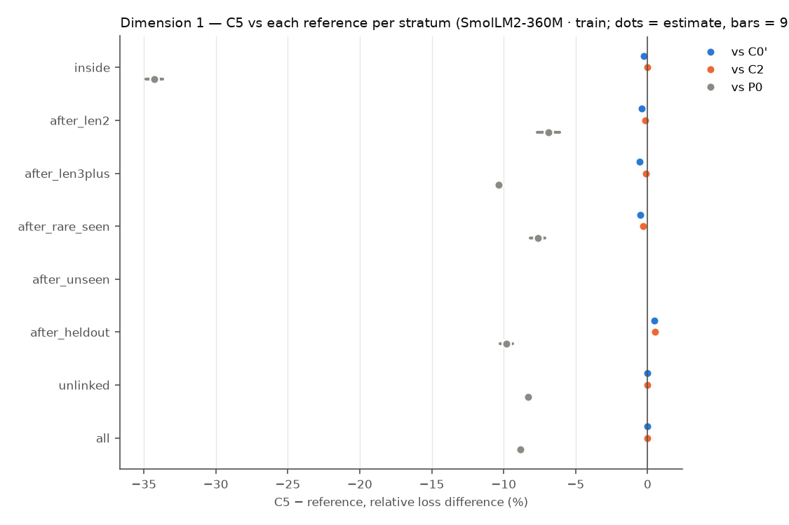
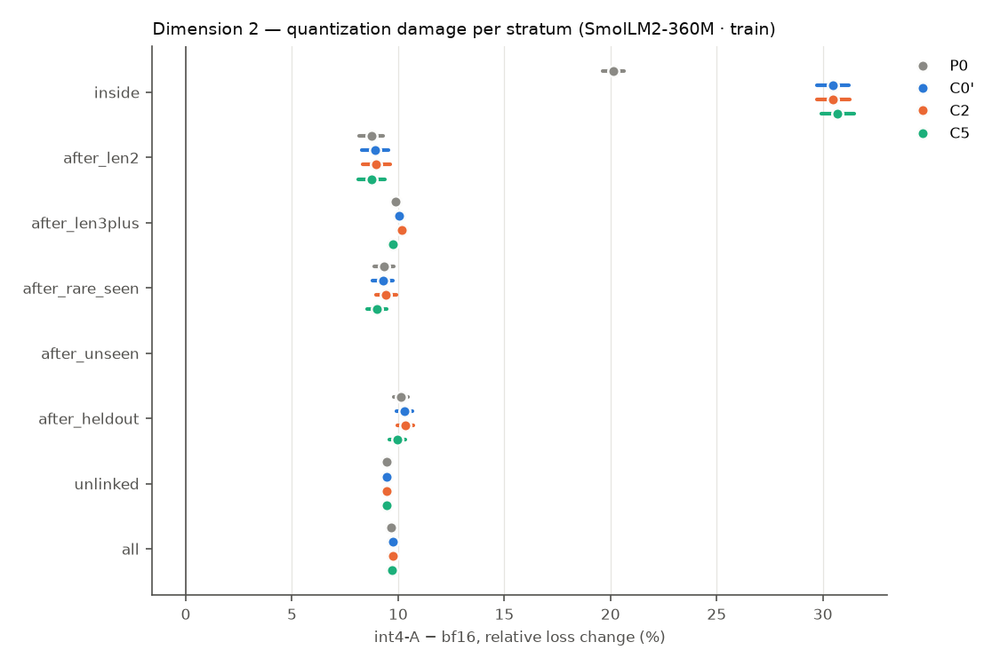
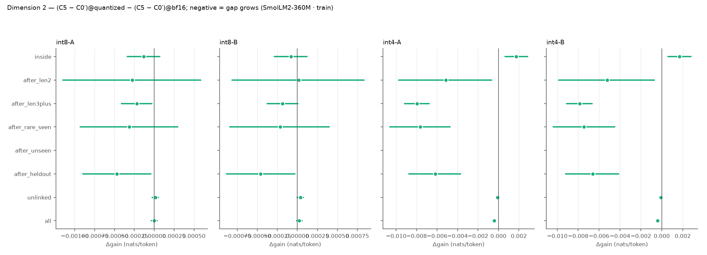
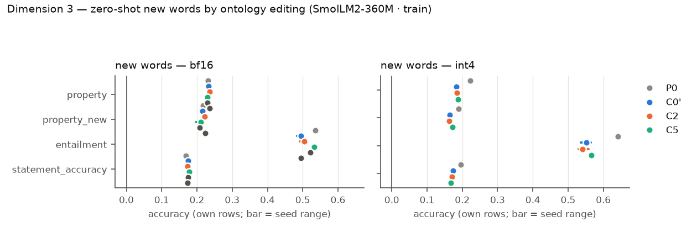

# R9 — retrofit × quantization (E9)

E9 asks three questions on pretrained hosts, all on one fixed test set: (1) does a VSA ontology channel trained jointly with the host improve it on long-token, rare and out-of-distribution words; (2) is the gap larger under weight quantization; (3) after training, can the model learn new or changed words zero-shot by editing the ontology alone? Models: **P0** the original host (evaluation only), **C0′** continued training without the channel, **C2** the same with a capacity-matched free per-concept table, **C5** the same with the attentive VSA channel. Loss differences are condition − reference (negative = lower loss), token-weighted and pooled over common seeds, with 95% cluster bootstraps over evaluation windows (10000 resamples); `*` = Holm-adjusted p < 0.05 within the family named in each table. P0 has no training randomness and pairs with every seed.

## SmolLM2-360M · train

Seeds: P0 [1]; C0' [1, 2, 3]; C2 [1, 2, 3]; C5 [1, 2, 3]; C5sh [1, 2, 3]; C6d [1, 2, 3].

### Dimension 1 — C5 vs C0′, C2 and P0 (bf16)

Relative loss difference [95% CI] (Holm over the three references within each stratum):

| Stratum | Targets | C5 − C0′ | C5 − C2 | C5 − P0 | C2 − C0′ | C0′ − P0 |
|---|---:|---|---|---|---|---|
| inside (long-token words) | 309057 | -0.28% [-0.34, -0.22]* | -0.03% [-0.07, +0.01] | -34.27% [-34.87, -33.67]* | -0.25% [-0.30, -0.20] | -34.09% [-34.68, -33.49] |
| after_len2 (long-token words) | 30471 | -0.40% [-0.62, -0.19]* | -0.15% [-0.31, +0.02] | -6.88% [-7.68, -6.12]* | -0.26% [-0.38, -0.14] | -6.51% [-7.25, -5.80] |
| after_len3plus (long-token words) | 595311 | -0.57% [-0.62, -0.51]* | -0.11% [-0.15, -0.07]* | -10.37% [-10.57, -10.16]* | -0.46% [-0.50, -0.42] | -9.86% [-10.05, -9.66] |
| after_rare_seen (rare words) | 64869 | -0.50% [-0.65, -0.36]* | -0.32% [-0.44, -0.20]* | -7.62% [-8.14, -7.11]* | -0.18% [-0.26, -0.10] | -7.15% [-7.65, -6.67] |
| after_unseen (out of distribution) | n/a | n/a | n/a | n/a | n/a | n/a |
| after_heldout (out of distribution) | 129489 | +0.48% [+0.35, +0.62]* | +0.50% [+0.37, +0.64]* | -9.80% [-10.23, -9.37]* | -0.02% [-0.04, -0.00] | -10.24% [-10.65, -9.82] |
| unlinked (locality) | 11654319 | -0.01% [-0.01, -0.01]* | -0.00% [-0.01, -0.00]* | -8.31% [-8.39, -8.24]* | -0.01% [-0.01, -0.01] | -8.30% [-8.38, -8.23] |
| all (locality) | 12570624 | -0.04% [-0.04, -0.04]* | -0.01% [-0.01, -0.01]* | -8.85% [-8.93, -8.77]* | -0.03% [-0.03, -0.03] | -8.81% [-8.89, -8.73] |

Absolute differences (nats/token):

| Stratum | C5 − C0′ | C5 − C2 | C5 − P0 |
|---|---|---|---|
| inside | -0.0031 [-0.0038, -0.0024]* | -0.0003 [-0.0008, +0.0001] | -0.5765 [-0.5902, -0.5630]* |
| after_len2 | -0.0095 [-0.0147, -0.0044]* | -0.0035 [-0.0074, +0.0006] | -0.1747 [-0.1961, -0.1549]* |
| after_len3plus | -0.0126 [-0.0139, -0.0114]* | -0.0024 [-0.0033, -0.0015]* | -0.2563 [-0.2618, -0.2510]* |
| after_rare_seen | -0.0118 [-0.0153, -0.0085]* | -0.0075 [-0.0104, -0.0047]* | -0.1929 [-0.2066, -0.1797]* |
| after_unseen | n/a | n/a | n/a |
| after_heldout | +0.0105 [+0.0077, +0.0133]* | +0.0109 [+0.0082, +0.0138]* | -0.2372 [-0.2479, -0.2265]* |
| unlinked | -0.0002 [-0.0003, -0.0002]* | -0.0001 [-0.0001, -0.0000]* | -0.1965 [-0.1982, -0.1947]* |
| all | -0.0009 [-0.0010, -0.0008]* | -0.0002 [-0.0003, -0.0001]* | -0.2081 [-0.2099, -0.2063]* |

Probe differences (bf16): C5 − reference per subset, per seed (paired bootstrap over items):

| Reference | Seed | Probe | all | heldout | seen | unlinked |
|---|---:|---|---|---|---|---|
| C0' | 1 | lambada/accuracy | -0.002 [-0.005, +0.000] (n 5153) | — | — | -0.002 [-0.005, +0.000] (n 5153) |
| C0' | 1 | wic/probe_accuracy | -0.005 [-0.016, +0.006] (n 638) | — | — | -0.005 [-0.016, +0.006] (n 638) |
| C0' | 1 | card660/spearman_tied | -0.002 [-0.005, -0.000] (n 660) | — | — | -0.002 [-0.005, +0.000] (n 659) |
| C0' | 1 | rare_words/spearman_tied | +0.000 [-0.001, +0.001] (n 2034) | — | — | +0.000 [-0.001, +0.001] (n 2034) |
| C0' | 1 | wsd/probe_f1 | +0.001 [-0.001, +0.002] (n 7253) | — | — | +0.001 [-0.001, +0.002] (n 7253) |
| C0' | 1 | bless/pair_probe_macro_f1 | +0.002 [-0.000, +0.004] (n 4310) | — | — | +0.002 [-0.000, +0.004] (n 4310) |
| C0' | 1 | bless/prompt_auc | +0.001 [+0.000, +0.001] (n 14547) | — | — | +0.001 [+0.000, +0.001] (n 14547) |
| C0' | 1 | hyperlex/cosine_spearman | -0.000 [-0.001, +0.001] (n 2616) | — | — | -0.000 [-0.001, +0.001] (n 2616) |
| C0' | 2 | lambada/accuracy | -0.001 [-0.004, +0.001] (n 5153) | — | — | -0.001 [-0.004, +0.001] (n 5153) |
| C0' | 2 | wic/probe_accuracy | -0.005 [-0.014, +0.005] (n 638) | — | — | -0.005 [-0.014, +0.005] (n 638) |
| C0' | 2 | card660/spearman_tied | -0.001 [-0.003, +0.001] (n 660) | — | — | -0.001 [-0.003, +0.002] (n 659) |
| C0' | 2 | rare_words/spearman_tied | -0.001 [-0.002, -0.000] (n 2034) | — | — | -0.001 [-0.002, -0.000] (n 2034) |
| C0' | 2 | wsd/probe_f1 | -0.000 [-0.002, +0.002] (n 7253) | — | — | -0.000 [-0.002, +0.002] (n 7253) |
| C0' | 2 | bless/pair_probe_macro_f1 | +0.000 [-0.003, +0.003] (n 4310) | — | — | +0.000 [-0.003, +0.003] (n 4310) |
| C0' | 2 | bless/prompt_auc | +0.000 [+0.000, +0.001] (n 14547) | — | — | +0.000 [+0.000, +0.001] (n 14547) |
| C0' | 2 | hyperlex/cosine_spearman | +0.001 [-0.000, +0.002] (n 2616) | — | — | +0.001 [-0.000, +0.002] (n 2616) |
| C0' | 3 | lambada/accuracy | +0.000 [-0.002, +0.002] (n 5153) | — | — | +0.000 [-0.002, +0.002] (n 5153) |
| C0' | 3 | wic/probe_accuracy | +0.000 [-0.011, +0.009] (n 638) | — | — | +0.000 [-0.011, +0.009] (n 638) |
| C0' | 3 | card660/spearman_tied | +0.002 [-0.000, +0.004] (n 660) | — | — | +0.002 [-0.000, +0.004] (n 659) |
| C0' | 3 | rare_words/spearman_tied | +0.001 [-0.000, +0.002] (n 2034) | — | — | +0.001 [-0.000, +0.002] (n 2034) |
| C0' | 3 | wsd/probe_f1 | -0.001 [-0.003, +0.001] (n 7253) | — | — | -0.001 [-0.003, +0.001] (n 7253) |
| C0' | 3 | bless/pair_probe_macro_f1 | -0.000 [-0.004, +0.002] (n 4310) | — | — | -0.000 [-0.004, +0.002] (n 4310) |
| C0' | 3 | bless/prompt_auc | +0.000 [+0.000, +0.001] (n 14547) | — | — | +0.000 [+0.000, +0.001] (n 14547) |
| C0' | 3 | hyperlex/cosine_spearman | -0.000 [-0.001, +0.001] (n 2616) | — | — | -0.000 [-0.001, +0.001] (n 2616) |
| C2 | 1 | lambada/accuracy | -0.002 [-0.005, +0.000] (n 5153) | — | — | -0.002 [-0.005, +0.000] (n 5153) |
| C2 | 1 | wic/probe_accuracy | -0.009 [-0.020, +0.000] (n 638) | — | — | -0.009 [-0.020, +0.000] (n 638) |
| C2 | 1 | card660/spearman_tied | +0.000 [-0.002, +0.002] (n 660) | — | — | +0.000 [-0.002, +0.003] (n 659) |
| C2 | 1 | rare_words/spearman_tied | +0.000 [-0.001, +0.001] (n 2034) | — | — | +0.000 [-0.001, +0.001] (n 2034) |
| C2 | 1 | wsd/probe_f1 | +0.000 [-0.002, +0.002] (n 7253) | — | — | +0.000 [-0.002, +0.002] (n 7253) |
| C2 | 1 | bless/pair_probe_macro_f1 | +0.001 [-0.000, +0.003] (n 4310) | — | — | +0.001 [-0.000, +0.003] (n 4310) |
| C2 | 1 | bless/prompt_auc | -0.000 [-0.000, +0.000] (n 14547) | — | — | -0.000 [-0.000, +0.000] (n 14547) |
| C2 | 1 | hyperlex/cosine_spearman | -0.001 [-0.002, +0.000] (n 2616) | — | — | -0.001 [-0.002, +0.000] (n 2616) |
| C2 | 2 | lambada/accuracy | -0.001 [-0.003, +0.001] (n 5153) | — | — | -0.001 [-0.003, +0.001] (n 5153) |
| C2 | 2 | wic/probe_accuracy | -0.009 [-0.019, +0.000] (n 638) | — | — | -0.009 [-0.019, +0.000] (n 638) |
| C2 | 2 | card660/spearman_tied | -0.001 [-0.003, +0.001] (n 660) | — | — | -0.001 [-0.003, +0.001] (n 659) |
| C2 | 2 | rare_words/spearman_tied | -0.001 [-0.002, +0.000] (n 2034) | — | — | -0.001 [-0.002, +0.000] (n 2034) |
| C2 | 2 | wsd/probe_f1 | -0.001 [-0.002, +0.001] (n 7253) | — | — | -0.001 [-0.002, +0.001] (n 7253) |
| C2 | 2 | bless/pair_probe_macro_f1 | +0.001 [-0.001, +0.004] (n 4310) | — | — | +0.001 [-0.001, +0.004] (n 4310) |
| C2 | 2 | bless/prompt_auc | +0.000 [+0.000, +0.001] (n 14547) | — | — | +0.000 [+0.000, +0.001] (n 14547) |
| C2 | 2 | hyperlex/cosine_spearman | +0.001 [-0.001, +0.002] (n 2616) | — | — | +0.001 [-0.001, +0.002] (n 2616) |
| C2 | 3 | lambada/accuracy | -0.002 [-0.005, +0.000] (n 5153) | — | — | -0.002 [-0.005, +0.000] (n 5153) |
| C2 | 3 | wic/probe_accuracy | +0.006 [-0.005, +0.017] (n 638) | — | — | +0.006 [-0.005, +0.017] (n 638) |
| C2 | 3 | card660/spearman_tied | +0.000 [-0.002, +0.003] (n 660) | — | — | +0.001 [-0.002, +0.003] (n 659) |
| C2 | 3 | rare_words/spearman_tied | +0.001 [-0.000, +0.002] (n 2034) | — | — | +0.001 [-0.000, +0.002] (n 2034) |
| C2 | 3 | wsd/probe_f1 | -0.001 [-0.003, +0.001] (n 7253) | — | — | -0.001 [-0.003, +0.001] (n 7253) |
| C2 | 3 | bless/pair_probe_macro_f1 | -0.000 [-0.003, +0.002] (n 4310) | — | — | -0.000 [-0.003, +0.002] (n 4310) |
| C2 | 3 | bless/prompt_auc | -0.001 [-0.001, -0.001] (n 14547) | — | — | -0.001 [-0.001, -0.001] (n 14547) |
| C2 | 3 | hyperlex/cosine_spearman | +0.001 [-0.000, +0.002] (n 2616) | — | — | +0.001 [-0.000, +0.002] (n 2616) |
| P0 | 1 | lambada/accuracy | -0.009 [-0.014, -0.003] (n 5153) | — | — | -0.009 [-0.014, -0.003] (n 5153) |
| P0 | 1 | wic/probe_accuracy | +0.013 [-0.016, +0.039] (n 638) | — | — | +0.013 [-0.016, +0.039] (n 638) |
| P0 | 1 | card660/spearman_tied | -0.017 [-0.035, +0.001] (n 660) | — | — | -0.016 [-0.035, +0.001] (n 659) |
| P0 | 1 | rare_words/spearman_tied | -0.010 [-0.018, -0.003] (n 2034) | — | — | -0.010 [-0.018, -0.003] (n 2034) |
| P0 | 1 | wsd/probe_f1 | -0.000 [-0.004, +0.003] (n 7253) | — | — | -0.000 [-0.004, +0.003] (n 7253) |
| P0 | 1 | bless/pair_probe_macro_f1 | +0.004 [-0.003, +0.011] (n 4310) | — | — | +0.004 [-0.003, +0.011] (n 4310) |
| P0 | 1 | bless/prompt_auc | +0.011 [+0.009, +0.013] (n 14547) | — | — | +0.011 [+0.009, +0.013] (n 14547) |
| P0 | 1 | hyperlex/cosine_spearman | +0.001 [-0.006, +0.007] (n 2616) | — | — | +0.001 [-0.006, +0.007] (n 2616) |
| P0 | 2 | lambada/accuracy | -0.008 [-0.013, -0.002] (n 5153) | — | — | -0.008 [-0.013, -0.002] (n 5153) |
| P0 | 2 | wic/probe_accuracy | +0.011 [-0.017, +0.039] (n 638) | — | — | +0.011 [-0.017, +0.039] (n 638) |
| P0 | 2 | card660/spearman_tied | -0.017 [-0.035, +0.001] (n 660) | — | — | -0.017 [-0.035, +0.001] (n 659) |
| P0 | 2 | rare_words/spearman_tied | -0.011 [-0.019, -0.003] (n 2034) | — | — | -0.011 [-0.019, -0.003] (n 2034) |
| P0 | 2 | wsd/probe_f1 | -0.001 [-0.004, +0.003] (n 7253) | — | — | -0.001 [-0.004, +0.003] (n 7253) |
| P0 | 2 | bless/pair_probe_macro_f1 | +0.005 [-0.002, +0.012] (n 4310) | — | — | +0.005 [-0.002, +0.012] (n 4310) |
| P0 | 2 | bless/prompt_auc | +0.012 [+0.010, +0.014] (n 14547) | — | — | +0.012 [+0.010, +0.014] (n 14547) |
| P0 | 2 | hyperlex/cosine_spearman | +0.001 [-0.005, +0.008] (n 2616) | — | — | +0.001 [-0.005, +0.008] (n 2616) |
| P0 | 3 | lambada/accuracy | -0.007 [-0.012, -0.001] (n 5153) | — | — | -0.007 [-0.012, -0.001] (n 5153) |
| P0 | 3 | wic/probe_accuracy | +0.017 [-0.011, +0.045] (n 638) | — | — | +0.017 [-0.011, +0.045] (n 638) |
| P0 | 3 | card660/spearman_tied | -0.015 [-0.033, +0.003] (n 660) | — | — | -0.015 [-0.034, +0.003] (n 659) |
| P0 | 3 | rare_words/spearman_tied | -0.009 [-0.017, -0.002] (n 2034) | — | — | -0.009 [-0.017, -0.002] (n 2034) |
| P0 | 3 | wsd/probe_f1 | -0.001 [-0.004, +0.002] (n 7253) | — | — | -0.001 [-0.004, +0.002] (n 7253) |
| P0 | 3 | bless/pair_probe_macro_f1 | +0.003 [-0.004, +0.010] (n 4310) | — | — | +0.003 [-0.004, +0.010] (n 4310) |
| P0 | 3 | bless/prompt_auc | +0.012 [+0.010, +0.014] (n 14547) | — | — | +0.012 [+0.010, +0.014] (n 14547) |
| P0 | 3 | hyperlex/cosine_spearman | +0.001 [-0.005, +0.008] (n 2616) | — | — | +0.001 [-0.005, +0.008] (n 2616) |

### Dimension 2 — quantization damage and the gap under quantization

Quantization damage `variant − bf16`, relative [95% CI] (A = channel FP16, B = channel quantized; models without a channel have B = A):

| Stratum | Model | int8-A | int8-B | int4-A | int4-B |
|---|---|---|---|---|---|
| inside | P0 | -0.13% [-0.17, -0.09] | -0.13% [-0.17, -0.09] | +20.12% [+19.63, +20.62] | +20.12% [+19.63, +20.62] |
| inside | C0' | +0.21% [+0.16, +0.26] | +0.21% [+0.16, +0.26] | +30.45% [+29.71, +31.23] | +30.45% [+29.71, +31.23] |
| inside | C2 | +0.19% [+0.15, +0.24] | +0.19% [+0.15, +0.23] | +30.48% [+29.73, +31.26] | +30.48% [+29.73, +31.25] |
| inside | C5 | +0.20% [+0.15, +0.24] | +0.20% [+0.16, +0.25] | +30.70% [+29.95, +31.47] | +30.69% [+29.94, +31.46] |
| after_len2 | P0 | +0.07% [+0.01, +0.14] | +0.07% [+0.01, +0.14] | +8.73% [+8.17, +9.31] | +8.73% [+8.17, +9.31] |
| after_len2 | C0' | +0.11% [+0.04, +0.17] | +0.11% [+0.04, +0.17] | +8.91% [+8.29, +9.55] | +8.91% [+8.29, +9.55] |
| after_len2 | C2 | +0.09% [+0.02, +0.16] | +0.08% [+0.01, +0.15] | +8.96% [+8.32, +9.62] | +8.95% [+8.31, +9.61] |
| after_len2 | C5 | +0.09% [+0.03, +0.16] | +0.11% [+0.04, +0.17] | +8.73% [+8.12, +9.36] | +8.73% [+8.11, +9.36] |
| after_len3plus | P0 | +0.12% [+0.10, +0.14] | +0.12% [+0.10, +0.14] | +9.89% [+9.74, +10.05] | +9.89% [+9.74, +10.05] |
| after_len3plus | C0' | +0.11% [+0.09, +0.12] | +0.11% [+0.09, +0.12] | +10.07% [+9.89, +10.24] | +10.07% [+9.89, +10.24] |
| after_len3plus | C2 | +0.11% [+0.09, +0.12] | +0.11% [+0.10, +0.13] | +10.19% [+10.01, +10.37] | +10.20% [+10.02, +10.38] |
| after_len3plus | C5 | +0.10% [+0.08, +0.11] | +0.10% [+0.09, +0.12] | +9.76% [+9.59, +9.93] | +9.77% [+9.60, +9.94] |
| after_rare_seen | P0 | +0.17% [+0.13, +0.22] | +0.17% [+0.13, +0.22] | +9.32% [+8.87, +9.77] | +9.32% [+8.87, +9.77] |
| after_rare_seen | C0' | +0.15% [+0.11, +0.20] | +0.15% [+0.11, +0.20] | +9.29% [+8.81, +9.77] | +9.29% [+8.81, +9.77] |
| after_rare_seen | C2 | +0.15% [+0.10, +0.19] | +0.14% [+0.09, +0.18] | +9.43% [+8.96, +9.92] | +9.44% [+8.96, +9.92] |
| after_rare_seen | C5 | +0.14% [+0.10, +0.18] | +0.14% [+0.10, +0.18] | +9.01% [+8.54, +9.47] | +9.01% [+8.54, +9.48] |
| after_unseen | P0 | n/a | n/a | n/a | n/a |
| after_unseen | C0' | n/a | n/a | n/a | n/a |
| after_unseen | C2 | n/a | n/a | n/a | n/a |
| after_unseen | C5 | n/a | n/a | n/a | n/a |
| after_heldout | P0 | +0.10% [+0.06, +0.13] | +0.10% [+0.06, +0.13] | +10.12% [+9.77, +10.47] | +10.12% [+9.77, +10.47] |
| after_heldout | C0' | +0.08% [+0.05, +0.11] | +0.08% [+0.05, +0.11] | +10.30% [+9.92, +10.69] | +10.30% [+9.92, +10.69] |
| after_heldout | C2 | +0.10% [+0.06, +0.13] | +0.10% [+0.07, +0.13] | +10.34% [+9.95, +10.73] | +10.33% [+9.95, +10.73] |
| after_heldout | C5 | +0.06% [+0.02, +0.09] | +0.06% [+0.02, +0.09] | +9.97% [+9.59, +10.35] | +9.95% [+9.57, +10.33] |
| unlinked | P0 | +0.08% [+0.07, +0.08] | +0.08% [+0.07, +0.08] | +9.47% [+9.42, +9.51] | +9.47% [+9.42, +9.51] |
| unlinked | C0' | +0.13% [+0.13, +0.14] | +0.13% [+0.13, +0.14] | +9.45% [+9.40, +9.50] | +9.45% [+9.40, +9.50] |
| unlinked | C2 | +0.13% [+0.13, +0.14] | +0.13% [+0.13, +0.14] | +9.46% [+9.42, +9.51] | +9.46% [+9.41, +9.51] |
| unlinked | C5 | +0.13% [+0.13, +0.14] | +0.13% [+0.13, +0.14] | +9.45% [+9.40, +9.50] | +9.45% [+9.40, +9.49] |
| all | P0 | +0.07% [+0.07, +0.08] | +0.07% [+0.07, +0.08] | +9.66% [+9.62, +9.71] | +9.66% [+9.62, +9.71] |
| all | C0' | +0.13% [+0.13, +0.14] | +0.13% [+0.13, +0.14] | +9.73% [+9.69, +9.78] | +9.73% [+9.69, +9.78] |
| all | C2 | +0.13% [+0.13, +0.14] | +0.13% [+0.13, +0.14] | +9.75% [+9.70, +9.80] | +9.75% [+9.70, +9.80] |
| all | C5 | +0.13% [+0.13, +0.14] | +0.13% [+0.13, +0.14] | +9.72% [+9.67, +9.76] | +9.72% [+9.67, +9.76] |

Gap under quantization vs C0': gain = C5 − C0' at bf16 and quantized, `Δgain` = difference in differences (negative = the channel's advantage grows under quantization; Holm over references × variants within each stratum), retained = gain_q / gain_bf16:

| Stratum | Variant | gain bf16 | gain quantized | Δgain [95% CI] | retained |
|---|---|---|---|---|---|
| inside | int8-A | -0.0031 [-0.0038, -0.0024] | -0.0032 [-0.0039, -0.0026] | -0.0001 [-0.0003, +0.0001] | 1.04 |
| inside | int8-B | -0.0031 [-0.0038, -0.0024] | -0.0032 [-0.0039, -0.0025] | -0.0001 [-0.0003, +0.0001] | 1.03 |
| inside | int4-A | -0.0031 [-0.0038, -0.0024] | -0.0013 [-0.0025, -0.0002] | +0.0018 [+0.0006, +0.0028]* | 0.43 |
| inside | int4-B | -0.0031 [-0.0038, -0.0024] | -0.0014 [-0.0026, -0.0002] | +0.0017 [+0.0006, +0.0028]* | 0.45 |
| after_len2 | int8-A | -0.0096 [-0.0147, -0.0045] | -0.0098 [-0.0151, -0.0046] | -0.0003 [-0.0011, +0.0006] | 1.03 |
| after_len2 | int8-B | -0.0096 [-0.0147, -0.0045] | -0.0095 [-0.0148, -0.0044] | +0.0000 [-0.0008, +0.0008] | 1.00 |
| after_len2 | int4-A | -0.0096 [-0.0147, -0.0045] | -0.0147 [-0.0210, -0.0086] | -0.0051 [-0.0098, -0.0007] | 1.54 |
| after_len2 | int4-B | -0.0096 [-0.0147, -0.0045] | -0.0148 [-0.0212, -0.0087] | -0.0052 [-0.0099, -0.0007] | 1.55 |
| after_len3plus | int8-A | -0.0126 [-0.0139, -0.0114] | -0.0128 [-0.0141, -0.0116] | -0.0002 [-0.0004, -0.0000] | 1.02 |
| after_len3plus | int8-B | -0.0126 [-0.0139, -0.0114] | -0.0128 [-0.0141, -0.0115] | -0.0002 [-0.0004, +0.0000] | 1.01 |
| after_len3plus | int4-A | -0.0126 [-0.0139, -0.0114] | -0.0206 [-0.0222, -0.0190] | -0.0080 [-0.0092, -0.0068]* | 1.63 |
| after_len3plus | int4-B | -0.0126 [-0.0139, -0.0114] | -0.0205 [-0.0221, -0.0189] | -0.0079 [-0.0091, -0.0067]* | 1.62 |
| after_rare_seen | int8-A | -0.0118 [-0.0153, -0.0085] | -0.0121 [-0.0157, -0.0087] | -0.0003 [-0.0009, +0.0003] | 1.03 |
| after_rare_seen | int8-B | -0.0118 [-0.0153, -0.0085] | -0.0120 [-0.0156, -0.0087] | -0.0002 [-0.0008, +0.0004] | 1.02 |
| after_rare_seen | int4-A | -0.0118 [-0.0153, -0.0085] | -0.0194 [-0.0237, -0.0153] | -0.0076 [-0.0106, -0.0047]* | 1.65 |
| after_rare_seen | int4-B | -0.0118 [-0.0153, -0.0085] | -0.0192 [-0.0234, -0.0151] | -0.0074 [-0.0104, -0.0045]* | 1.63 |
| after_heldout | int8-A | +0.0105 [+0.0077, +0.0133] | +0.0100 [+0.0072, +0.0128] | -0.0005 [-0.0009, -0.0000] | 0.96 |
| after_heldout | int8-B | +0.0105 [+0.0077, +0.0133] | +0.0100 [+0.0072, +0.0128] | -0.0005 [-0.0009, -0.0000] | 0.96 |
| after_heldout | int4-A | +0.0105 [+0.0077, +0.0133] | +0.0043 [+0.0009, +0.0077] | -0.0062 [-0.0088, -0.0037]* | 0.41 |
| after_heldout | int4-B | +0.0105 [+0.0077, +0.0133] | +0.0039 [+0.0004, +0.0072] | -0.0066 [-0.0092, -0.0041]* | 0.37 |
| unlinked | int8-A | -0.0002 [-0.0003, -0.0002] | -0.0002 [-0.0003, -0.0002] | +0.0000 [-0.0000, +0.0001] | 0.94 |
| unlinked | int8-B | -0.0002 [-0.0003, -0.0002] | -0.0002 [-0.0002, -0.0001] | +0.0000 [-0.0000, +0.0001] | 0.84 |
| unlinked | int4-A | -0.0002 [-0.0003, -0.0002] | -0.0003 [-0.0004, -0.0002] | -0.0001 [-0.0002, +0.0000] | 1.33 |
| unlinked | int4-B | -0.0002 [-0.0003, -0.0002] | -0.0003 [-0.0004, -0.0002] | -0.0001 [-0.0002, +0.0000] | 1.34 |
| all | int8-A | -0.0009 [-0.0010, -0.0008] | -0.0009 [-0.0010, -0.0008] | -0.0000 [-0.0000, +0.0000] | 1.00 |
| all | int8-B | -0.0009 [-0.0010, -0.0008] | -0.0009 [-0.0009, -0.0008] | +0.0000 [-0.0000, +0.0001] | 0.97 |
| all | int4-A | -0.0009 [-0.0010, -0.0008] | -0.0013 [-0.0014, -0.0012] | -0.0004 [-0.0005, -0.0003]* | 1.48 |
| all | int4-B | -0.0009 [-0.0010, -0.0008] | -0.0013 [-0.0014, -0.0012] | -0.0004 [-0.0005, -0.0003]* | 1.48 |

Gap under quantization vs C2: gain = C5 − C2 at bf16 and quantized, `Δgain` = difference in differences (negative = the channel's advantage grows under quantization; Holm over references × variants within each stratum), retained = gain_q / gain_bf16:

| Stratum | Variant | gain bf16 | gain quantized | Δgain [95% CI] | retained |
|---|---|---|---|---|---|
| inside | int8-A | -0.0003 [-0.0008, +0.0001] | -0.0002 [-0.0007, +0.0002] | +0.0001 [-0.0001, +0.0003] | 0.76 |
| inside | int8-B | -0.0003 [-0.0008, +0.0001] | -0.0002 [-0.0006, +0.0003] | +0.0002 [-0.0000, +0.0003] | 0.51 |
| inside | int4-A | -0.0003 [-0.0008, +0.0001] | +0.0020 [+0.0010, +0.0030] | +0.0023 [+0.0014, +0.0032]* | -6.38 |
| inside | int4-B | -0.0003 [-0.0008, +0.0001] | +0.0020 [+0.0010, +0.0030] | +0.0023 [+0.0014, +0.0032]* | -6.37 |
| after_len2 | int8-A | -0.0035 [-0.0074, +0.0006] | -0.0035 [-0.0076, +0.0007] | -0.0000 [-0.0008, +0.0009] | 1.00 |
| after_len2 | int8-B | -0.0035 [-0.0074, +0.0006] | -0.0030 [-0.0070, +0.0012] | +0.0005 [-0.0003, +0.0013] | 0.85 |
| after_len2 | int4-A | -0.0035 [-0.0074, +0.0006] | -0.0093 [-0.0145, -0.0044] | -0.0058 [-0.0100, -0.0018]* | 2.66 |
| after_len2 | int4-B | -0.0035 [-0.0074, +0.0006] | -0.0091 [-0.0143, -0.0042] | -0.0056 [-0.0098, -0.0017]* | 2.61 |
| after_len3plus | int8-A | -0.0024 [-0.0033, -0.0015] | -0.0026 [-0.0035, -0.0017] | -0.0002 [-0.0004, -0.0000] | 1.08 |
| after_len3plus | int8-B | -0.0024 [-0.0033, -0.0015] | -0.0026 [-0.0035, -0.0017] | -0.0002 [-0.0004, -0.0000] | 1.09 |
| after_len3plus | int4-A | -0.0024 [-0.0033, -0.0015] | -0.0121 [-0.0133, -0.0108] | -0.0097 [-0.0108, -0.0086]* | 5.06 |
| after_len3plus | int4-B | -0.0024 [-0.0033, -0.0015] | -0.0122 [-0.0135, -0.0109] | -0.0098 [-0.0109, -0.0088]* | 5.11 |
| after_rare_seen | int8-A | -0.0075 [-0.0104, -0.0047] | -0.0077 [-0.0106, -0.0049] | -0.0002 [-0.0007, +0.0003] | 1.03 |
| after_rare_seen | int8-B | -0.0075 [-0.0104, -0.0047] | -0.0075 [-0.0104, -0.0047] | +0.0001 [-0.0005, +0.0007] | 0.99 |
| after_rare_seen | int4-A | -0.0075 [-0.0104, -0.0047] | -0.0183 [-0.0222, -0.0145] | -0.0107 [-0.0138, -0.0078]* | 2.42 |
| after_rare_seen | int4-B | -0.0075 [-0.0104, -0.0047] | -0.0182 [-0.0221, -0.0144] | -0.0106 [-0.0136, -0.0077]* | 2.41 |
| after_heldout | int8-A | +0.0109 [+0.0081, +0.0138] | +0.0101 [+0.0073, +0.0129] | -0.0008 [-0.0013, -0.0004]* | 0.93 |
| after_heldout | int8-B | +0.0109 [+0.0081, +0.0138] | +0.0100 [+0.0073, +0.0128] | -0.0009 [-0.0013, -0.0004]* | 0.92 |
| after_heldout | int4-A | +0.0109 [+0.0081, +0.0138] | +0.0040 [+0.0005, +0.0073] | -0.0070 [-0.0095, -0.0045]* | 0.36 |
| after_heldout | int4-B | +0.0109 [+0.0081, +0.0138] | +0.0036 [+0.0002, +0.0070] | -0.0073 [-0.0098, -0.0049]* | 0.33 |
| unlinked | int8-A | -0.0001 [-0.0001, -0.0000] | -0.0000 [-0.0001, -0.0000] | +0.0000 [-0.0000, +0.0001] | 0.59 |
| unlinked | int8-B | -0.0001 [-0.0001, -0.0000] | -0.0001 [-0.0001, -0.0000] | +0.0000 [-0.0000, +0.0001] | 0.69 |
| unlinked | int4-A | -0.0001 [-0.0001, -0.0000] | -0.0004 [-0.0005, -0.0003] | -0.0003 [-0.0004, -0.0002]* | 4.94 |
| unlinked | int4-B | -0.0001 [-0.0001, -0.0000] | -0.0004 [-0.0005, -0.0003] | -0.0003 [-0.0004, -0.0002]* | 4.89 |
| all | int8-A | -0.0002 [-0.0003, -0.0001] | -0.0002 [-0.0002, -0.0001] | +0.0000 [-0.0000, +0.0001] | 0.89 |
| all | int8-B | -0.0002 [-0.0003, -0.0001] | -0.0002 [-0.0003, -0.0001] | +0.0000 [-0.0000, +0.0001] | 0.91 |
| all | int4-A | -0.0002 [-0.0003, -0.0001] | -0.0009 [-0.0010, -0.0008] | -0.0007 [-0.0008, -0.0006]* | 4.35 |
| all | int4-B | -0.0002 [-0.0003, -0.0001] | -0.0009 [-0.0010, -0.0008] | -0.0007 [-0.0008, -0.0006]* | 4.35 |

Gap under quantization vs P0: gain = C5 − P0 at bf16 and quantized, `Δgain` = difference in differences (negative = the channel's advantage grows under quantization; Holm over references × variants within each stratum), retained = gain_q / gain_bf16:

| Stratum | Variant | gain bf16 | gain quantized | Δgain [95% CI] | retained |
|---|---|---|---|---|---|
| inside | int8-A | -0.5765 [-0.5902, -0.5630] | -0.5720 [-0.5857, -0.5587] | +0.0044 [+0.0038, +0.0051]* | 0.99 |
| inside | int8-B | -0.5765 [-0.5902, -0.5630] | -0.5720 [-0.5856, -0.5586] | +0.0045 [+0.0038, +0.0051]* | 0.99 |
| inside | int4-A | -0.5765 [-0.5902, -0.5630] | -0.5755 [-0.5892, -0.5623] | +0.0010 [-0.0041, +0.0062] | 1.00 |
| inside | int4-B | -0.5765 [-0.5902, -0.5630] | -0.5756 [-0.5892, -0.5624] | +0.0009 [-0.0042, +0.0061] | 1.00 |
| after_len2 | int8-A | -0.1747 [-0.1962, -0.1549] | -0.1743 [-0.1955, -0.1545] | +0.0004 [-0.0014, +0.0022] | 1.00 |
| after_len2 | int8-B | -0.1747 [-0.1962, -0.1549] | -0.1740 [-0.1954, -0.1541] | +0.0007 [-0.0011, +0.0025] | 1.00 |
| after_len2 | int4-A | -0.1747 [-0.1962, -0.1549] | -0.1901 [-0.2136, -0.1677] | -0.0154 [-0.0247, -0.0063]* | 1.09 |
| after_len2 | int4-B | -0.1747 [-0.1962, -0.1549] | -0.1902 [-0.2136, -0.1677] | -0.0154 [-0.0248, -0.0063]* | 1.09 |
| after_len3plus | int8-A | -0.2564 [-0.2618, -0.2510] | -0.2571 [-0.2625, -0.2517] | -0.0007 [-0.0011, -0.0003]* | 1.00 |
| after_len3plus | int8-B | -0.2564 [-0.2618, -0.2510] | -0.2571 [-0.2625, -0.2517] | -0.0007 [-0.0011, -0.0003]* | 1.00 |
| after_len3plus | int4-A | -0.2564 [-0.2618, -0.2510] | -0.2846 [-0.2905, -0.2785] | -0.0282 [-0.0308, -0.0256]* | 1.11 |
| after_len3plus | int4-B | -0.2564 [-0.2618, -0.2510] | -0.2845 [-0.2904, -0.2785] | -0.0281 [-0.0307, -0.0255]* | 1.11 |
| after_rare_seen | int8-A | -0.1929 [-0.2067, -0.1797] | -0.1941 [-0.2080, -0.1809] | -0.0012 [-0.0024, -0.0000] | 1.01 |
| after_rare_seen | int8-B | -0.1929 [-0.2067, -0.1797] | -0.1940 [-0.2079, -0.1807] | -0.0011 [-0.0023, +0.0001] | 1.01 |
| after_rare_seen | int4-A | -0.1929 [-0.2067, -0.1797] | -0.2182 [-0.2340, -0.2032] | -0.0253 [-0.0324, -0.0184]* | 1.13 |
| after_rare_seen | int4-B | -0.1929 [-0.2067, -0.1797] | -0.2180 [-0.2338, -0.2030] | -0.0251 [-0.0322, -0.0181]* | 1.13 |
| after_heldout | int8-A | -0.2372 [-0.2480, -0.2265] | -0.2384 [-0.2492, -0.2276] | -0.0011 [-0.0020, -0.0002]* | 1.00 |
| after_heldout | int8-B | -0.2372 [-0.2480, -0.2265] | -0.2383 [-0.2491, -0.2276] | -0.0011 [-0.0020, -0.0002]* | 1.00 |
| after_heldout | int4-A | -0.2372 [-0.2480, -0.2265] | -0.2645 [-0.2765, -0.2529] | -0.0273 [-0.0328, -0.0218]* | 1.12 |
| after_heldout | int4-B | -0.2372 [-0.2480, -0.2265] | -0.2650 [-0.2770, -0.2533] | -0.0278 [-0.0333, -0.0222]* | 1.12 |
| unlinked | int8-A | -0.1964 [-0.1982, -0.1947] | -0.1954 [-0.1971, -0.1936] | +0.0011 [+0.0010, +0.0012]* | 0.99 |
| unlinked | int8-B | -0.1964 [-0.1982, -0.1947] | -0.1953 [-0.1971, -0.1936] | +0.0011 [+0.0010, +0.0012]* | 0.99 |
| unlinked | int4-A | -0.1964 [-0.1982, -0.1947] | -0.2154 [-0.2173, -0.2135] | -0.0190 [-0.0195, -0.0185]* | 1.10 |
| unlinked | int4-B | -0.1964 [-0.1982, -0.1947] | -0.2154 [-0.2173, -0.2135] | -0.0190 [-0.0195, -0.0185]* | 1.10 |
| all | int8-A | -0.2081 [-0.2099, -0.2063] | -0.2070 [-0.2088, -0.2052] | +0.0011 [+0.0010, +0.0012]* | 0.99 |
| all | int8-B | -0.2081 [-0.2099, -0.2063] | -0.2070 [-0.2088, -0.2052] | +0.0011 [+0.0010, +0.0012]* | 0.99 |
| all | int4-A | -0.2081 [-0.2099, -0.2063] | -0.2271 [-0.2290, -0.2251] | -0.0190 [-0.0195, -0.0185]* | 1.09 |
| all | int4-B | -0.2081 [-0.2099, -0.2063] | -0.2271 [-0.2290, -0.2251] | -0.0190 [-0.0195, -0.0185]* | 1.09 |

> Single seed in at least one model: CIs cover evaluation windows only.

Probe damage int4 − bf16 per model (paired over items; all items / held-out / seen):

| Model | Seed | Probe | all | heldout | seen |
|---|---:|---|---|---|---|
| P0 | 1 | lambada/accuracy | -0.132 [-0.143, -0.121] | — | — |
| P0 | 1 | wic/probe_accuracy | +0.045 [+0.003, +0.086] | — | — |
| P0 | 1 | card660/spearman_tied | -0.018 [-0.052, +0.014] | — | — |
| P0 | 1 | rare_words/spearman_tied | -0.000 [-0.018, +0.018] | — | — |
| P0 | 1 | wsd/probe_f1 | +0.002 [-0.002, +0.007] | — | — |
| P0 | 1 | bless/pair_probe_macro_f1 | -0.008 [-0.019, +0.002] | — | — |
| P0 | 1 | bless/prompt_auc | +0.042 [+0.038, +0.046] | — | — |
| P0 | 1 | hyperlex/cosine_spearman | +0.014 [-0.001, +0.030] | — | — |
| C0' | 1 | lambada/accuracy | -0.133 [-0.144, -0.121] | — | — |
| C0' | 1 | wic/probe_accuracy | +0.013 [-0.030, +0.052] | — | — |
| C0' | 1 | card660/spearman_tied | -0.012 [-0.043, +0.018] | — | — |
| C0' | 1 | rare_words/spearman_tied | -0.012 [-0.029, +0.006] | — | — |
| C0' | 1 | wsd/probe_f1 | -0.000 [-0.005, +0.004] | — | — |
| C0' | 1 | bless/pair_probe_macro_f1 | -0.009 [-0.019, +0.002] | — | — |
| C0' | 1 | bless/prompt_auc | +0.039 [+0.035, +0.043] | — | — |
| C0' | 1 | hyperlex/cosine_spearman | +0.008 [-0.006, +0.023] | — | — |
| C0' | 2 | lambada/accuracy | -0.129 [-0.140, -0.118] | — | — |
| C0' | 2 | wic/probe_accuracy | +0.014 [-0.028, +0.053] | — | — |
| C0' | 2 | card660/spearman_tied | -0.006 [-0.037, +0.023] | — | — |
| C0' | 2 | rare_words/spearman_tied | -0.014 [-0.031, +0.005] | — | — |
| C0' | 2 | wsd/probe_f1 | -0.002 [-0.006, +0.003] | — | — |
| C0' | 2 | bless/pair_probe_macro_f1 | -0.012 [-0.023, -0.001] | — | — |
| C0' | 2 | bless/prompt_auc | +0.044 [+0.040, +0.048] | — | — |
| C0' | 2 | hyperlex/cosine_spearman | +0.007 [-0.007, +0.022] | — | — |
| C0' | 3 | lambada/accuracy | -0.131 [-0.141, -0.119] | — | — |
| C0' | 3 | wic/probe_accuracy | +0.002 [-0.041, +0.041] | — | — |
| C0' | 3 | card660/spearman_tied | -0.004 [-0.037, +0.025] | — | — |
| C0' | 3 | rare_words/spearman_tied | -0.009 [-0.027, +0.009] | — | — |
| C0' | 3 | wsd/probe_f1 | +0.000 [-0.005, +0.005] | — | — |
| C0' | 3 | bless/pair_probe_macro_f1 | -0.011 [-0.021, -0.000] | — | — |
| C0' | 3 | bless/prompt_auc | +0.035 [+0.031, +0.039] | — | — |
| C0' | 3 | hyperlex/cosine_spearman | +0.009 [-0.005, +0.024] | — | — |
| C2 | 1 | lambada/accuracy | -0.133 [-0.144, -0.122] | — | — |
| C2 | 1 | wic/probe_accuracy | +0.005 [-0.038, +0.044] | — | — |
| C2 | 1 | card660/spearman_tied | -0.011 [-0.042, +0.018] | — | — |
| C2 | 1 | rare_words/spearman_tied | -0.013 [-0.031, +0.005] | — | — |
| C2 | 1 | wsd/probe_f1 | -0.002 [-0.006, +0.003] | — | — |
| C2 | 1 | bless/pair_probe_macro_f1 | -0.008 [-0.018, +0.003] | — | — |
| C2 | 1 | bless/prompt_auc | +0.043 [+0.039, +0.047] | — | — |
| C2 | 1 | hyperlex/cosine_spearman | +0.008 [-0.006, +0.023] | — | — |
| C2 | 2 | lambada/accuracy | -0.131 [-0.142, -0.119] | — | — |
| C2 | 2 | wic/probe_accuracy | +0.000 [-0.042, +0.039] | — | — |
| C2 | 2 | card660/spearman_tied | -0.008 [-0.041, +0.021] | — | — |
| C2 | 2 | rare_words/spearman_tied | -0.012 [-0.030, +0.006] | — | — |
| C2 | 2 | wsd/probe_f1 | +0.000 [-0.005, +0.005] | — | — |
| C2 | 2 | bless/pair_probe_macro_f1 | -0.009 [-0.019, +0.002] | — | — |
| C2 | 2 | bless/prompt_auc | +0.040 [+0.037, +0.044] | — | — |
| C2 | 2 | hyperlex/cosine_spearman | +0.010 [-0.004, +0.025] | — | — |
| C2 | 3 | lambada/accuracy | -0.135 [-0.146, -0.123] | — | — |
| C2 | 3 | wic/probe_accuracy | +0.016 [-0.027, +0.056] | — | — |
| C2 | 3 | card660/spearman_tied | -0.010 [-0.041, +0.019] | — | — |
| C2 | 3 | rare_words/spearman_tied | -0.011 [-0.029, +0.007] | — | — |
| C2 | 3 | wsd/probe_f1 | -0.001 [-0.005, +0.004] | — | — |
| C2 | 3 | bless/pair_probe_macro_f1 | -0.008 [-0.018, +0.003] | — | — |
| C2 | 3 | bless/prompt_auc | +0.041 [+0.037, +0.045] | — | — |
| C2 | 3 | hyperlex/cosine_spearman | +0.011 [-0.004, +0.026] | — | — |
| C5 | 1 | lambada/accuracy | -0.127 [-0.138, -0.116] | — | — |
| C5 | 1 | wic/probe_accuracy | +0.008 [-0.034, +0.047] | — | — |
| C5 | 1 | card660/spearman_tied | -0.007 [-0.038, +0.022] | — | — |
| C5 | 1 | rare_words/spearman_tied | -0.013 [-0.031, +0.005] | — | — |
| C5 | 1 | wsd/probe_f1 | +0.000 [-0.004, +0.005] | — | — |
| C5 | 1 | bless/pair_probe_macro_f1 | -0.012 [-0.022, -0.000] | — | — |
| C5 | 1 | bless/prompt_auc | +0.044 [+0.040, +0.048] | — | — |
| C5 | 1 | hyperlex/cosine_spearman | +0.009 [-0.004, +0.024] | — | — |
| C5 | 2 | lambada/accuracy | -0.127 [-0.138, -0.116] | — | — |
| C5 | 2 | wic/probe_accuracy | +0.022 [-0.020, +0.063] | — | — |
| C5 | 2 | card660/spearman_tied | -0.004 [-0.036, +0.025] | — | — |
| C5 | 2 | rare_words/spearman_tied | -0.011 [-0.029, +0.006] | — | — |
| C5 | 2 | wsd/probe_f1 | +0.001 [-0.004, +0.005] | — | — |
| C5 | 2 | bless/pair_probe_macro_f1 | -0.012 [-0.022, -0.000] | — | — |
| C5 | 2 | bless/prompt_auc | +0.039 [+0.036, +0.043] | — | — |
| C5 | 2 | hyperlex/cosine_spearman | +0.007 [-0.006, +0.022] | — | — |
| C5 | 3 | lambada/accuracy | -0.132 [-0.143, -0.120] | — | — |
| C5 | 3 | wic/probe_accuracy | +0.006 [-0.036, +0.047] | — | — |
| C5 | 3 | card660/spearman_tied | -0.009 [-0.040, +0.019] | — | — |
| C5 | 3 | rare_words/spearman_tied | -0.013 [-0.030, +0.005] | — | — |
| C5 | 3 | wsd/probe_f1 | +0.000 [-0.004, +0.005] | — | — |
| C5 | 3 | bless/pair_probe_macro_f1 | -0.014 [-0.024, -0.003] | — | — |
| C5 | 3 | bless/prompt_auc | +0.044 [+0.040, +0.048] | — | — |
| C5 | 3 | hyperlex/cosine_spearman | +0.008 [-0.006, +0.023] | — | — |

Probe differences at int4 (variant A): C5 − reference per subset, per seed (paired bootstrap over items):

| Reference | Seed | Probe | all | heldout | seen | unlinked |
|---|---:|---|---|---|---|---|
| C0' | 1 | lambada/accuracy | +0.003 [-0.001, +0.006] (n 5153) | — | — | +0.003 [-0.001, +0.006] (n 5153) |
| C0' | 1 | wic/probe_accuracy | -0.009 [-0.024, +0.003] (n 638) | — | — | -0.009 [-0.024, +0.003] (n 638) |
| C0' | 1 | card660/spearman_tied | +0.003 [-0.003, +0.009] (n 660) | — | — | +0.003 [-0.003, +0.010] (n 659) |
| C0' | 1 | rare_words/spearman_tied | -0.001 [-0.004, +0.002] (n 2034) | — | — | -0.001 [-0.004, +0.002] (n 2034) |
| C0' | 1 | wsd/probe_f1 | +0.001 [-0.001, +0.003] (n 7253) | — | — | +0.001 [-0.001, +0.003] (n 7253) |
| C0' | 1 | bless/pair_probe_macro_f1 | -0.002 [-0.006, +0.002] (n 4310) | — | — | -0.002 [-0.006, +0.002] (n 4310) |
| C0' | 1 | bless/prompt_auc | +0.006 [+0.005, +0.006] (n 14547) | — | — | +0.006 [+0.005, +0.006] (n 14547) |
| C0' | 1 | hyperlex/cosine_spearman | +0.001 [-0.001, +0.003] (n 2616) | — | — | +0.001 [-0.001, +0.003] (n 2616) |
| C0' | 2 | lambada/accuracy | +0.000 [-0.003, +0.004] (n 5153) | — | — | +0.000 [-0.003, +0.004] (n 5153) |
| C0' | 2 | wic/probe_accuracy | +0.003 [-0.011, +0.017] (n 638) | — | — | +0.003 [-0.011, +0.017] (n 638) |
| C0' | 2 | card660/spearman_tied | +0.001 [-0.005, +0.008] (n 660) | — | — | +0.001 [-0.005, +0.008] (n 659) |
| C0' | 2 | rare_words/spearman_tied | +0.001 [-0.003, +0.004] (n 2034) | — | — | +0.001 [-0.003, +0.004] (n 2034) |
| C0' | 2 | wsd/probe_f1 | +0.002 [+0.000, +0.004] (n 7253) | — | — | +0.002 [+0.000, +0.004] (n 7253) |
| C0' | 2 | bless/pair_probe_macro_f1 | +0.001 [-0.003, +0.004] (n 4310) | — | — | +0.001 [-0.003, +0.004] (n 4310) |
| C0' | 2 | bless/prompt_auc | -0.004 [-0.005, -0.004] (n 14547) | — | — | -0.004 [-0.005, -0.004] (n 14547) |
| C0' | 2 | hyperlex/cosine_spearman | +0.001 [-0.002, +0.004] (n 2616) | — | — | +0.001 [-0.002, +0.004] (n 2616) |
| C0' | 3 | lambada/accuracy | -0.001 [-0.005, +0.003] (n 5153) | — | — | -0.001 [-0.005, +0.003] (n 5153) |
| C0' | 3 | wic/probe_accuracy | +0.005 [-0.011, +0.022] (n 638) | — | — | +0.005 [-0.011, +0.022] (n 638) |
| C0' | 3 | card660/spearman_tied | -0.003 [-0.010, +0.004] (n 660) | — | — | -0.003 [-0.010, +0.004] (n 659) |
| C0' | 3 | rare_words/spearman_tied | -0.003 [-0.006, +0.001] (n 2034) | — | — | -0.003 [-0.006, +0.001] (n 2034) |
| C0' | 3 | wsd/probe_f1 | -0.001 [-0.003, +0.001] (n 7253) | — | — | -0.001 [-0.003, +0.001] (n 7253) |
| C0' | 3 | bless/pair_probe_macro_f1 | -0.003 [-0.007, +0.000] (n 4310) | — | — | -0.003 [-0.007, +0.000] (n 4310) |
| C0' | 3 | bless/prompt_auc | +0.010 [+0.009, +0.011] (n 14547) | — | — | +0.010 [+0.009, +0.011] (n 14547) |
| C0' | 3 | hyperlex/cosine_spearman | -0.002 [-0.005, +0.002] (n 2616) | — | — | -0.002 [-0.005, +0.002] (n 2616) |
| C2 | 1 | lambada/accuracy | +0.003 [-0.000, +0.007] (n 5153) | — | — | +0.003 [-0.000, +0.007] (n 5153) |
| C2 | 1 | wic/probe_accuracy | -0.006 [-0.020, +0.008] (n 638) | — | — | -0.006 [-0.020, +0.008] (n 638) |
| C2 | 1 | card660/spearman_tied | +0.004 [-0.001, +0.010] (n 660) | — | — | +0.005 [-0.001, +0.010] (n 659) |
| C2 | 1 | rare_words/spearman_tied | +0.000 [-0.003, +0.003] (n 2034) | — | — | +0.000 [-0.003, +0.003] (n 2034) |
| C2 | 1 | wsd/probe_f1 | +0.002 [-0.000, +0.004] (n 7253) | — | — | +0.002 [-0.000, +0.004] (n 7253) |
| C2 | 1 | bless/pair_probe_macro_f1 | -0.002 [-0.007, +0.002] (n 4310) | — | — | -0.002 [-0.007, +0.002] (n 4310) |
| C2 | 1 | bless/prompt_auc | +0.001 [+0.000, +0.002] (n 14547) | — | — | +0.001 [+0.000, +0.002] (n 14547) |
| C2 | 1 | hyperlex/cosine_spearman | +0.001 [-0.002, +0.003] (n 2616) | — | — | +0.001 [-0.002, +0.003] (n 2616) |
| C2 | 2 | lambada/accuracy | +0.002 [-0.001, +0.006] (n 5153) | — | — | +0.002 [-0.001, +0.006] (n 5153) |
| C2 | 2 | wic/probe_accuracy | +0.013 [-0.003, +0.030] (n 638) | — | — | +0.013 [-0.003, +0.030] (n 638) |
| C2 | 2 | card660/spearman_tied | +0.004 [-0.002, +0.009] (n 660) | — | — | +0.003 [-0.002, +0.009] (n 659) |
| C2 | 2 | rare_words/spearman_tied | -0.000 [-0.003, +0.002] (n 2034) | — | — | -0.000 [-0.003, +0.002] (n 2034) |
| C2 | 2 | wsd/probe_f1 | +0.000 [-0.002, +0.002] (n 7253) | — | — | +0.000 [-0.002, +0.002] (n 7253) |
| C2 | 2 | bless/pair_probe_macro_f1 | -0.001 [-0.005, +0.002] (n 4310) | — | — | -0.001 [-0.005, +0.002] (n 4310) |
| C2 | 2 | bless/prompt_auc | -0.000 [-0.001, +0.000] (n 14547) | — | — | -0.000 [-0.001, +0.000] (n 14547) |
| C2 | 2 | hyperlex/cosine_spearman | -0.002 [-0.004, +0.000] (n 2616) | — | — | -0.002 [-0.004, +0.000] (n 2616) |
| C2 | 3 | lambada/accuracy | +0.001 [-0.003, +0.005] (n 5153) | — | — | +0.001 [-0.003, +0.005] (n 5153) |
| C2 | 3 | wic/probe_accuracy | -0.003 [-0.019, +0.014] (n 638) | — | — | -0.003 [-0.019, +0.014] (n 638) |
| C2 | 3 | card660/spearman_tied | +0.001 [-0.005, +0.006] (n 660) | — | — | +0.000 [-0.005, +0.006] (n 659) |
| C2 | 3 | rare_words/spearman_tied | -0.001 [-0.004, +0.003] (n 2034) | — | — | -0.001 [-0.004, +0.003] (n 2034) |
| C2 | 3 | wsd/probe_f1 | +0.000 [-0.002, +0.002] (n 7253) | — | — | +0.000 [-0.002, +0.002] (n 7253) |
| C2 | 3 | bless/pair_probe_macro_f1 | -0.006 [-0.011, -0.002] (n 4310) | — | — | -0.006 [-0.011, -0.002] (n 4310) |
| C2 | 3 | bless/prompt_auc | +0.002 [+0.002, +0.003] (n 14547) | — | — | +0.002 [+0.002, +0.003] (n 14547) |
| C2 | 3 | hyperlex/cosine_spearman | -0.002 [-0.005, +0.001] (n 2616) | — | — | -0.002 [-0.005, +0.001] (n 2616) |
| P0 | 1 | lambada/accuracy | -0.004 [-0.012, +0.003] (n 5153) | — | — | -0.004 [-0.012, +0.003] (n 5153) |
| P0 | 1 | wic/probe_accuracy | -0.025 [-0.060, +0.009] (n 638) | — | — | -0.025 [-0.060, +0.009] (n 638) |
| P0 | 1 | card660/spearman_tied | -0.005 [-0.030, +0.021] (n 660) | — | — | -0.005 [-0.031, +0.021] (n 659) |
| P0 | 1 | rare_words/spearman_tied | -0.023 [-0.037, -0.009] (n 2034) | — | — | -0.023 [-0.037, -0.009] (n 2034) |
| P0 | 1 | wsd/probe_f1 | -0.002 [-0.006, +0.002] (n 7253) | — | — | -0.002 [-0.006, +0.002] (n 7253) |
| P0 | 1 | bless/pair_probe_macro_f1 | +0.001 [-0.008, +0.009] (n 4310) | — | — | +0.001 [-0.008, +0.009] (n 4310) |
| P0 | 1 | bless/prompt_auc | +0.013 [+0.011, +0.016] (n 14547) | — | — | +0.013 [+0.011, +0.016] (n 14547) |
| P0 | 1 | hyperlex/cosine_spearman | -0.004 [-0.018, +0.009] (n 2616) | — | — | -0.004 [-0.018, +0.009] (n 2616) |
| P0 | 2 | lambada/accuracy | -0.003 [-0.010, +0.005] (n 5153) | — | — | -0.003 [-0.010, +0.005] (n 5153) |
| P0 | 2 | wic/probe_accuracy | -0.013 [-0.045, +0.020] (n 638) | — | — | -0.013 [-0.045, +0.020] (n 638) |
| P0 | 2 | card660/spearman_tied | -0.003 [-0.029, +0.024] (n 660) | — | — | -0.003 [-0.029, +0.024] (n 659) |
| P0 | 2 | rare_words/spearman_tied | -0.022 [-0.036, -0.008] (n 2034) | — | — | -0.022 [-0.036, -0.008] (n 2034) |
| P0 | 2 | wsd/probe_f1 | -0.002 [-0.006, +0.002] (n 7253) | — | — | -0.002 [-0.006, +0.002] (n 7253) |
| P0 | 2 | bless/pair_probe_macro_f1 | +0.001 [-0.007, +0.010] (n 4310) | — | — | +0.001 [-0.007, +0.010] (n 4310) |
| P0 | 2 | bless/prompt_auc | +0.010 [+0.007, +0.013] (n 14547) | — | — | +0.010 [+0.007, +0.013] (n 14547) |
| P0 | 2 | hyperlex/cosine_spearman | -0.005 [-0.019, +0.007] (n 2616) | — | — | -0.005 [-0.019, +0.007] (n 2616) |
| P0 | 3 | lambada/accuracy | -0.007 [-0.014, +0.002] (n 5153) | — | — | -0.007 [-0.014, +0.002] (n 5153) |
| P0 | 3 | wic/probe_accuracy | -0.022 [-0.056, +0.013] (n 638) | — | — | -0.022 [-0.056, +0.013] (n 638) |
| P0 | 3 | card660/spearman_tied | -0.007 [-0.031, +0.019] (n 660) | — | — | -0.007 [-0.032, +0.019] (n 659) |
| P0 | 3 | rare_words/spearman_tied | -0.022 [-0.036, -0.008] (n 2034) | — | — | -0.022 [-0.036, -0.008] (n 2034) |
| P0 | 3 | wsd/probe_f1 | -0.003 [-0.007, +0.001] (n 7253) | — | — | -0.003 [-0.007, +0.001] (n 7253) |
| P0 | 3 | bless/pair_probe_macro_f1 | -0.003 [-0.011, +0.006] (n 4310) | — | — | -0.003 [-0.011, +0.006] (n 4310) |
| P0 | 3 | bless/prompt_auc | +0.014 [+0.011, +0.017] (n 14547) | — | — | +0.014 [+0.011, +0.017] (n 14547) |
| P0 | 3 | hyperlex/cosine_spearman | -0.005 [-0.018, +0.009] (n 2616) | — | — | -0.005 [-0.018, +0.009] (n 2616) |

### General text (the track's `eval-general`: locality and general-text quantization damage)

C5 − reference at bf16 (locality, nats/token; positive = worse on general text) and its change under quantization (Δgain; negative = the gap grows; Holm over references × variants):

| Stratum | Reference | Variant | gain bf16 [95% CI] | Δgain [95% CI] |
|---|---|---|---|---|
| all | C0' | int8-A | -0.0000 [-0.0000, +0.0000] | -0.0000 [-0.0000, +0.0000] |
| unlinked | C0' | int8-A | -0.0000 [-0.0000, +0.0000] | -0.0000 [-0.0000, +0.0000] |
| all | C0' | int8-B | -0.0000 [-0.0000, +0.0000] | -0.0000 [-0.0000, +0.0000] |
| unlinked | C0' | int8-B | -0.0000 [-0.0000, +0.0000] | -0.0000 [-0.0000, +0.0000] |
| all | C0' | int4-A | -0.0000 [-0.0000, +0.0000] | -0.0002 [-0.0002, -0.0001]* |
| unlinked | C0' | int4-A | -0.0000 [-0.0000, +0.0000] | -0.0002 [-0.0002, -0.0001]* |
| all | C0' | int4-B | -0.0000 [-0.0000, +0.0000] | -0.0002 [-0.0002, -0.0001]* |
| unlinked | C0' | int4-B | -0.0000 [-0.0000, +0.0000] | -0.0002 [-0.0002, -0.0001]* |
| all | C2 | int8-A | -0.0000 [-0.0000, +0.0000] | -0.0000 [-0.0000, +0.0000] |
| unlinked | C2 | int8-A | -0.0000 [-0.0000, +0.0000] | -0.0000 [-0.0000, +0.0000] |
| all | C2 | int8-B | -0.0000 [-0.0000, +0.0000] | -0.0000 [-0.0000, +0.0000] |
| unlinked | C2 | int8-B | -0.0000 [-0.0000, +0.0000] | -0.0000 [-0.0000, +0.0000] |
| all | C2 | int4-A | -0.0000 [-0.0000, +0.0000] | -0.0002 [-0.0002, -0.0001]* |
| unlinked | C2 | int4-A | -0.0000 [-0.0000, +0.0000] | -0.0002 [-0.0002, -0.0001]* |
| all | C2 | int4-B | -0.0000 [-0.0000, +0.0000] | -0.0002 [-0.0002, -0.0001]* |
| unlinked | C2 | int4-B | -0.0000 [-0.0000, +0.0000] | -0.0002 [-0.0002, -0.0001]* |
| all | P0 | int8-A | -0.0074 [-0.0078, -0.0070] | +0.0003 [+0.0002, +0.0004]* |
| unlinked | P0 | int8-A | -0.0074 [-0.0078, -0.0070] | +0.0003 [+0.0002, +0.0004]* |
| all | P0 | int8-B | -0.0074 [-0.0078, -0.0070] | +0.0003 [+0.0002, +0.0004]* |
| unlinked | P0 | int8-B | -0.0074 [-0.0078, -0.0070] | +0.0003 [+0.0002, +0.0004]* |
| all | P0 | int4-A | -0.0074 [-0.0078, -0.0070] | -0.0014 [-0.0018, -0.0010]* |
| unlinked | P0 | int4-A | -0.0074 [-0.0078, -0.0070] | -0.0014 [-0.0018, -0.0010]* |
| all | P0 | int4-B | -0.0074 [-0.0078, -0.0070] | -0.0014 [-0.0018, -0.0010]* |
| unlinked | P0 | int4-B | -0.0074 [-0.0078, -0.0070] | -0.0014 [-0.0018, -0.0010]* |

Quantization damage on general text (relative):

| Model | int8-A | int8-B | int4-A | int4-B |
|---|---|---|---|---|
| P0 | +0.08% [+0.08, +0.08] | +0.08% [+0.08, +0.08] | +7.13% [+7.06, +7.21] | +7.13% [+7.06, +7.21] |
| C0' | +0.09% [+0.09, +0.10] | +0.09% [+0.09, +0.10] | +7.10% [+7.03, +7.18] | +7.10% [+7.03, +7.18] |
| C2 | +0.09% [+0.09, +0.10] | +0.09% [+0.09, +0.10] | +7.10% [+7.04, +7.18] | +7.10% [+7.04, +7.18] |
| C5 | +0.09% [+0.09, +0.10] | +0.09% [+0.09, +0.10] | +7.10% [+7.03, +7.17] | +7.10% [+7.03, +7.17] |

### Dimension 3 — zero-shot learning by ontology editing (no weight update)

**bf16** — new words (mean over linked items; `own` = the model's own rows: frame composed for C5, fallback row for C2, nothing for C0′/P0):

| Model | Seed | Source | property | property_new | entailment | paraphrase | statement_accuracy | statement_loss |
|---|---:|---|---:|---:|---:|---:|---:|---:|
| P0 | 1 | own | 0.231 | 0.217 | 0.535 | 0.215 | 0.168 | 5.148 |
| C0' | 1 | own | 0.232 | 0.213 | 0.483 | 0.217 | 0.173 | 4.723 |
| C0' | 2 | own | 0.233 | 0.217 | 0.497 | 0.222 | 0.173 | 4.722 |
| C0' | 3 | own | 0.235 | 0.218 | 0.503 | 0.215 | 0.177 | 4.722 |
| C2 | 1 | own | 0.239 | 0.223 | 0.492 | 0.225 | 0.172 | 4.724 |
| C2 | 1 | none | 0.238 | 0.220 | 0.495 | 0.228 | 0.170 | 4.724 |
| C2 | 1 | mean_row | 0.238 | 0.217 | 0.503 | 0.228 | 0.173 | 4.724 |
| C2 | 2 | own | 0.235 | 0.223 | 0.510 | 0.225 | 0.175 | 4.723 |
| C2 | 2 | none | 0.239 | 0.227 | 0.500 | 0.225 | 0.175 | 4.723 |
| C2 | 2 | mean_row | 0.240 | 0.225 | 0.498 | 0.225 | 0.175 | 4.723 |
| C2 | 3 | own | 0.233 | 0.220 | 0.512 | 0.223 | 0.173 | 4.724 |
| C2 | 3 | none | 0.227 | 0.213 | 0.518 | 0.227 | 0.170 | 4.724 |
| C2 | 3 | mean_row | 0.231 | 0.218 | 0.508 | 0.218 | 0.172 | 4.724 |
| C5 | 1 | own | 0.225 | 0.197 | 0.530 | 0.228 | 0.180 | 4.685 |
| C5 | 1 | none | 0.237 | 0.227 | 0.480 | 0.223 | 0.173 | 4.732 |
| C5 | 1 | mean_row | 0.227 | 0.208 | 0.525 | 0.243 | 0.178 | 4.690 |
| C5 | 1 | random_frame | 0.230 | 0.215 | 0.532 | 0.243 | 0.173 | 4.701 |
| C5 | 2 | own | 0.233 | 0.220 | 0.528 | 0.253 | 0.175 | 4.688 |
| C5 | 2 | none | 0.243 | 0.237 | 0.488 | 0.235 | 0.172 | 4.731 |
| C5 | 2 | mean_row | 0.228 | 0.202 | 0.510 | 0.228 | 0.173 | 4.704 |
| C5 | 2 | random_frame | 0.226 | 0.213 | 0.523 | 0.248 | 0.173 | 4.706 |
| C5 | 3 | own | 0.232 | 0.215 | 0.538 | 0.238 | 0.180 | 4.691 |
| C5 | 3 | none | 0.236 | 0.220 | 0.493 | 0.235 | 0.173 | 4.732 |
| C5 | 3 | mean_row | 0.228 | 0.202 | 0.537 | 0.235 | 0.183 | 4.682 |
| C5 | 3 | random_frame | 0.230 | 0.207 | 0.532 | 0.253 | 0.178 | 4.698 |
| C5sh | 1 | own | 0.235 | 0.215 | 0.527 | 0.232 | 0.177 | 4.709 |
| C5sh | 1 | none | 0.236 | 0.220 | 0.493 | 0.237 | 0.173 | 4.730 |
| C5sh | 1 | mean_row | 0.231 | 0.203 | 0.527 | 0.228 | 0.180 | 4.692 |
| C5sh | 1 | random_frame | 0.239 | 0.213 | 0.512 | 0.223 | 0.170 | 4.715 |
| C5sh | 2 | own | 0.231 | 0.207 | 0.517 | 0.228 | 0.172 | 4.704 |
| C5sh | 2 | none | 0.237 | 0.218 | 0.498 | 0.223 | 0.172 | 4.730 |
| C5sh | 2 | mean_row | 0.223 | 0.203 | 0.515 | 0.237 | 0.175 | 4.700 |
| C5sh | 2 | random_frame | 0.233 | 0.222 | 0.500 | 0.223 | 0.170 | 4.712 |
| C5sh | 3 | own | 0.224 | 0.200 | 0.523 | 0.232 | 0.175 | 4.709 |
| C5sh | 3 | none | 0.240 | 0.225 | 0.498 | 0.223 | 0.173 | 4.730 |
| C5sh | 3 | mean_row | 0.235 | 0.202 | 0.518 | 0.222 | 0.180 | 4.690 |
| C5sh | 3 | random_frame | 0.231 | 0.212 | 0.520 | 0.223 | 0.172 | 4.713 |
| C6d | 1 | own | 0.237 | 0.225 | 0.490 | 0.235 | 0.175 | 4.727 |
| C6d | 1 | none | 0.230 | 0.215 | 0.488 | 0.230 | 0.175 | 4.729 |
| C6d | 1 | mean_row | 0.233 | 0.217 | 0.498 | 0.230 | 0.172 | 4.724 |
| C6d | 2 | own | 0.234 | 0.218 | 0.498 | 0.220 | 0.172 | 4.727 |
| C6d | 2 | none | 0.233 | 0.212 | 0.502 | 0.218 | 0.173 | 4.729 |
| C6d | 2 | mean_row | 0.237 | 0.225 | 0.517 | 0.230 | 0.172 | 4.723 |
| C6d | 3 | own | 0.237 | 0.225 | 0.497 | 0.237 | 0.172 | 4.725 |
| C6d | 3 | none | 0.233 | 0.223 | 0.507 | 0.232 | 0.173 | 4.729 |
| C6d | 3 | mean_row | 0.230 | 0.220 | 0.508 | 0.228 | 0.173 | 4.725 |

C5 own − C0' own (new words; paired over items, seed-averaged; Holm over tests):

| Test | Difference [95% CI] | n | p (Holm) |
|---|---|---:|---:|
| property | -0.004 [-0.016, +0.008] | 600 | 1.0000 |
| property_new | -0.006 [-0.023, +0.012] | 300 | 1.0000 |
| property_category | -0.002 [-0.018, +0.014] | 300 | 1.0000 |
| entailment | +0.038 [+0.019, +0.057]* | 600 | 0.0016 |
| paraphrase | +0.022 [+0.002, +0.043] | 600 | 0.1944 |
| statement_accuracy | +0.004 [-0.004, +0.012] | 600 | 1.0000 |
| statement_margin | +0.012 [+0.001, +0.023] | 600 | 0.1944 |
| statement_loss | -0.035 [-0.046, -0.023]* | 600 | 0.0016 |

C5 own − C2 own (new words; paired over items, seed-averaged; Holm over tests):

| Test | Difference [95% CI] | n | p (Holm) |
|---|---|---:|---:|
| property | -0.006 [-0.018, +0.006] | 600 | 0.6671 |
| property_new | -0.012 [-0.029, +0.005] | 300 | 0.6599 |
| property_category | -0.000 [-0.016, +0.016] | 300 | 0.9935 |
| entailment | +0.028 [+0.009, +0.047]* | 600 | 0.0280 |
| paraphrase | +0.016 [-0.004, +0.036] | 600 | 0.6599 |
| statement_accuracy | +0.005 [-0.003, +0.013] | 600 | 0.6671 |
| statement_margin | +0.012 [+0.001, +0.024] | 600 | 0.1884 |
| statement_loss | -0.036 [-0.048, -0.025]* | 600 | 0.0016 |

C5 own − P0 own (new words; paired over items, seed-averaged; Holm over tests):

| Test | Difference [95% CI] | n | p (Holm) |
|---|---|---:|---:|
| property | -0.001 [-0.024, +0.021] | 600 | 1.0000 |
| property_new | -0.006 [-0.037, +0.024] | 300 | 1.0000 |
| property_category | +0.004 [-0.028, +0.037] | 300 | 1.0000 |
| entailment | -0.003 [-0.042, +0.037] | 600 | 1.0000 |
| paraphrase | +0.025 [-0.014, +0.063] | 600 | 1.0000 |
| statement_accuracy | +0.010 [-0.006, +0.026] | 600 | 1.0000 |
| statement_margin | +0.086 [+0.048, +0.122]* | 600 | 0.0016 |
| statement_loss | -0.461 [-0.493, -0.428]* | 600 | 0.0016 |

**bf16** — edits (ES/PS/NS after the edit; EM = change of log p(new) − log p(old)):

| Model | Seed | Subset | edits | ES before → after | EM [95% CI] | EM − control [95% CI] | PS | NS | score |
|---|---:|---|---:|---|---|---|---:|---:|---:|
| P0 (not editable) | 1 | all | 200 | 0.323 → 0.323 | +0.000 [+0.000, +0.000] | +0.000 [+0.000, +0.000] | 0.325 | 0.671 | 0.391 |
| P0 (not editable) | 1 | seen | 100 | 0.250 → 0.250 | +0.000 [+0.000, +0.000] | +0.000 [+0.000, +0.000] | 0.250 | 0.718 | 0.319 |
| P0 (not editable) | 1 | heldout | 100 | 0.395 → 0.395 | +0.000 [+0.000, +0.000] | +0.000 [+0.000, +0.000] | 0.400 | 0.625 | 0.452 |
| C0' (not editable) | 1 | all | 200 | 0.335 → 0.335 | +0.000 [+0.000, +0.000] | +0.000 [+0.000, +0.000] | 0.315 | 0.666 | 0.392 |
| C0' (not editable) | 1 | seen | 100 | 0.280 → 0.280 | +0.000 [+0.000, +0.000] | +0.000 [+0.000, +0.000] | 0.270 | 0.723 | 0.346 |
| C0' (not editable) | 1 | heldout | 100 | 0.390 → 0.390 | +0.000 [+0.000, +0.000] | +0.000 [+0.000, +0.000] | 0.360 | 0.610 | 0.430 |
| C0' (not editable) | 2 | all | 200 | 0.338 → 0.338 | +0.000 [+0.000, +0.000] | +0.000 [+0.000, +0.000] | 0.315 | 0.665 | 0.393 |
| C0' (not editable) | 2 | seen | 100 | 0.285 → 0.285 | +0.000 [+0.000, +0.000] | +0.000 [+0.000, +0.000] | 0.270 | 0.723 | 0.349 |
| C0' (not editable) | 2 | heldout | 100 | 0.390 → 0.390 | +0.000 [+0.000, +0.000] | +0.000 [+0.000, +0.000] | 0.360 | 0.608 | 0.429 |
| C0' (not editable) | 3 | all | 200 | 0.335 → 0.335 | +0.000 [+0.000, +0.000] | +0.000 [+0.000, +0.000] | 0.315 | 0.669 | 0.392 |
| C0' (not editable) | 3 | seen | 100 | 0.285 → 0.285 | +0.000 [+0.000, +0.000] | +0.000 [+0.000, +0.000] | 0.270 | 0.725 | 0.349 |
| C0' (not editable) | 3 | heldout | 100 | 0.385 → 0.385 | +0.000 [+0.000, +0.000] | +0.000 [+0.000, +0.000] | 0.360 | 0.613 | 0.428 |
| C2 (not editable) | 1 | all | 200 | 0.328 → 0.328 | +0.000 [+0.000, +0.000] | +0.000 [+0.000, +0.000] | 0.305 | 0.662 | 0.383 |
| C2 (not editable) | 1 | seen | 100 | 0.270 → 0.270 | +0.000 [+0.000, +0.000] | +0.000 [+0.000, +0.000] | 0.250 | 0.720 | 0.330 |
| C2 (not editable) | 1 | heldout | 100 | 0.385 → 0.385 | +0.000 [+0.000, +0.000] | +0.000 [+0.000, +0.000] | 0.360 | 0.605 | 0.427 |
| C2 (not editable) | 2 | all | 200 | 0.330 → 0.330 | +0.000 [+0.000, +0.000] | +0.000 [+0.000, +0.000] | 0.310 | 0.660 | 0.386 |
| C2 (not editable) | 2 | seen | 100 | 0.275 → 0.275 | +0.000 [+0.000, +0.000] | +0.000 [+0.000, +0.000] | 0.260 | 0.715 | 0.338 |
| C2 (not editable) | 2 | heldout | 100 | 0.385 → 0.385 | +0.000 [+0.000, +0.000] | +0.000 [+0.000, +0.000] | 0.360 | 0.605 | 0.427 |
| C2 (not editable) | 3 | all | 200 | 0.330 → 0.330 | +0.000 [+0.000, +0.000] | +0.000 [+0.000, +0.000] | 0.315 | 0.669 | 0.390 |
| C2 (not editable) | 3 | seen | 100 | 0.280 → 0.280 | +0.000 [+0.000, +0.000] | +0.000 [+0.000, +0.000] | 0.270 | 0.725 | 0.347 |
| C2 (not editable) | 3 | heldout | 100 | 0.380 → 0.380 | +0.000 [+0.000, +0.000] | +0.000 [+0.000, +0.000] | 0.360 | 0.613 | 0.426 |
| C5 | 1 | all | 200 | 0.323 → 0.335 | +0.063 [-0.025, +0.150] | +0.010 [-0.059, +0.082] | 0.320 | 0.672 | 0.395 |
| C5 | 1 | seen | 100 | 0.270 → 0.290 | +0.109 [-0.006, +0.230] | +0.012 [-0.093, +0.115] | 0.270 | 0.723 | 0.351 |
| C5 | 1 | heldout | 100 | 0.375 → 0.380 | +0.016 [-0.104, +0.143] | +0.009 [-0.098, +0.114] | 0.370 | 0.623 | 0.432 |
| C5 | 2 | all | 200 | 0.320 → 0.323 | +0.118 [+0.034, +0.200] | +0.101 [+0.028, +0.170] | 0.325 | 0.675 | 0.392 |
| C5 | 2 | seen | 100 | 0.275 → 0.270 | +0.173 [+0.067, +0.284] | +0.122 [+0.030, +0.218] | 0.270 | 0.725 | 0.341 |
| C5 | 2 | heldout | 100 | 0.365 → 0.375 | +0.062 [-0.062, +0.191] | +0.080 [-0.022, +0.185] | 0.380 | 0.625 | 0.435 |
| C5 | 3 | all | 200 | 0.318 → 0.323 | +0.136 [+0.042, +0.231] | +0.053 [-0.023, +0.135] | 0.330 | 0.680 | 0.395 |
| C5 | 3 | seen | 100 | 0.265 → 0.285 | +0.223 [+0.087, +0.364] | +0.040 [-0.060, +0.143] | 0.280 | 0.728 | 0.355 |
| C5 | 3 | heldout | 100 | 0.370 → 0.360 | +0.048 [-0.080, +0.188] | +0.065 [-0.049, +0.191] | 0.380 | 0.632 | 0.429 |
| C6d (not editable) | 1 | all | 200 | 0.320 → 0.320 | +0.000 [+0.000, +0.000] | +0.000 [+0.000, +0.000] | 0.315 | 0.686 | 0.387 |
| C6d (not editable) | 1 | seen | 100 | 0.265 → 0.265 | +0.000 [+0.000, +0.000] | +0.000 [+0.000, +0.000] | 0.260 | 0.735 | 0.334 |
| C6d (not editable) | 1 | heldout | 100 | 0.375 → 0.375 | +0.000 [+0.000, +0.000] | +0.000 [+0.000, +0.000] | 0.370 | 0.637 | 0.432 |
| C6d (not editable) | 2 | all | 200 | 0.320 → 0.320 | +0.000 [+0.000, +0.000] | +0.000 [+0.000, +0.000] | 0.315 | 0.686 | 0.387 |
| C6d (not editable) | 2 | seen | 100 | 0.265 → 0.265 | +0.000 [+0.000, +0.000] | +0.000 [+0.000, +0.000] | 0.260 | 0.738 | 0.334 |
| C6d (not editable) | 2 | heldout | 100 | 0.375 → 0.375 | +0.000 [+0.000, +0.000] | +0.000 [+0.000, +0.000] | 0.370 | 0.635 | 0.432 |
| C6d (not editable) | 3 | all | 200 | 0.325 → 0.325 | +0.000 [+0.000, +0.000] | +0.000 [+0.000, +0.000] | 0.315 | 0.682 | 0.389 |
| C6d (not editable) | 3 | seen | 100 | 0.265 → 0.265 | +0.000 [+0.000, +0.000] | +0.000 [+0.000, +0.000] | 0.260 | 0.728 | 0.334 |
| C6d (not editable) | 3 | heldout | 100 | 0.385 → 0.385 | +0.000 [+0.000, +0.000] | +0.000 [+0.000, +0.000] | 0.370 | 0.637 | 0.437 |

**int4** — new words (mean over linked items; `own` = the model's own rows: frame composed for C5, fallback row for C2, nothing for C0′/P0):

| Model | Seed | Source | property | property_new | entailment | paraphrase | statement_accuracy | statement_loss |
|---|---:|---|---:|---:|---:|---:|---:|---:|
| P0 | 1 | own | 0.222 | 0.190 | 0.642 | 0.250 | 0.195 | 6.041 |
| C0' | 1 | own | 0.177 | 0.158 | 0.537 | 0.253 | 0.173 | 5.498 |
| C0' | 2 | own | 0.186 | 0.172 | 0.565 | 0.282 | 0.173 | 5.470 |
| C0' | 3 | own | 0.186 | 0.162 | 0.552 | 0.265 | 0.173 | 5.459 |
| C2 | 1 | own | 0.182 | 0.163 | 0.530 | 0.283 | 0.170 | 5.500 |
| C2 | 1 | none | 0.181 | 0.162 | 0.528 | 0.282 | 0.175 | 5.501 |
| C2 | 1 | mean_row | 0.187 | 0.170 | 0.535 | 0.285 | 0.173 | 5.500 |
| C2 | 2 | own | 0.188 | 0.165 | 0.533 | 0.275 | 0.172 | 5.454 |
| C2 | 2 | none | 0.193 | 0.162 | 0.542 | 0.277 | 0.172 | 5.454 |
| C2 | 2 | mean_row | 0.191 | 0.167 | 0.538 | 0.282 | 0.170 | 5.453 |
| C2 | 3 | own | 0.185 | 0.158 | 0.558 | 0.280 | 0.168 | 5.483 |
| C2 | 3 | none | 0.185 | 0.163 | 0.552 | 0.283 | 0.172 | 5.481 |
| C2 | 3 | mean_row | 0.182 | 0.165 | 0.553 | 0.283 | 0.172 | 5.482 |
| C5 | 1 | own | 0.184 | 0.167 | 0.572 | 0.258 | 0.170 | 5.423 |
| C5 | 1 | none | 0.190 | 0.165 | 0.547 | 0.270 | 0.167 | 5.494 |
| C5 | 1 | mean_row | 0.202 | 0.183 | 0.570 | 0.277 | 0.170 | 5.412 |
| C5 | 1 | random_frame | 0.193 | 0.172 | 0.565 | 0.282 | 0.170 | 5.444 |
| C5 | 2 | own | 0.192 | 0.172 | 0.563 | 0.257 | 0.172 | 5.419 |
| C5 | 2 | none | 0.186 | 0.162 | 0.537 | 0.278 | 0.158 | 5.489 |
| C5 | 2 | mean_row | 0.197 | 0.172 | 0.565 | 0.282 | 0.165 | 5.433 |
| C5 | 2 | random_frame | 0.189 | 0.160 | 0.553 | 0.280 | 0.165 | 5.435 |
| C5 | 3 | own | 0.189 | 0.177 | 0.563 | 0.282 | 0.160 | 5.425 |
| C5 | 3 | none | 0.193 | 0.168 | 0.532 | 0.263 | 0.167 | 5.492 |
| C5 | 3 | mean_row | 0.193 | 0.172 | 0.567 | 0.278 | 0.168 | 5.399 |
| C5 | 3 | random_frame | 0.195 | 0.167 | 0.542 | 0.278 | 0.168 | 5.428 |

C5 own − C0' own (new words; paired over items, seed-averaged; Holm over tests):

| Test | Difference [95% CI] | n | p (Holm) |
|---|---|---:|---:|
| property | +0.006 [-0.006, +0.017] | 600 | 1.0000 |
| property_new | +0.008 [-0.006, +0.022] | 300 | 1.0000 |
| property_category | +0.003 [-0.014, +0.021] | 300 | 1.0000 |
| entailment | +0.015 [-0.005, +0.035] | 600 | 1.0000 |
| paraphrase | -0.001 [-0.024, +0.022] | 600 | 1.0000 |
| statement_accuracy | -0.006 [-0.017, +0.004] | 600 | 1.0000 |
| statement_margin | +0.007 [-0.006, +0.021] | 600 | 1.0000 |
| statement_loss | -0.054 [-0.068, -0.039]* | 600 | 0.0016 |

C5 own − C2 own (new words; paired over items, seed-averaged; Holm over tests):

| Test | Difference [95% CI] | n | p (Holm) |
|---|---|---:|---:|
| property | +0.004 [-0.008, +0.015] | 600 | 1.0000 |
| property_new | +0.009 [-0.004, +0.023] | 300 | 0.8789 |
| property_category | -0.002 [-0.020, +0.016] | 300 | 1.0000 |
| entailment | +0.026 [+0.006, +0.046] | 600 | 0.0840 |
| paraphrase | -0.014 [-0.037, +0.009] | 600 | 0.9175 |
| statement_accuracy | -0.003 [-0.013, +0.007] | 600 | 1.0000 |
| statement_margin | +0.012 [-0.001, +0.025] | 600 | 0.4056 |
| statement_loss | -0.057 [-0.072, -0.043]* | 600 | 0.0016 |

C5 own − P0 own (new words; paired over items, seed-averaged; Holm over tests):

| Test | Difference [95% CI] | n | p (Holm) |
|---|---|---:|---:|
| property | -0.033 [-0.058, -0.009]* | 600 | 0.0410 |
| property_new | -0.018 [-0.051, +0.014] | 300 | 0.5251 |
| property_category | -0.048 [-0.086, -0.011]* | 300 | 0.0414 |
| entailment | -0.076 [-0.118, -0.032]* | 600 | 0.0024 |
| paraphrase | +0.016 [-0.026, +0.057] | 600 | 0.5251 |
| statement_accuracy | -0.028 [-0.049, -0.007]* | 600 | 0.0410 |
| statement_margin | +0.127 [+0.077, +0.176]* | 600 | 0.0016 |
| statement_loss | -0.619 [-0.661, -0.576]* | 600 | 0.0016 |

**int4** — edits (ES/PS/NS after the edit; EM = change of log p(new) − log p(old)):

| Model | Seed | Subset | edits | ES before → after | EM [95% CI] | EM − control [95% CI] | PS | NS | score |
|---|---:|---|---:|---|---|---|---:|---:|---:|
| P0 (not editable) | 1 | all | 200 | 0.345 → 0.345 | +0.000 [+0.000, +0.000] | +0.000 [+0.000, +0.000] | 0.345 | 0.637 | 0.407 |
| P0 (not editable) | 1 | seen | 100 | 0.270 → 0.270 | +0.000 [+0.000, +0.000] | +0.000 [+0.000, +0.000] | 0.270 | 0.693 | 0.339 |
| P0 (not editable) | 1 | heldout | 100 | 0.420 → 0.420 | +0.000 [+0.000, +0.000] | +0.000 [+0.000, +0.000] | 0.420 | 0.583 | 0.463 |
| C0' (not editable) | 1 | all | 200 | 0.367 → 0.367 | +0.000 [+0.000, +0.000] | +0.000 [+0.000, +0.000] | 0.380 | 0.642 | 0.434 |
| C0' (not editable) | 1 | seen | 100 | 0.270 → 0.270 | +0.000 [+0.000, +0.000] | +0.000 [+0.000, +0.000] | 0.290 | 0.710 | 0.350 |
| C0' (not editable) | 1 | heldout | 100 | 0.465 → 0.465 | +0.000 [+0.000, +0.000] | +0.000 [+0.000, +0.000] | 0.470 | 0.575 | 0.499 |
| C0' (not editable) | 2 | all | 200 | 0.357 → 0.357 | +0.000 [+0.000, +0.000] | +0.000 [+0.000, +0.000] | 0.380 | 0.657 | 0.432 |
| C0' (not editable) | 2 | seen | 100 | 0.265 → 0.265 | +0.000 [+0.000, +0.000] | +0.000 [+0.000, +0.000] | 0.290 | 0.723 | 0.349 |
| C0' (not editable) | 2 | heldout | 100 | 0.450 → 0.450 | +0.000 [+0.000, +0.000] | +0.000 [+0.000, +0.000] | 0.470 | 0.593 | 0.497 |
| C0' (not editable) | 3 | all | 200 | 0.362 → 0.362 | +0.000 [+0.000, +0.000] | +0.000 [+0.000, +0.000] | 0.385 | 0.647 | 0.435 |
| C0' (not editable) | 3 | seen | 100 | 0.265 → 0.265 | +0.000 [+0.000, +0.000] | +0.000 [+0.000, +0.000] | 0.290 | 0.713 | 0.348 |
| C0' (not editable) | 3 | heldout | 100 | 0.460 → 0.460 | +0.000 [+0.000, +0.000] | +0.000 [+0.000, +0.000] | 0.480 | 0.583 | 0.502 |
| C2 (not editable) | 1 | all | 200 | 0.357 → 0.357 | +0.000 [+0.000, +0.000] | +0.000 [+0.000, +0.000] | 0.375 | 0.651 | 0.429 |
| C2 (not editable) | 1 | seen | 100 | 0.265 → 0.265 | +0.000 [+0.000, +0.000] | +0.000 [+0.000, +0.000] | 0.270 | 0.713 | 0.338 |
| C2 (not editable) | 1 | heldout | 100 | 0.450 → 0.450 | +0.000 [+0.000, +0.000] | +0.000 [+0.000, +0.000] | 0.480 | 0.590 | 0.500 |
| C2 (not editable) | 2 | all | 200 | 0.362 → 0.362 | +0.000 [+0.000, +0.000] | +0.000 [+0.000, +0.000] | 0.390 | 0.645 | 0.436 |
| C2 (not editable) | 2 | seen | 100 | 0.265 → 0.265 | +0.000 [+0.000, +0.000] | +0.000 [+0.000, +0.000] | 0.300 | 0.705 | 0.352 |
| C2 (not editable) | 2 | heldout | 100 | 0.460 → 0.460 | +0.000 [+0.000, +0.000] | +0.000 [+0.000, +0.000] | 0.480 | 0.585 | 0.503 |
| C2 (not editable) | 3 | all | 200 | 0.362 → 0.362 | +0.000 [+0.000, +0.000] | +0.000 [+0.000, +0.000] | 0.375 | 0.645 | 0.430 |
| C2 (not editable) | 3 | seen | 100 | 0.265 → 0.265 | +0.000 [+0.000, +0.000] | +0.000 [+0.000, +0.000] | 0.270 | 0.710 | 0.338 |
| C2 (not editable) | 3 | heldout | 100 | 0.460 → 0.460 | +0.000 [+0.000, +0.000] | +0.000 [+0.000, +0.000] | 0.480 | 0.580 | 0.502 |
| C5 | 1 | all | 200 | 0.355 → 0.367 | +0.051 [-0.033, +0.131] | +0.041 [-0.036, +0.122] | 0.375 | 0.652 | 0.434 |
| C5 | 1 | seen | 100 | 0.260 → 0.265 | +0.070 [-0.058, +0.192] | +0.014 [-0.104, +0.138] | 0.280 | 0.723 | 0.344 |
| C5 | 1 | heldout | 100 | 0.450 → 0.470 | +0.032 [-0.078, +0.137] | +0.068 [-0.038, +0.170] | 0.470 | 0.583 | 0.502 |
| C5 | 2 | all | 200 | 0.357 → 0.365 | +0.137 [+0.070, +0.202] | +0.109 [+0.027, +0.193] | 0.375 | 0.661 | 0.434 |
| C5 | 2 | seen | 100 | 0.250 → 0.255 | +0.186 [+0.093, +0.283] | +0.167 [+0.036, +0.316] | 0.290 | 0.725 | 0.343 |
| C5 | 2 | heldout | 100 | 0.465 → 0.475 | +0.088 [-0.009, +0.186] | +0.051 [-0.046, +0.138] | 0.460 | 0.598 | 0.504 |
| C5 | 3 | all | 200 | 0.355 → 0.357 | +0.116 [+0.025, +0.204] | +0.036 [-0.045, +0.118] | 0.385 | 0.650 | 0.433 |
| C5 | 3 | seen | 100 | 0.270 → 0.265 | +0.126 [+0.008, +0.267] | +0.017 [-0.088, +0.130] | 0.300 | 0.715 | 0.353 |
| C5 | 3 | heldout | 100 | 0.440 → 0.450 | +0.106 [-0.019, +0.237] | +0.055 [-0.064, +0.177] | 0.470 | 0.585 | 0.495 |

### WP-PQ1 — operator and specificity ablation of C5

Arms: **C5sh** shuffled frames. Same recipe, test set and parameters as the candidate otherwise.

Seeds: C5sh [1, 2, 3].

Relative loss difference [95% CI] (`*` = Holm over the arms within the stratum; negative C5 − arm = C5 better):

| Stratum | C5 − C5sh | C5sh − C0′ |
|---|---|---|
| inside (long-token words) | +0.05% [+0.02, +0.09]* | -0.33% [-0.40, -0.27]* |
| after_len2 (long-token words) | -0.02% [-0.14, +0.09] | -0.38% [-0.59, -0.17]* |
| after_len3plus (long-token words) | -0.00% [-0.03, +0.03] | -0.56% [-0.62, -0.51]* |
| after_rare_seen (rare words) | -0.08% [-0.16, -0.00]* | -0.42% [-0.55, -0.29]* |
| after_unseen (out of distribution) | n/a | n/a |
| after_heldout (out of distribution) | +0.18% [+0.08, +0.27]* | +0.31% [+0.21, +0.41]* |
| unlinked (locality) | -0.00% [-0.00, +0.00] | -0.01% [-0.01, -0.01]* |
| all (locality) | -0.00% [-0.00, +0.00] | -0.04% [-0.04, -0.04]* |

Absolute C5 − arm (nats/token):

| Stratum | C5sh |
|---|---|
| inside | +0.0006 [+0.0002, +0.0010]* |
| after_len2 | -0.0005 [-0.0032, +0.0021] |
| after_len3plus | -0.0000 [-0.0007, +0.0006] |
| after_rare_seen | -0.0020 [-0.0038, -0.0001]* |
| after_unseen | n/a |
| after_heldout | +0.0038 [+0.0018, +0.0059]* |
| unlinked | -0.0000 [-0.0001, +0.0000] |
| all | -0.0000 [-0.0001, +0.0000] |

### WP-PQ1 — same-site row sources (vs C5)

Arms: **C6d** definition encoder: a frozen per-entry vector through a trained MLP projector (parameters matched to the candidate's dictionary plus projector), at the same site and gate; held-out terms get their vectors from the same source. `after_heldout` is the zero-shot comparison.

Seeds: C6d [1, 2, 3].

Relative loss difference [95% CI] (`*` = Holm over the arms within the stratum; negative C5 − arm = C5 better):

| Stratum | C5 − C6d | C6d − C0′ |
|---|---|---|
| inside (long-token words) | -0.11% [-0.15, -0.07]* | -0.17% [-0.23, -0.11]* |
| after_len2 (long-token words) | -0.14% [-0.28, -0.00]* | -0.26% [-0.46, -0.07]* |
| after_len3plus (long-token words) | -0.12% [-0.15, -0.09]* | -0.45% [-0.50, -0.39]* |
| after_rare_seen (rare words) | -0.15% [-0.25, -0.05]* | -0.35% [-0.51, -0.21]* |
| after_unseen (out of distribution) | n/a | n/a |
| after_heldout (out of distribution) | +0.22% [+0.14, +0.30]* | +0.26% [+0.15, +0.38]* |
| unlinked (locality) | -0.00% [-0.00, -0.00]* | -0.01% [-0.01, -0.01]* |
| all (locality) | -0.01% [-0.01, -0.01]* | -0.03% [-0.04, -0.03]* |

Absolute C5 − arm (nats/token):

| Stratum | C6d |
|---|---|
| inside | -0.0012 [-0.0017, -0.0007]* |
| after_len2 | -0.0034 [-0.0068, -0.0001]* |
| after_len3plus | -0.0027 [-0.0034, -0.0019]* |
| after_rare_seen | -0.0035 [-0.0058, -0.0012]* |
| after_unseen | n/a |
| after_heldout | +0.0048 [+0.0030, +0.0066]* |
| unlinked | -0.0001 [-0.0001, -0.0000]* |
| all | -0.0002 [-0.0002, -0.0001]* |

### WP-PQ1 — filler vs non-filler targets after a term (copy concern)

`X_filler` = targets in the 8-token window after a span that belong to an alias of a filler of that span's ontology frame (starting after the span); `X_nonfiller` = the rest of `X` (`e9_rescore`, bf16). Relative loss difference C5 − reference [95% CI] (`*` = Holm over all filler / non-filler tests); filler share = fraction of the stratum's targets that are filler tokens; gain share = fraction of the summed loss difference carried by filler tokens.

| Stratum | Reference | targets | filler share | total | filler | non-filler | gain share on fillers |
|---|---|---:|---:|---|---|---|---:|
| after | C0' | 624990 | 0.002 | -0.56% [-0.61, -0.50] | -1.83% [-4.06, +0.37] | -0.56% [-0.61, -0.50]* | 0.004 |
| after | C2 | 624990 | 0.002 | -0.11% [-0.15, -0.07] | -0.83% [-2.76, +1.17] | -0.11% [-0.15, -0.07]* | 0.010 |
| after | P0 | 624990 | 0.002 | -10.20% [-10.41, -10.00] | -12.87% [-17.92, -7.83]* | -10.20% [-10.40, -10.00]* | 0.002 |
| after | C5sh | 624990 | 0.002 | -0.00% [-0.03, +0.03] | -0.09% [-0.78, +0.64] | -0.00% [-0.03, +0.03] | 0.067 |
| after | C6d | 624990 | 0.002 | -0.12% [-0.15, -0.09] | +1.05% [-0.15, +2.38] | -0.12% [-0.16, -0.09]* | -0.011 |
| after_heldout | C0' | 129489 | 0.001 | +0.48% [+0.35, +0.62] | +0.26% [-4.58, +7.76] | +0.48% [+0.35, +0.62]* | 0.000 |
| after_heldout | C2 | 129489 | 0.001 | +0.50% [+0.37, +0.64] | +0.25% [-4.68, +7.92] | +0.50% [+0.37, +0.64]* | 0.000 |
| after_heldout | P0 | 129489 | 0.001 | -9.80% [-10.23, -9.37] | +11.57% [-4.47, +28.55] | -9.81% [-10.24, -9.39]* | -0.001 |
| after_heldout | C5sh | 129489 | 0.001 | +0.17% [+0.08, +0.27] | +1.70% [-0.99, +6.22] | +0.17% [+0.08, +0.27]* | 0.006 |
| after_heldout | C6d | 129489 | 0.001 | +0.22% [+0.13, +0.30] | +2.38% [-0.08, +6.17] | +0.22% [+0.13, +0.30]* | 0.006 |
| after_rare_seen | C0' | 64869 | 0.005 | -0.50% [-0.65, -0.36] | -1.67% [-5.35, +2.16] | -0.50% [-0.65, -0.36]* | 0.006 |
| after_rare_seen | C2 | 64869 | 0.005 | -0.32% [-0.44, -0.20] | -2.31% [-5.93, +0.86] | -0.32% [-0.44, -0.20]* | 0.014 |
| after_rare_seen | P0 | 64869 | 0.005 | -7.62% [-8.14, -7.11] | -17.73% [-28.51, -7.96]* | -7.60% [-8.11, -7.09]* | 0.005 |
| after_rare_seen | C5sh | 64869 | 0.005 | -0.08% [-0.16, -0.00] | +0.21% [-0.80, +1.17] | -0.08% [-0.16, -0.00] | -0.005 |
| after_rare_seen | C6d | 64869 | 0.005 | -0.15% [-0.25, -0.05] | -0.28% [-2.66, +2.57] | -0.15% [-0.25, -0.05] | 0.004 |
| after_len3plus | C0' | 595311 | 0.002 | -0.57% [-0.62, -0.51] | -1.64% [-4.01, +0.65] | -0.56% [-0.62, -0.51]* | 0.004 |
| after_len3plus | C2 | 595311 | 0.002 | -0.11% [-0.15, -0.07] | -0.98% [-2.99, +1.10] | -0.11% [-0.15, -0.07]* | 0.012 |
| after_len3plus | P0 | 595311 | 0.002 | -10.37% [-10.57, -10.16] | -12.61% [-18.06, -7.22]* | -10.36% [-10.57, -10.15]* | 0.002 |
| after_len3plus | C5sh | 595311 | 0.002 | -0.00% [-0.03, +0.03] | -0.30% [-0.88, +0.28] | -0.00% [-0.03, +0.03] | 0.301 |
| after_len3plus | C6d | 595311 | 0.002 | -0.12% [-0.15, -0.09] | +0.75% [-0.32, +1.91] | -0.12% [-0.15, -0.09]* | -0.008 |

### WP-PQ1 — claim-B controls (quantizers, channel off, quantized embedding)

Absolute nats/token in the four cells, gap = candidate − reference, `DiD` = gap@q − gap@bf16 (negative = the advantage grows under quantization; `*` = Holm over quantizers within the stratum), `DiD off` = the same with the candidate's channel switched off at both precisions (the C5-trained host weights alone), `channel DiD` = (C5 − C5off)@q − (C5 − C5off)@bf16 (the channel's own contribution). `int4-A` = torchao RTN; `int4-rtn/hqq/nf4/gptq/awq` simulated (`evaluation.quantization`); `-emb` = input embedding quantized too. Paired window bootstraps, pooled over common seeds.

**C5 vs C0'**

| Stratum | n | q | ref bf16 | cand bf16 | ref q | cand q | gap bf16 | gap q | DiD [95% CI] | DiD off [95% CI] | channel DiD [95% CI] |
|---|---:|---|---:|---:|---:|---:|---|---|---|---|---|
| after_heldout | 129489 | int4-A | 2.1719 | 2.1823 | 2.3955 | 2.3998 | +0.0105 | +0.0043 | -0.0062 [-0.0088, -0.0037]* | -0.0000 [-0.0010, +0.0010] | -0.0062 [-0.0087, -0.0038] |
| after_heldout | 129489 | int4-hqq | 2.1719 | 2.1823 | 2.3559 | 2.3638 | +0.0105 | +0.0079 | -0.0026 [-0.0045, -0.0007]* | n/a | n/a |
| after_heldout | 129489 | int4-nf4 | 2.1719 | 2.1823 | 2.3082 | 2.3148 | +0.0105 | +0.0066 | -0.0039 [-0.0056, -0.0021]* | n/a | n/a |
| after_heldout | 129489 | int4-gptq | 2.1719 | 2.1823 | 2.2450 | 2.2529 | +0.0105 | +0.0079 | -0.0026 [-0.0047, -0.0004]* | n/a | n/a |
| after_heldout | 129489 | int4-awq | 2.1719 | 2.1823 | 2.2709 | 2.2741 | +0.0105 | +0.0032 | -0.0073 [-0.0093, -0.0053]* | n/a | n/a |
| after_heldout | 129489 | int4-A-emb | 2.1719 | 2.1823 | 2.4044 | 2.4070 | +0.0105 | +0.0027 | -0.0078 [-0.0105, -0.0053]* | n/a | n/a |
| after_rare_seen | 64869 | int4-A | 2.3501 | 2.3383 | 2.5683 | 2.5489 | -0.0117 | -0.0194 | -0.0077 [-0.0106, -0.0047]* | -0.0003 [-0.0016, +0.0011] | -0.0074 [-0.0105, -0.0044] |
| after_rare_seen | 64869 | int4-hqq | 2.3501 | 2.3383 | 2.5301 | 2.5190 | -0.0117 | -0.0111 | +0.0006 [-0.0017, +0.0030] | n/a | n/a |
| after_rare_seen | 64869 | int4-nf4 | 2.3501 | 2.3383 | 2.4842 | 2.4724 | -0.0117 | -0.0119 | -0.0001 [-0.0022, +0.0019] | n/a | n/a |
| after_rare_seen | 64869 | int4-gptq | 2.3501 | 2.3383 | 2.4240 | 2.4100 | -0.0117 | -0.0139 | -0.0022 [-0.0050, +0.0007] | n/a | n/a |
| after_rare_seen | 64869 | int4-awq | 2.3501 | 2.3383 | 2.4470 | 2.4313 | -0.0117 | -0.0157 | -0.0039 [-0.0060, -0.0018]* | n/a | n/a |
| after_rare_seen | 64869 | int4-A-emb | 2.3501 | 2.3383 | 2.5741 | 2.5543 | -0.0117 | -0.0198 | -0.0081 [-0.0113, -0.0050]* | n/a | n/a |
| after_len3plus | 595311 | int4-A | 2.2292 | 2.2166 | 2.4535 | 2.4330 | -0.0126 | -0.0206 | -0.0080 [-0.0092, -0.0068]* | +0.0027 [+0.0020, +0.0034] | -0.0107 [-0.0120, -0.0093] |
| after_len3plus | 595311 | int4-hqq | 2.2292 | 2.2166 | 2.4124 | 2.3992 | -0.0126 | -0.0132 | -0.0006 [-0.0015, +0.0002] | n/a | n/a |
| after_len3plus | 595311 | int4-nf4 | 2.2292 | 2.2166 | 2.3646 | 2.3486 | -0.0126 | -0.0160 | -0.0034 [-0.0042, -0.0025]* | n/a | n/a |
| after_len3plus | 595311 | int4-gptq | 2.2292 | 2.2166 | 2.3039 | 2.2895 | -0.0126 | -0.0144 | -0.0018 [-0.0028, -0.0009]* | n/a | n/a |
| after_len3plus | 595311 | int4-awq | 2.2292 | 2.2166 | 2.3275 | 2.3107 | -0.0126 | -0.0169 | -0.0043 [-0.0051, -0.0034]* | n/a | n/a |
| after_len3plus | 595311 | int4-A-emb | 2.2292 | 2.2166 | 2.4609 | 2.4395 | -0.0126 | -0.0214 | -0.0088 [-0.0101, -0.0076]* | n/a | n/a |
| inside | 309057 | int4-A | 1.1085 | 1.1055 | 1.4461 | 1.4448 | -0.0031 | -0.0013 | +0.0017 [+0.0006, +0.0028]* | +0.0004 [-0.0004, +0.0012] | +0.0013 [+0.0005, +0.0022] |
| inside | 309057 | int4-hqq | 1.1085 | 1.1055 | 1.3663 | 1.3595 | -0.0031 | -0.0068 | -0.0037 [-0.0048, -0.0026]* | n/a | n/a |
| inside | 309057 | int4-nf4 | 1.1085 | 1.1055 | 1.3262 | 1.3243 | -0.0031 | -0.0018 | +0.0012 [+0.0006, +0.0019]* | n/a | n/a |
| inside | 309057 | int4-gptq | 1.1085 | 1.1055 | 1.2647 | 1.2594 | -0.0031 | -0.0053 | -0.0022 [-0.0039, -0.0005]* | n/a | n/a |
| inside | 309057 | int4-awq | 1.1085 | 1.1055 | 1.2752 | 1.2713 | -0.0031 | -0.0039 | -0.0008 [-0.0017, +0.0000] | n/a | n/a |
| inside | 309057 | int4-A-emb | 1.1085 | 1.1055 | 1.4615 | 1.4597 | -0.0031 | -0.0018 | +0.0012 [+0.0001, +0.0023] | n/a | n/a |
| unlinked | 11654319 | int4-A | 2.1669 | 2.1666 | 2.3716 | 2.3713 | -0.0002 | -0.0003 | -0.0001 [-0.0002, +0.0000] | +0.0000 [-0.0001, +0.0001] | -0.0001 [-0.0001, -0.0000] |
| unlinked | 11654319 | int4-hqq | 2.1669 | 2.1666 | 2.3470 | 2.3462 | -0.0002 | -0.0008 | -0.0006 [-0.0007, -0.0005]* | n/a | n/a |
| unlinked | 11654319 | int4-nf4 | 2.1669 | 2.1666 | 2.2912 | 2.2910 | -0.0002 | -0.0002 | +0.0000 [-0.0000, +0.0001] | n/a | n/a |
| unlinked | 11654319 | int4-gptq | 2.1669 | 2.1666 | 2.2437 | 2.2430 | -0.0002 | -0.0007 | -0.0005 [-0.0006, -0.0003]* | n/a | n/a |
| unlinked | 11654319 | int4-awq | 2.1669 | 2.1666 | 2.2605 | 2.2593 | -0.0002 | -0.0012 | -0.0009 [-0.0010, -0.0008]* | n/a | n/a |
| unlinked | 11654319 | int4-A-emb | 2.1669 | 2.1666 | 2.3764 | 2.3761 | -0.0002 | -0.0003 | -0.0001 [-0.0001, +0.0000] | n/a | n/a |
| all | 12570624 | int4-A | 2.1454 | 2.1445 | 2.3542 | 2.3529 | -0.0009 | -0.0013 | -0.0004 [-0.0005, -0.0003]* | +0.0002 [+0.0001, +0.0002] | -0.0006 [-0.0007, -0.0005] |
| all | 12570624 | int4-hqq | 2.1454 | 2.1445 | 2.3274 | 2.3259 | -0.0009 | -0.0015 | -0.0006 [-0.0007, -0.0005]* | n/a | n/a |
| all | 12570624 | int4-nf4 | 2.1454 | 2.1445 | 2.2724 | 2.2714 | -0.0009 | -0.0010 | -0.0001 [-0.0002, -0.0000]* | n/a | n/a |
| all | 12570624 | int4-gptq | 2.1454 | 2.1445 | 2.2240 | 2.2225 | -0.0009 | -0.0015 | -0.0006 [-0.0008, -0.0004]* | n/a | n/a |
| all | 12570624 | int4-awq | 2.1454 | 2.1445 | 2.2409 | 2.2389 | -0.0009 | -0.0020 | -0.0011 [-0.0012, -0.0010]* | n/a | n/a |
| all | 12570624 | int4-A-emb | 2.1454 | 2.1445 | 2.3593 | 2.3580 | -0.0009 | -0.0013 | -0.0005 [-0.0006, -0.0003]* | n/a | n/a |

**C5 vs C2**

| Stratum | n | q | ref bf16 | cand bf16 | ref q | cand q | gap bf16 | gap q | DiD [95% CI] | DiD off [95% CI] | channel DiD [95% CI] |
|---|---:|---|---:|---:|---:|---:|---|---|---|---|---|
| after_heldout | 129489 | int4-A | 2.1714 | 2.1823 | 2.3959 | 2.3998 | +0.0109 | +0.0040 | -0.0070 [-0.0095, -0.0046]* | -0.0008 [-0.0018, +0.0002] | -0.0062 [-0.0087, -0.0038] |
| after_heldout | 129489 | int4-hqq | 2.1714 | 2.1823 | 2.3557 | 2.3638 | +0.0109 | +0.0081 | -0.0028 [-0.0046, -0.0010]* | n/a | n/a |
| after_heldout | 129489 | int4-nf4 | 2.1714 | 2.1823 | 2.3083 | 2.3148 | +0.0109 | +0.0066 | -0.0044 [-0.0061, -0.0026]* | n/a | n/a |
| after_heldout | 129489 | int4-gptq | 2.1714 | 2.1823 | 2.2456 | 2.2529 | +0.0109 | +0.0073 | -0.0037 [-0.0085, -0.0002]* | n/a | n/a |
| after_heldout | 129489 | int4-awq | 2.1714 | 2.1823 | 2.2703 | 2.2741 | +0.0109 | +0.0038 | -0.0071 [-0.0092, -0.0050]* | n/a | n/a |
| after_heldout | 129489 | int4-A-emb | 2.1714 | 2.1823 | 2.4043 | 2.4070 | +0.0109 | +0.0028 | -0.0082 [-0.0108, -0.0057]* | n/a | n/a |
| after_rare_seen | 64869 | int4-A | 2.3459 | 2.3383 | 2.5671 | 2.5489 | -0.0075 | -0.0183 | -0.0107 [-0.0138, -0.0078]* | -0.0033 [-0.0054, -0.0013] | -0.0074 [-0.0105, -0.0044] |
| after_rare_seen | 64869 | int4-hqq | 2.3459 | 2.3383 | 2.5272 | 2.5190 | -0.0075 | -0.0082 | -0.0007 [-0.0027, +0.0013] | n/a | n/a |
| after_rare_seen | 64869 | int4-nf4 | 2.3459 | 2.3383 | 2.4819 | 2.4724 | -0.0075 | -0.0095 | -0.0020 [-0.0040, -0.0001] | n/a | n/a |
| after_rare_seen | 64869 | int4-gptq | 2.3459 | 2.3383 | 2.4182 | 2.4100 | -0.0075 | -0.0082 | -0.0007 [-0.0035, +0.0021] | n/a | n/a |
| after_rare_seen | 64869 | int4-awq | 2.3459 | 2.3383 | 2.4425 | 2.4313 | -0.0075 | -0.0112 | -0.0037 [-0.0060, -0.0014]* | n/a | n/a |
| after_rare_seen | 64869 | int4-A-emb | 2.3459 | 2.3383 | 2.5734 | 2.5543 | -0.0075 | -0.0191 | -0.0116 [-0.0148, -0.0085]* | n/a | n/a |
| after_len3plus | 595311 | int4-A | 2.2189 | 2.2166 | 2.4450 | 2.4330 | -0.0024 | -0.0121 | -0.0097 [-0.0108, -0.0086]* | +0.0010 [-0.0001, +0.0020] | -0.0107 [-0.0120, -0.0093] |
| after_len3plus | 595311 | int4-hqq | 2.2189 | 2.2166 | 2.4032 | 2.3992 | -0.0024 | -0.0041 | -0.0017 [-0.0024, -0.0010]* | n/a | n/a |
| after_len3plus | 595311 | int4-nf4 | 2.2189 | 2.2166 | 2.3544 | 2.3486 | -0.0024 | -0.0058 | -0.0034 [-0.0041, -0.0028]* | n/a | n/a |
| after_len3plus | 595311 | int4-gptq | 2.2189 | 2.2166 | 2.2933 | 2.2895 | -0.0024 | -0.0038 | -0.0014 [-0.0029, -0.0002]* | n/a | n/a |
| after_len3plus | 595311 | int4-awq | 2.2189 | 2.2166 | 2.3168 | 2.3107 | -0.0024 | -0.0061 | -0.0037 [-0.0045, -0.0029]* | n/a | n/a |
| after_len3plus | 595311 | int4-A-emb | 2.2189 | 2.2166 | 2.4526 | 2.4395 | -0.0024 | -0.0132 | -0.0108 [-0.0119, -0.0097]* | n/a | n/a |
| inside | 309057 | int4-A | 1.1058 | 1.1055 | 1.4428 | 1.4448 | -0.0003 | +0.0020 | +0.0023 [+0.0014, +0.0032]* | +0.0010 [+0.0001, +0.0018] | +0.0013 [+0.0005, +0.0022] |
| inside | 309057 | int4-hqq | 1.1058 | 1.1055 | 1.3614 | 1.3595 | -0.0003 | -0.0019 | -0.0016 [-0.0025, -0.0007]* | n/a | n/a |
| inside | 309057 | int4-nf4 | 1.1058 | 1.1055 | 1.3233 | 1.3243 | -0.0003 | +0.0010 | +0.0013 [+0.0008, +0.0018]* | n/a | n/a |
| inside | 309057 | int4-gptq | 1.1058 | 1.1055 | 1.2613 | 1.2594 | -0.0003 | -0.0019 | -0.0016 [-0.0032, +0.0001] | n/a | n/a |
| inside | 309057 | int4-awq | 1.1058 | 1.1055 | 1.2735 | 1.2713 | -0.0003 | -0.0022 | -0.0019 [-0.0029, -0.0009]* | n/a | n/a |
| inside | 309057 | int4-A-emb | 1.1058 | 1.1055 | 1.4582 | 1.4597 | -0.0003 | +0.0014 | +0.0017 [+0.0008, +0.0027]* | n/a | n/a |
| unlinked | 11654319 | int4-A | 2.1667 | 2.1666 | 2.3717 | 2.3713 | -0.0001 | -0.0004 | -0.0003 [-0.0004, -0.0002]* | -0.0002 [-0.0003, -0.0002] | -0.0001 [-0.0001, -0.0000] |
| unlinked | 11654319 | int4-hqq | 2.1667 | 2.1666 | 2.3470 | 2.3462 | -0.0001 | -0.0008 | -0.0007 [-0.0008, -0.0006]* | n/a | n/a |
| unlinked | 11654319 | int4-nf4 | 2.1667 | 2.1666 | 2.2911 | 2.2910 | -0.0001 | -0.0001 | -0.0000 [-0.0001, +0.0000] | n/a | n/a |
| unlinked | 11654319 | int4-gptq | 2.1667 | 2.1666 | 2.2432 | 2.2430 | -0.0001 | -0.0002 | -0.0001 [-0.0005, +0.0002] | n/a | n/a |
| unlinked | 11654319 | int4-awq | 2.1667 | 2.1666 | 2.2591 | 2.2593 | -0.0001 | +0.0002 | +0.0003 [+0.0002, +0.0004]* | n/a | n/a |
| unlinked | 11654319 | int4-A-emb | 2.1667 | 2.1666 | 2.3766 | 2.3761 | -0.0001 | -0.0005 | -0.0004 [-0.0005, -0.0003]* | n/a | n/a |
| all | 12570624 | int4-A | 2.1447 | 2.1445 | 2.3538 | 2.3529 | -0.0002 | -0.0009 | -0.0007 [-0.0008, -0.0006]* | -0.0001 [-0.0002, -0.0000] | -0.0006 [-0.0007, -0.0005] |
| all | 12570624 | int4-hqq | 2.1447 | 2.1445 | 2.3269 | 2.3259 | -0.0002 | -0.0010 | -0.0008 [-0.0009, -0.0007]* | n/a | n/a |
| all | 12570624 | int4-nf4 | 2.1447 | 2.1445 | 2.2718 | 2.2714 | -0.0002 | -0.0004 | -0.0002 [-0.0002, -0.0001]* | n/a | n/a |
| all | 12570624 | int4-gptq | 2.1447 | 2.1445 | 2.2229 | 2.2225 | -0.0002 | -0.0004 | -0.0002 [-0.0006, +0.0001] | n/a | n/a |
| all | 12570624 | int4-awq | 2.1447 | 2.1445 | 2.2391 | 2.2389 | -0.0002 | -0.0001 | +0.0001 [-0.0001, +0.0002] | n/a | n/a |
| all | 12570624 | int4-A-emb | 2.1447 | 2.1445 | 2.3590 | 2.3580 | -0.0002 | -0.0011 | -0.0009 [-0.0010, -0.0008]* | n/a | n/a |

**C5 vs P0**

| Stratum | n | q | ref bf16 | cand bf16 | ref q | cand q | gap bf16 | gap q | DiD [95% CI] | DiD off [95% CI] | channel DiD [95% CI] |
|---|---:|---|---:|---:|---:|---:|---|---|---|---|---|
| after_heldout | 129489 | int4-A | 2.4195 | 2.1823 | 2.6644 | 2.3998 | -0.2372 | -0.2645 | -0.0273 [-0.0328, -0.0218]* | -0.0212 [-0.0263, -0.0161] | -0.0062 [-0.0087, -0.0038] |
| after_heldout | 129489 | int4-hqq | 2.4195 | 2.1823 | 2.6166 | 2.3638 | -0.2372 | -0.2528 | -0.0156 [-0.0205, -0.0108]* | n/a | n/a |
| after_heldout | 129489 | int4-nf4 | 2.4195 | 2.1823 | 2.5601 | 2.3148 | -0.2372 | -0.2453 | -0.0081 [-0.0121, -0.0042]* | n/a | n/a |
| after_heldout | 129489 | int4-gptq | 2.4195 | 2.1823 | 2.5051 | 2.2529 | -0.2372 | -0.2522 | -0.0150 [-0.0191, -0.0108]* | n/a | n/a |
| after_heldout | 129489 | int4-awq | 2.4195 | 2.1823 | 2.5175 | 2.2741 | -0.2372 | -0.2434 | -0.0061 [-0.0101, -0.0022]* | n/a | n/a |
| after_heldout | 129489 | int4-A-emb | 2.4195 | 2.1823 | 2.6719 | 2.4070 | -0.2372 | -0.2649 | -0.0277 [-0.0333, -0.0219]* | n/a | n/a |
| after_rare_seen | 64869 | int4-A | 2.5312 | 2.3383 | 2.7671 | 2.5489 | -0.1928 | -0.2182 | -0.0254 [-0.0324, -0.0184]* | -0.0179 [-0.0245, -0.0113] | -0.0074 [-0.0105, -0.0044] |
| after_rare_seen | 64869 | int4-hqq | 2.5312 | 2.3383 | 2.7323 | 2.5190 | -0.1928 | -0.2133 | -0.0204 [-0.0269, -0.0140]* | n/a | n/a |
| after_rare_seen | 64869 | int4-nf4 | 2.5312 | 2.3383 | 2.6674 | 2.4724 | -0.1928 | -0.1950 | -0.0022 [-0.0072, +0.0028] | n/a | n/a |
| after_rare_seen | 64869 | int4-gptq | 2.5312 | 2.3383 | 2.6143 | 2.4100 | -0.1928 | -0.2042 | -0.0114 [-0.0166, -0.0062]* | n/a | n/a |
| after_rare_seen | 64869 | int4-awq | 2.5312 | 2.3383 | 2.6276 | 2.4313 | -0.1928 | -0.1963 | -0.0034 [-0.0084, +0.0016] | n/a | n/a |
| after_rare_seen | 64869 | int4-A-emb | 2.5312 | 2.3383 | 2.7730 | 2.5543 | -0.1928 | -0.2187 | -0.0259 [-0.0331, -0.0188]* | n/a | n/a |
| after_len3plus | 595311 | int4-A | 2.4729 | 2.2166 | 2.7176 | 2.4330 | -0.2563 | -0.2846 | -0.0282 [-0.0308, -0.0256]* | -0.0176 [-0.0201, -0.0151] | -0.0107 [-0.0120, -0.0093] |
| after_len3plus | 595311 | int4-hqq | 2.4729 | 2.2166 | 2.6731 | 2.3992 | -0.2563 | -0.2739 | -0.0176 [-0.0198, -0.0154]* | n/a | n/a |
| after_len3plus | 595311 | int4-nf4 | 2.4729 | 2.2166 | 2.6102 | 2.3486 | -0.2563 | -0.2616 | -0.0053 [-0.0071, -0.0035]* | n/a | n/a |
| after_len3plus | 595311 | int4-gptq | 2.4729 | 2.2166 | 2.5582 | 2.2895 | -0.2563 | -0.2687 | -0.0124 [-0.0142, -0.0105]* | n/a | n/a |
| after_len3plus | 595311 | int4-awq | 2.4729 | 2.2166 | 2.5710 | 2.3107 | -0.2563 | -0.2603 | -0.0039 [-0.0057, -0.0021]* | n/a | n/a |
| after_len3plus | 595311 | int4-A-emb | 2.4729 | 2.2166 | 2.7242 | 2.4395 | -0.2563 | -0.2847 | -0.0284 [-0.0310, -0.0257]* | n/a | n/a |
| inside | 309057 | int4-A | 1.6819 | 1.1055 | 2.0203 | 1.4448 | -0.5765 | -0.5755 | +0.0009 [-0.0041, +0.0061] | -0.0004 [-0.0055, +0.0048] | +0.0013 [+0.0005, +0.0022] |
| inside | 309057 | int4-hqq | 1.6819 | 1.1055 | 1.9323 | 1.3595 | -0.5765 | -0.5728 | +0.0036 [-0.0009, +0.0081] | n/a | n/a |
| inside | 309057 | int4-nf4 | 1.6819 | 1.1055 | 1.8936 | 1.3243 | -0.5765 | -0.5693 | +0.0072 [+0.0033, +0.0111]* | n/a | n/a |
| inside | 309057 | int4-gptq | 1.6819 | 1.1055 | 1.8420 | 1.2594 | -0.5765 | -0.5826 | -0.0062 [-0.0102, -0.0021]* | n/a | n/a |
| inside | 309057 | int4-awq | 1.6819 | 1.1055 | 1.8294 | 1.2713 | -0.5765 | -0.5581 | +0.0184 [+0.0148, +0.0220]* | n/a | n/a |
| inside | 309057 | int4-A-emb | 1.6819 | 1.1055 | 2.0321 | 1.4597 | -0.5765 | -0.5725 | +0.0040 [-0.0012, +0.0092] | n/a | n/a |
| unlinked | 11654319 | int4-A | 2.3631 | 2.1666 | 2.5868 | 2.3713 | -0.1965 | -0.2154 | -0.0190 [-0.0195, -0.0185]* | -0.0189 [-0.0194, -0.0184] | -0.0001 [-0.0001, -0.0000] |
| unlinked | 11654319 | int4-hqq | 2.3631 | 2.1666 | 2.5582 | 2.3462 | -0.1965 | -0.2120 | -0.0156 [-0.0161, -0.0151]* | n/a | n/a |
| unlinked | 11654319 | int4-nf4 | 2.3631 | 2.1666 | 2.4916 | 2.2910 | -0.1965 | -0.2006 | -0.0041 [-0.0045, -0.0037]* | n/a | n/a |
| unlinked | 11654319 | int4-gptq | 2.3631 | 2.1666 | 2.4494 | 2.2430 | -0.1965 | -0.2064 | -0.0100 [-0.0103, -0.0096]* | n/a | n/a |
| unlinked | 11654319 | int4-awq | 2.3631 | 2.1666 | 2.4545 | 2.2593 | -0.1965 | -0.1952 | +0.0012 [+0.0009, +0.0016]* | n/a | n/a |
| unlinked | 11654319 | int4-A-emb | 2.3631 | 2.1666 | 2.5916 | 2.3761 | -0.1965 | -0.2155 | -0.0191 [-0.0196, -0.0185]* | n/a | n/a |
| all | 12570624 | int4-A | 2.3526 | 2.1445 | 2.5800 | 2.3529 | -0.2081 | -0.2271 | -0.0190 [-0.0195, -0.0185]* | -0.0184 [-0.0189, -0.0179] | -0.0006 [-0.0007, -0.0005] |
| all | 12570624 | int4-hqq | 2.3526 | 2.1445 | 2.5493 | 2.3259 | -0.2081 | -0.2234 | -0.0152 [-0.0157, -0.0148]* | n/a | n/a |
| all | 12570624 | int4-nf4 | 2.3526 | 2.1445 | 2.4835 | 2.2714 | -0.2081 | -0.2120 | -0.0039 [-0.0043, -0.0035]* | n/a | n/a |
| all | 12570624 | int4-gptq | 2.3526 | 2.1445 | 2.4406 | 2.2225 | -0.2081 | -0.2181 | -0.0100 [-0.0104, -0.0096]* | n/a | n/a |
| all | 12570624 | int4-awq | 2.3526 | 2.1445 | 2.4457 | 2.2389 | -0.2081 | -0.2068 | +0.0014 [+0.0010, +0.0017]* | n/a | n/a |
| all | 12570624 | int4-A-emb | 2.3526 | 2.1445 | 2.5851 | 2.3580 | -0.2081 | -0.2271 | -0.0190 [-0.0195, -0.0185]* | n/a | n/a |

Rescored runs (`RUN/rescore`): P0 [1]; C0' [1, 2, 3]; C2 [1, 2, 3]; C5 [1, 2, 3]; C5sh [1, 2, 3]; C6d [1, 2, 3].

### Figures

